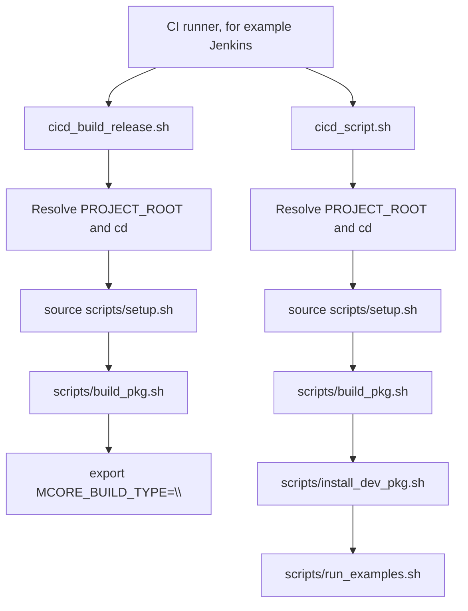
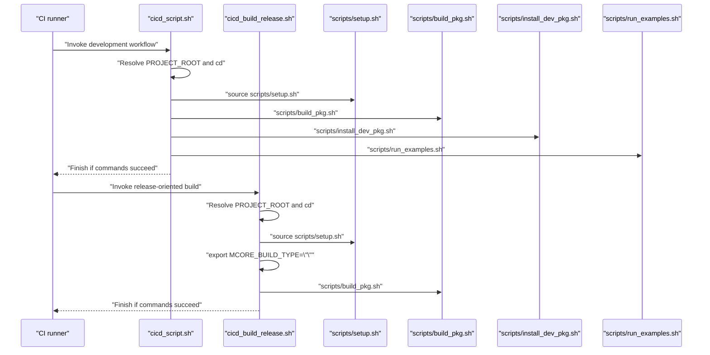

<!-- source: DeepWiki mcp.deepwiki.com · repo NVIDIA/aerial-cuda-accelerated-ran · page 11.2 CI/CD Pipeline · fetched 2026-10-26 -->

# CI/CD Pipeline

Relevant source files

The following files were used as context for generating this wiki page:

- [5GModel/aerial_mcore/scripts/cicd_build_release.sh](5GModel/aerial_mcore/scripts/cicd_build_release.sh)
- [5GModel/aerial_mcore/scripts/cicd_script.sh](5GModel/aerial_mcore/scripts/cicd_script.sh)

## Purpose and Scope

This page describes the CI/CD entry-point scripts provided for `aerial_mcore`: `cicd_script.sh` and `cicd_build_release.sh`. It covers their execution order, environment setup, package-build invocation, and the difference between the development-validation and release-build paths. The supplied scripts do not define Jenkins job configuration or the internal behavior of the scripts they call, so those details are not inferred here. [5GModel/aerial_mcore/scripts/cicd_script.sh:18-41](), [5GModel/aerial_mcore/scripts/cicd_build_release.sh:18-36]()

**Sources:** [5GModel/aerial_mcore/scripts/cicd_script.sh:18-41](), [5GModel/aerial_mcore/scripts/cicd_build_release.sh:18-36]()

---

## CI/CD Scripts Overview

The two orchestration scripts are located under `5GModel/aerial_mcore/scripts/`. Both enable `set -e`, resolve the project root from the script’s own path, change into that directory, source `scripts/setup.sh`, and invoke `scripts/build_pkg.sh`. The development script additionally invokes `scripts/install_dev_pkg.sh` and `scripts/run_examples.sh`; the release script sets `MCORE_BUILD_TYPE` to an empty string and stops after the build invocation. [5GModel/aerial_mcore/scripts/cicd_script.sh:18-41](), [5GModel/aerial_mcore/scripts/cicd_build_release.sh:18-36]()

| Script | Pipeline role | Distinguishing steps |
|---|---|---|
| `cicd_script.sh` | Build and validation orchestration | Builds, installs the developer-mode package, then runs examples. [5GModel/aerial_mcore/scripts/cicd_script.sh:31-38]() |
| `cicd_build_release.sh` | Release-oriented build orchestration | Sets `MCORE_BUILD_TYPE=""` and invokes the package build without the install or example steps. [5GModel/aerial_mcore/scripts/cicd_build_release.sh:28-33]() |

These files provide shell entry points that a CI system such as Jenkins can invoke. The scripts themselves do not specify Jenkins pipeline stages, agent labels, job triggers, artifact publishing, or Jenkins-specific configuration. [5GModel/aerial_mcore/scripts/cicd_script.sh:18-41](), [5GModel/aerial_mcore/scripts/cicd_build_release.sh:18-36]()

**Sources:** [5GModel/aerial_mcore/scripts/cicd_script.sh:18-41](), [5GModel/aerial_mcore/scripts/cicd_build_release.sh:18-36]()

---

## Pipeline Architecture

The diagram maps the two pipeline roles to the concrete shell scripts and the commands they invoke. The called scripts’ implementation details are outside the supplied source content. [5GModel/aerial_mcore/scripts/cicd_script.sh:21-38](), [5GModel/aerial_mcore/scripts/cicd_build_release.sh:21-33]()

**Orchestration Entry Points and Code Entities**

**Sources:** [5GModel/aerial_mcore/scripts/cicd_script.sh:21-38](), [5GModel/aerial_mcore/scripts/cicd_build_release.sh:21-33]()

---

## Main Development Pipeline

`cicd_script.sh` is the fuller of the two workflows. Its execution is sequential: it resolves and enters the project root, sources `scripts/setup.sh`, builds the package, installs the developer-mode package, and runs examples. The script prints a start message before the workflow and a finish message after the final command. [5GModel/aerial_mcore/scripts/cicd_script.sh:21-41]()

### Script Structure

| Stage | Implementation | Effect in the orchestration script |
|---|---|---|
| Fail-fast behavior | `set -e` | A failing command terminates the script rather than proceeding to later stages. [5GModel/aerial_mcore/scripts/cicd_script.sh:18-19]() |
| Root resolution | `readlink -f`, `dirname`, and `cd $PROJECT_ROOT` | Finds the script’s absolute path, derives the project root, and changes the working directory. [5GModel/aerial_mcore/scripts/cicd_script.sh:21-26]() |
| Environment setup | `source scripts/setup.sh` | Sources the setup script in the current shell. [5GModel/aerial_mcore/scripts/cicd_script.sh:28-29]() |
| Package build | `scripts/build_pkg.sh` | Invokes the package-build script. [5GModel/aerial_mcore/scripts/cicd_script.sh:31-32]() |
| Developer installation | `scripts/install_dev_pkg.sh` | Runs after the build completes. [5GModel/aerial_mcore/scripts/cicd_script.sh:34-35]() |
| Example execution | `scripts/run_examples.sh` | Runs after developer installation; because of `set -e`, a failure prevents the finish message. [5GModel/aerial_mcore/scripts/cicd_script.sh:18-19](), [5GModel/aerial_mcore/scripts/cicd_script.sh:37-41]() |

The script calls `scripts/build_pkg.sh`, `scripts/install_dev_pkg.sh`, and `scripts/run_examples.sh`; the supplied content does not show their internal commands, test selection, or artifact handling. [5GModel/aerial_mcore/scripts/cicd_script.sh:31-38]()

**Sources:** [5GModel/aerial_mcore/scripts/cicd_script.sh:18-41]()

---

## Release Pipeline

`cicd_build_release.sh` performs root resolution and setup, explicitly exports `MCORE_BUILD_TYPE` as the empty string, and invokes `scripts/build_pkg.sh`. It does not call the developer-install or example scripts in the provided implementation. [5GModel/aerial_mcore/scripts/cicd_build_release.sh:21-33]()

The script’s comment identifies the following operation as building the package, but the script does not itself show the build implementation or identify the generated artifact. Therefore, the resulting package format and publication behavior cannot be established from this file alone. [5GModel/aerial_mcore/scripts/cicd_build_release.sh:32-36]()

**Sources:** [5GModel/aerial_mcore/scripts/cicd_build_release.sh:21-36]()

---

## Pipeline Execution Flow

This sequence diagram contrasts the development path with the release-oriented path. Both paths source `scripts/setup.sh` and call `scripts/build_pkg.sh`; only the development path proceeds to installation and example execution. [5GModel/aerial_mcore/scripts/cicd_script.sh:28-38](), [5GModel/aerial_mcore/scripts/cicd_build_release.sh:28-33]()

**Development and Release Script Sequences**

**Sources:** [5GModel/aerial_mcore/scripts/cicd_script.sh:21-41](), [5GModel/aerial_mcore/scripts/cicd_build_release.sh:21-36]()

---

## Error Handling and Exit Codes

Both scripts use `set -e`, enabling Bash’s exit-on-error behavior for the commands in the scripts. Consequently, a failing setup or build command prevents later commands from running; in the development script, a failed installation prevents example execution, and a failed example command prevents the final finish message. [5GModel/aerial_mcore/scripts/cicd_script.sh:18-19](), [5GModel/aerial_mcore/scripts/cicd_script.sh:28-41](), [5GModel/aerial_mcore/scripts/cicd_build_release.sh:18-19](), [5GModel/aerial_mcore/scripts/cicd_build_release.sh:28-36]()

The supplied files do not define custom exit-code mapping, retry behavior, cleanup handlers, or failure-reporting hooks. They rely on command failure and `set -e` to stop the shell workflow. [5GModel/aerial_mcore/scripts/cicd_script.sh:18-41](), [5GModel/aerial_mcore/scripts/cicd_build_release.sh:18-36]()

**Sources:** [5GModel/aerial_mcore/scripts/cicd_script.sh:18-41](), [5GModel/aerial_mcore/scripts/cicd_build_release.sh:18-36]()

---

## Integration with Testing Infrastructure

The development pipeline’s validation step is the call to `scripts/run_examples.sh`, which occurs only after `scripts/build_pkg.sh` and `scripts/install_dev_pkg.sh` complete. The supplied orchestration script does not enumerate the examples or identify them as regression, unit, or performance tests. [5GModel/aerial_mcore/scripts/cicd_script.sh:31-38]()

The release-oriented script has no corresponding installation or example-execution call; its listed operations end with `scripts/build_pkg.sh`. [5GModel/aerial_mcore/scripts/cicd_build_release.sh:28-36]()

**Sources:** [5GModel/aerial_mcore/scripts/cicd_script.sh:31-38](), [5GModel/aerial_mcore/scripts/cicd_build_release.sh:28-36]()

---

## Pipeline Extension Points

The scripts separate shared setup/build operations from development-only validation. In `cicd_script.sh`, additional sequential checks could be placed after the existing build or example calls; in `cicd_build_release.sh`, the explicit `MCORE_BUILD_TYPE` export is the visible build-configuration override. These observations describe the current script structure, not additional implemented pipeline stages. [5GModel/aerial_mcore/scripts/cicd_script.sh:28-41](), [5GModel/aerial_mcore/scripts/cicd_build_release.sh:28-36]()

**Sources:** [5GModel/aerial_mcore/scripts/cicd_script.sh:28-41](), [5GModel/aerial_mcore/scripts/cicd_build_release.sh:28-36]()

---

