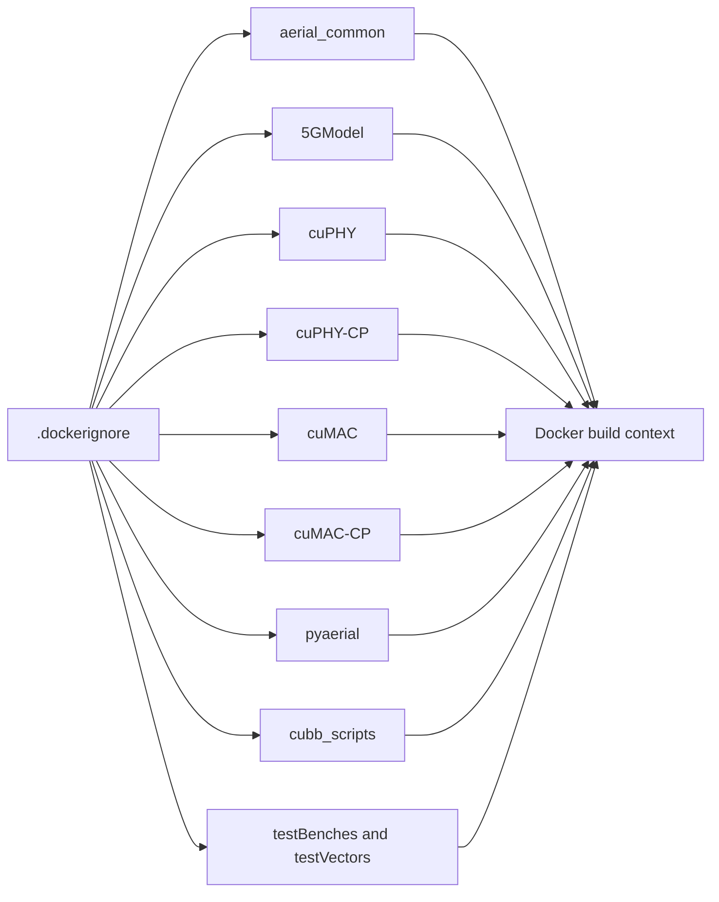

<!-- source: DeepWiki mcp.deepwiki.com · repo NVIDIA/aerial-cuda-accelerated-ran · page 11.3 Docker Deployment · fetched 2026-10-26 -->

# Docker Deployment

Relevant source files

The following files were used as context for generating this wiki page:

- [.dockerignore](.dockerignore)

## Purpose and Scope

This section documents the Docker build-context rules visible in the provided `.dockerignore`. The file uses a deny-by-default pattern and selectively allows repository paths and root-level files into the Docker build context. The provided source does not include Dockerfiles, container build or run scripts, or cuPHY-CP container patches, so their implementation and data flow cannot be described here. [.dockerignore:1-24]()

Sources: [.dockerignore:1-24]()

---

## Docker Build Context Strategy

The `.dockerignore` starts by ignoring all paths with `*`, then uses negated patterns (`!`) to allow selected paths. The allowlist includes source directories, build-related paths, test infrastructure, and several root-level files. [.dockerignore:1-24]()

### Build Context Filtering

**Diagram: `.dockerignore` deny-by-default and allowlist flow**

```mermaid
flowchart TD
    Repository["Repository build context"]
    Deny["*"]
    Allowed["Negated patterns: !path"]
    Context["Paths not excluded by the rules"]

    Repository --> Deny
    Deny --> Allowed
    Allowed --> Context

    Allowed --> Git["!.git"]
    Allowed --> GitAttributes["!.gitattributes"]
    Allowed --> GitModules["!.gitmodules"]
    Allowed --> SDKVersion["!aerial-sdk-version"]
    Allowed --> AerialCommon["!aerial_common"]
    Allowed --> Build["!build*"]
    Allowed --> Model["!5GModel"]
    Allowed --> CMake["!cmake"]
    Allowed --> Scripts["!cubb_scripts"]
    Allowed --> CuMAC["!cuMAC"]
    Allowed --> CuMACCP["!cuMAC-CP"]
    Allowed --> CuPHY["!cuPHY"]
    Allowed --> CuPHYCP["!cuPHY-CP"]
    Allowed --> PyAerial["!pyaerial"]
    Allowed --> TestBenches["!testBenches"]
    Allowed --> TestVectors["!testVectors"]
    Allowed --> CMakeLists["!CMakeLists.txt"]
    Allowed --> CMakePresets["!CMakePresets.json"]
    Allowed --> Readme["!README.md"]
    Allowed --> License["!LICENSE.txt"]
```

Sources: [.dockerignore:1-24]()

The filtering rules are:

1. **Default exclusion:** `*` ignores all paths by default. [.dockerignore:1-2]()
2. **Selective inclusion:** Negated patterns beginning with `!` identify paths to allow, including `5GModel`, `cuPHY`, `cuPHY-CP`, `pyaerial`, and `testVectors`. [.dockerignore:4-20]()
3. **Root-level build and project files:** The allowlist also includes `build*`, `CMakeLists.txt`, `CMakePresets.json`, `README.md`, and `LICENSE.txt`. [.dockerignore:10,21-24]()

Sources: [.dockerignore:1-24]()

### Allowlist by Role

| Role | Allowed paths |
|---|---|
| Repository metadata | `.git`, `.gitattributes`, `.gitmodules` [.dockerignore:5-7]() |
| SDK and shared components | `aerial-sdk-version`, `aerial_common` [.dockerignore:8-9]() |
| Build system | `build*`, `cmake`, `CMakeLists.txt`, `CMakePresets.json` [.dockerignore:10,12,21-22]() |
| Simulation and PHY/MAC components | `5GModel`, `cuMAC`, `cuMAC-CP`, `cuPHY`, `cuPHY-CP` [.dockerignore:11,15-17]() |
| Python bindings and automation | `pyaerial`, `cubb_scripts` [.dockerignore:13,18]() |
| Test infrastructure | `testBenches`, `testVectors` [.dockerignore:19-20]() |
| Project documentation and license | `README.md`, `LICENSE.txt` [.dockerignore:23-24]() |

Sources: [.dockerignore:5-24]()

The patterns are the complete allowlist shown in the provided file. The `build*` pattern is broader than a single literal directory name: it matches paths whose names begin with `build`. [.dockerignore:10]() The file does not enumerate individual files beneath the allowed directories, nor does it describe how a Dockerfile consumes them. [.dockerignore:1-24]()

Sources: [.dockerignore:1-24]()

---

## Container Build and Run Scripts

The provided source contains `.dockerignore` rules but no container build or run scripts. Consequently, the invocation sequence, build arguments, image naming, runtime options, mount configuration, and container entrypoints for `pyaerial` or cuBB are not documented by this page. [.dockerignore:1-24]()

The allowlist includes `pyaerial`, `cuPHY`, `cuPHY-CP`, `cuMAC`, `cuMAC-CP`, and `cubb_scripts`; this establishes that these paths are not excluded by the listed rules, but does not establish how any container is built or run. [.dockerignore:13-18]()

**Diagram: repository names exposed by the allowlist**

Sources: [.dockerignore:8-20]()

---

## cuPHY-CP Container Patches

The supplied `.dockerignore` allows the `cuPHY-CP` path into the build context. It does not describe patches, patch application, container-specific changes, or the relationship between cuPHY-CP and a container image. Those details cannot be established from this file alone. [.dockerignore:16-17]()

Sources: [.dockerignore:16-17]()

---

## Build Context Implications

The allowlist makes the named repository paths eligible to enter the Docker build context, subject to Docker’s ignore-pattern processing. It does not prove that every file under an allowed path is ultimately copied into an image: that depends on Dockerfile instructions, which are not included in the provided source. [.dockerignore:1-24]()

The file explicitly allows `testVectors` and `testBenches`; it does not state their size, whether they are required at runtime, or whether they are copied into any particular image. [.dockerignore:19-20]() Likewise, allowing `build*` does not establish that build artifacts exist or are reused during a container build. [.dockerignore:10]()

Sources: [.dockerignore:1-24]()

---

