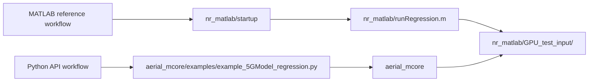
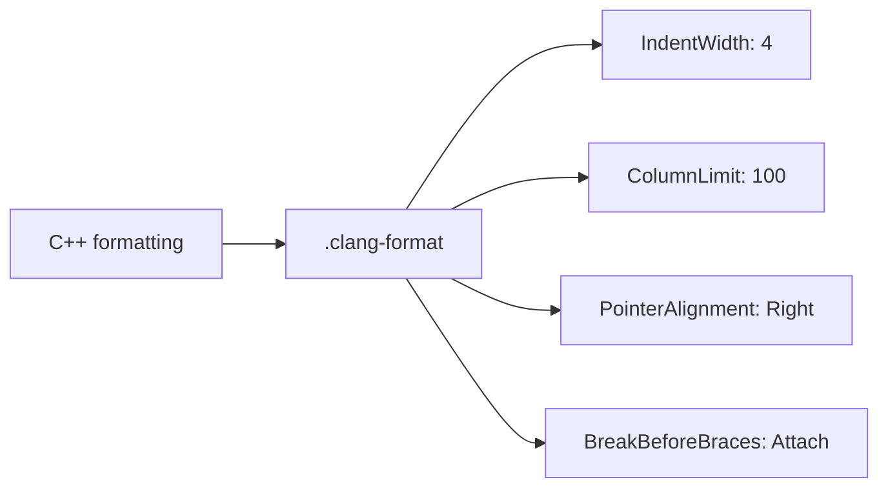

<!-- source: DeepWiki mcp.deepwiki.com · repo NVIDIA/aerial-cuda-accelerated-ran · page 12 Development Guide · fetched 2026-10-26 -->

# Development Guide

Relevant source files

The following files were used as context for generating this wiki page:

- [.clang-format](.clang-format)
- [5GModel/AGENTS.md](5GModel/AGENTS.md)

## Purpose and scope

This page introduces the developer-facing topics for the repository: working with the `5GModel` reference implementation and `aerial_mcore`, applying the configured C++ formatting policy, and understanding where version-control and large-file guidance fits into the workflow. It is a parent page; use the child pages for procedures and detailed rules. The `5GModel` reference model supports waveform validation, test-vector generation, and receiver performance simulations. [5GModel/AGENTS.md:3-14]()

Sources: [5GModel/AGENTS.md:3-14]()

## Development Workflow

The development workflow spans the MATLAB reference implementation in `nr_matlab/` and the Python bindings in `aerial_mcore/`. The reference instructions identify `startup` and `runRegression` as the MATLAB entry points, and point to `example_5GModel_regression.py` for programmatic test-vector generation. [5GModel/AGENTS.md:18-24]()

**Workflow concepts mapped to code entities**

For editable installation, local example runs, iterative testing, and the `cubb_scripts` autoconfig and launch tools, see [Development Workflow](#12.1).

Sources: [5GModel/AGENTS.md:18-24]()

## Code Style and Static Analysis

The repository includes a `.clang-format` configuration for C++ formatting. The visible settings specify four-space indentation, a 100-column limit, right-aligned pointers, and attached braces. [`.clang-format:90-103`]() [`.clang-format:151-159`]() [`.clang-format:197-201`]() See [Code Style and Static Analysis](#12.2) for the detailed formatting policy, static-analysis checks, and naming guidance.

**Formatting configuration mapped to developer activity**

Sources: [`.clang-format:90-103`]() [`.clang-format:151-159`]() [`.clang-format:197-201`]()

## Version Control Strategy

Version-control practices cover the organization of source, generated outputs, and large assets across repository subsystems. The `5GModel` guidance identifies `GPU_test_input/` as the destination for generated test vectors and notes that cuPHY tests and the performance harness consume those vectors. [5GModel/AGENTS.md:18-20]() [5GModel/AGENTS.md:26-30]() See [Version Control Strategy](#12.3) for repository organization and ignore-pattern details.

Sources: [5GModel/AGENTS.md:18-20]() [5GModel/AGENTS.md:26-30]()

## Git LFS and Large Files

Large-file handling is a separate part of the development workflow because simulation and ML-related assets can include test data and model artifacts. Consult [Git LFS and Large Files](#12.4) for the repository’s tracking rules and guidance on adding or working with large assets. The `5GModel` guidance identifies H5 test vectors as generated inputs used for cuPHY and cuBB verification. [5GModel/AGENTS.md:8-10]()

Sources: [5GModel/AGENTS.md:8-10]()

---

