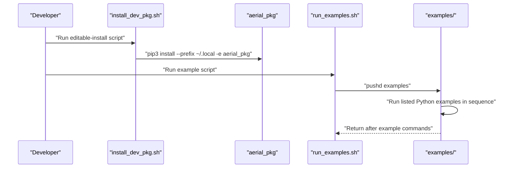
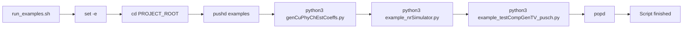

<!-- source: DeepWiki mcp.deepwiki.com · repo NVIDIA/aerial-cuda-accelerated-ran · page 12.1 Development Workflow · fetched 2026-10-26 -->

# Development Workflow

Relevant source files

The following files were used as context for generating this wiki page:

- [5GModel/aerial_mcore/scripts/install_dev_pkg.sh](5GModel/aerial_mcore/scripts/install_dev_pkg.sh)
- [5GModel/aerial_mcore/scripts/run_examples.sh](5GModel/aerial_mcore/scripts/run_examples.sh)

## Purpose and Scope

This page describes the locally evidenced development workflow for `aerial_mcore`: installing the package in editable mode and running the example scripts provided by the repository. It focuses on the behavior of `install_dev_pkg.sh` and `run_examples.sh`; the supplied file contents do not document `cubb_scripts` autoconfiguration or launch-pattern tools. [5GModel/aerial_mcore/scripts/install_dev_pkg.sh:18-32](), [5GModel/aerial_mcore/scripts/run_examples.sh:18-36]()

Sources: [5GModel/aerial_mcore/scripts/install_dev_pkg.sh:18-32](), [5GModel/aerial_mcore/scripts/run_examples.sh:18-36]()

## Editable Package Installation

`install_dev_pkg.sh` installs the `aerial_pkg` package in editable mode using `pip3`. The script resolves its own absolute path, derives the project root as the parent of its script directory, changes to that root, and runs the installation with the user-local prefix `~/.local`. It enables `set -e`, so a failing command stops the script before its completion message. [5GModel/aerial_mcore/scripts/install_dev_pkg.sh:18-32]()

| Workflow step | Script behavior |
|---|---|
| Resolve script location | Uses `readlink -f` and `dirname` to determine `SCRIPT`, `SCRIPT_DIR`, and `PROJECT_ROOT`. [5GModel/aerial_mcore/scripts/install_dev_pkg.sh:21-24]() |
| Enter project root | Changes directory to `PROJECT_ROOT`. [5GModel/aerial_mcore/scripts/install_dev_pkg.sh:25-26]() |
| Install editable package | Runs `pip3 install --prefix ~/.local -e aerial_pkg`. [5GModel/aerial_mcore/scripts/install_dev_pkg.sh:28-30]() |
| Stop on failure | Enables `set -e` before performing the installation steps. [5GModel/aerial_mcore/scripts/install_dev_pkg.sh:18-19]() |

**Diagram: Editable-install workflow mapped to script entities**

Sources: [5GModel/aerial_mcore/scripts/install_dev_pkg.sh:18-32]()

## Development Cycle

The two scripts support a simple local loop: install `aerial_pkg` in editable mode, then invoke the example runner to execute the repository’s selected examples. The install script targets `aerial_pkg`; the example runner changes to the project root and then enters `examples/` before running the example files. [5GModel/aerial_mcore/scripts/install_dev_pkg.sh:21-30](), [5GModel/aerial_mcore/scripts/run_examples.sh:21-33]()

The provided scripts do not specify a broader test suite, generated-artifact location, MATLAB initialization behavior, or a rebuild procedure for changes outside the editable Python package. Those details should not be inferred from these scripts alone. [5GModel/aerial_mcore/scripts/install_dev_pkg.sh:28-30](), [5GModel/aerial_mcore/scripts/run_examples.sh:28-33]()

**Diagram: Developer workflow mapped to package and example entities**

Sources: [5GModel/aerial_mcore/scripts/install_dev_pkg.sh:21-30](), [5GModel/aerial_mcore/scripts/run_examples.sh:21-33]()

## Running Examples Locally

`run_examples.sh` resolves its own path, derives `PROJECT_ROOT`, changes to that directory, and uses `pushd examples` to run three Python scripts. It uses `set -e`, so a failing command prevents later commands and the final completion message from being reached. [5GModel/aerial_mcore/scripts/run_examples.sh:18-33]()

| Order | Example command |
|---:|---|
| 1 | `python3 genCuPhyChEstCoeffs.py` [5GModel/aerial_mcore/scripts/run_examples.sh:28-30]() |
| 2 | `python3 example_nrSimulator.py` [5GModel/aerial_mcore/scripts/run_examples.sh:30-31]() |
| 3 | `python3 example_testCompGenTV_pusch.py` [5GModel/aerial_mcore/scripts/run_examples.sh:31-32]() |

The script restores the previous directory with `popd` after the example commands complete. [5GModel/aerial_mcore/scripts/run_examples.sh:29-33]()

**Diagram: `run_examples.sh` command sequence**

Sources: [5GModel/aerial_mcore/scripts/run_examples.sh:18-36]()

## cubb_scripts Autoconfiguration and Launch-Pattern Tools

The supplied file contents document the `aerial_mcore` editable-install and example-runner scripts, but do not include `cubb_scripts` files or their autoconfiguration and launch-pattern interfaces. Consequently, this page does not describe their command names, configuration inputs, generated files, or execution behavior. [5GModel/aerial_mcore/scripts/install_dev_pkg.sh:18-32](), [5GModel/aerial_mcore/scripts/run_examples.sh:18-36]()

Sources: [5GModel/aerial_mcore/scripts/install_dev_pkg.sh:18-32](), [5GModel/aerial_mcore/scripts/run_examples.sh:18-36]()

---

