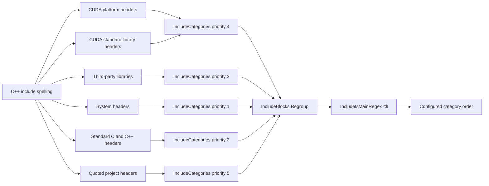
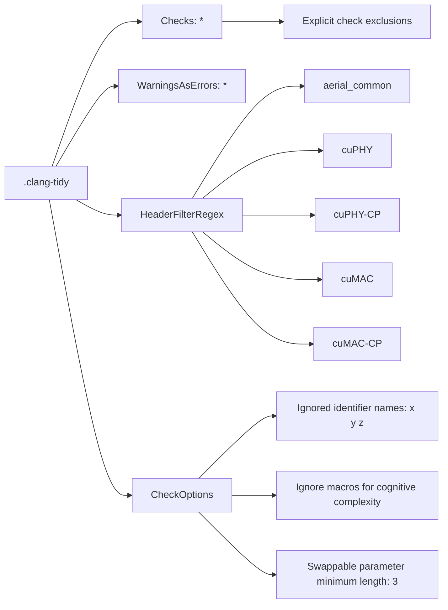
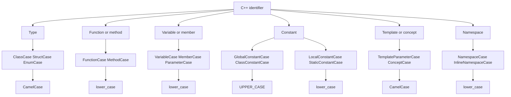
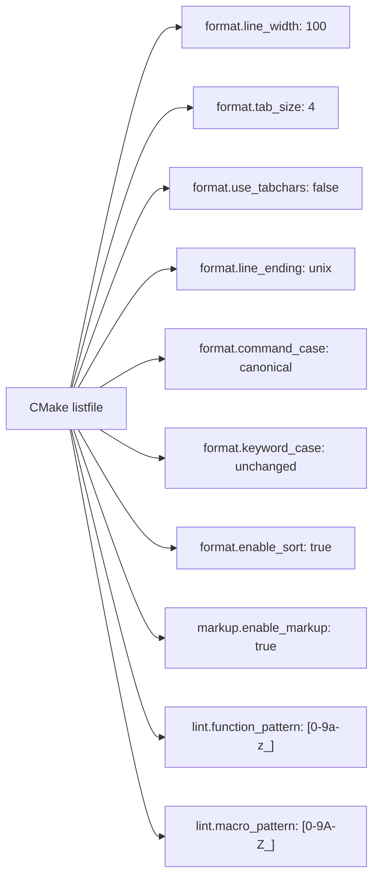

<!-- source: DeepWiki mcp.deepwiki.com · repo NVIDIA/aerial-cuda-accelerated-ran · page 12.2 Code Style and Static Analysis · fetched 2026-10-26 -->

# Code Style and Static Analysis

Relevant source files

The following files were used as context for generating this wiki page:

- [.clang-format](.clang-format)
- [.clang-tidy](.clang-tidy)
- [.cmake-format.yaml](.cmake-format.yaml)

## Purpose and scope

This page documents the repository’s checked-in formatting and static-analysis configuration for C++ and CMake: `.clang-format`, `.clang-tidy`, and `.cmake-format.yaml`. It explains the configured layout rules, include ordering, enabled-check policy, naming conventions, and CMake formatting and lint settings. The available configuration excerpts do not specify the commands used to run these tools or how they are enforced in CI.  
Sources: `[.clang-format:1-5]()` `[.clang-tidy:1-29]()` `[.cmake-format.yaml:1-19]()`

## Configuration at a glance

| Configuration file | Purpose | Notable settings |
|---|---|---|
| `.clang-format` | C++ formatting | C++ language mode, 4-space indentation, 100-column limit, categorized includes, and attached braces. `[.clang-format:1-5]()` `[.clang-format:90-103]()` `[.clang-format:114-158]()` |
| `.clang-tidy` | C++ static analysis | Broad check selection with explicit exclusions, warnings treated as errors, a header filter, and identifier-naming rules. `[.clang-tidy:1-29]()` `[.clang-tidy:31-76]()` |
| `.cmake-format.yaml` | CMake formatting and lint configuration | 100-column line width, four-space indentation, Unix line endings, and regular expressions for function and macro names. `[.cmake-format.yaml:15-25]()` `[.cmake-format.yaml:87-95]()` `[.cmake-format.yaml:164-174]()` |

Sources: `[.clang-format:1-5]()` `[.clang-format:90-103]()` `[.clang-format:114-158]()` `[.clang-tidy:1-29]()` `[.clang-tidy:31-76]()` `[.cmake-format.yaml:15-25]()` `[.cmake-format.yaml:87-95]()` `[.cmake-format.yaml:164-174]()`

## C++ formatting with `clang-format`

`.clang-format` selects `Cpp` and establishes an LLVM-based starting point, with a project-specific access-modifier offset of `-4`. The shown configuration uses four-space indentation and a 100-column limit. It derives LF line endings, inserts a final newline, and uses right-aligned pointers. `[.clang-format:1-5]()` `[.clang-format:96-103]()` `[.clang-format:151-161]()` `[.clang-format:175-175]()` `[.clang-format:197-197]()`  
Sources: `[.clang-format:1-5]()` `[.clang-format:96-103]()` `[.clang-format:151-161]()` `[.clang-format:175-175]()` `[.clang-format:197-197]()`

### Layout and line breaking

The configured brace style is `Attach`. The shown brace-wrapping options keep braces attached after classes, functions, namespaces, structs, enums, and control statements. Short blocks and short `if` statements are not kept on one line; short functions and lambdas may be. Template declarations break when multiline, and constructor initializers break before the colon. `[.clang-format:48-59]()` `[.clang-format:65-83]()` `[.clang-format:90-95]()`  
Sources: `[.clang-format:48-59]()` `[.clang-format:65-83]()` `[.clang-format:90-95]()`  

Argument and parameter bin-packing are disabled, so the formatter is configured not to pack multiple arguments or parameters onto the same line. Continuation indentation is eight spaces. The file also configures aligned operands, trailing comments, and escaped newlines. `[.clang-format:40-46]()` `[.clang-format:62-64]()` `[.clang-format:99-100]()`  
Sources: `[.clang-format:40-46]()` `[.clang-format:62-64]()` `[.clang-format:99-100]()`  

### Include grouping and ordering

`IncludeBlocks: Regroup` enables grouping according to the configured include categories. The rules assign priorities to CUDA headers, third-party headers, system headers, standard C/C++ headers, and quoted project headers. The category patterns distinguish angle-bracket includes from quoted project includes. `[.clang-format:114-143]()`  

The configuration disables clang-format’s main-header detection heuristics by setting `IncludeIsMainRegex` and `IncludeIsMainSourceRegex` to patterns that match nothing. The accompanying comments explain that this prevents main-header detection from overriding the configured priority order. `[.clang-format:145-150]()`  
Sources: `[.clang-format:114-150]()`  

**Diagram: Include classification from source convention to configured category**

Sources: `[.clang-format:114-150]()`

### Other formatting details

Consecutive-assignment, bit-field, declaration, macro, and short-case-statement alignment are disabled in the shown configuration. Namespace indentation is `None`; access modifiers do not receive indentation, and empty lines are not inserted after access modifiers. Namespace comments are configured to be fixed by the formatter. `[.clang-format:7-39]()` `[.clang-format:104-107]()` `[.clang-format:151-153]()` `[.clang-format:179-179]()`  
Sources: `[.clang-format:7-39]()` `[.clang-format:104-107]()` `[.clang-format:151-153]()` `[.clang-format:179-179]()`  

## C++ static analysis with `clang-tidy`

The `Checks` setting begins with `"*"` and then excludes named check families and individual checks. The visible exclusions include `abseil-*`, `google-*`, `llvm*`, `readability-identifier-length`, and `bugprone-implicit-widening-of-multiplication-result`. The configuration comments that the latter is disabled because of a clang-tidy crash with LLVM 18.x when processing bundled fmt headers, and notes that the issue is fixed in LLVM 19+. `[.clang-tidy:1-26]()`  

`WarningsAsErrors: '*'` promotes warnings from selected checks to errors. `HeaderFilterRegex` scopes matching headers to paths beneath `aerial_sdk` in the `aerial_common`, `cuPHY`, `cuPHY-CP`, `cuMAC`, and `cuMAC-CP` directories. `FormatStyle: none` means clang-tidy is not given a formatting style through this setting. `[.clang-tidy:27-29]()`  
Sources: `[.clang-tidy:1-29]()`  

The file also sets check options: `readability-identifier-length` ignores the names `x`, `y`, and `z` for variables and parameters; cognitive-complexity analysis is configured to ignore macros; and the minimum length for `bugprone-easily-swappable-parameters` is set to `3`. `[.clang-tidy:31-39]()`  
Sources: `[.clang-tidy:31-39]()`  

**Diagram: Static-analysis configuration scope**

Sources: `[.clang-tidy:1-29]()` `[.clang-tidy:31-39]()`

## Naming conventions

The `readability-identifier-naming` options define naming conventions by identifier category. Types—including classes, structs, enums, unions, typedefs, type aliases, and `using` declarations—use `CamelCase`. Functions and methods, including static, private, public, protected, and `constexpr` methods, use `lower_case`. `[.clang-tidy:41-76]()`  
Sources: `[.clang-tidy:41-76]()`  

Variables and members—including locals, parameters, static and global variables, and members across access levels—use `lower_case`. Constants follow more specific rules: general, global, and class constants use `UPPER_CASE`; static constants, const members, and local constants use `lower_case`; `constexpr` variables use `UPPER_CASE`. Const member names additionally have a configured `_` suffix. `[.clang-tidy:78-126]()`  
Sources: `[.clang-tidy:78-126]()`  

Const parameters use `lower_case`. Template parameters, template-template parameters, and concepts use `CamelCase`; parameter packs use `lower_case`; value template parameters use `UPPER_CASE`. Namespaces and inline namespaces use `lower_case`. `[.clang-tidy:128-154]()`  
Sources: `[.clang-tidy:128-154]()`  

| Identifier category | Configured case |
|---|---|
| Classes, structs, enums, unions, typedefs, aliases, and `using` declarations | `CamelCase` `[.clang-tidy:43-56]()` |
| Functions and methods | `lower_case` `[.clang-tidy:61-76]()` |
| Variables, parameters, and members | `lower_case` `[.clang-tidy:81-98]()` |
| General, global, and class constants | `UPPER_CASE` `[.clang-tidy:105-112]()` |
| Static constants, const members, and local constants | `lower_case` `[.clang-tidy:109-118]()` |
| `constexpr` and static `constexpr` variables | `UPPER_CASE` `[.clang-tidy:119-122]()` |
| Enum and scoped-enum constants | `CamelCase` `[.clang-tidy:123-126]()` |
| Template parameters and concepts | `CamelCase` `[.clang-tidy:137-142]()` |
| Namespaces | `lower_case` `[.clang-tidy:151-154]()` |

**Diagram: Naming policy mapped to clang-tidy option groups**

Sources: `[.clang-tidy:41-76]()` `[.clang-tidy:78-126]()` `[.clang-tidy:128-154]()`

## CMake formatting and lint configuration

`.cmake-format.yaml` sets the CMake formatter’s line width to 100 characters and indentation to four spaces, with tabs disabled. Its line ending is `unix`. Command names use `canonical` case, while keyword case is left `unchanged`. Sorting is enabled for argument lists that the formatter recognizes as sortable, but automatic sortability inference is disabled. `[.cmake-format.yaml:15-32]()` `[.cmake-format.yaml:87-106]()`  
Sources: `[.cmake-format.yaml:15-32]()` `[.cmake-format.yaml:87-106]()`  

The shown layout options set `max_subgroups_hwrap` to 2, `max_pargs_hwrap` to 6, and `max_lines_hwrap` to 2. Control-flow and function names are not separated from their parentheses by a space, and closing parentheses are not configured to dangle onto their own line. `[.cmake-format.yaml:42-72]()` `[.cmake-format.yaml:83-86]()`  
Sources: `[.cmake-format.yaml:42-72]()` `[.cmake-format.yaml:83-86]()`  

Comment markup is enabled. The first comment block in each listfile is kept literal, and comment blocks matching the configured pattern containing `Arguments:`, `Example usage:`, or `Note:` are treated as literal. The CMake linter’s function-name pattern accepts lowercase letters, digits, and underscores; its macro-name pattern accepts uppercase letters, digits, and underscores. `[.cmake-format.yaml:118-140]()` `[.cmake-format.yaml:161-174]()`  
Sources: `[.cmake-format.yaml:118-140]()` `[.cmake-format.yaml:161-174]()`  

**Diagram: CMake formatting and lint settings mapped to configuration entities**

Sources: `[.cmake-format.yaml:15-32]()` `[.cmake-format.yaml:87-106]()` `[.cmake-format.yaml:161-174]()`

## Practical interpretation

For C++ formatting, the checked-in policy is represented by `.clang-format`; the most visible baseline is four-space indentation, a 100-column limit, attached braces, and categorized include ordering. For C++ analysis and naming, `.clang-tidy` supplies the check selection, warning severity, header scope, and identifier-case rules. For CMake, `.cmake-format.yaml` defines formatting, comment handling, and lint-name patterns. These files document configuration; the provided excerpts do not establish when or how tooling is invoked. `[.clang-format:90-103]()` `[.clang-format:114-158]()` `[.clang-tidy:1-29]()` `[.clang-tidy:41-154]()` `[.cmake-format.yaml:15-32]()` `[.cmake-format.yaml:161-174]()`  
Sources: `[.clang-format:90-103]()` `[.clang-format:114-158]()` `[.clang-tidy:1-29]()` `[.clang-tidy:41-154]()` `[.cmake-format.yaml:15-32]()` `[.cmake-format.yaml:161-174]()`

---

