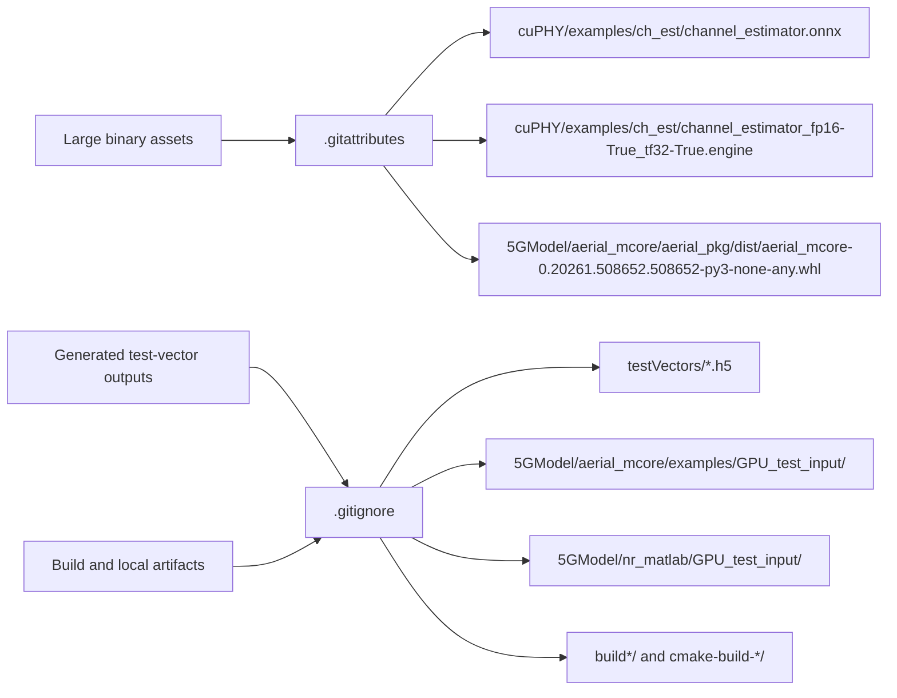
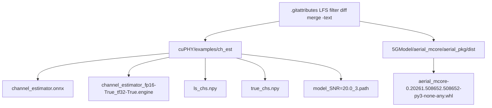
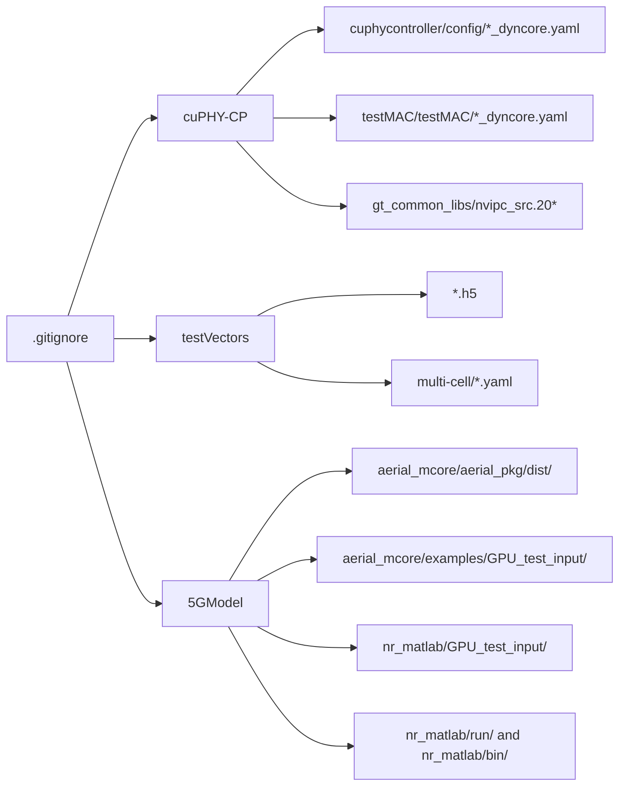
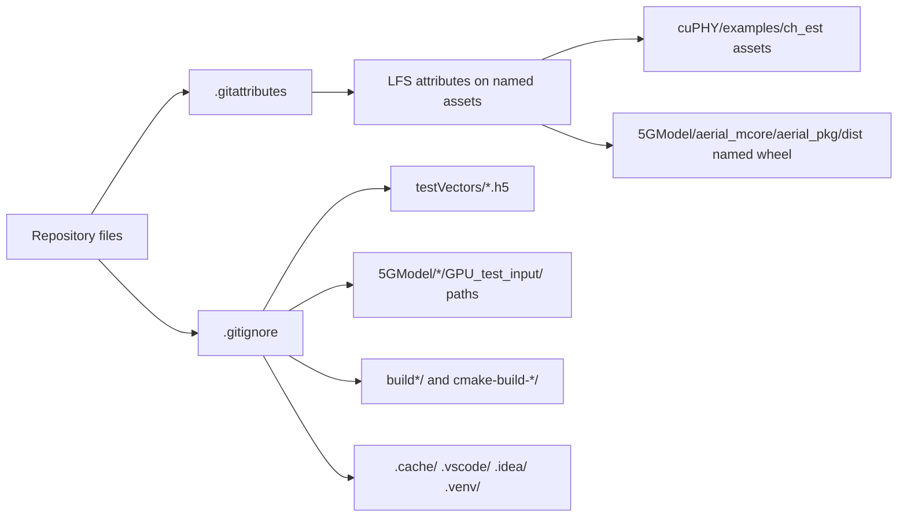

<!-- source: DeepWiki mcp.deepwiki.com · repo NVIDIA/aerial-cuda-accelerated-ran · page 12.3 Version Control Strategy · fetched 2026-10-26 -->

# Version Control Strategy

Relevant source files

The following files were used as context for generating this wiki page:

- [.gitattributes](.gitattributes)
- [.gitignore](.gitignore)

## Purpose and Scope

This page describes the repository’s visible version-control rules: Git LFS attributes in `.gitattributes`, exclusions in the root `.gitignore`, and how those rules apply to paths spanning `5GModel`, `cuPHY`, `cuPHY-CP`, and `testVectors`. It distinguishes files explicitly assigned LFS attributes from files matched by ignore patterns. [.gitattributes:1-10]() [.gitignore:1-23]()

Sources: [.gitattributes:1-10]() [.gitignore:1-23]()

---

## Overview

The supplied configuration expresses three distinct handling policies: ordinary text handling through `* text=auto`, Git LFS filters for specified assets, and ignore rules for selected generated or local files and directories. The rules apply to the paths and patterns listed below; they do not establish a general policy for every file in each subsystem. [.gitattributes:1-10]() [.gitignore:1-23]()

| Policy | Configuration | Examples |
|---|---|---|
| Text normalization | `.gitattributes` sets `* text=auto`. [.gitattributes:1]() | Default attribute rule for files not otherwise specified. |
| Git LFS | Specific paths and extensions use `filter=lfs diff=lfs merge=lfs -text`. [.gitattributes:2-10]() | Pickle and Parquet files, selected `cuPHY/examples/ch_est` assets, and one `aerial_mcore` wheel. |
| Ignore | Root `.gitignore` contains path and glob exclusions. [.gitignore:1-23]() | Build directories, IDE state, selected test-vector outputs, and MATLAB/Python artifacts. |

The configuration ties version-control behavior to concrete subsystem locations: `5GModel/aerial_mcore`, `5GModel/nr_matlab`, `cuPHY/examples/ch_est`, `cuPHY-CP`, and `testVectors`. [.gitattributes:5-10]() [.gitignore:1-23]()

Sources: [.gitattributes:1-10]() [.gitignore:1-23]()

### Policy Flow: Repository Terms to Configuration Entries

This diagram connects the repository concepts named in the strategy to the exact configuration files and matching entries. [.gitattributes:2-10]() [.gitignore:1-23]()

**Diagram: Repository Concepts and Version-Control Rules**

Sources: [.gitattributes:5-10]() [.gitignore:5-18]()

---

## Git LFS Configuration

### Tracked File Types and Entities

The `.gitattributes` file assigns LFS filters to the license PDF, all `.pkl` and `.parquet` files, five explicitly named assets under `cuPHY/examples/ch_est`, and one wheel under `5GModel/aerial_mcore/aerial_pkg/dist`. [.gitattributes:2-10]()

| Attribute rule | Scope or path | Version-control implication |
|---|---|---|
| `filter=lfs diff=lfs merge=lfs -text` | `NVIDIA[[:space:]]Aerial[[:space:]]License.pdf` | Assigns LFS filters and disables text treatment for the matched license filename. [.gitattributes:2]() |
| Same LFS attributes | `*.pkl` and `*.parquet` | Assigns LFS filters to files with these extensions. [.gitattributes:3-4]() |
| Same LFS attributes | `channel_estimator_fp16-True_tf32-True.engine`, `channel_estimator.onnx`, `ls_chs.npy`, `model_SNR=20.0_3.path`, and `true_chs.npy` under `cuPHY/examples/ch_est/` | Assigns LFS filters to these named channel-estimation assets. [.gitattributes:5-9]() |
| Same LFS attributes | `aerial_mcore-0.20261.508652.508652-py3-none-any.whl` under `5GModel/aerial_mcore/aerial_pkg/dist/` | Assigns LFS filters to this specific wheel path. [.gitattributes:10]() |

The `.gitattributes` file does not contain a general `*.whl`, `*.npy`, `*.onnx`, or `*.engine` rule; the listed model and wheel entries are path-specific, while `.pkl` and `.parquet` use extension-wide patterns. [.gitattributes:3-10]()

Sources: [.gitattributes:2-10]()

### LFS Asset Mapping: Repository Names to Attribute Rules

The diagram maps the `cuPHY` channel-estimation assets and the `aerial_mcore` distribution wheel to the exact `.gitattributes` entries that assign LFS filters. [.gitattributes:5-10]()

**Diagram: LFS Rules and Concrete Paths**

Sources: [.gitattributes:5-10]()

---

## Ignore Patterns and Repository Cleanliness

The root `.gitignore` contains exclusions for configuration files, IPC-related paths, test-vector outputs, editor and environment directories, build directories, and selected `5GModel` artifacts. These are the rules present in the supplied root ignore file. [.gitignore:1-23]()

### Root-Level Exclusions

| Pattern | Scope or example | What the rule excludes |
|---|---|---|
| `*_dyncore.yaml` | `cuPHY-CP/cuphycontroller/config/` and `cuPHY-CP/testMAC/testMAC/` | Matching dynamic-core YAML files in the two named directories. [.gitignore:1-2]() |
| `nvipc_src.20*` | `cuPHY-CP/gt_common_libs/` | Matching IPC source paths. [.gitignore:3]() |
| `core.*` | Matching paths relative to the ignore file | Names beginning with `core.`. [.gitignore:4]() |
| `testVectors/*.h5` | `testVectors/` | HDF5 files directly within that directory. [.gitignore:5]() |
| `testVectors/multi-cell/*.yaml` | `testVectors/multi-cell/` | YAML files directly within that directory. [.gitignore:6]() |
| `.cache/`, `.vscode/`, `.idea/`, `.venv/` | Matching directories | Cache, editor, and virtual-environment directories. [.gitignore:7-10]() |
| `build*/`, `cmake-build-*/` | Matching directories | Directories matching the listed build-name patterns. [.gitignore:11-12]() |

The rules for `testVectors/*.h5` and `testVectors/multi-cell/*.yaml` are scoped to those paths; they are not general exclusions for every HDF5 or YAML file in the repository. [.gitignore:5-6]()

Sources: [.gitignore:1-12]()

### `5GModel` Exclusions

The root ignore file contains explicit exclusions for Python bytecode caches, `aerial_mcore` distribution and source paths, generated `GPU_test_input` directories, MATLAB runtime/build paths, autosave files, and a MATLAB-local VS Code path. [.gitignore:13-23]()

| Pattern | Repository path | Excluded content |
|---|---|---|
| `5GModel/**/__pycache__/` | `5GModel` descendants | Python cache directories. [.gitignore:13]() |
| `5GModel/aerial_mcore/aerial_pkg/dist/` | `aerial_mcore/aerial_pkg` | The distribution directory. [.gitignore:14]() |
| `5GModel/aerial_mcore/aerial_pkg/src/` | `aerial_mcore/aerial_pkg` | The package source staging path. [.gitignore:15]() |
| `5GModel/aerial_mcore/examples/GPU_test_input/` | `aerial_mcore/examples` | The named test-input directory. [.gitignore:16]() |
| `5GModel/nr_matlab/GPU_test_input/` | `nr_matlab` | The named test-input directory. [.gitignore:17]() |
| `5GModel/nr_matlab/run/` and `5GModel/nr_matlab/bin/` | `nr_matlab` | The `run` and `bin` directories. [.gitignore:18-19]() |
| `5GModel/nr_matlab/*.asv` and `5GModel/nr_matlab/*/*.asv` | `nr_matlab` and one directory level below | MATLAB autosave files matching the patterns. [.gitignore:20-21]() |
| `5GModel/nr_matlab/.vscode/*.*` | MATLAB-local VS Code directory | Matching files within that directory. [.gitignore:22]() |
| `5GModel/nr_matlab/core.*` | `nr_matlab` | Matching core files. [.gitignore:23]() |

The ignore rule for `5GModel/aerial_mcore/aerial_pkg/dist/` coexists with an LFS attribute for one specific wheel beneath that directory. The ignore file excludes that path from ordinary Git consideration, while the attributes file assigns LFS behavior if the file is otherwise tracked; the two files therefore express separate rules, not a guarantee that the wheel is tracked. [.gitignore:14]() [.gitattributes:10]()

Sources: [.gitignore:13-23]() [.gitattributes:10]()

### Ignore Mapping: Subsystems to Root Rules

This diagram associates subsystem paths with the exact ignore entries that affect them. It distinguishes `cuPHY-CP`, `testVectors`, and `5GModel` rather than treating the root ignore file as one undifferentiated list. [.gitignore:1-23]()

**Diagram: Ignore Rules by Repository Path**

Sources: [.gitignore:1-23]()

---

## Repository Organization Strategy

The supplied version-control configuration identifies subsystem locations through explicit paths; it does not define the full repository architecture or the tracking policy for every file in those subsystems. The paths below summarize only the organization visible in `.gitattributes` and the root `.gitignore`. [.gitattributes:5-10]() [.gitignore:1-23]()

### Subsystem Paths and Version-Control Rules

| Subsystem or area | Paths named in configuration | Relevant rule |
|---|---|---|
| `5GModel/aerial_mcore` | `aerial_pkg/dist/`, `aerial_pkg/src/`, `examples/GPU_test_input/` | Distribution, source, and test-input paths are ignored; one explicitly named wheel has LFS attributes. [.gitignore:14-16]() [.gitattributes:10]() |
| `5GModel/nr_matlab` | `GPU_test_input/`, `run/`, `bin/`, autosave and local editor paths | These generated or local paths are ignored. [.gitignore:17-23]() |
| `cuPHY/examples/ch_est` | Named model, engine, NumPy, and path assets | The listed assets have LFS attributes. [.gitattributes:5-9]() |
| `cuPHY-CP` | Controller config, `testMAC`, and `gt_common_libs` paths | Selected dynamic-core YAML and IPC source paths are ignored. [.gitignore:1-3]() |
| `testVectors` | `*.h5` and `multi-cell/*.yaml` | The specified HDF5 and YAML paths are ignored. [.gitignore:5-6]() |

Sources: [.gitattributes:5-10]() [.gitignore:1-23]()

### Data Flow and Version-Control Interaction

The configuration indicates how selected repository paths are classified: named model assets and a named wheel receive LFS attributes, while generated test inputs and build-related paths match ignore patterns. These rules describe repository handling; they do not specify when assets are downloaded, how test vectors are generated, or how package builds are invoked. [.gitattributes:5-10]() [.gitignore:5-19]()

**Diagram: Version-Control Handling by Path**

Sources: [.gitattributes:5-10]() [.gitignore:5-18]()

---

