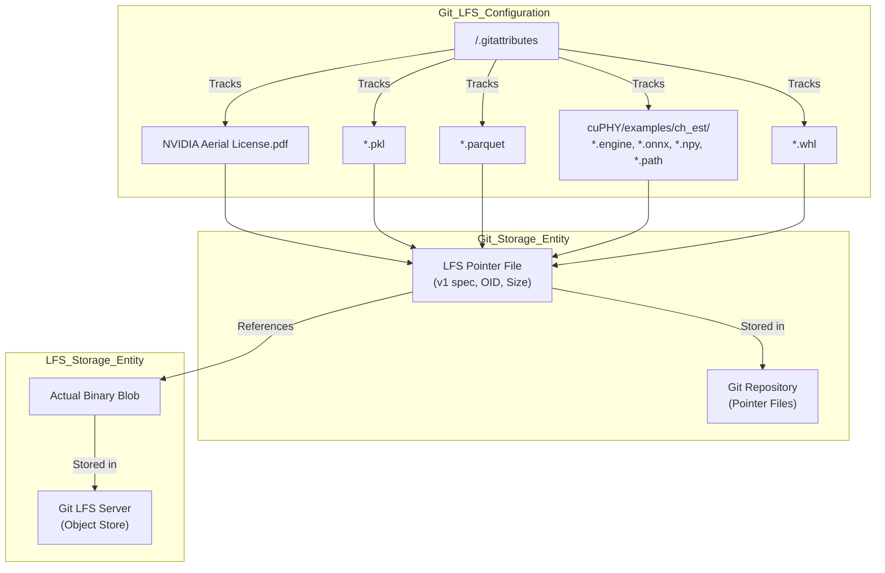
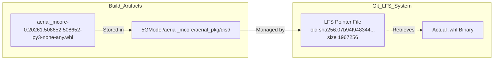
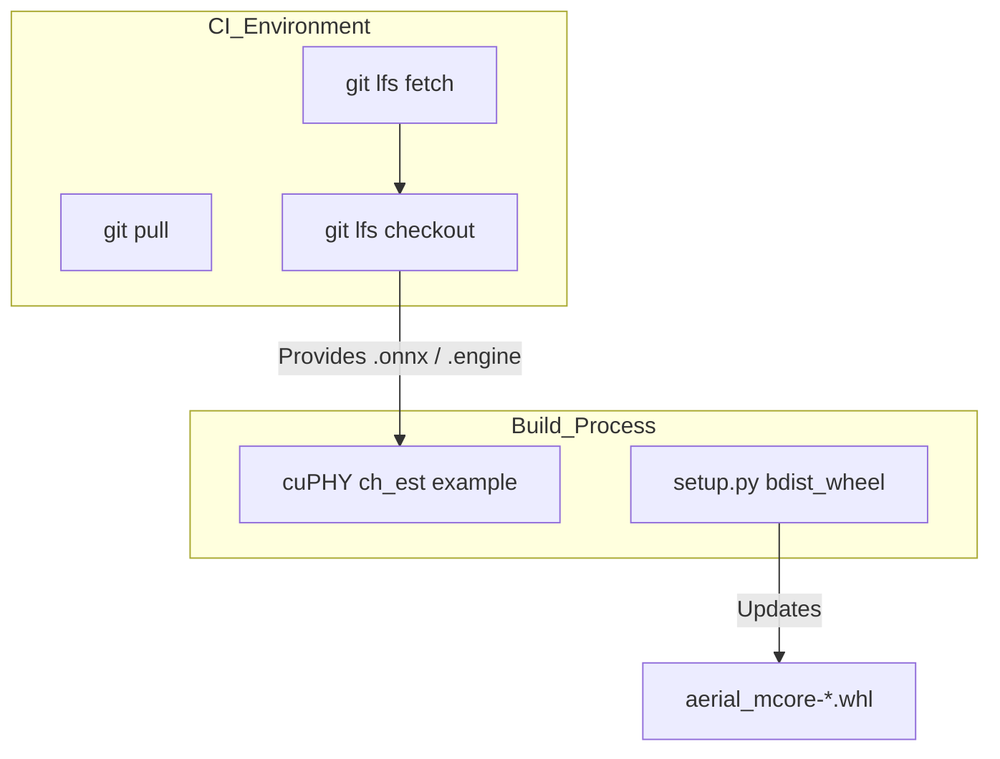

<!-- source: DeepWiki mcp.deepwiki.com · repo NVIDIA/aerial-cuda-accelerated-ran · page 12.4 Git LFS and Large Files · fetched 2026-10-26 -->

# Git LFS and Large Files

<details>
<summary>Relevant source files</summary>

The following files were used as context for generating this wiki page:

- [.gitattributes](.gitattributes)
- [5GModel/aerial_mcore/aerial_pkg/dist/aerial_mcore-0.20261.508652.508652-py3-none-any.whl](5GModel/aerial_mcore/aerial_pkg/dist/aerial_mcore-0.20261.508652.508652-py3-none-any.whl)

</details>


## Purpose and Scope

This document explains the Git Large File Storage (LFS) configuration and usage in the NVIDIA Aerial CUDA Accelerated RAN repository. It covers which file types are managed by LFS, the configuration details, and workflows for developers working with large binary assets. This page specifically details how the repository manages machine learning models (ONNX/TensorRT), scientific data (NumPy/Parquet), and distribution artifacts (Python wheels).

Sources: [.gitattributes:1-10]()

---

## Overview of Git LFS in This Repository

Git LFS is used in this repository to efficiently manage large binary files that would otherwise bloat the Git history. Instead of storing large files directly in the Git repository, LFS stores only pointer files in Git while the actual file content is stored on a separate LFS server.

The repository uses LFS for several categories of large files:
- **Machine learning models**: `.onnx` and `.engine` files used for neural receivers and channel estimation.
- **Scientific data files**: `.npy` (NumPy), `.pkl` (Pickle), and `.parquet` files for test vectors and dataset storage.
- **Distribution packages**: `.whl` Python wheels for the `aerial_mcore` package.
- **Documentation**: Large PDF licenses.
- **Model artifacts**: `.path` files representing model weights or paths.

Sources: [.gitattributes:1-10]()

---

## Git LFS Configuration

### .gitattributes Structure

The LFS configuration is defined in [.gitattributes:1-10](). This file specifies which file patterns should be tracked by LFS using the `filter=lfs diff=lfs merge=lfs -text` attributes. This ensures that these files are treated as binary assets rather than text files during merges and diffs.

Title: Git LFS File Management Architecture


Sources: [.gitattributes:1-10]()

---

## File Types Managed by LFS

### Machine Learning and Signal Processing Models

The following ML model formats are tracked by LFS, specifically within the `cuPHY` channel estimation examples and neural receiver pipelines:

| File Type | Pattern | Purpose | Example Location |
|-----------|---------|---------|------------------|
| Pickle files | `*.pkl` | Serialized Python objects/weights | [Multiple locations] |
| ONNX models | `*.onnx` | Neural network interchange format | `cuPHY/examples/ch_est/channel_estimator.onnx` |
| TensorRT engines | `*.engine` | Optimized inference engines | `cuPHY/examples/ch_est/channel_estimator_fp16-True_tf32-True.engine` |

Sources: [.gitattributes:3-6]()

### Scientific and Test Data

The repository tracks binary data formats used for validating the 5G physical layer:

| File Type | Pattern | Purpose | Example Location |
|-----------|---------|---------|------------------|
| Parquet files | `*.parquet` | Columnar data storage | [Data lake exports] |
| NumPy arrays | `*.npy` | Binary array data for test vectors | `cuPHY/examples/ch_est/ls_chs.npy` |
| Path files | `*.path` | Model weights or path definitions | `cuPHY/examples/ch_est/model_SNR=20.0_3.path` |

Sources: [.gitattributes:4,7-9]()

### Distribution Artifacts

Python wheel files are tracked by LFS to avoid bloating the repository with pre-built binary distributions. The current tracked wheel is located in the `5GModel/aerial_mcore/aerial_pkg/dist/` directory.

Title: Python Wheel Storage via LFS


Sources: [.gitattributes:10](), [5GModel/aerial_mcore/aerial_pkg/dist/aerial_mcore-0.20261.508652.508652-py3-none-any.whl:1-3]()

---

## LFS Pointer File Format

When a file is tracked by LFS, Git stores a small pointer file instead of the actual content. This is visible if Git LFS is not installed or if viewing the raw file in the repository.

**Example Pointer (Aerial MCore Wheel):**
- **Version:** `https://git-lfs.github.com/spec/v1`
- **OID:** `sha256:07b94f948344ce3c4ec16ed3f17f9b104b0e8ce05a12cb19c36ff04506132160`
- **Size:** 1967256 bytes

Sources: [5GModel/aerial_mcore/aerial_pkg/dist/aerial_mcore-0.20261.508652.508652-py3-none-any.whl:1-3]()

---

## Working with LFS Files

### Initial Setup

Before working with the repository, Git LFS must be installed and initialized to ensure that `git clone` and `git checkout` operations correctly fetch the binary assets.

```bash
# Initialize LFS for your user environment
git lfs install
```

### Checking LFS Status

Developers can verify which files are currently being tracked as LFS objects:

```bash
# List all LFS-tracked files in the current checkout
git lfs ls-files

# View LFS pointer information for a specific file
git lfs pointer --file=cuPHY/examples/ch_est/channel_estimator.onnx
```

### Adding New Large Assets

When adding new large files, ensure they match existing LFS patterns in [.gitattributes:1-10](). If a new file extension is required, use the `track` command:

```bash
# Example of tracking HDF5 files if they weren't ignored
git lfs track "*.h5"
```

Note: Many `.h5` files are handled separately or excluded by repository ignore rules.

Sources: [.gitattributes:1-10]()

---

## Integration with Build System and CI/CD

The build system and CI/CD pipelines rely on LFS for both inputs and outputs:

1.  **Inference Inputs**: The `cuPHY` channel estimation examples require the `.onnx` and `.engine` files tracked in `cuPHY/examples/ch_est/` [.gitattributes:5-6]().
2.  **Package Distribution**: The `aerial_mcore` wheel is tracked to allow versioned access to pre-built packages [.gitattributes:10]().
3.  **CI/CD Pipeline**: Automated scripts like `cicd_script.sh` or `cicd_build_release.sh` must ensure `git lfs pull` is executed if the environment does not automatically fetch LFS objects.

Title: LFS Asset Flow in CI/CD


Sources: [.gitattributes:5-10]()

---

## Best Practices

1.  **Always verify LFS installation**: Before running examples in `cuPHY/examples/ch_est/`, ensure the files are not just pointers.
2.  **Avoid tracking temporary files**: Large files generated during simulation should be kept out of version control unless they are part of the golden reference set.
3.  **Docker Context**: When building Docker images, ensure build contexts include necessary LFS-tracked assets if required at runtime.
4.  **Version Consistency**: When updating the `aerial_mcore` package, ensure the new `.whl` file in `5GModel/aerial_mcore/aerial_pkg/dist/` is correctly staged so Git LFS can track the new version.

Sources: [.gitattributes:1-10]()

---

