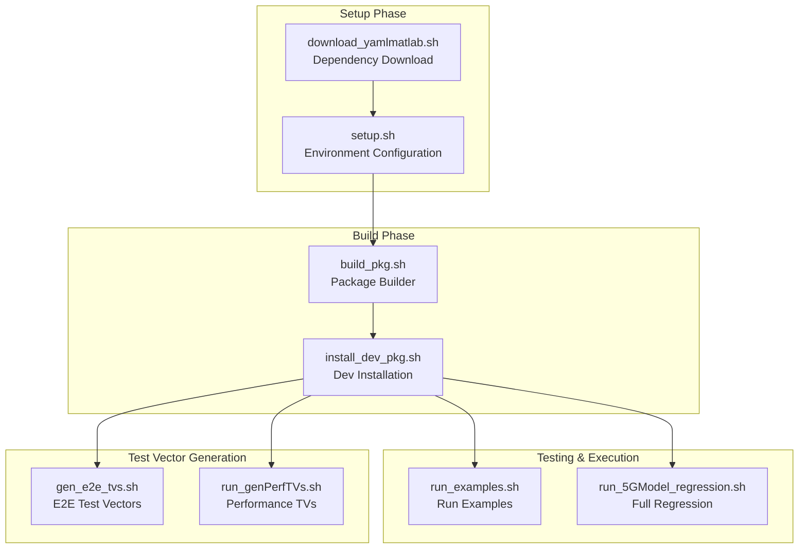

<!-- source: DeepWiki mcp.deepwiki.com · repo NVIDIA/aerial-cuda-accelerated-ran · page 13 Script Reference · fetched 2026-10-26 -->

# Script Reference

<details>
<summary>Relevant source files</summary>

The following files were used as context for generating this wiki page:

- [5GModel/aerial_mcore/scripts/run_examples.sh](5GModel/aerial_mcore/scripts/run_examples.sh)

</details>


## Purpose and Scope

This document provides a high-level reference for all shell scripts in the NVIDIA Aerial CUDA Accelerated RAN repository. These scripts automate environment setup, package building, installation, testing, and test vector generation workflows. Each category of scripts delegates detailed execution to specific child pages.

For setup and environment configuration, see [Setup and Environment Scripts](#13.1). For build and installation automation, see [Build and Installation Scripts](#13.2). For test execution and regression suites, see [Testing and Execution Scripts](#13.3). For test vector generation scripts, see [Test Vector Generation Scripts](#13.4).

Sources: [5GModel/aerial_mcore/scripts/run_examples.sh:1-36]()

## Script Organization

The repository contains scripts organized by function in the `5GModel/aerial_mcore/scripts/` directory. Scripts follow a consistent pattern: they resolve their own paths, navigate to the project root, perform their designated task, and exit with appropriate status codes.

### Script Categories Overview

| Category | Purpose | Key Scripts | Child Page |
|----------|---------|-------------|------------|
| Setup & Environment | Configure MATLAB Runtime paths and environment variables | `setup.sh`, `download_yamlmatlab.sh` | [Setup and Environment Scripts](#13.1) |
| Build & Installation | Build wheel packages and install in development/release mode | `build_pkg.sh`, `install_dev_pkg.sh` | [Build and Installation Scripts](#13.2) |
| Testing & Execution | Run examples, regression suites, and CI pipelines | `run_examples.sh`, `run_5GModel_regression.sh`, `cicd_script.sh` | [Testing and Execution Scripts](#13.3) |
| Test Vector Generation | Generate specialized test vectors and waveforms | `gen_e2e_tvs.sh`, `gen_e2e_ota_tvs.sh`, `run_genPerfTVs.sh` | [Test Vector Generation Scripts](#13.4) |

Sources: [5GModel/aerial_mcore/scripts/run_examples.sh:1-36]()

## Script Execution Flow



**Script Execution Flow Diagram**: This diagram illustrates the high-level workflow from setup and dependency downloads to package building, testing, and test vector generation.

Sources: [5GModel/aerial_mcore/scripts/run_examples.sh:1-36]()

## Common Script Patterns

All scripts in the repository follow consistent patterns for robustness and maintainability:

### Standard Script Header

```bash
#!/bin/bash
# SPDX-FileCopyrightText: Copyright (c) 2025 NVIDIA CORPORATION & AFFILIATES
# SPDX-License-Identifier: Apache-2.0

# Exit on first error
set -e

# Switch to PROJECT_ROOT directory
SCRIPT=$(readlink -f $0)
SCRIPT_DIR=$(dirname $SCRIPT)
PROJECT_ROOT=$(dirname $SCRIPT_DIR)
echo $SCRIPT starting...
cd $PROJECT_ROOT
```

This pattern ensures:
- Immediate exit on any command failure (`set -e`) [5GModel/aerial_mcore/scripts/run_examples.sh:19-19]()
- Correct path resolution regardless of invocation location [5GModel/aerial_mcore/scripts/run_examples.sh:22-24]()
- Execution from project root directory [5GModel/aerial_mcore/scripts/run_examples.sh:26-26]()

Sources: [5GModel/aerial_mcore/scripts/run_examples.sh:1-36]()

## Setup and Environment Scripts

For detailed reference, configuration options, and script parameters, see [Setup and Environment Scripts](#13.1). These scripts handle MATLAB Runtime environment variables, dependent library downloads such as `yamlmatlab`, and system identification.

Sources: [5GModel/aerial_mcore/scripts/run_examples.sh:1-36]()

## Build and Installation Scripts

For detailed instructions on packaging, wheel generation, and environment installation, see [Build and Installation Scripts](#13.2). These include `build_pkg.sh` and `install_dev_pkg.sh`.

Sources: [5GModel/aerial_mcore/scripts/run_examples.sh:1-36]()

## Testing and Execution Scripts

For detailed information on executing regression tests, sharded test runners, and example scripts like `run_examples.sh` [5GModel/aerial_mcore/scripts/run_examples.sh:28-33](), see [Testing and Execution Scripts](#13.3).

Sources: [5GModel/aerial_mcore/scripts/run_examples.sh:28-33]()

## Test Vector Generation Scripts

For details on generating end-to-end test vectors, over-the-air test vectors, and performance validation data, see [Test Vector Generation Scripts](#13.4).

Sources: [5GModel/aerial_mcore/scripts/run_examples.sh:1-36]()

---

