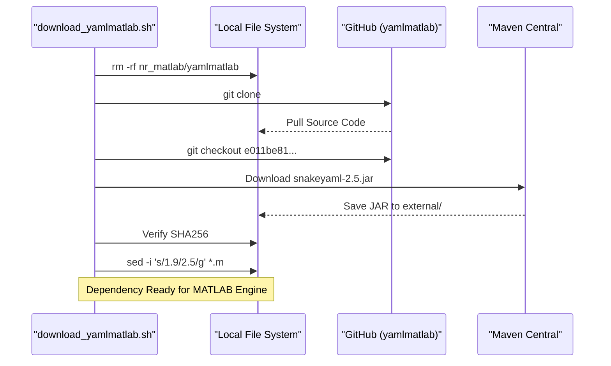

<!-- source: DeepWiki mcp.deepwiki.com · repo NVIDIA/aerial-cuda-accelerated-ran · page 13.1 Setup and Environment Scripts · fetched 2026-10-26 -->

# Setup and Environment Scripts

<details>
<summary>Relevant source files</summary>

The following files were used as context for generating this wiki page:

- [5GModel/aerial_mcore/scripts/setup.sh](5GModel/aerial_mcore/scripts/setup.sh)
- [5GModel/get_uuid.sh](5GModel/get_uuid.sh)

</details>


This page provides a technical reference for the environment configuration, dependency setup, and utility scripts located in the `5GModel/` and `5GModel/aerial_mcore/scripts/` directories. These scripts prepare the development environment by configuring MATLAB Runtime paths, setting environment variables, downloading required dependencies, and generating unique identifiers for test vector generation.

## Overview

The setup and environment scripts provide foundational configuration required before building or using the `aerial_mcore` package and MATLAB simulation core. These scripts handle:

- **MATLAB Runtime Configuration**: Setting `LD_LIBRARY_PATH` for MATLAB Runtime R2026a on Linux [5GModel/aerial_mcore/scripts/setup.sh:23-23]().
- **Environment Variables**: Defining build type and Python environment markers [5GModel/aerial_mcore/scripts/setup.sh:20-25]().
- **Dependency Management**: Downloading and configuring external libraries (`yamlmatlab`, `SnakeYAML`) across platforms.
- **System Identification**: Calculating unique identifier hashes via `get_uuid.sh` for tracking simulation state and test vector consistency [5GModel/get_uuid.sh:19-38]().

## Script Inventory

| Script | Platform | Purpose | Execution Method |
|--------|----------|---------|------------------|
| `setup.sh` | Linux | Configure MATLAB Runtime and environment variables | `source setup.sh` |
| `download_yamlmatlab.sh` | Linux | Download and configure `yamlmatlab` dependency | `./download_yamlmatlab.sh` |
| `download_yamlmatlab_mac.sh` | macOS | macOS variant of the dependency downloader | `./download_yamlmatlab_mac.sh` |
| `download_yamlmatlab_win.ps1` | Windows | PowerShell variant for Windows environments | `.\download_yamlmatlab_win.ps1` |
| `get_uuid.sh` | Linux | Compute MD5 checksum hash for 5GModel code state | `./get_uuid.sh` |

Sources: [5GModel/aerial_mcore/scripts/setup.sh:18-25](), [5GModel/get_uuid.sh:1-38]()

## setup.sh - Environment Configuration (Linux)

### Purpose and Usage

The `setup.sh` script configures the shell environment to enable `aerial_mcore` functionality. It must be sourced (not executed) to modify the current shell's environment [5GModel/aerial_mcore/scripts/setup.sh:18-18]().

```bash
source 5GModel/aerial_mcore/scripts/setup.sh
```

### Environment Variables Set

#### AERIAL_PYTHON
**Purpose**: Marker variable indicating the Aerial Python environment is active.  
**Behavior**: Set to `1` only if not already defined [5GModel/aerial_mcore/scripts/setup.sh:20-21]().  
**Effect**: Modifies shell prompt to display `[Aerial Python]` prefix [5GModel/aerial_mcore/scripts/setup.sh:22-22]().

#### LD_LIBRARY_PATH
**Purpose**: Configure dynamic linker search paths for MATLAB Runtime R2026a shared libraries.  
**Paths Added**: Includes `runtime/glnxa64`, `bin/glnxa64`, `sys/os/glnxa64`, `extern/bin/glnxa64`, and `sys/opengl/lib/glnxa64` [5GModel/aerial_mcore/scripts/setup.sh:23-23]().

#### MCORE_BUILD_TYPE
**Purpose**: Indicates the build configuration mode.  
**Value**: Set to `"dev"` [5GModel/aerial_mcore/scripts/setup.sh:25-25]().

### Configuration Flow

**Diagram: setup.sh Logic**
```mermaid
graph TD
    "StartNode"["source setup.sh"]
    "CheckVar"{"is AERIAL_PYTHON set?"}
    "SetVar"["export AERIAL_PYTHON=1"]
    "SetPS1"["Update PS1 Prompt"]
    "SetLD"["Update LD_LIBRARY_PATH R2026a"]
    "SetBuild"["export MCORE_BUILD_TYPE=dev"]
    "EndNode"["Environment Ready"]

    "StartNode" --> "CheckVar"
    "CheckVar" -- "No" --> "SetVar"
    "SetVar" --> "SetPS1"
    "SetPS1" --> "SetLD"
    "SetLD" --> "SetBuild"
    "CheckVar" -- "Yes" --> "SetBuild"
    "SetBuild" --> "EndNode"
```
Sources: [5GModel/aerial_mcore/scripts/setup.sh:18-25]()

## download_yamlmatlab.sh - Dependency Configuration

The repository requires `yamlmatlab` for YAML parsing within the MATLAB-based `nr_matlab` subsystem. Scripts are provided for Linux, macOS, and Windows to automate this setup.

### Linux and macOS Implementation
Both `download_yamlmatlab.sh` and `download_yamlmatlab_mac.sh` perform the following steps:
1. **Path Resolution**: Calculate `MODEL_ROOT` relative to the script location [5GModel/aerial_mcore/scripts/download_yamlmatlab.sh:22-25]().
2. **Repository Cloning**: Clone `yamlmatlab` from GitHub into `nr_matlab/yamlmatlab` [5GModel/aerial_mcore/scripts/download_yamlmatlab.sh:29-29]().
3. **Version Pinning**: Checkout specific commit `e011be81a77d2bbcb5a88c244789f2211aadeb59` [5GModel/aerial_mcore/scripts/download_yamlmatlab.sh:30-30]().
4. **SnakeYAML Upgrade**: Replace the default `snakeyaml-1.9.jar` with version `2.5` from Maven Central [5GModel/aerial_mcore/scripts/download_yamlmatlab.sh:31-31]().
5. **Checksum Verification**: Validate the downloaded JAR using a SHA256 hash [5GModel/aerial_mcore/scripts/download_yamlmatlab.sh:31-31]().
6. **MATLAB Patching**: Update all `.m` files to reference the new JAR version using `sed` [5GModel/aerial_mcore/scripts/download_yamlmatlab.sh:32-32]().

### Windows Implementation (`.ps1`)
The PowerShell script `download_yamlmatlab_win.ps1` implements the same logic with Windows-specific enhancements:
- **Retry Logic**: Includes an `Invoke-WithRetry` helper function to handle transient network issues during `git clone` or `Invoke-WebRequest` [5GModel/aerial_mcore/scripts/download_yamlmatlab_win.ps1:28-56]().
- **Safe Patching**: Uses `[System.IO.File]::ReadAllBytes` and `WriteAllBytes` to preserve existing line endings (LF or CRLF) when updating `.m` files [5GModel/aerial_mcore/scripts/download_yamlmatlab_win.ps1:102-111]().

### Code Entity Association

**Diagram: Dependency Setup Code Entities**
```mermaid
graph LR
    subgraph "External_Resources"
        "GitRepo"["GitHub: yamlmatlab.git"]
        "Maven"["Maven: snakeyaml-2.5.jar"]
    end

    subgraph "Scripts_Entities"
        "LinScript"["download_yamlmatlab.sh"]
        "WinScript"["download_yamlmatlab_win.ps1"]
    end

    subgraph "File_System_Entities"
        "TargetDir"["nr_matlab/yamlmatlab"]
        "JarFile"["external/snakeyaml-2.5.jar"]
        "SHAFile"["snakeyaml-2.5.jar.sha256"]
    end

    "LinScript" -- "git clone" --> "GitRepo"
    "WinScript" -- "git clone" --> "GitRepo"
    "LinScript" -- "wget/curl" --> "Maven"
    "WinScript" -- "Invoke-WebRequest" --> "Maven"
    
    "GitRepo" -- "clones to" --> "TargetDir"
    "Maven" -- "saved as" --> "JarFile"
    "SHAFile" -- "verifies" --> "JarFile"
```
Sources: [5GModel/aerial_mcore/scripts/download_yamlmatlab.sh:21-32](), [5GModel/aerial_mcore/scripts/download_yamlmatlab_mac.sh:21-32](), [5GModel/aerial_mcore/scripts/download_yamlmatlab_win.ps1:18-113]()

### Dependency Data Flow

**Diagram: Data Flow for yamlmatlab Setup**

Sources: [5GModel/aerial_mcore/scripts/download_yamlmatlab.sh:28-32](), [5GModel/aerial_mcore/scripts/download_yamlmatlab_win.ps1:58-111]()

## get_uuid.sh - 5GModel State Identifier Utility

### Purpose and Implementation

The `get_uuid.sh` script computes a deterministic MD5 checksum hash representing the current file contents of the `5GModel/` codebase [5GModel/get_uuid.sh:19-38](). This hash is used across the CI/CD pipeline and test vector generation frameworks to determine if underlying simulation models have changed.

The script performs the following operations:
1. Changes directory to `$cuBB_SDK` [5GModel/get_uuid.sh:26-26]().
2. Sets `LC_ALL=C` for consistent byte-level sorting [5GModel/get_uuid.sh:24-24]().
3. Defines a `non_uuid` regular expression filter using `egrep -v` to exclude files that do not affect simulation outcome or test vector generation (such as markdown documentation, packaging scripts, compiler outputs, and internal directories) [5GModel/get_uuid.sh:28-36]().
4. Executes `find 5GModel -type f -exec md5sum {} \;` across all tracked files, filters out excluded paths, sorts by file path, and pipes the result into `md5sum` to produce a single aggregated hash [5GModel/get_uuid.sh:38-38]().

### UUID Generation Flow

**Diagram: get_uuid.sh Execution Pipeline**
```mermaid
graph TD
    "Start"["cd $cuBB_SDK"] --> "FindFiles"["find 5GModel -type f -exec md5sum"]
    "FindFiles" --> "Filter"["egrep -v non_uuid filter"]
    subgraph "Excluded Patterns"
        "P1"["\\.md$"]
        "P2"["5GModel/aerial_mcore/aerial_pkg"]
        "P3"["5GModel/nr_matlab/CompilerSDKOutput"]
        "P4"["5GModel/nr_matlab/scripts"]
        "P5"["5GModel/documents"]
        "P6"["5GModel/(.*/)?internal/"]
    end
    "Filter" -. "Excludes" -.-> "P1"
    "Filter" --> "Sort"["sort -fid -k 2"]
    "Sort" --> "FinalMD5"["md5sum - | awk print $1"]
    "FinalMD5" --> "Output"["Print Unique UUID Hash"]
```
Sources: [5GModel/get_uuid.sh:21-38]()

---

