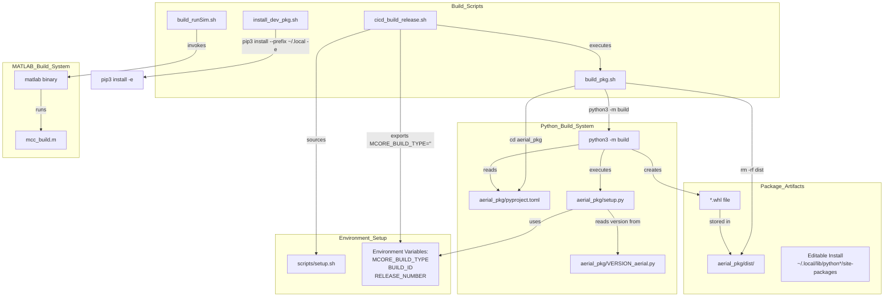
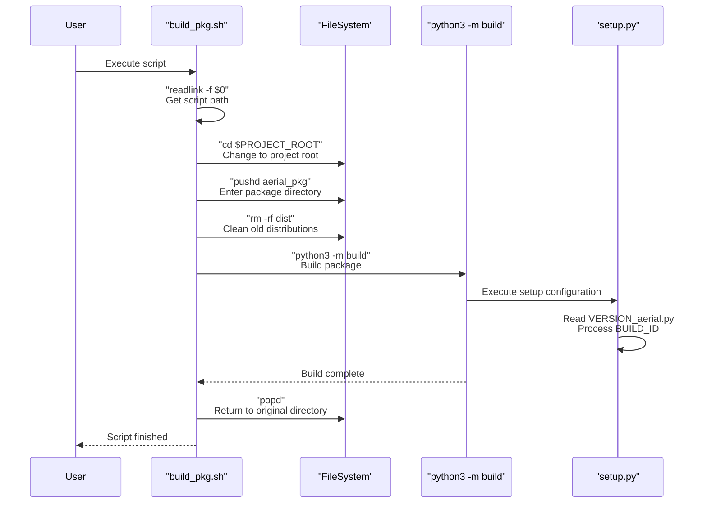
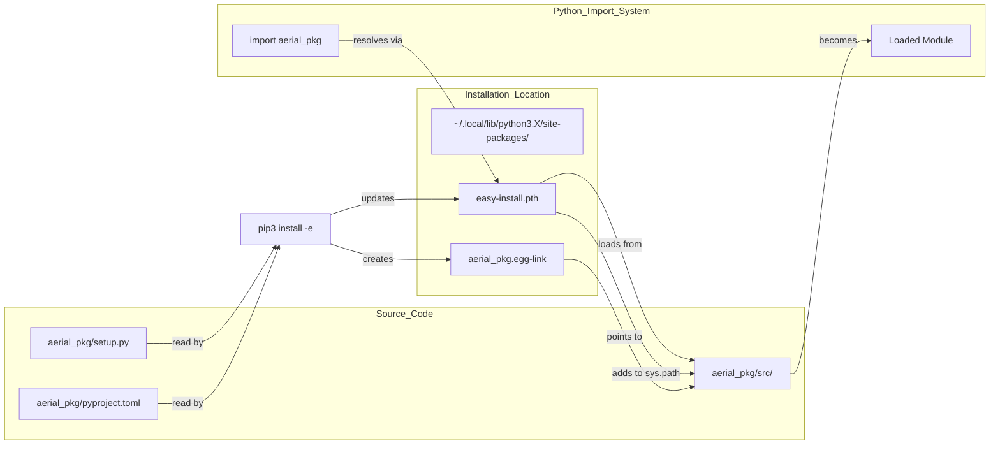
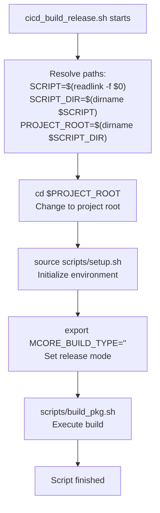
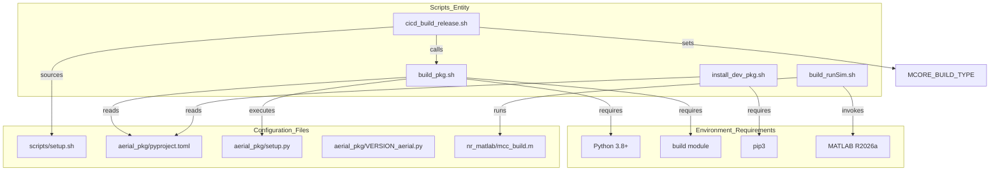

<!-- source: DeepWiki mcp.deepwiki.com · repo NVIDIA/aerial-cuda-accelerated-ran · page 13.2 Build and Installation Scripts · fetched 2026-10-26 -->

# Build and Installation Scripts

<details>
<summary>Relevant source files</summary>

The following files were used as context for generating this wiki page:

- [5GModel/aerial_mcore/scripts/build_pkg.sh](5GModel/aerial_mcore/scripts/build_pkg.sh)
- [5GModel/aerial_mcore/scripts/cicd_build_release.sh](5GModel/aerial_mcore/scripts/cicd_build_release.sh)
- [5GModel/aerial_mcore/scripts/install_dev_pkg.sh](5GModel/aerial_mcore/scripts/install_dev_pkg.sh)
- [5GModel/nr_matlab/build_runSim.sh](5GModel/nr_matlab/build_runSim.sh)

</details>


## Purpose and Scope

This document provides comprehensive reference material for the build and installation scripts in the NVIDIA Aerial CUDA Accelerated RAN repository. Specifically, it covers `build_pkg.sh`, `install_dev_pkg.sh`, and `cicd_build_release.sh` for the `aerial_mcore` Python package, as well as `build_runSim.sh` for compiling the `nr_matlab` simulation core. These scripts automate the process of building distributable Python wheel packages, installing them in development and production modes, and compiling MATLAB deployment artifacts.

For environment configuration that precedes the build process, see [13.1 Setup and Environment Scripts](). For scripts that execute tests and examples after installation, see [13.3 Testing and Execution Scripts]().

---

## Overview

The build and installation subsystem consists of scripts distributed across the Python package and MATLAB simulation core directories:

| Script Path | Purpose | Output |
|-------------|---------|--------|
| `5GModel/aerial_mcore/scripts/build_pkg.sh` | Core build script that creates wheel distributions | `dist/*.whl` file |
| `5GModel/aerial_mcore/scripts/install_dev_pkg.sh` | Installs package in editable/development mode | Editable installation in `~/.local` |
| `5GModel/aerial_mcore/scripts/cicd_build_release.sh` | Orchestrates release builds for CI/CD | Release wheel package |
| `5GModel/nr_matlab/build_runSim.sh` | Compiles MATLAB simulation binaries via `mcc_build.m` | Compiled MATLAB binaries/ctf |

Sources: [5GModel/aerial_mcore/scripts/build_pkg.sh:1-35](), [5GModel/aerial_mcore/scripts/install_dev_pkg.sh:1-32](), [5GModel/aerial_mcore/scripts/cicd_build_release.sh:1-36](), [5GModel/nr_matlab/build_runSim.sh:1-18]()

---

## Build Script Architecture

### Build Workflow Diagram

Title: "Build and Installation Script Flow"


This diagram shows how the build scripts interact with the Python build system, MATLAB runtime compilation, and environment configuration to produce installable packages and simulation binaries.

Sources: [5GModel/aerial_mcore/scripts/build_pkg.sh:20-32](), [5GModel/aerial_mcore/scripts/install_dev_pkg.sh:20-29](), [5GModel/aerial_mcore/scripts/cicd_build_release.sh:20-33](), [5GModel/nr_matlab/build_runSim.sh:1-18]()

---

## Core Python Build Script: build_pkg.sh

### Script Location and Purpose

`5GModel/aerial_mcore/scripts/build_pkg.sh` is the core build script that creates distributable wheel packages from the `aerial_mcore` source code.

### Execution Flow

Title: "build_pkg.sh Execution Sequence"


Sources: [5GModel/aerial_mcore/scripts/build_pkg.sh:1-35]()

### Key Operations

The script performs the following operations:
1. **Error Handling**: Sets `set -e` to terminate immediately on the first encountered error [5GModel/aerial_mcore/scripts/build_pkg.sh:19]().
2. **Path Resolution**: Determines the absolute project root directory using `readlink` and `dirname` [5GModel/aerial_mcore/scripts/build_pkg.sh:22-26]().
3. **Directory Navigation**: Changes context to the `aerial_pkg` subdirectory [5GModel/aerial_mcore/scripts/build_pkg.sh:29]().
4. **Clean Build**: Purges any existing `dist/` artifacts [5GModel/aerial_mcore/scripts/build_pkg.sh:30]().
5. **Package Build**: Invokes `python3 -m build` adhering to PEP 517 standards [5GModel/aerial_mcore/scripts/build_pkg.sh:31]().

Sources: [5GModel/aerial_mcore/scripts/build_pkg.sh:1-35]()

---

## Development Installation Script: install_dev_pkg.sh

### Script Location and Purpose

`5GModel/aerial_mcore/scripts/install_dev_pkg.sh` installs the `aerial_mcore` package in editable mode for local development workflows.

### Installation Command

The script executes:
```bash
pip3 install --prefix ~/.local -e aerial_pkg
```
[5GModel/aerial_mcore/scripts/install_dev_pkg.sh:29]()

* `--prefix ~/.local`: Installs to the user's local site-packages directory rather than system-wide.
* `-e`: Editable development install mode, establishing symlinks to source trees.

### Editable Installation Behavior

Title: "Editable Installation Mechanism"


Sources: [5GModel/aerial_mcore/scripts/install_dev_pkg.sh:1-32]()

---

## Release Build Script: cicd_build_release.sh

### Script Location and Purpose

`5GModel/aerial_mcore/scripts/cicd_build_release.sh` orchestrates release builds for CI/CD pipelines, setting appropriate production environment parameters before invoking the build sequence.

### Script Operations

Title: "cicd_build_release.sh Execution Flow"


Sources: [5GModel/aerial_mcore/scripts/cicd_build_release.sh:1-36]()

### Environment Configuration

* `MCORE_BUILD_TYPE`: Exported as an empty string (`""`) to indicate a production release build [5GModel/aerial_mcore/scripts/cicd_build_release.sh:30]().

Sources: [5GModel/aerial_mcore/scripts/cicd_build_release.sh:1-36]()

---

## MATLAB Simulation Build Script: build_runSim.sh

### Script Location and Purpose

`5GModel/nr_matlab/build_runSim.sh` is located in the MATLAB simulation core directory. It invokes the MATLAB interpreter in non-interactive batch mode to execute `mcc_build.m`, compiling MATLAB code into standalone or deployable simulation binaries.

### Execution Command

```sh
/home/tools/matlab/mathworks_r2026a/bin/matlab -nodisplay -nosplash -nodesktop -r "run('./mcc_build.m');exit;"
```
[5GModel/nr_matlab/build_runSim.sh:18]()

* `-nodisplay`, `-nosplash`, `-nodesktop`: Suppress GUI components for headless execution.
* `-r`: Executes the specified MATLAB command string (`run('./mcc_build.m');exit;`).

Sources: [5GModel/nr_matlab/build_runSim.sh:1-18]()

---

## Script Dependencies and Requirements

### Build Dependencies

Title: "Script Dependencies and Requirements"


Sources: [5GModel/aerial_mcore/scripts/build_pkg.sh:31](), [5GModel/aerial_mcore/scripts/install_dev_pkg.sh:29](), [5GModel/aerial_mcore/scripts/cicd_build_release.sh:29-33](), [5GModel/nr_matlab/build_runSim.sh:18]()

---

