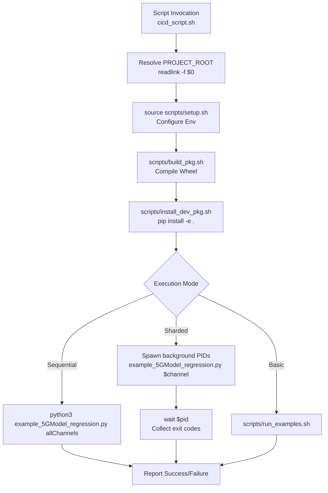
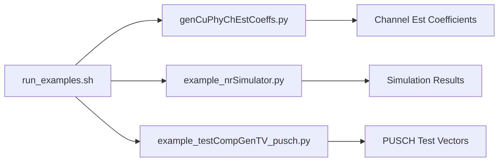
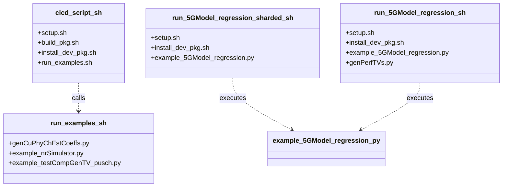

<!-- source: DeepWiki mcp.deepwiki.com · repo NVIDIA/aerial-cuda-accelerated-ran · page 13.3 Testing and Execution Scripts · fetched 2026-10-26 -->

# Testing and Execution Scripts

<details>
<summary>Relevant source files</summary>

The following files were used as context for generating this wiki page:

- [5GModel/aerial_mcore/scripts/cicd_script.sh](5GModel/aerial_mcore/scripts/cicd_script.sh)
- [5GModel/aerial_mcore/scripts/run_5GModel_regression.sh](5GModel/aerial_mcore/scripts/run_5GModel_regression.sh)
- [5GModel/aerial_mcore/scripts/run_5GModel_regression_sharded.sh](5GModel/aerial_mcore/scripts/run_5GModel_regression_sharded.sh)
- [5GModel/aerial_mcore/scripts/run_examples.sh](5GModel/aerial_mcore/scripts/run_examples.sh)

</details>


## Purpose and Scope

This document provides comprehensive technical reference documentation for the testing and execution scripts in the `aerial_mcore` system located at `5GModel/aerial_mcore/scripts/`. These scripts orchestrate the execution of test cases, verification examples, and regression suites. They handle environment setup, package compilation, dependency installation, parallel or sequential test execution, and result aggregation.

The primary scripts covered include `run_examples.sh`, `run_5GModel_regression.sh`, `run_5GModel_regression_sharded.sh`, and `cicd_script.sh`. These scripts automate the validation of the 5G NR physical layer simulation components and their integration with the CUDA-accelerated RAN framework.

**Sources:** [5GModel/aerial_mcore/scripts/run_examples.sh:1-36](), [5GModel/aerial_mcore/scripts/run_5GModel_regression.sh:1-43](), [5GModel/aerial_mcore/scripts/run_5GModel_regression_sharded.sh:1-87](), [5GModel/aerial_mcore/scripts/cicd_script.sh:1-41]()

---

## Overview of Testing Scripts

The `aerial_mcore` system provides several bash scripts, each serving a specific role in the continuous integration and local validation workflow:

| Script Name | Primary Purpose | Key Features |
|-------------|----------------|--------------|
| `run_examples.sh` | Basic validation of core functionality | Executes PUSCH test vector generation and NR Simulator examples [5GModel/aerial_mcore/scripts/run_examples.sh:30-32](). |
| `run_5GModel_regression.sh` | Sequential regression testing | Installs dev package and runs regression for all channels sequentially [5GModel/aerial_mcore/scripts/run_5GModel_regression.sh:32-39](). |
| `run_5GModel_regression_sharded.sh` | Parallel regression testing | Executes 16 concurrent background processes for different 5G channels [5GModel/aerial_mcore/scripts/run_5GModel_regression_sharded.sh:43-48](). |
| `cicd_script.sh` | CI/CD Pipeline Orchestration | Full lifecycle workflow: Setup -> Build -> Install -> Run Examples [5GModel/aerial_mcore/scripts/cicd_script.sh:29-38](). |

All scripts follow a shared execution pattern:
1. Determine absolute script path and set `PROJECT_ROOT` [5GModel/aerial_mcore/scripts/cicd_script.sh:22-26]().
2. Source environment setup via `scripts/setup.sh` [5GModel/aerial_mcore/scripts/run_5GModel_regression.sh:29]().
3. Install the package in developer mode using `scripts/install_dev_pkg.sh` (omitted in basic `run_examples.sh`) [5GModel/aerial_mcore/scripts/run_5GModel_regression_sharded.sh:35]().
4. Execute Python example scripts or regression suites [5GModel/aerial_mcore/scripts/run_examples.sh:29-33]().
5. Capture exit codes and report status [5GModel/aerial_mcore/scripts/run_5GModel_regression_sharded.sh:50-87]().

**Sources:** [5GModel/aerial_mcore/scripts/run_examples.sh:22-33](), [5GModel/aerial_mcore/scripts/run_5GModel_regression.sh:22-39](), [5GModel/aerial_mcore/scripts/run_5GModel_regression_sharded.sh:25-48](), [5GModel/aerial_mcore/scripts/cicd_script.sh:22-38]()

---

## Script Execution Workflow

The following diagram maps the natural language execution stages to concrete code entities (`cicd_script.sh`, `setup.sh`, `build_pkg.sh`, `install_dev_pkg.sh`, and regression drivers).

### Execution Flow Architecture

Sources: [5GModel/aerial_mcore/scripts/cicd_script.sh:22-38](), [5GModel/aerial_mcore/scripts/run_5GModel_regression_sharded.sh:43-61]()

---

## cicd_script.sh - CI/CD Pipeline Orchestration

### Purpose
`cicd_script.sh` is the master orchestration script invoked by CI/CD pipelines. It ensures strict error handling (`set -e`) [5GModel/aerial_mcore/scripts/cicd_script.sh:19](), performs environment bootstrapping, builds package artifacts, installs them locally, and runs smoke tests.

### Implementation Details
The script executes the following sequence:
1. **Directory Context Switch**: Resolves its own location and changes directory to `PROJECT_ROOT` [5GModel/aerial_mcore/scripts/cicd_script.sh:21-26]().
2. **Environment Setup**: Sources `scripts/setup.sh` [5GModel/aerial_mcore/scripts/cicd_script.sh:29]().
3. **Build Package**: Invokes `scripts/build_pkg.sh` [5GModel/aerial_mcore/scripts/cicd_script.sh:32]().
4. **Developer Installation**: Invokes `scripts/install_dev_pkg.sh` [5GModel/aerial_mcore/scripts/cicd_script.sh:35]().
5. **Run Verification**: Invokes `scripts/run_examples.sh` [5GModel/aerial_mcore/scripts/cicd_script.sh:38]().

**Sources:** [5GModel/aerial_mcore/scripts/cicd_script.sh:1-41]()

---

## run_5GModel_regression_sharded.sh - Parallel Testing

### Purpose
`run_5GModel_regression_sharded.sh` executes regression tests for 16 distinct 5G channels and artifact groups concurrently using background jobs, reducing validation duration.

### Channel Configuration
The script defines the complete channel array `channels` [5GModel/aerial_mcore/scripts/run_5GModel_regression_sharded.sh:22-22]():
- Downlink: `ssb`, `pdcch`, `pdsch`, `csirs`, `dlmix`
- Uplink: `prach`, `pucch`, `pusch`, `srs`, `ulmix`
- Configurations & Support: `bfw`, `cuPHY-CP_TVs`, `perf_TVs`, `cfgTemplate`, `launchPatternFile`, `CfgTV_nvbug`

### Sharding Implementation
The script iterates through the channel array, invoking `example_5GModel_regression.py` asynchronously for each, redirecting output to log files, and collecting process IDs (`pids`) [5GModel/aerial_mcore/scripts/run_5GModel_regression_sharded.sh:43-48]():
```bash
for (( idx=0; idx<${#channels[@]}; idx++)); do
   channel="${channels[$idx]}"
   echo Starting channel $channel
   python3 -u ./example_5GModel_regression.py $channel > result_$channel.txt 2>&1 &
   pids+=("$!")
done
```

It subsequently joins all background jobs using `wait $pid` and accumulates success/failure status arrays [5GModel/aerial_mcore/scripts/run_5GModel_regression_sharded.sh:50-62]().

**Sources:** [5GModel/aerial_mcore/scripts/run_5GModel_regression_sharded.sh:1-87]()

---

## run_5GModel_regression.sh - Sequential Testing

### Purpose
`run_5GModel_regression.sh` runs regression suites sequentially. It is typically employed for debugging individual channel failures or in resource-constrained environments where parallel execution is unstable.

### Implementation
- **Developer Installation**: Runs `scripts/install_dev_pkg.sh` [5GModel/aerial_mcore/scripts/run_5GModel_regression.sh:32]().
- **All Channels Execution**: Switches to the `examples` directory and calls `python3 -u ./example_5GModel_regression.py allChannels` [5GModel/aerial_mcore/scripts/run_5GModel_regression.sh:35-39]().
- **Performance Pattern Check**: Invokes `genPerfTVs.py 69 1 0` to validate performance pattern generation parameters [5GModel/aerial_mcore/scripts/run_5GModel_regression.sh:40]().

**Sources:** [5GModel/aerial_mcore/scripts/run_5GModel_regression.sh:1-43]()

---

## run_examples.sh - Basic Validation

### Purpose
`run_examples.sh` provides a fast validation path for core physical layer simulation components without requiring full regression overhead.

### Executed Components
The script runs three standalone Python examples within the `examples` directory [5GModel/aerial_mcore/scripts/run_examples.sh:29-33]():
1. `genCuPhyChEstCoeffs.py` — Generates cuPHY channel estimation coefficients.
2. `example_nrSimulator.py` — Executes standard NR simulator configuration and run workflows.
3. `example_testCompGenTV_pusch.py` — Generates compact PUSCH test vectors.

### Example Execution Data Flow

Sources: [5GModel/aerial_mcore/scripts/run_examples.sh:1-36]()

---

## Script Dependency and Relationship

The testing scripts interact with specific python modules and setup scripts. The mapping below illustrates the relationship between orchestrators and target code entities.

### Code Entity Relationship Diagram

Sources: [5GModel/aerial_mcore/scripts/cicd_script.sh:29-38](), [5GModel/aerial_mcore/scripts/run_5GModel_regression_sharded.sh:46](), [5GModel/aerial_mcore/scripts/run_5GModel_regression.sh:39](), [5GModel/aerial_mcore/scripts/run_examples.sh:30-32]()

---

