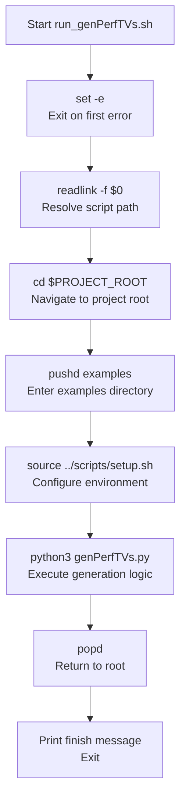
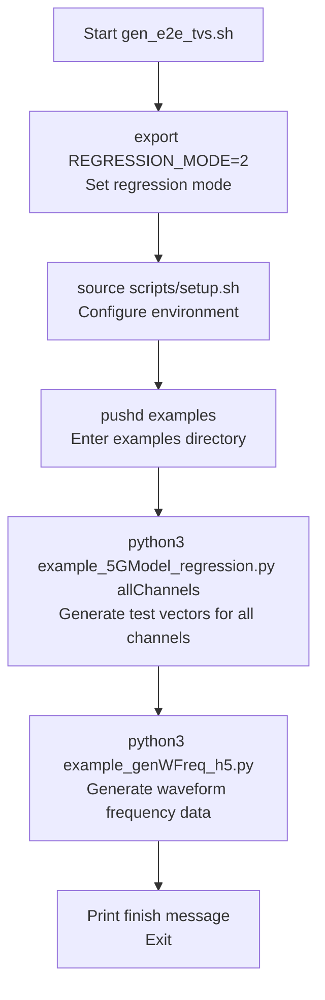
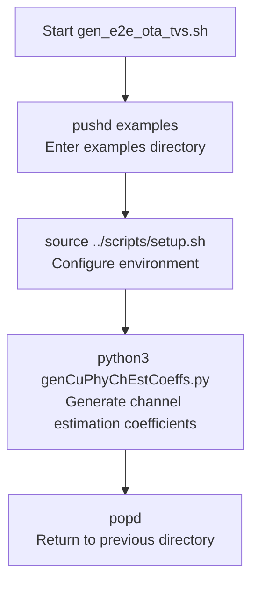
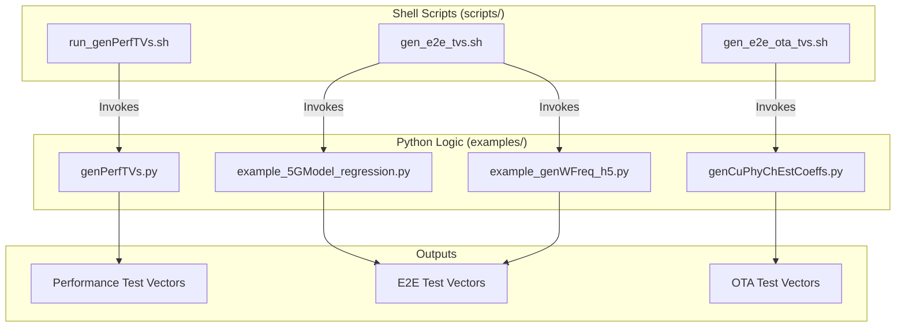

<!-- source: DeepWiki mcp.deepwiki.com · repo NVIDIA/aerial-cuda-accelerated-ran · page 13.4 Test Vector Generation Scripts · fetched 2026-10-26 -->

# Test Vector Generation Scripts

Relevant source files

The following files were used as context for generating this wiki page:

- [5GModel/aerial_mcore/scripts/gen_e2e_ota_tvs.sh](5GModel/aerial_mcore/scripts/gen_e2e_ota_tvs.sh)
- [5GModel/aerial_mcore/scripts/gen_e2e_tvs.sh](5GModel/aerial_mcore/scripts/gen_e2e_tvs.sh)
- [5GModel/aerial_mcore/scripts/run_genPerfTVs.sh](5GModel/aerial_mcore/scripts/run_genPerfTVs.sh)

## Purpose and Scope

This page provides a reference for scripts that generate test vectors used for validating the physical layer implementation. These scripts orchestrate the generation of various test vector types including performance test vectors, end-to-end (e2e) test vectors, and over-the-air (OTA) test vectors. 

This page focuses specifically on the script interfaces, command-line arguments, and internal operations of the generation scripts, including `gen_e2e_tvs.sh`, `gen_e2e_ota_tvs.sh`, `run_genPerfTVs.sh`, and `build_runSim.sh`.

Sources: [5GModel/aerial_mcore/scripts/gen_e2e_tvs.sh:1-44](), [5GModel/aerial_mcore/scripts/gen_e2e_ota_tvs.sh:1-31](), [5GModel/aerial_mcore/scripts/run_genPerfTVs.sh:1-34]()

---

## Overview of Test Vector Generation Scripts

The test vector generation system consists of primary shell scripts that wrap Python and MATLAB logic to serve different validation purposes:

| Script | Location | Purpose | Primary Components Invoked |
|--------|----------|---------|------------------|
| `run_genPerfTVs.sh` | `scripts/` | Generate performance test vectors and launch patterns | `genPerfTVs.py` |
| `gen_e2e_tvs.sh` | `scripts/` | Generate comprehensive end-to-end test vectors | `example_5GModel_regression.py`, `example_genWFreq_h5.py` |
| `gen_e2e_ota_tvs.sh` | `scripts/` | Generate over-the-air channel estimation test vectors | `genCuPhyChEstCoeffs.py` |

Sources: [5GModel/aerial_mcore/scripts/run_genPerfTVs.sh:28-31](), [5GModel/aerial_mcore/scripts/gen_e2e_tvs.sh:34-40](), [5GModel/aerial_mcore/scripts/gen_e2e_ota_tvs.sh:28-31]()

---

## Performance Test Vector Generation

### Script: run_genPerfTVs.sh

**Location:** `5GModel/aerial_mcore/scripts/run_genPerfTVs.sh`

The `run_genPerfTVs.sh` script is a wrapper that sets up the environment and executes the `genPerfTVs.py` Python script. It ensures that the `PROJECT_ROOT` is correctly identified and the environment is initialized via `setup.sh`.

#### Operational Flow

**Diagram: run_genPerfTVs.sh Execution Flow**

Sources: [5GModel/aerial_mcore/scripts/run_genPerfTVs.sh:19-34]()

---

## End-to-End Test Vector Scripts

### Script: gen_e2e_tvs.sh

**Location:** `5GModel/aerial_mcore/scripts/gen_e2e_tvs.sh`

The `gen_e2e_tvs.sh` script orchestrates the generation of comprehensive end-to-end test vectors covering all channels and waveform frequency data. This script is typically used for full system regression testing.

#### Environment Configuration

The script sets specific environment variables before execution:

| Variable | Value | Purpose |
|----------|-------|---------|
| `REGRESSION_MODE` | 2 | Sets regression mode to e2e test vector generation mode |

Sources: [5GModel/aerial_mcore/scripts/gen_e2e_tvs.sh:28]()

#### Operational Flow

**Diagram: gen_e2e_tvs.sh Execution Flow**

Sources: [5GModel/aerial_mcore/scripts/gen_e2e_tvs.sh:28-44]()

#### Generated Outputs

1. **All Channel Test Vectors** (via `example_5GModel_regression.py allChannels`)
   - SSB, PDCCH, PDSCH, PUSCH, and other supported channels.
2. **Waveform Frequency Data** (via `example_genWFreq_h5.py`)
   - HDF5 files containing waveform frequency representations used for frequency-domain testing.

Sources: [5GModel/aerial_mcore/scripts/gen_e2e_tvs.sh:39-40]()

---

### Script: gen_e2e_ota_tvs.sh

**Location:** `5GModel/aerial_mcore/scripts/gen_e2e_ota_tvs.sh`

The `gen_e2e_ota_tvs.sh` script generates over-the-air (OTA) test vectors, specifically focusing on channel estimation coefficients required for OTA testing scenarios.

#### Operational Flow

**Diagram: gen_e2e_ota_tvs.sh Execution Flow**

Sources: [5GModel/aerial_mcore/scripts/gen_e2e_ota_tvs.sh:28-31]()

#### Generated Outputs

The script generates cuPHY channel estimation coefficients by invoking `genCuPhyChEstCoeffs.py`. These coefficients are essential for physical layer OTA testing and channel estimation validation.

Sources: [5GModel/aerial_mcore/scripts/gen_e2e_ota_tvs.sh:30]()

---

## Script Relationships and Workflow

**Diagram: Test Vector Generation Script Relationships**

Sources: [5GModel/aerial_mcore/scripts/run_genPerfTVs.sh:30](), [5GModel/aerial_mcore/scripts/gen_e2e_tvs.sh:39-40](), [5GModel/aerial_mcore/scripts/gen_e2e_ota_tvs.sh:30]()

### Execution Best Practices

1. **Error Handling:** All shell scripts use `set -e` to exit immediately on any command failure, ensuring that partial or corrupted test vector sets are not generated. [5GModel/aerial_mcore/scripts/gen_e2e_tvs.sh:19](), [5GModel/aerial_mcore/scripts/run_genPerfTVs.sh:19]()
2. **Environment Isolation:** Scripts use `pushd` and `popd` to manage the working directory, ensuring that relative paths within the scripts (like `../scripts/setup.sh`) resolve correctly regardless of the caller's location. [5GModel/aerial_mcore/scripts/run_genPerfTVs.sh:28-31]()
3. **Regression Mode:** When generating E2E test vectors, ensure `REGRESSION_MODE=2` is exported to trigger the correct MATLAB engine behaviors for full validation output. [5GModel/aerial_mcore/scripts/gen_e2e_tvs.sh:28]()

---

