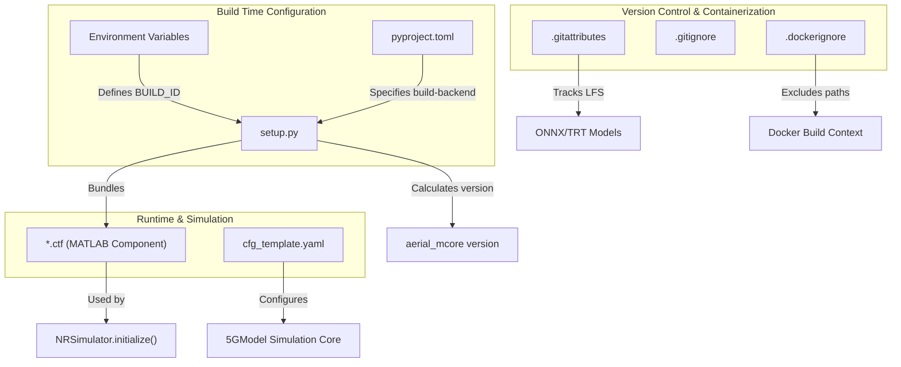
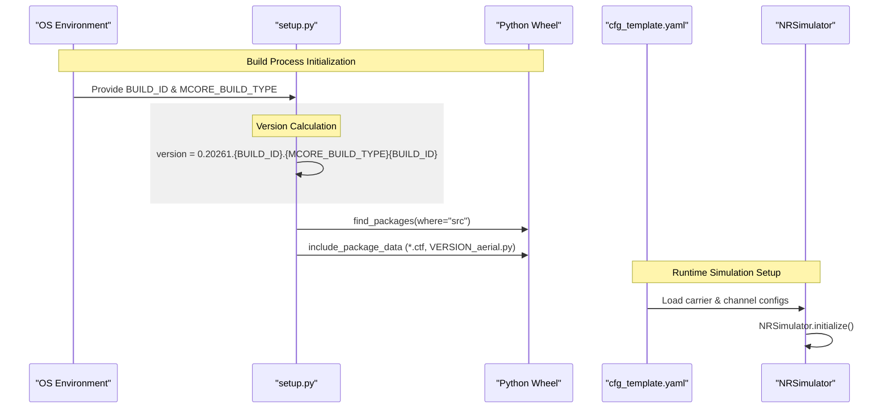

<!-- source: DeepWiki mcp.deepwiki.com · repo NVIDIA/aerial-cuda-accelerated-ran · page 14 Configuration Reference · fetched 2026-10-26 -->

# Configuration Reference

Relevant source files

The following files were used as context for generating this wiki page:

- [5GModel/nr_matlab/cfg_template.yaml](5GModel/nr_matlab/cfg_template.yaml)

## Purpose and Scope

This page provides a high-level reference for the configuration architecture of the NVIDIA Aerial CUDA Accelerated RAN repository. It covers how environment variables, build system files, simulation templates, and repository metadata interact across the `aerial_mcore`, `cuPHY`, and `pyaerial` subsystems to control build and runtime behavior.

For detailed technical specifications, refer to the following child pages:
*   **[Environment Variables](#14.1)** — BUILD_ID, MCORE_BUILD_TYPE, REGRESSION_MODE, RELEASE_NUMBER, AERIAL_PYTHON, TEST_VECTOR_DIR, cuBB_SDK and their effects.
*   **[Package and Simulation Configuration](#14.2)** — setup.py/pyproject.toml build config plus YAML simulation templates (`cfg_template.yaml`, `profile_FRC.yaml`) and config functions.
*   **[Docker and Git Configuration](#14.3)** — `.dockerignore`, `.gitignore`, `.gitattributes` rules for build optimization and LFS tracking.

---

## Configuration Architecture

The system employs a multi-layered configuration strategy. Global environment variables drive the Python package versioning and C++ build paths, while specific configuration files manage dependency resolution, version control hygiene, and MATLAB simulation properties.

### System Configuration Mapping

The following diagram maps high-level system requirements to specific code entities and configuration files.

Sources: [5GModel/aerial_mcore/aerial_pkg/setup.py:20-44](), [.dockerignore:1-23](), [.gitattributes:1-10](), [5GModel/nr_matlab/cfg_template.yaml:1-39]()

---

## Key Configuration Components

### Environment and Build Variables
The build system for `aerial_mcore` relies heavily on environment variables to ensure traceability in CI/CD pipelines. The `BUILD_ID` is a mandatory parameter, while `MCORE_BUILD_TYPE` modifies the resulting version string.

| Variable | Role | Code Reference |
| :--- | :--- | :--- |
| `BUILD_ID` | Mandatory unique identifier for the build | [5GModel/aerial_mcore/aerial_pkg/setup.py:21-23]() |
| `MCORE_BUILD_TYPE` | Optional suffix (e.g., 'dev') for versioning | [5GModel/aerial_mcore/aerial_pkg/setup.py:25-27]() |

For a full list of runtime and build variables, see **[Environment Variables](#14.1)**.

Sources: [5GModel/aerial_mcore/aerial_pkg/setup.py:21-27]()

### Package and Simulation Configuration
The repository uses standard Python packaging configuration alongside YAML simulation templates. `setup.py` handles dynamic versioning, package discovery, and data inclusion for the `aerial_mcore` package. Simulation parameters for the MATLAB core are structured via YAML templates such as `cfg_template.yaml`.

*   **Version Logic**: The version string is constructed dynamically using environment parameters [5GModel/aerial_mcore/aerial_pkg/setup.py:31]().
*   **Data Bundling**: Critical non-Python assets, such as MATLAB Compiled Technology Files (`*.ctf`), are explicitly included in package distribution [5GModel/aerial_mcore/aerial_pkg/setup.py:41]().
*   **Simulation Templates**: Templates configure carrier frequencies, subcarrier spacing, bandwidth parts, and physical channels (`pdsch`, `pusch`, `pdcch`) [5GModel/nr_matlab/cfg_template.yaml:18-115]().

For details on package and simulation configuration, see **[Package and Simulation Configuration](#14.2)**.

Sources: [5GModel/aerial_mcore/aerial_pkg/setup.py:31-41](), [5GModel/nr_matlab/cfg_template.yaml:18-115]()

### Repository and Container Hygiene
The repository manages a large volume of binary assets (test vectors, HDF5 files, and ML models) and complex source trees. 

*   **Docker Optimization**: The `.dockerignore` file uses a deny-all approach (`*`), explicitly whitelisting only necessary directories like `5GModel`, `cuPHY`, `cuMAC`, and `pyaerial` to maintain a lean build context [.dockerignore:1-23]().
*   **Git LFS**: Large files, including ONNX models (`.onnx`), TensorRT engines (`.engine`), and pre-built Python wheels (`.whl`), are managed via `.gitattributes` to prevent repository bloat [.gitattributes:5-10]().

For details on these rules, see **[Docker and Git Configuration](#14.3)**.

Sources: [.dockerignore:1-23](), [.gitattributes:5-10]()

---

## Configuration Flow Diagram

This diagram illustrates how configuration parameters flow from the OS environment into software artifacts and simulation engines.

Sources: [5GModel/aerial_mcore/aerial_pkg/setup.py:21-41](), [5GModel/nr_matlab/cfg_template.yaml:18-35]()

---

## Related Documentation
*   **[Build System](#11)** — Information on how these configurations are used during CMake and pip build processes.
*   **[Development Guide](#12)** — Instructions on setting up local configuration for editable development modes.

Sources: [5GModel/aerial_mcore/aerial_pkg/setup.py:20-44]()

---

