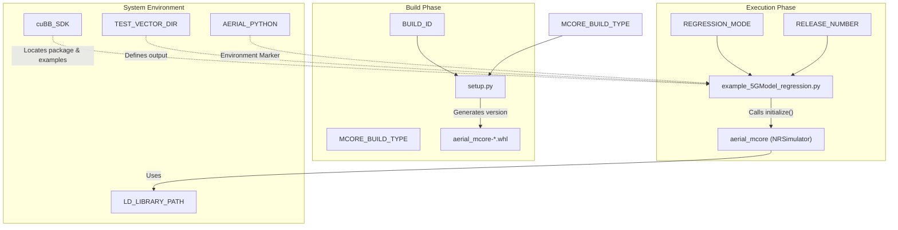
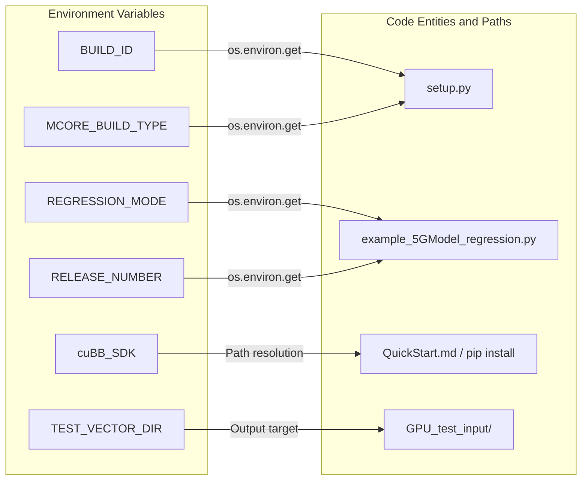

<!-- source: DeepWiki mcp.deepwiki.com · repo NVIDIA/aerial-cuda-accelerated-ran · page 14.1 Environment Variables · fetched 2026-10-26 -->

# Environment Variables

<details>
<summary>Relevant source files</summary>

The following files were used as context for generating this wiki page:

- [5GModel/aerial_mcore/QuickStart.md](5GModel/aerial_mcore/QuickStart.md)
- [5GModel/aerial_mcore/scripts/setup.sh](5GModel/aerial_mcore/scripts/setup.sh)

</details>


## Purpose and Scope

This document provides a comprehensive reference for all environment variables used in the NVIDIA Aerial CUDA Accelerated RAN system. These variables control build configuration, runtime behavior, testing modes, system paths, and SDK root locations. Understanding these variables is essential for configuring the development environment, building packages, and running tests correctly.

The environment variables are primarily consumed by the Python build system (`setup.py`), the MATLAB-based simulation regression scripts (`example_5GModel_regression.py`), and shell initialization scripts (`setup.sh`).

Sources: [5GModel/aerial_mcore/aerial_pkg/setup.py:20-31](), [5GModel/aerial_mcore/scripts/setup.sh:1-25](), [5GModel/aerial_mcore/QuickStart.md:1-22]()

## Environment Variable Categories

The system uses environment variables across four primary categories:

| Category | Purpose | Primary Scripts |
|----------|---------|----------------|
| Build Configuration | Control package versioning and build type | `setup.py`, `build_pkg.sh`, `cicd_build_release.sh` |
| SDK & Runtime Paths | Configure SDK root and MATLAB Runtime library paths | `setup.sh`, QuickStart workflows |
| Testing Control | Define regression modes and release targets | `example_5GModel_regression.py` |
| Development Markers | Indicate active development environment | `setup.sh` |

Sources: [5GModel/aerial_mcore/aerial_pkg/setup.py:20-31](), [5GModel/aerial_mcore/examples/example_5GModel_regression.py:87-97](), [5GModel/aerial_mcore/scripts/setup.sh:1-25]()

## Variable Dependencies and Workflow

The following diagram illustrates how environment variables propagate through the system from build time to regression testing and SDK navigation.



**Diagram: Environment Variable Data Flow**

Sources: [5GModel/aerial_mcore/aerial_pkg/setup.py:20-31](), [5GModel/aerial_mcore/examples/example_5GModel_regression.py:34-101](), [5GModel/aerial_mcore/scripts/setup.sh:1-25](), [5GModel/aerial_mcore/QuickStart.md:1-22]()

## Build Configuration Variables

### BUILD_ID
**Purpose:** Uniquely identifies each build and forms part of the package version string. This is typically provided by a CI/CD system like Jenkins.
**Type:** Required
**Usage:** The `BUILD_ID` is used to construct the package version according to PEP 440 format.
**Implementation:**
In `setup.py`, the script enforces the presence of this variable:
```python
BUILD_ID = os.environ.get('BUILD_ID')
if BUILD_ID is None:
    raise RuntimeError("Environment variable BUILD_ID must be set")
```

### MCORE_BUILD_TYPE
**Purpose:** Specifies the build variant (e.g., development vs. production) and affects the version suffix.
**Type:** Optional
**Default:** Empty string `""` in CI/CD release scripts, but set to `"dev"` in local setup scripts (`setup.sh`) [5GModel/aerial_mcore/scripts/setup.sh:25-25]().
**Usage:** Combined with `BUILD_ID` to create the full version string in the package build configuration [5GModel/aerial_mcore/aerial_pkg/setup.py:25-31]().

Sources: [5GModel/aerial_mcore/aerial_pkg/setup.py:20-31](), [5GModel/aerial_mcore/scripts/setup.sh:25-25]()

## Testing and Regression Variables

### REGRESSION_MODE
**Purpose:** Controls which regression test suite is executed and how test vectors (TVs) are generated in regression scripts (e.g., `example_5GModel_regression.py`) [5GModel/aerial_mcore/QuickStart.md:19-20]().
**Type:** Required for regression execution.
**Valid Values:**
* `0`: **MR Mode** - Runs a subset of tests supported by cuPHY using compact mode.
* `1`: **Nightly Mode** - Runs full regression tests for the 5GModel [5GModel/aerial_mcore/QuickStart.md:19-20]().
* `2`: **Compact TV Mode** - Specifically generates test vectors in compact mode.

Sources: [5GModel/aerial_mcore/QuickStart.md:19-20]()

### RELEASE_NUMBER
**Purpose:** Specifies the 5G NR release version to target for testing and simulation configurations.
**Type:** Optional
**Default:** `10000` (represents the latest development branch).
**Usage:** Passed to the MATLAB engine's regression and initialization hooks to select appropriate 5G test parameters.

Sources: [5GModel/aerial_mcore/QuickStart.md:1-22]()

## Path, SDK, and Runtime Variables

### cuBB_SDK
**Purpose:** Points to the root directory of the NVIDIA Aerial cuBB SDK workspace. It is used extensively across installation guides, quickstarts, and container scripts to locate package wheels (`${cuBB_SDK}/5GModel/aerial_mcore/aerial_pkg/dist/`) and example directories (`${cuBB_SDK}/5GModel/aerial_mcore/examples`) [5GModel/aerial_mcore/QuickStart.md:12-17]().

Sources: [5GModel/aerial_mcore/QuickStart.md:12-17]()

### TEST_VECTOR_DIR / GPU_test_input
**Purpose:** Defines the target directory where generated test vectors and HDF5 configuration files are stored. By default, regression scripts output test vectors to the `GPU_test_input/` directory within the examples workspace [5GModel/aerial_mcore/QuickStart.md:21-21]().

Sources: [5GModel/aerial_mcore/QuickStart.md:21-21]()

### LD_LIBRARY_PATH
**Purpose:** Essential for the Python-MATLAB bridge. It must point to the MATLAB Runtime (MCR) shared libraries.
**Implementation:** The `setup.sh` script automatically appends the necessary R2026a runtime paths to `LD_LIBRARY_PATH` [5GModel/aerial_mcore/scripts/setup.sh:23-23]():
```bash
export LD_LIBRARY_PATH=$LD_LIBRARY_PATH:/usr/local/MATLAB/MATLAB_Runtime/R2026a/runtime/glnxa64:/usr/local/MATLAB/MATLAB_Runtime/R2026a/bin/glnxa64:/usr/local/MATLAB/MATLAB_Runtime/R2026a/sys/os/glnxa64:/usr/local/MATLAB/MATLAB_Runtime/R2026a/extern/bin/glnxa64:/usr/local/MATLAB/MATLAB_Runtime/R2026a/sys/opengl/lib/glnxa64
```
**Requirement:** Scripts utilizing the `aerial_mcore` package require these paths to load underlying Compiled Technology File (`.ctf`) components.

Sources: [5GModel/aerial_mcore/scripts/setup.sh:23-23]()

### AERIAL_PYTHON
**Purpose:** A marker variable set by `setup.sh` to prevent redundant configuration of the shell environment, modify the prompt (`[Aerial Python]`), and identify the active Aerial Python development context [5GModel/aerial_mcore/scripts/setup.sh:20-24]().

Sources: [5GModel/aerial_mcore/scripts/setup.sh:20-24]()

## System Integration Diagram

The following diagram maps the environment variables to the specific code entities and paths that consume them.



**Diagram: Mapping Variables to Code Entities**

Sources: [5GModel/aerial_mcore/aerial_pkg/setup.py:20-31](), [5GModel/aerial_mcore/examples/example_5GModel_regression.py:34-101](), [5GModel/aerial_mcore/QuickStart.md:1-22]()

## Variable Reference Summary

| Variable | Scope | Required | Impact |
| :--- | :--- | :--- | :--- |
| `BUILD_ID` | Build | Yes | Sets the 3rd segment of the PEP 440 version string. |
| `MCORE_BUILD_TYPE` | Build | No | Adds a build variant tag (e.g., `dev`) to the version string. |
| `REGRESSION_MODE` | Test | Yes (for regression) | Determines if test generation uses compact or full mode. |
| `RELEASE_NUMBER` | Test | No | Filters test cases by 5G release version (default `10000`). |
| `cuBB_SDK` | Path | Yes (for setup) | Root directory pointer for cuBB SDK workspace and packages. |
| `TEST_VECTOR_DIR` | Path | No | Destination directory for generated test vectors (`GPU_test_input/`). |
| `LD_LIBRARY_PATH` | Runtime | Yes | Allows the system to locate MATLAB Runtime R2026a libraries. |
| `AERIAL_PYTHON` | Environment | No | Identifies and initializes the shell for Aerial Python development. |

Sources: [5GModel/aerial_mcore/aerial_pkg/setup.py:20-31](), [5GModel/aerial_mcore/QuickStart.md:1-22](), [5GModel/aerial_mcore/scripts/setup.sh:1-25]()

---

