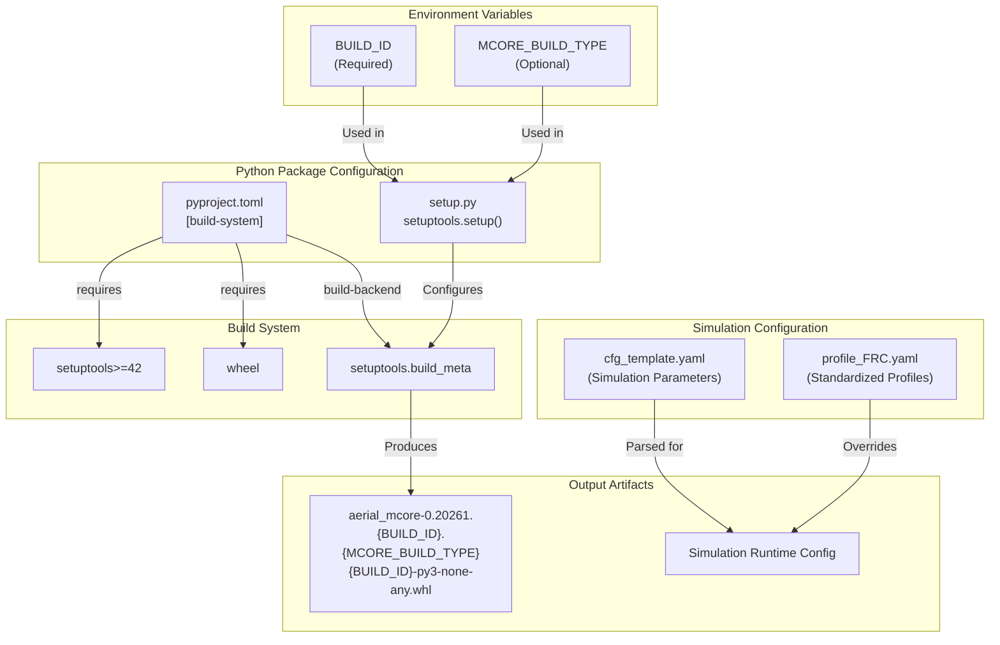
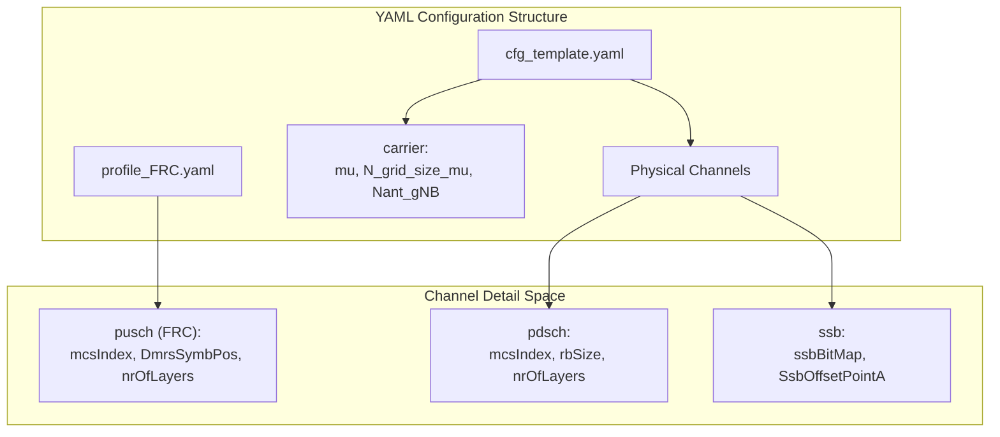
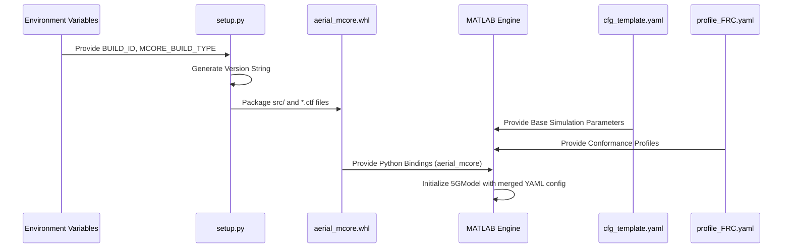

<!-- source: DeepWiki mcp.deepwiki.com · repo NVIDIA/aerial-cuda-accelerated-ran · page 14.2 Package and Simulation Configuration · fetched 2026-10-26 -->

# Package and Simulation Configuration

<details>
<summary>Relevant source files</summary>

The following files were used as context for generating this wiki page:

- [5GModel/aerial_mcore/aerial_pkg/pyproject.toml](5GModel/aerial_mcore/aerial_pkg/pyproject.toml)
- [5GModel/aerial_mcore/aerial_pkg/setup.py](5GModel/aerial_mcore/aerial_pkg/setup.py)
- [5GModel/nr_matlab/cfg/profiles/profile_FRC.yaml](5GModel/nr_matlab/cfg/profiles/profile_FRC.yaml)
- [5GModel/nr_matlab/cfg_template.yaml](5GModel/nr_matlab/cfg_template.yaml)

</details>


## Purpose and Scope

This document explains the package configuration files for the `aerial_mcore` Python package and the YAML configuration templates used for 5G simulations. It covers the structure and contents of `setup.py` and `pyproject.toml`, which define how the package is built, versioned, and distributed, as well as the parameters defined in `cfg_template.yaml` and profile-specific files for the MATLAB-based 5G model.

## Configuration Files Overview

The `aerial_mcore` package uses two primary configuration files that work together to define the package build system, while the simulation core relies on YAML templates for scenario definition.

| File | Purpose | Standard/Format |
|------|---------|----------|
| `pyproject.toml` | Declares build system requirements and backend | PEP 517/518 |
| `setup.py` | Defines package metadata, version, and content | setuptools |
| `cfg_template.yaml` | Template for NR carrier and channel configurations | YAML |
| `profile_FRC.yaml` | Pre-defined Fixed Reference Channel (FRC) profiles | YAML |



**Configuration Relationship Diagram**

Sources: [5GModel/aerial_mcore/aerial_pkg/pyproject.toml:16-21](), [5GModel/aerial_mcore/aerial_pkg/setup.py:20-44](), [5GModel/nr_matlab/cfg_template.yaml:16-250](), [5GModel/nr_matlab/cfg/profiles/profile_FRC.yaml:19-82]()

## pyproject.toml Configuration

The `pyproject.toml` file defines the build system requirements following PEP 517 and PEP 518 standards. This file is minimal and focuses solely on declaring what tools are needed to build the package.

### Build System Declaration

`[5GModel/aerial_mcore/aerial_pkg/pyproject.toml:16-21]()`

```toml
[build-system]
requires = [
    "setuptools>=42",
    "wheel"
]
build-backend = "setuptools.build_meta"
```

| Field | Value | Purpose |
|-------|-------|---------|
| `requires` | `["setuptools>=42", "wheel"]` | Build dependencies that must be installed before building |
| `build-backend` | `"setuptools.build_meta"` | Backend module that implements the build interface |

Sources: [5GModel/aerial_mcore/aerial_pkg/pyproject.toml:16-21]()

## setup.py Configuration

The `setup.py` file contains the core package configuration, including metadata and dynamic versioning logic.

### Environment Variable Requirements

`[5GModel/aerial_mcore/aerial_pkg/setup.py:20-27]()`

The configuration enforces strict environment variable requirements for CI/CD integration:

```python
BUILD_ID = os.environ.get('BUILD_ID')
if BUILD_ID is None:
    raise RuntimeError("Environment variable BUILD_ID must be set")

MCORE_BUILD_TYPE = os.environ.get('MCORE_BUILD_TYPE')
if MCORE_BUILD_TYPE is None:
    MCORE_BUILD_TYPE=''
```

| Variable | Required | Default | Purpose |
|----------|----------|---------|---------|
| `BUILD_ID` | Yes | N/A | Unique identifier (e.g., Jenkins build number) |
| `MCORE_BUILD_TYPE` | No | `''` | Build type marker (e.g., 'dev', 'rc') |

Sources: [5GModel/aerial_mcore/aerial_pkg/setup.py:20-27]()

### Version Generation

The version string is dynamically constructed to follow PEP 440 conventions:

`[5GModel/aerial_mcore/aerial_pkg/setup.py:29-31]()`

```python
version=f"0.20261.{BUILD_ID}.{MCORE_BUILD_TYPE}{BUILD_ID}"
```

The version structure is: `0.20261.{BUILD_ID}.{MCORE_BUILD_TYPE}{BUILD_ID}`.
Example: `0.20261.1024.rc1024` (where `BUILD_ID=1024` and `MCORE_BUILD_TYPE='rc'`).

Sources: [5GModel/aerial_mcore/aerial_pkg/setup.py:29-31]()

### Package Metadata and Content

The `setuptools.setup()` call defines how the package is discovered and what files are included:

`[5GModel/aerial_mcore/aerial_pkg/setup.py:33-44]()`

| Parameter | Value | Description |
|-----------|-------|-------------|
| `name` | `"aerial_mcore"` | Package name for installation |
| `package_dir` | `{"": "src"}` | Maps package root to `src/` directory |
| `packages` | `find_packages(where="src")` | Discovers packages in `src/` |
| `package_data` | `{"": ["*.ctf","VERSION_aerial.py"]}` | Includes MATLAB Compiled Technology Files (`.ctf`) |
| `python_requires` | `">=3.8"` | Minimum Python version |
| `zip_safe` | `False` | Prevents running from zip (required for `.ctf` access) |

Sources: [5GModel/aerial_mcore/aerial_pkg/setup.py:33-44]()

## YAML Configuration Templates

The repository uses YAML files to define simulation scenarios. This includes a base template and specific profiles for conformance testing.

### Core Simulation Parameters

The `5GModel/nr_matlab/cfg_template.yaml` file provides a comprehensive template for configuring the 5G NR physical layer simulation [5GModel/nr_matlab/cfg_template.yaml:16-250]().

| Section | Parameter | Description |
|---------|-----------|-------------|
| `testAlloc` | `dl`, `ul`, `ssb`, etc. | Weights or flags for allocating different channel types in the test [5GModel/nr_matlab/cfg_template.yaml:16-17]() |
| `carrier` | `mu` | Numerology (e.g., 1.0 for 30kHz SCS) [5GModel/nr_matlab/cfg_template.yaml:22]() |
| `carrier` | `N_grid_size_mu` | Resource Grid size in Resource Blocks (RBs) [5GModel/nr_matlab/cfg_template.yaml:24]() |
| `carrier` | `Nant_gNB` | Number of gNB antennas [5GModel/nr_matlab/cfg_template.yaml:26]() |
| `carrier` | `TddPeriod` | TDD Periodicity in ms [5GModel/nr_matlab/cfg_template.yaml:34]() |

Sources: [5GModel/nr_matlab/cfg_template.yaml:16-250]()

### Physical Channel Configurations

The template defines detailed parameters for every 5G NR physical channel:

*   **SSB**: Configures `ssbSubcarrierOffset`, `SsbOffsetPointA`, and `ssbBitMap` [5GModel/nr_matlab/cfg_template.yaml:40-62]().
*   **PDCCH**: Defines CORESETs, search spaces, and DCI payloads [5GModel/nr_matlab/cfg_template.yaml:64-98]().
*   **PDSCH**: Configures modulation (`qamModOrder`), coding (`targetCodeRate`), layers (`nrOfLayers`), and resource allocation (`rbStart`, `rbSize`) [5GModel/nr_matlab/cfg_template.yaml:99-149]().
*   **CSI-RS**: Configures density, row, and beamforming indices [5GModel/nr_matlab/cfg_template.yaml:150-168]().
*   **PRACH**: Defines root sequences and zero correlation zones [5GModel/nr_matlab/cfg_template.yaml:169-184]().
*   **PUCCH**: Configures format types (0-4) and hopping identifiers [5GModel/nr_matlab/cfg_template.yaml:185-223]().
*   **SRS**: Configures antenna ports, symbols, and frequency hopping [5GModel/nr_matlab/cfg_template.yaml:224-250]().

Sources: [5GModel/nr_matlab/cfg_template.yaml:40-250]()

### Fixed Reference Channel (FRC) Profiles

Specific configurations for TS38.141 conformance testing are defined in `5GModel/nr_matlab/cfg/profiles/profile_FRC.yaml`. These profiles override the base template for PUSCH performance testing [5GModel/nr_matlab/cfg/profiles/profile_FRC.yaml:16-18]().

Examples include:
*   `profile_FRC_G_FR1_A3_14`: Single layer, MCS 1, 100MHz [5GModel/nr_matlab/cfg/profiles/profile_FRC.yaml:19-30]().
*   `profile_FRC_G_FR1_A4_28`: Two layers, MCS 10, 100MHz [5GModel/nr_matlab/cfg/profiles/profile_FRC.yaml:71-82]().

Sources: [5GModel/nr_matlab/cfg/profiles/profile_FRC.yaml:16-82]()



**Simulation Parameter Hierarchy**

Sources: [5GModel/nr_matlab/cfg_template.yaml:16-250](), [5GModel/nr_matlab/cfg/profiles/profile_FRC.yaml:19-82]()

## Configuration Data Flow

The following diagram illustrates how the configuration files move from the repository into the runtime environment.



**Configuration Data Flow**

Sources: [5GModel/aerial_mcore/aerial_pkg/setup.py:20-44](), [5GModel/nr_matlab/cfg_template.yaml:16-250](), [5GModel/nr_matlab/cfg/profiles/profile_FRC.yaml:19-82]()

---

