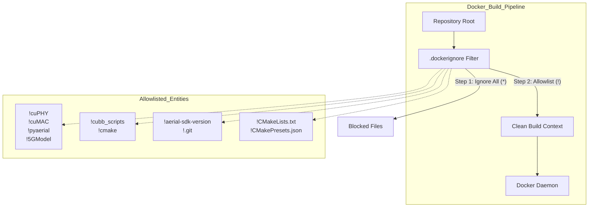
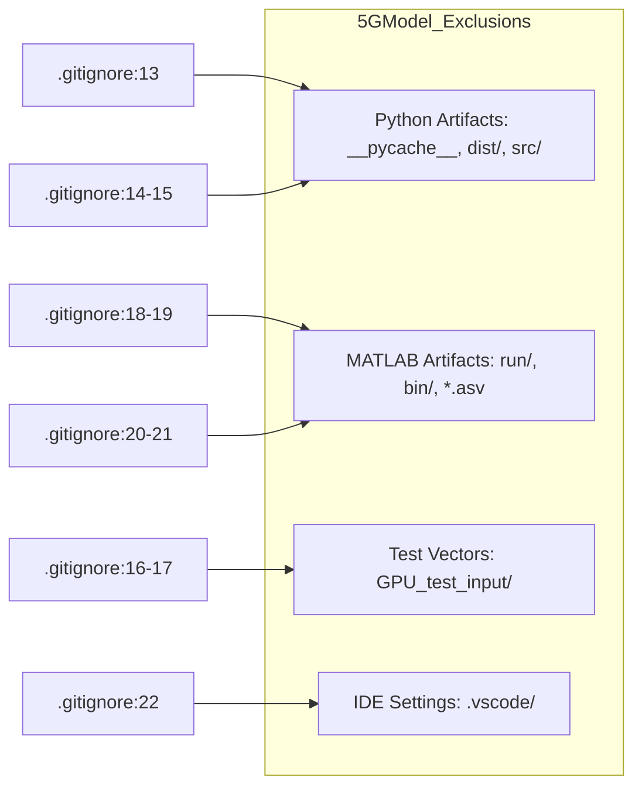
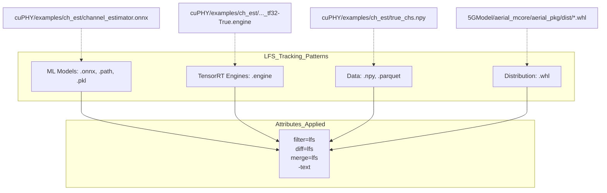

<!-- source: DeepWiki mcp.deepwiki.com · repo NVIDIA/aerial-cuda-accelerated-ran · page 14.3 Docker and Git Configuration · fetched 2026-10-26 -->

# Docker and Git Configuration

Relevant source files

The following files were used as context for generating this wiki page:

- [.dockerignore](.dockerignore)
- [.gitattributes](.gitattributes)
- [.gitignore](.gitignore)

## Purpose and Scope

This page documents the Docker and Git configuration files that control build optimization and version control behavior in the NVIDIA Aerial CUDA Accelerated RAN repository. It covers `.dockerignore`, `.gitignore`, and `.gitattributes` configurations.

These configurations ensure that:
1.  **Docker Build Context** is minimized by using an allowlist approach, preventing unnecessary files from being sent to the Docker daemon.
2.  **Git Repository Hygiene** is maintained by excluding build artifacts, temporary MATLAB files, and IDE-specific metadata.
3.  **Large Binary Assets** (ML models, TensorRT engines, and Python wheels) are managed efficiently via Git LFS.

Sources: [.dockerignore:1-24](), [.gitignore:1-23](), [.gitattributes:1-10]()

---

## Configuration Files Overview

The repository uses three primary configuration files to manage build context and version control:

| File | Purpose | Strategy |
|------|---------|----------|
| `.dockerignore` | Filters Docker build context | Allowlist approach: deny all (`*`), permit specific paths (`!path`) |
| `.gitignore` | Excludes generated artifacts from Git | Blocklist approach: ignore build outputs, caches, and test vectors |
| `.gitattributes` | Configures Git LFS for large files | Explicit patterns for binary assets requiring LFS storage and `-text` attributes |

Sources: [.dockerignore:1-24](), [.gitignore:1-23](), [.gitattributes:1-10]()

---

## .dockerignore Configuration

### Allowlist Strategy

The `.dockerignore` file implements a **deny-by-default** strategy. This is critical for performance in environments where the build context is large (e.g., containing many test vectors or build artifacts).

**Title: Docker Build Context Filtering Strategy**

Sources: [.dockerignore:1-24]()

### Permitted Paths

The following paths are explicitly allowed into the Docker build context to support the compilation and containerization of the Aerial RAN components:

*   **Subsystems**: `!5GModel`, `!cuMAC`, `!cuMAC-CP`, `!cuPHY`, `!cuPHY-CP`, `!pyaerial` [.dockerignore:10-18]()
*   **Infrastructure**: `!cmake`, `!cubb_scripts`, `!testBenches`, `!testVectors` [.dockerignore:12-20]()
*   **Build Configuration**: `!CMakeLists.txt`, `!CMakePresets.json`, `!build*` [.dockerignore:10-22]()
*   **Metadata & Licensing**: `!.git`, `!.gitattributes`, `!.gitmodules`, `!aerial-sdk-version`, `!README.md`, `!LICENSE.txt` [.dockerignore:5-24]()

Sources: [.dockerignore:1-24]()

---

## .gitignore Configuration

The project maintains `.gitignore` to manage exclusions across build targets, IDE caches, MATLAB outputs, and test vectors.

### Root and Subsystem Level Exclusions

The `.gitignore` file focuses on general build artifacts, IDE settings, dynamic configurations, and `5GModel` specific runtime outputs.

| Category | Patterns |
|----------|----------|
| **Dynamic Configs** | `cuPHY-CP/cuphycontroller/config/*_dyncore.yaml`, `cuPHY-CP/testMAC/testMAC/*_dyncore.yaml` [.gitignore:1-2]() |
| **Test Vectors & Caches** | `testVectors/*.h5`, `testVectors/multi-cell/*.yaml` [.gitignore:5-6]() |
| **Build Artifacts** | `build*/`, `cmake-build-*/` [.gitignore:11-12]() |
| **IDE/Caches** | `.cache/`, `.vscode/`, `.idea/`, `.venv/` [.gitignore:7-10]() |
| **5GModel Python/MATLAB** | `5GModel/**/__pycache__/`, `5GModel/aerial_mcore/aerial_pkg/dist/`, `5GModel/aerial_mcore/aerial_pkg/src/` [.gitignore:13-15]() |
| **MATLAB Runtime/Inputs** | `5GModel/aerial_mcore/examples/GPU_test_input/`, `5GModel/nr_matlab/GPU_test_input/`, `5GModel/nr_matlab/run/`, `5GModel/nr_matlab/bin/`, `5GModel/nr_matlab/*.asv` [.gitignore:16-20]() |

Sources: [.gitignore:1-23]()

**Title: 5GModel Subsystem Exclusions Mapping**

Sources: [.gitignore:13-23]()

---

## .gitattributes and Git LFS Configuration

Git LFS is used to manage large binary files, ensuring that the main Git object database remains small while still versioning essential models and data.

### LFS Tracked Patterns

The repository tracks several types of binary assets, particularly for the machine learning and physical layer components.

**Title: Git LFS Tracking and Attribute Association**

Sources: [.gitattributes:1-10]()

| File Type | Pattern / Path |
|-----------|----------------|
| **Documentation** | `NVIDIA Aerial License.pdf` [.gitattributes:2]() |
| **ML Models** | `*.pkl`, `cuPHY/examples/ch_est/channel_estimator.onnx`, `cuPHY/examples/ch_est/model_SNR=20.0_3.path` [.gitattributes:3-8]() |
| **TRT Engines** | `cuPHY/examples/ch_est/channel_estimator_fp16-True_tf32-True.engine` [.gitattributes:5]() |
| **Data Arrays** | `*.parquet`, `cuPHY/examples/ch_est/*.npy` [.gitattributes:4-9]() |
| **Python Wheels** | `5GModel/aerial_mcore/aerial_pkg/dist/aerial_mcore-*.whl` [.gitattributes:10]() |

### Attribute Implementation

All LFS-tracked files are configured with the following attributes:
`filter=lfs diff=lfs merge=lfs -text` [.gitattributes:2-10]()

This configuration ensures that:
1.  `filter=lfs`: The file content is replaced by a pointer in Git.
2.  `diff/merge=lfs`: Git uses LFS logic for version comparisons and merging.
3.  `-text`: Disables end-of-line (EOL) normalization, which is critical for binary file integrity.

Sources: [.gitattributes:1-10]()

---

