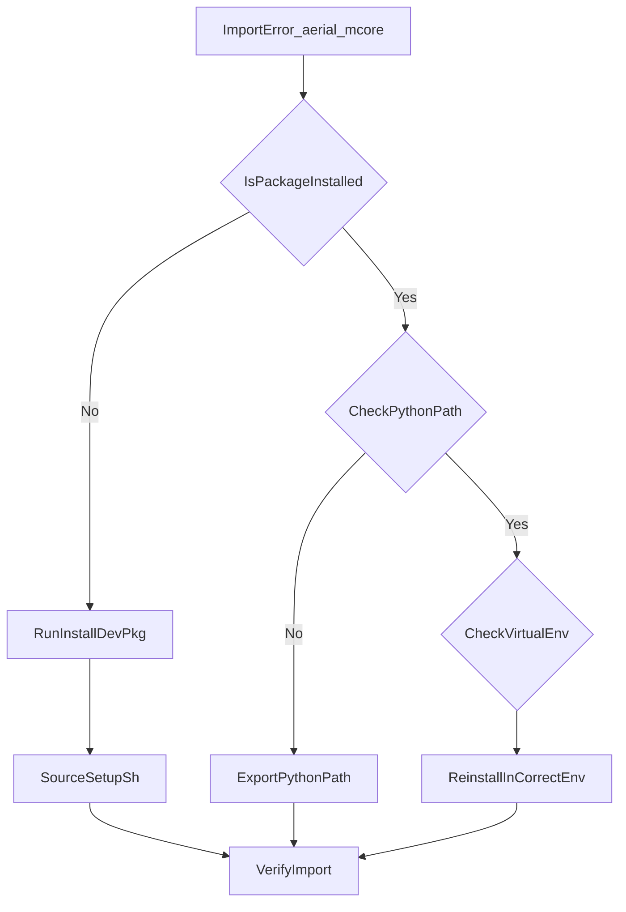
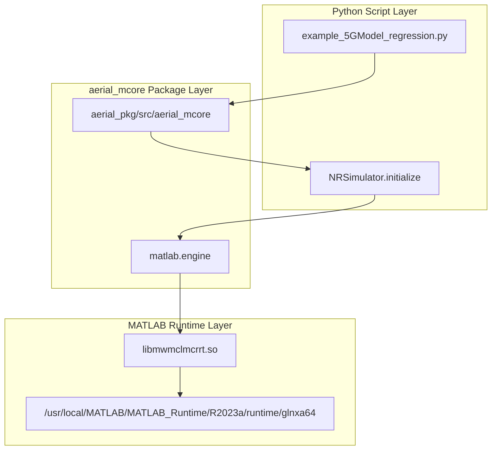
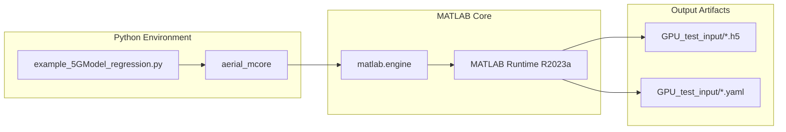

<!-- source: DeepWiki mcp.deepwiki.com · repo NVIDIA/aerial-cuda-accelerated-ran · page 15 Troubleshooting and FAQ · fetched 2026-10-26 -->

# Troubleshooting and FAQ

<details>
<summary>Relevant source files</summary>

The following files were used as context for generating this wiki page:

- [5GModel/AGENTS.md](5GModel/AGENTS.md)
- [5GModel/README.md](5GModel/README.md)
- [5GModel/aerial_mcore/QuickStart.md](5GModel/aerial_mcore/QuickStart.md)

</details>


This wiki page provides comprehensive troubleshooting solutions and frequently asked questions for setting up, building, and running the NVIDIA Aerial CUDA Accelerated RAN codebase, with a specific focus on the `aerial_mcore` package, MATLAB 5GModel simulation core, and cuPHY/cuBB test vector integration.

---

## Purpose and Scope

The scope of this page covers common failure modes across environment initialization, python package installation, MATLAB runtime binding, test vector generation, and downstream cuPHY pipeline dependencies. It is intended for developers and engineers debugging build issues or test execution errors within the Aerial container environment.

Sources: [5GModel/AGENTS.md:1-15](), [5GModel/aerial_mcore/QuickStart.md:1-5]()

---

## Environment Configuration Issues

### MATLAB Runtime Not Found

**Symptom**: Error messages like `libmwmclmcrrt.so.9.14: cannot open shared object file` or MATLAB engine initialization failures during `aerial_mcore` execution.

**Cause**: The MATLAB Runtime R2023a is not installed or `LD_LIBRARY_PATH` is not correctly configured in the active shell environment.

**Solution**:
1. Verify MATLAB Runtime R2023a is installed at `/usr/local/MATLAB/MATLAB_Runtime/R2023a/`.
2. Source the setup script to configure environment variables [5GModel/aerial_mcore/QuickStart.md:18-18]():

```bash
cd 5GModel/aerial_mcore
source scripts/setup.sh
```

The setup script configures `LD_LIBRARY_PATH` to include MATLAB runtime libraries [5GModel/aerial_mcore/scripts/setup.sh:23-23]():

```bash
export LD_LIBRARY_PATH=$LD_LIBRARY_PATH:/usr/local/MATLAB/MATLAB_Runtime/R2023a/runtime/glnxa64:/usr/local/MATLAB/MATLAB_Runtime/R2023a/bin/glnxa64:/usr/local/MATLAB/MATLAB_Runtime/R2023a/sys/os/glnxa64:/usr/local/MATLAB/MATLAB_Runtime/R2023a/extern/bin/glnxa64:/usr/local/MATLAB/MATLAB_Runtime/R2023a/sys/opengl/lib/glnxa64
```

Sources: [5GModel/aerial_mcore/scripts/setup.sh:20-25](), [5GModel/aerial_mcore/QuickStart.md:15-18]()

---

### Environment Variables Not Set

**Symptom**: Scripts fail with usage messages or unexpected behavior during test vector generation.

**Cause**: Required environment variables like `REGRESSION_MODE` are not set prior to invocation [5GModel/aerial_mcore/QuickStart.md:19-19]().

| Environment Variable | Purpose | Valid Values | Default |
|---------------------|---------|--------------|---------|
| `REGRESSION_MODE` | Controls test generation mode | `0` (MR), `1` (Nightly), `2` (Compact) | None (Required) |
| `AERIAL_PYTHON` | Indicates aerial_mcore environment | `1` | Set by setup.sh |
| `MCORE_BUILD_TYPE` | Build configuration | `dev`, `release` | `dev` |

Sources: [5GModel/aerial_mcore/QuickStart.md:18-20](), [5GModel/aerial_mcore/scripts/setup.sh:20-25]()

---

## Installation Problems

### pip Install Fails with Missing Dependencies

**Symptom**: Installation fails with errors about missing Python packages or build tools.

**Cause**: Python environment lacks required dependencies like `setuptools`, `wheel`, or Python version is incompatible.

**Solution**:
1. Verify Python version (requires Python 3.8+).
2. Install/upgrade build dependencies: `pip3 install --upgrade pip setuptools wheel`.
3. Install the package using the provided development script `install_dev_pkg.sh` [5GModel/aerial_mcore/scripts/install_dev_pkg.sh:29-29]().

Sources: [5GModel/aerial_mcore/scripts/install_dev_pkg.sh:18-32]()

---

### Wheel File Not Found

**Symptom**: Error during installation indicating `aerial_mcore-*.whl` file does not exist.

**Cause**: Package has not been built yet.

**Solution**: Build the package before installation. Inside the development container, the wheel is located in `${cuBB_SDK}/5GModel/aerial_mcore/aerial_pkg/dist/` [5GModel/aerial_mcore/QuickStart.md:12-12]().

```bash
sudo -H pip install ${cuBB_SDK}/5GModel/aerial_mcore/aerial_pkg/dist/aerial_mcore-*.whl
```

Sources: [5GModel/aerial_mcore/QuickStart.md:9-13]()

---

### Import Error: No module named 'aerial_mcore'

**Symptom**: Python scripts fail with `ModuleNotFoundError: No module named 'aerial_mcore'`.

**Cause**: Package not installed or installation path not in `PYTHONPATH`.

Title: "Import Error Diagnostic Workflow"


Sources: [5GModel/aerial_mcore/scripts/install_dev_pkg.sh:29-29]()

---

## Test Vector Generation & cuPHY Dependency Failures

### GPU_test_input Directory Empty or Missing

**Symptom**: After running regression script, `GPU_test_input/` directory is empty or missing expected `.h5` and `.yaml` files, causing cuPHY unit tests or testBenches to skip/fail [5GModel/AGENTS.md:28-30]().

**Cause**: Script failed before generating outputs, or `REGRESSION_MODE` was omitted [5GModel/aerial_mcore/QuickStart.md:19-19]().

**Solution**:
1. Ensure working directory is correct:
   `cd ${cuBB_SDK}/5GModel/aerial_mcore/examples` [5GModel/aerial_mcore/QuickStart.md:17-17]()
2. Export regression mode:
   `export REGRESSION_MODE=1` [5GModel/aerial_mcore/QuickStart.md:19-19]()
3. Run the regression script:
   `python3 ./example_5GModel_regression.py allChannels` [5GModel/aerial_mcore/QuickStart.md:20-20]()

Sources: [5GModel/AGENTS.md:28-30](), [5GModel/aerial_mcore/QuickStart.md:15-22]()

---

## Runtime Errors and MATLAB Integration

### MATLAB Engine Initialization Failure

**Symptom**: Error when calling `NRSimulator.initialize()` or MATLAB functions fail to execute due to shared library loading issues.

Title: "MATLAB Engine and Runtime Integration Code Entity Map"


Sources: [5GModel/aerial_mcore/scripts/setup.sh:23-23]()

---

## Frequently Asked Questions

### Q: How do I verify my installation is working correctly?

**A**: Run the quickstart verification sequence:

```bash
source 5GModel/aerial_mcore/scripts/setup.sh
export REGRESSION_MODE=1
cd 5GModel/aerial_mcore/examples
python3 ./example_5GModel_regression.py allChannels
ls -alF GPU_test_input/
```

Successful execution produces `.h5` and `.yaml` test vector files (e.g., `template_UL_PUSCH_gNB_CUPHY_s0p0.h5`) [5GModel/aerial_mcore/QuickStart.md:55-68]().

Sources: [5GModel/aerial_mcore/QuickStart.md:15-68]()

---

### Q: What is the relationship between aerial_mcore and the 5G Model?

**A**: 
Title: "Aerial MCore and MATLAB Integration Architecture"


**aerial_mcore** provides Python API bindings to the Aerial 5GModel [5GModel/aerial_mcore/QuickStart.md:1-1](), leveraging the MATLAB Engine to generate 3GPP-compliant test vectors for cuPHY validation [5GModel/AGENTS.md:8-10]().

Sources: [5GModel/AGENTS.md:5-10](), [5GModel/aerial_mcore/QuickStart.md:1-3]()

---

## Quick Diagnostic Reference

| File Path | Purpose |
|-----------|---------|
| `/usr/local/MATLAB/MATLAB_Runtime/R2023a/` | MATLAB Runtime installation directory |
| `5GModel/aerial_mcore/scripts/setup.sh` | Environment configuration script |
| `5GModel/aerial_mcore/scripts/install_dev_pkg.sh` | Developer installation script |
| `5GModel/aerial_mcore/examples/GPU_test_input/` | Generated test vector output directory |
| `nr_matlab/runRegression.m` | MATLAB regression entry point |

Sources: [5GModel/AGENTS.md:39-39](), [5GModel/aerial_mcore/QuickStart.md:21-21](), [5GModel/aerial_mcore/scripts/install_dev_pkg.sh:29-29](), [5GModel/aerial_mcore/scripts/setup.sh:23-23]()

---

