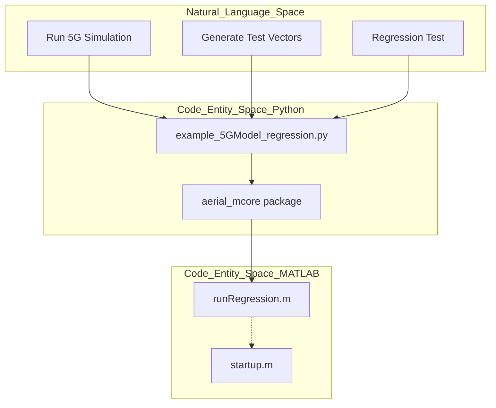
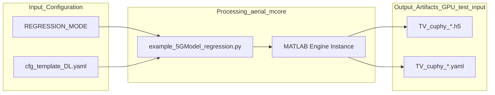

<!-- source: DeepWiki mcp.deepwiki.com · repo NVIDIA/aerial-cuda-accelerated-ran · page 16 Glossary · fetched 2026-10-26 -->

# Glossary

Relevant source files

The following files were used as context for generating this wiki page:

- [.dockerignore](.dockerignore)
- [5GModel/AGENTS.md](5GModel/AGENTS.md)
- [5GModel/aerial_mcore/QuickStart.md](5GModel/aerial_mcore/QuickStart.md)

This page provides definitions for codebase-specific terms, jargon, abbreviations, and domain concepts used throughout the NVIDIA Aerial CUDA Accelerated RAN repository. It serves as a technical reference for onboarding engineers to understand the mapping between 5G NR standards and the specific software implementations in this repository.

## 5G NR and Physical Layer Terms

| Term | Definition | Code Pointer |
|:---|:---|:---|
| **BWP** | Bandwidth Part. A subset of contiguous common resource blocks on a given carrier. | [5GModel/aerial_mcore/QuickStart.md:35-68]() |
| **CDL / TDL** | Clustered Delay Line / Tapped Delay Line. Standardized 3GPP channel models used for link-level simulations. | [5GModel/aerial_mcore/QuickStart.md:35-68]() |
| **CSI-RS** | Channel State Information Reference Signal. Used by the UE to estimate the channel and report channel quality. | [5GModel/aerial_mcore/QuickStart.md:35-37]() |
| **DMRS** | Demodulation Reference Signal. Specific reference signals used for channel estimation for coherent demodulation. | [5GModel/aerial_mcore/QuickStart.md:59-62]() |
| **LDPC** | Low-Density Parity-Check. The channel coding scheme used for 5G NR data channels (PDSCH/PUSCH). | [5GModel/AGENTS.md:1-42]() |
| **PDCCH** | Physical Downlink Control Channel. Carries Downlink Control Information (DCI). | [5GModel/aerial_mcore/QuickStart.md:35-37]() |
| **PDSCH** | Physical Downlink Shared Channel. The main data-bearing downlink channel. | [5GModel/aerial_mcore/QuickStart.md:35-37]() |
| **PRACH** | Physical Random Access Channel. Used by the UE for initial access and synchronization. | [5GModel/aerial_mcore/QuickStart.md:44-49]() |
| **PUCCH** | Physical Uplink Control Channel. Carries Uplink Control Information (UCI) such as HARQ-ACK and CSI. | [5GModel/aerial_mcore/QuickStart.md:44-50]() |
| **PUSCH** | Physical Uplink Shared Channel. The main data-bearing uplink channel. | [5GModel/aerial_mcore/QuickStart.md:44-48]() |
| **SRS** | Sounding Reference Signal. Transmitted by the UE to allow the gNB to estimate the uplink channel state. | [5GModel/aerial_mcore/QuickStart.md:44-47]() |
| **SSB** | Synchronization Signal Block. Contains PSS, SSS, and PBCH; used for cell search and synchronization. | [5GModel/aerial_mcore/QuickStart.md:35-37]() |

Sources: [5GModel/AGENTS.md:1-42](), [5GModel/aerial_mcore/QuickStart.md:35-68]()

## NVIDIA Aerial SDK Components

### cuPHY
The CUDA-accelerated Physical Layer library. It provides high-performance implementations of 5G NR signal processing blocks (FFT, channel estimation, equalization, LDPC decoding) optimized for NVIDIA GPUs.
*   **Implementation**: C++/CUDA.
*   **Key Files**: Located under `cuPHY/` directory. [.dockerignore:16-16]()

### cuPHY-CP (Control Plane)
The control plane for cuPHY, responsible for managing the lifecycle of the PHY, processing L2 commands (FAPI), and orchestrating GPU tasks.
*   **Key Directory**: `cuPHY-CP/` [.dockerignore:17-17]()
*   **Associated Components**: Includes `cuphycontroller`, `testMAC`, and SCF L2 adapters.

### cuMAC / cuMAC-CP
The CUDA-accelerated MAC layer scheduler and its corresponding control plane.
*   **Directories**: `cuMAC/` and `cuMAC-CP/` [.dockerignore:14-15]()

### aerial_mcore
A Python package that provides bindings to the MATLAB-based 5G reference model. It allows developers to generate golden test vectors and run simulations directly from Python.
*   **Initialization**: `NRSimulator.initialize()` [5GModel/AGENTS.md:21-25]()
*   **Package Definition**: `setup.py` / `pyproject.toml` [5GModel/AGENTS.md:36-37]()
*   **Distribution**: Provided as a `.whl` wheel file. [5GModel/aerial_mcore/QuickStart.md:9-13]()

### pyaerial
Python bindings for the Aerial SDK, specifically designed for Machine Learning (ML) research. It allows calling cuPHY CUDA kernels directly from Python/PyTorch.
*   **Key Components**: Neural receivers, channel estimation models (`.onnx`, `.engine`).
*   **Directory**: `pyaerial/` [.dockerignore:18-18]()

Sources: [.dockerignore:14-18](), [5GModel/AGENTS.md:21-37](), [5GModel/aerial_mcore/QuickStart.md:9-13]()

## Software and Infrastructure Terms

### Test Vector (TV)
A set of input data and expected output data used to validate the correctness of a physical layer implementation.
*   **Format**: Typically `.h5` (HDF5) for signal data and `.yaml` for metadata/configuration. [5GModel/aerial_mcore/QuickStart.md:59-62]()
*   **Storage**: Generated into the `GPU_test_input/` directory. [5GModel/AGENTS.md:9-10]()

### Regression Mode
A configuration setting that determines the scope of test vector generation or simulation via the `REGRESSION_MODE` environment variable. [5GModel/aerial_mcore/QuickStart.md:18-20]()
*   **Nightly Mode (1)**: Full regression suite executed via Python examples. [5GModel/aerial_mcore/QuickStart.md:19-20]()

### BUILD_ID
An environment variable used by the build system to version the `aerial_mcore` Python wheel. It is mandatory for the setup process.
*   **Usage**: Appended to the package version string during wheel installation. [5GModel/aerial_mcore/QuickStart.md:9-13]()

### Git LFS (Large File Storage)
Used to manage large binary assets in the repository, such as compiled MATLAB files (`.ctf`), machine learning models (`.onnx`, `.engine`), and large test datasets.
*   **Tracking**: Defined via `.gitattributes`. [.dockerignore:6-6]()

Sources: [.dockerignore:6-6](), [5GModel/AGENTS.md:9-10](), [5GModel/aerial_mcore/QuickStart.md:9-20]()

## Architectural Diagrams

### Mapping Natural Language to Code Entities: Simulation Workflow

This diagram bridges the conceptual "Run Simulation" task to the specific Python and MATLAB entities involved.

Sources: [5GModel/AGENTS.md:18-25](), [5GModel/aerial_mcore/QuickStart.md:15-22]()

### Data Flow: Test Vector Generation

This diagram illustrates how configuration parameters flow through the system to produce physical test artifacts in the `GPU_test_input` directory.

Sources: [5GModel/AGENTS.md:9-10](), [5GModel/aerial_mcore/QuickStart.md:15-68]()