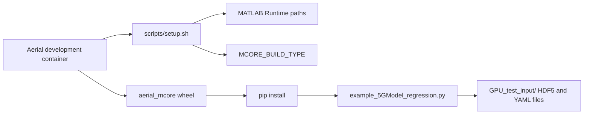
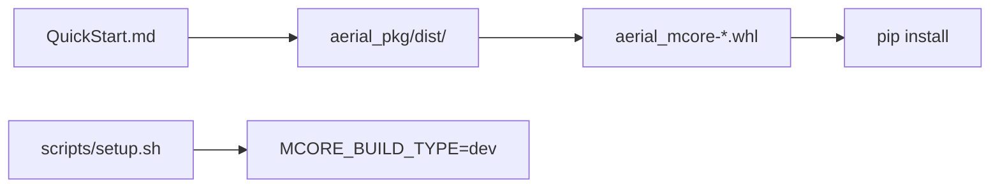
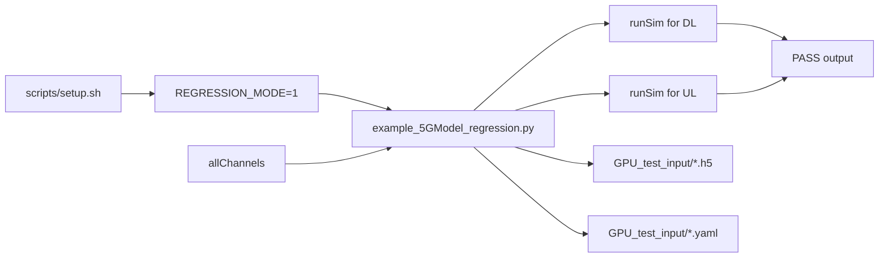

<!-- source: DeepWiki mcp.deepwiki.com · repo NVIDIA/aerial-cuda-accelerated-ran · page 2 Getting Started · fetched 2026-10-26 -->

# Getting Started

Relevant source files

The following files were used as context for generating this wiki page:

- [5GModel/aerial_mcore/QuickStart.md](5GModel/aerial_mcore/QuickStart.md)
- [5GModel/aerial_mcore/scripts/setup.sh](5GModel/aerial_mcore/scripts/setup.sh)

This page introduces the initial setup, installation, and first example workflow for `aerial_mcore`. It stays at a high level; use the child pages for detailed instructions.

- For runtime, Python, CUDA, and dependency requirements, see [Environment Setup](#2.1).
- For development and release installation and component builds, see [Installation](#2.2).
- For generating test vectors and running examples, see [Quick Start Tutorial](#2.3).

Sources: [5GModel/aerial_mcore/QuickStart.md:1-20]()

---

## Overview

The getting started workflow connects environment configuration, package installation, and simulation. The quick-start example is run inside the Aerial development container, installs a built `aerial_mcore` wheel, sources the package setup script, then runs a regression example that produces files in `GPU_test_input/`.[5GModel/aerial_mcore/QuickStart.md:9-22]() The setup script adds MATLAB Runtime library paths and sets `MCORE_BUILD_TYPE` to `dev`.[5GModel/aerial_mcore/scripts/setup.sh:18-25]()

**Workflow from setup to generated test vectors**

Sources: [5GModel/aerial_mcore/QuickStart.md:9-22](), [5GModel/aerial_mcore/scripts/setup.sh:18-25]()

For component-specific setup and build details, see [Environment Setup](#2.1) and [Installation](#2.2).

Sources: [5GModel/aerial_mcore/QuickStart.md:9-20](), [5GModel/aerial_mcore/scripts/setup.sh:18-25]()

---

## Environment Setup

The supplied `setup.sh` is intended to be sourced. It sets `AERIAL_PYTHON` on initial setup, appends MATLAB Runtime R2026a library directories to `LD_LIBRARY_PATH`, and exports `MCORE_BUILD_TYPE=dev`.[5GModel/aerial_mcore/scripts/setup.sh:18-25]() The quick-start instructions source this script from the `aerial_mcore/examples` directory before running the regression example.[5GModel/aerial_mcore/QuickStart.md:15-20]()

For CUDA requirements, Python environment details, and dependencies beyond these script settings, see [Environment Setup](#2.1).

Sources: [5GModel/aerial_mcore/scripts/setup.sh:18-25](), [5GModel/aerial_mcore/QuickStart.md:15-20]()

---

## Installation

The documented quick-start path installs a prebuilt `aerial_mcore` wheel from the package distribution directory using `pip`.[5GModel/aerial_mcore/QuickStart.md:9-13]() The setup script also sets `MCORE_BUILD_TYPE` to `dev`; consult [Installation](#2.2) for the development and release installation paths and for instructions covering cuPHY, cuMAC, and pyaerial builds.

**Installation path and code entities**

Sources: [5GModel/aerial_mcore/QuickStart.md:9-13](), [5GModel/aerial_mcore/scripts/setup.sh:25-25]()

---

## Quick Start Tutorial

The quick-start example sources the setup script, sets `REGRESSION_MODE=1`, and runs `example_5GModel_regression.py` with the `allChannels` argument.[5GModel/aerial_mcore/QuickStart.md:15-22]() Its sample output shows downlink and uplink runs reporting `PASS`, with HDF5 and YAML artifacts listed under `GPU_test_input/`.[5GModel/aerial_mcore/QuickStart.md:24-67]()

For step-by-step instructions and guidance on running basic examples, see [Quick Start Tutorial](#2.3).

**Example workflow: command and artifact entities**

Sources: [5GModel/aerial_mcore/QuickStart.md:15-22](), [5GModel/aerial_mcore/QuickStart.md:31-67]()

---

## Summary of Key Environment Variables

| Variable | Role in the documented workflow |
|---|---|
| `AERIAL_PYTHON` | Set by `setup.sh` when it has not already been set.[5GModel/aerial_mcore/scripts/setup.sh:20-22]() |
| `LD_LIBRARY_PATH` | Extended with MATLAB Runtime R2026a library directories by `setup.sh`.[5GModel/aerial_mcore/scripts/setup.sh:23-23]() |
| `MCORE_BUILD_TYPE` | Exported as `dev` by `setup.sh`.[5GModel/aerial_mcore/scripts/setup.sh:25-25]() |
| `REGRESSION_MODE` | Set to `1` in the documented test-vector example workflow.[5GModel/aerial_mcore/QuickStart.md:17-20]() |

Sources: [5GModel/aerial_mcore/scripts/setup.sh:20-25](), [5GModel/aerial_mcore/QuickStart.md:15-20]()

---

