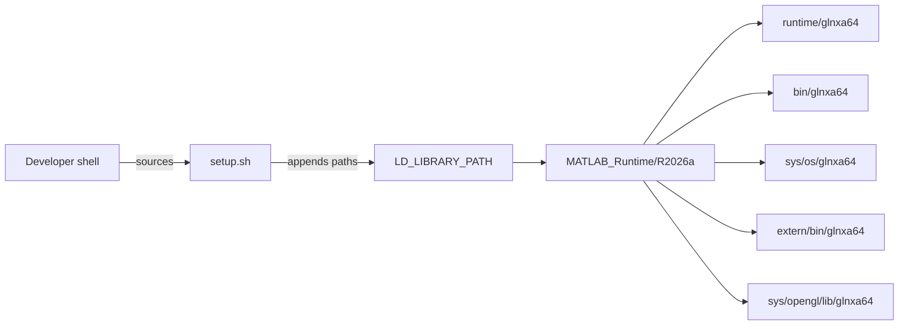
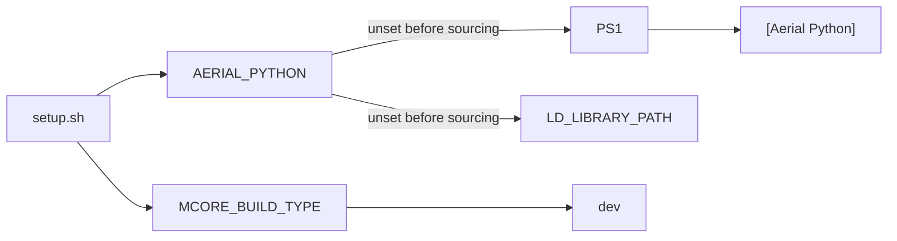

<!-- source: DeepWiki mcp.deepwiki.com · repo NVIDIA/aerial-cuda-accelerated-ran · page 2.1 Environment Setup · fetched 2026-10-26 -->

# Environment Setup

Relevant source files

The following files were used as context for generating this wiki page:

- [5GModel/aerial_mcore/scripts/setup.sh](5GModel/aerial_mcore/scripts/setup.sh)
- [5GModel/get_uuid.sh](5GModel/get_uuid.sh)

## Purpose and scope

This page documents the environment configuration established by the supplied `aerial_mcore` setup script and the repository UUID script. The available setup script configures MATLAB Runtime library lookup and development-mode environment variables. The supplied files do not specify Python or CUDA versions, installation steps, or dependency-installation procedures; those requirements are therefore not inferred here. [5GModel/aerial_mcore/scripts/setup.sh:18-25](); [5GModel/get_uuid.sh:19-38]()

Sources: [5GModel/aerial_mcore/scripts/setup.sh:18-25](); [5GModel/get_uuid.sh:19-38]()

## Environment configuration

### Shell setup

`5GModel/aerial_mcore/scripts/setup.sh` is intended to be sourced so its environment changes apply to the current shell. On its first invocation in a shell where `AERIAL_PYTHON` is unset, it sets `AERIAL_PYTHON=1`, prefixes the prompt with `[Aerial Python]`, and appends MATLAB Runtime library directories to `LD_LIBRARY_PATH`. It sets `MCORE_BUILD_TYPE` to `dev` after the guard, so that assignment occurs whenever the script is sourced. [5GModel/aerial_mcore/scripts/setup.sh:18-25]()

| Setting | Behavior in `setup.sh` |
|---|---|
| `AERIAL_PYTHON` | If unset, set to `1`; this also gates the prompt and library-path updates. [5GModel/aerial_mcore/scripts/setup.sh:20-24]() |
| `PS1` | If `AERIAL_PYTHON` was unset, prefix the prompt with `[Aerial Python]`. [5GModel/aerial_mcore/scripts/setup.sh:20-23]() |
| `LD_LIBRARY_PATH` | If `AERIAL_PYTHON` was unset, append five MATLAB Runtime directories. [5GModel/aerial_mcore/scripts/setup.sh:20-24]() |
| `MCORE_BUILD_TYPE` | Set to `dev` whenever the script is sourced. [5GModel/aerial_mcore/scripts/setup.sh:25]() |

Sources: [5GModel/aerial_mcore/scripts/setup.sh:18-25]()

### MATLAB Runtime library lookup

The script appends these paths under `/usr/local/MATLAB/MATLAB_Runtime/R2026a`: `runtime/glnxa64`, `bin/glnxa64`, `sys/os/glnxa64`, `extern/bin/glnxa64`, and `sys/opengl/lib/glnxa64`. This is the Runtime location and release encoded in the supplied script; the file does not install the Runtime or verify that the directories exist. [5GModel/aerial_mcore/scripts/setup.sh:23]()

| Path appended to `LD_LIBRARY_PATH` |
|---|
| `/usr/local/MATLAB/MATLAB_Runtime/R2026a/runtime/glnxa64` |
| `/usr/local/MATLAB/MATLAB_Runtime/R2026a/bin/glnxa64` |
| `/usr/local/MATLAB/MATLAB_Runtime/R2026a/sys/os/glnxa64` |
| `/usr/local/MATLAB/MATLAB_Runtime/R2026a/extern/bin/glnxa64` |
| `/usr/local/MATLAB/MATLAB_Runtime/R2026a/sys/opengl/lib/glnxa64` |

Sources: [5GModel/aerial_mcore/scripts/setup.sh:23]()

**Diagram: MATLAB Runtime configuration mapped to setup entities**

Sources: [5GModel/aerial_mcore/scripts/setup.sh:18-24]()

## Python environment

The setup script labels the shell prompt `[Aerial Python]`, uses `AERIAL_PYTHON` as a guard for its first-time shell configuration, and selects `MCORE_BUILD_TYPE=dev`. These settings do not establish a Python interpreter version, create a virtual environment, install Python packages, or demonstrate that Python is available. [5GModel/aerial_mcore/scripts/setup.sh:20-25]()

| Concern | What the supplied script establishes |
|---|---|
| Shell marker | `AERIAL_PYTHON=1` when the variable is initially unset. [5GModel/aerial_mcore/scripts/setup.sh:20-21]() |
| Prompt marker | `[Aerial Python]` prefix when the guard condition is met. [5GModel/aerial_mcore/scripts/setup.sh:20-23]() |
| Build mode | `MCORE_BUILD_TYPE=dev`. [5GModel/aerial_mcore/scripts/setup.sh:25]() |
| Interpreter and packages | No Python version or package-install procedure is specified in the supplied script. [5GModel/aerial_mcore/scripts/setup.sh:18-25]() |

Sources: [5GModel/aerial_mcore/scripts/setup.sh:18-25]()

**Diagram: Python-oriented shell settings mapped to code entities**

Sources: [5GModel/aerial_mcore/scripts/setup.sh:20-25]()

## CUDA and subsystem dependencies

The supplied `setup.sh` configures MATLAB Runtime paths and shell variables; it contains no CUDA version, CUDA installation path, driver requirement, or CUDA dependency-installation steps. The supplied `get_uuid.sh` operates on files under `5GModel` to calculate a checksum-derived UUID; it likewise does not describe CUDA setup. CUDA requirements for cuPHY, cuMAC, or other subsystems cannot be established from these files. [5GModel/aerial_mcore/scripts/setup.sh:18-25](); [5GModel/get_uuid.sh:19-38]()

The UUID script changes to `$cuBB_SDK`, filters selected files from the UUID input, sorts the remaining file checksums, and hashes the result. It excludes Markdown files and specified `5GModel` paths, including `aerial_pkg`, `CompilerSDKOutput`, `scripts`, `documents`, and internal directories. This is repository-content identification logic, not environment or CUDA dependency configuration. [5GModel/get_uuid.sh:26-38]()

| Area | Information available from the supplied files |
|---|---|
| MATLAB Runtime | `setup.sh` encodes the `R2026a` Linux library paths. [5GModel/aerial_mcore/scripts/setup.sh:23]() |
| Python | `setup.sh` defines shell markers and `MCORE_BUILD_TYPE=dev`, but no interpreter version or package dependencies. [5GModel/aerial_mcore/scripts/setup.sh:20-25]() |
| CUDA | No CUDA version or installation requirement is specified. [5GModel/aerial_mcore/scripts/setup.sh:18-25]() |
| UUID inputs | `get_uuid.sh` selects and hashes files under `5GModel`; this is not a dependency installer. [5GModel/get_uuid.sh:26-38]() |

Sources: [5GModel/aerial_mcore/scripts/setup.sh:18-25](); [5GModel/get_uuid.sh:26-38]()

**Diagram: repository UUID workflow mapped to script entities**

Sources: [5GModel/get_uuid.sh:21-38]()

---

