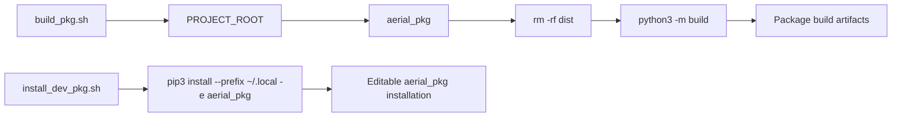
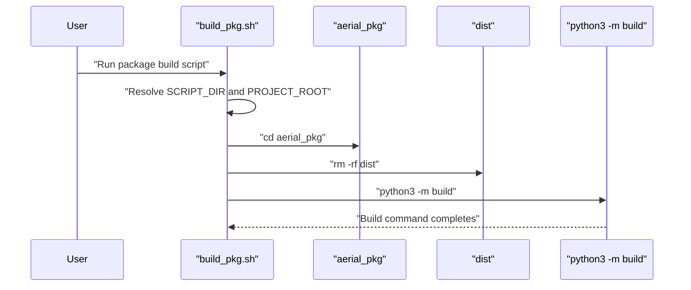
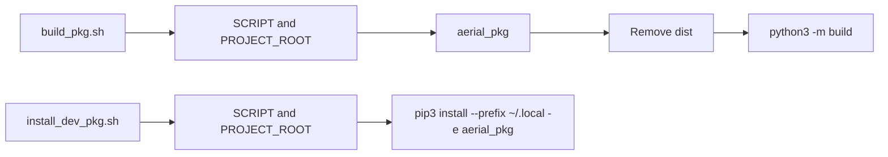

<!-- source: DeepWiki mcp.deepwiki.com · repo NVIDIA/aerial-cuda-accelerated-ran · page 2.2 Installation · fetched 2026-10-26 -->

# Installation

Relevant source files

The following files were used as context for generating this wiki page:

- [5GModel/aerial_mcore/scripts/build_pkg.sh](5GModel/aerial_mcore/scripts/build_pkg.sh)
- [5GModel/aerial_mcore/scripts/install_dev_pkg.sh](5GModel/aerial_mcore/scripts/install_dev_pkg.sh)

## Purpose and scope

This page documents the `aerial_mcore` package build, editable development installation, and the release-installation boundary supported by the available scripts. The supplied installation scripts do not document how to build cuPHY, cuMAC, or pyaerial; those build procedures are therefore not specified here.

Sources: [5GModel/aerial_mcore/scripts/build_pkg.sh:18-35](), [5GModel/aerial_mcore/scripts/install_dev_pkg.sh:18-32]()

## Overview

The package scripts provide two operations: `build_pkg.sh` invokes `python3 -m build` in `aerial_pkg` after removing its existing `dist` directory, while `install_dev_pkg.sh` runs an editable pip install of `aerial_pkg` with `~/.local` as the prefix. Both scripts enable `set -e`, so a failing command stops the script. [5GModel/aerial_mcore/scripts/build_pkg.sh:18-32](), [5GModel/aerial_mcore/scripts/install_dev_pkg.sh:18-30]()

The build script produces package build artifacts through the Python build frontend. The provided files do not specify a release-wheel installation command or describe package metadata, dependencies, or wheel contents. [5GModel/aerial_mcore/scripts/build_pkg.sh:28-32]()

Sources: [5GModel/aerial_mcore/scripts/build_pkg.sh:18-32](), [5GModel/aerial_mcore/scripts/install_dev_pkg.sh:18-30]()

## Installation Architecture

**Diagram: `aerial_mcore` script responsibilities and package flow**

The diagram associates the package build and developer-install operations with their script entities. `build_pkg.sh` resolves and enters `PROJECT_ROOT`, then builds from `aerial_pkg`; `install_dev_pkg.sh` uses the same root-directory setup and invokes pip with editable mode. [5GModel/aerial_mcore/scripts/build_pkg.sh:21-32](), [5GModel/aerial_mcore/scripts/install_dev_pkg.sh:21-30]()

Sources: [5GModel/aerial_mcore/scripts/build_pkg.sh:21-32](), [5GModel/aerial_mcore/scripts/install_dev_pkg.sh:21-30]()

### Package build flow

**Diagram: build script operations mapped to shell commands**

The script determines its location using `readlink -f`, derives `SCRIPT_DIR` and `PROJECT_ROOT`, changes to the project root and then `aerial_pkg`, removes `dist`, and invokes the build frontend. The script uses `set -e`, so command failures stop execution. [5GModel/aerial_mcore/scripts/build_pkg.sh:18-32]()

Sources: [5GModel/aerial_mcore/scripts/build_pkg.sh:18-32]()

## Building the Package

### Build execution

Run `build_pkg.sh` from its repository location. The script calculates the project root from its own path, changes into that root, enters `aerial_pkg`, removes the existing `dist` directory, and runs `python3 -m build`. [5GModel/aerial_mcore/scripts/build_pkg.sh:21-32]()

The script does not define build flags or pass arguments to `python3 -m build`. Its visible behavior is limited to the directory setup, removal of `dist`, and invocation of the build frontend. [5GModel/aerial_mcore/scripts/build_pkg.sh:21-32]()

Sources: [5GModel/aerial_mcore/scripts/build_pkg.sh:21-32]()

### Release artifacts and installation

`build_pkg.sh` runs the Python build frontend from `aerial_pkg` after clearing that directory’s existing `dist` folder. The supplied files do not identify the exact artifact filenames or give a command for installing a built release artifact; use the package’s release instructions for those details. [5GModel/aerial_mcore/scripts/build_pkg.sh:28-32]()

Sources: [5GModel/aerial_mcore/scripts/build_pkg.sh:28-32]()

### cuPHY, cuMAC, and pyaerial builds

The supplied files contain scripts for building and installing `aerial_mcore`, but no cuPHY, cuMAC, or pyaerial build scripts or instructions. This page consequently cannot give verified build steps for those components. [5GModel/aerial_mcore/scripts/build_pkg.sh:28-32](), [5GModel/aerial_mcore/scripts/install_dev_pkg.sh:28-30]()

Sources: [5GModel/aerial_mcore/scripts/build_pkg.sh:28-32](), [5GModel/aerial_mcore/scripts/install_dev_pkg.sh:28-30]()

## Development Installation

`install_dev_pkg.sh` installs `aerial_pkg` in editable mode, using `~/.local` as the installation prefix. The script resolves its own location, derives `PROJECT_ROOT`, changes to that directory, and invokes pip with `-e aerial_pkg`. [5GModel/aerial_mcore/scripts/install_dev_pkg.sh:21-30]()

### Installation command

Run `install_dev_pkg.sh` from its repository location. The pip operation performed by the script is `pip3 install --prefix ~/.local -e aerial_pkg`. [5GModel/aerial_mcore/scripts/install_dev_pkg.sh:21-30]()

### Installation parameters

| Parameter | Meaning in the script |
|---|---|
| `--prefix ~/.local` | Sets the installation prefix passed to pip. [5GModel/aerial_mcore/scripts/install_dev_pkg.sh:28-30]() |
| `-e aerial_pkg` | Requests an editable install of the `aerial_pkg` directory. [5GModel/aerial_mcore/scripts/install_dev_pkg.sh:28-30]() |

The supplied script does not include a package-import verification step or specify Python path configuration. [5GModel/aerial_mcore/scripts/install_dev_pkg.sh:28-32]()

Sources: [5GModel/aerial_mcore/scripts/install_dev_pkg.sh:21-32]()

## Release Installation

The supplied build script invokes `python3 -m build` in `aerial_pkg`, but the supplied files do not include a release installation script or document how to install the resulting artifact. [5GModel/aerial_mcore/scripts/build_pkg.sh:28-32]()

| Operation | Documented behavior |
|---|---|
| Build | `build_pkg.sh` clears `aerial_pkg/dist` and invokes `python3 -m build`. [5GModel/aerial_mcore/scripts/build_pkg.sh:28-32]() |
| Editable development install | `install_dev_pkg.sh` runs pip with `--prefix ~/.local -e aerial_pkg`. [5GModel/aerial_mcore/scripts/install_dev_pkg.sh:28-30]() |
| Release artifact installation | Not specified by the supplied files. |

Sources: [5GModel/aerial_mcore/scripts/build_pkg.sh:28-32](), [5GModel/aerial_mcore/scripts/install_dev_pkg.sh:28-30]()

## Installation Verification

Neither supplied script runs an import test, checks the installed package location, or initializes MATLAB. The available scripts therefore do not define a post-install verification procedure. [5GModel/aerial_mcore/scripts/build_pkg.sh:28-35](), [5GModel/aerial_mcore/scripts/install_dev_pkg.sh:28-32]()

Sources: [5GModel/aerial_mcore/scripts/build_pkg.sh:28-35](), [5GModel/aerial_mcore/scripts/install_dev_pkg.sh:28-32]()

## Troubleshooting

Both scripts enable `set -e`, which causes the script to exit when a command fails. The supplied files do not provide error-specific diagnostics or recovery instructions. [5GModel/aerial_mcore/scripts/build_pkg.sh:18-19](), [5GModel/aerial_mcore/scripts/install_dev_pkg.sh:18-19]()

Sources: [5GModel/aerial_mcore/scripts/build_pkg.sh:18-19](), [5GModel/aerial_mcore/scripts/install_dev_pkg.sh:18-19]()

## Build System Integration

**Diagram: build and editable-install entry points**

`build_pkg.sh` is the build entry point and `install_dev_pkg.sh` is the editable-install entry point. Both derive the project root from their script paths; only the build script clears `dist` and invokes `python3 -m build`. [5GModel/aerial_mcore/scripts/build_pkg.sh:21-32](), [5GModel/aerial_mcore/scripts/install_dev_pkg.sh:21-30]()

Sources: [5GModel/aerial_mcore/scripts/build_pkg.sh:21-32](), [5GModel/aerial_mcore/scripts/install_dev_pkg.sh:21-30]()

---

