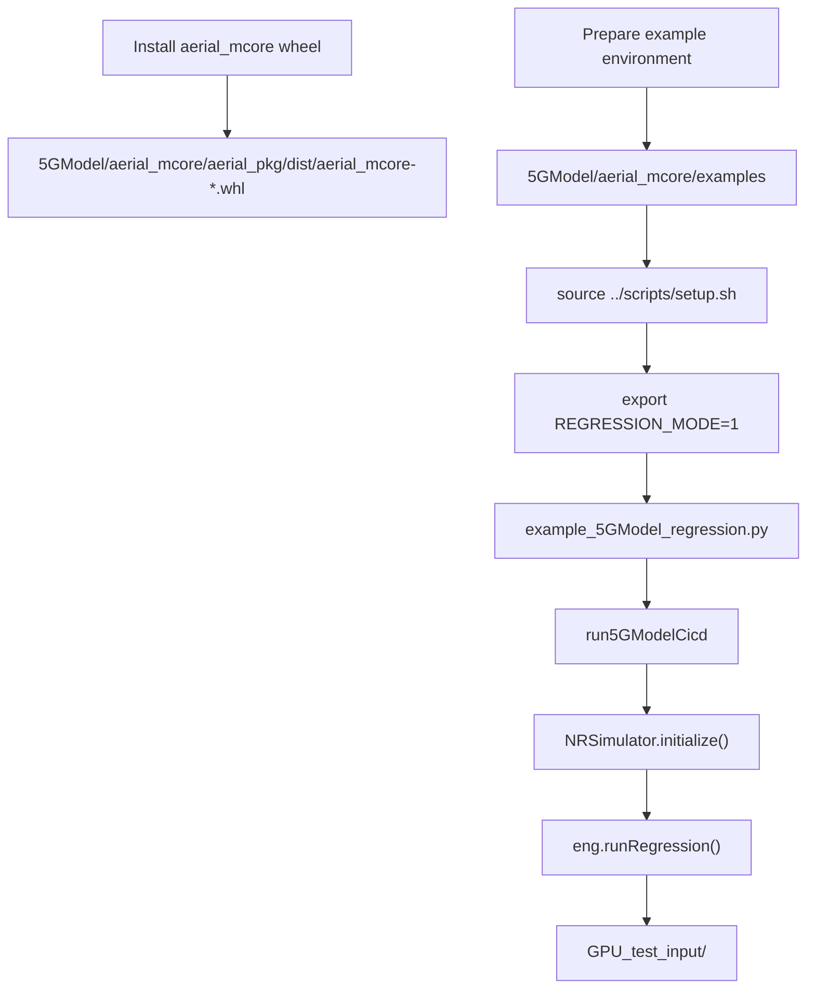
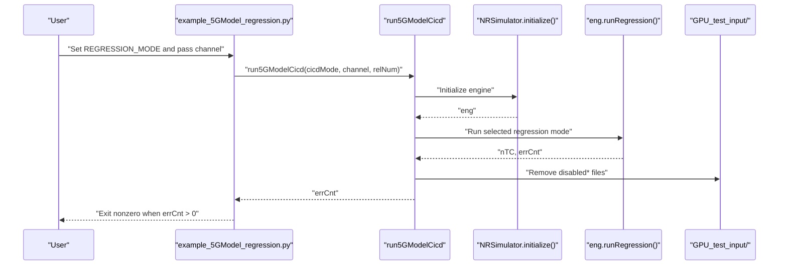

<!-- source: DeepWiki mcp.deepwiki.com · repo NVIDIA/aerial-cuda-accelerated-ran · page 2.3 Quick Start Tutorial · fetched 2026-10-26 -->

# Quick Start Tutorial

<details>
<summary>Relevant source files</summary>

The following files were used as context for generating this wiki page:

- [5GModel/aerial_mcore/QuickStart.md](5GModel/aerial_mcore/QuickStart.md)
- [5GModel/aerial_mcore/examples/example_5GModel_regression.py](5GModel/aerial_mcore/examples/example_5GModel_regression.py)

</details>


## Purpose and Scope

This section shows how to generate initial Aerial test-vector (TV) files using `aerial_mcore` and the 5GModel regression example. It covers installing the package wheel, preparing the example environment, selecting a regression mode, and locating generated files. The supplied quick-start instructions run inside the Aerial development container. [5GModel/aerial_mcore/QuickStart.md:1-22]()

Sources: [5GModel/aerial_mcore/QuickStart.md:1-22]()

## Quick Start Workflow

The workflow starts by installing the built `aerial_mcore` wheel. From the examples directory, source the package’s setup script, set `REGRESSION_MODE`, and run `example_5GModel_regression.py` with a channel argument. The documented example uses `allChannels`; the regression script initializes the simulator and calls MATLAB’s `runRegression` through the returned engine. [5GModel/aerial_mcore/QuickStart.md:9-22]()[5GModel/aerial_mcore/examples/example_5GModel_regression.py:16-17]()[5GModel/aerial_mcore/examples/example_5GModel_regression.py:22-66]()

### Natural-language workflow mapped to code entities

**Diagram: Quick-start steps and their code entities**



Sources: [5GModel/aerial_mcore/QuickStart.md:9-22]()[5GModel/aerial_mcore/examples/example_5GModel_regression.py:16-17]()[5GModel/aerial_mcore/examples/example_5GModel_regression.py:22-66]()

### Run the documented example

Use the following commands inside the Aerial development container. The wheel installation command uses the wheel under `${cuBB_SDK}/5GModel/aerial_mcore/aerial_pkg/dist/`; the example commands run from `${cuBB_SDK}/5GModel/aerial_mcore/examples`. [5GModel/aerial_mcore/QuickStart.md:9-22]()

```bash
sudo -H pip install ${cuBB_SDK}/5GModel/aerial_mcore/aerial_pkg/dist/aerial_mcore-*.whl

cd ${cuBB_SDK}/5GModel/aerial_mcore/examples
source ../scripts/setup.sh
export REGRESSION_MODE=1
python3 ./example_5GModel_regression.py allChannels
ls -alF GPU_test_input/
```

Sources: [5GModel/aerial_mcore/QuickStart.md:9-22]()

## Regression Modes and Execution Flow

`example_5GModel_regression.py` reads `REGRESSION_MODE` and accepts values from 0 through 2. Its `run5GModelCicd` function initializes the simulator with `NRSimulator.initialize()`, then selects a `runRegression` invocation according to the mode: mode 0 runs compact `allTests`, mode 1 runs full `allTests`, and mode 2 runs compact `TestVector`. The script removes `GPU_test_input/disabled*` after each regression invocation and returns the regression error count; the command-line entry point exits with status 1 if that count is greater than zero. [5GModel/aerial_mcore/examples/example_5GModel_regression.py:22-66]()[5GModel/aerial_mcore/examples/example_5GModel_regression.py:86-103]()

The quick-start example sets mode 1 and passes `allChannels`. The example script’s usage text describes `REGRESSION_MODE` values as MR subset, nightly full regression, and nightly test-vector generation, respectively. If `RELEASE_NUMBER` is unset, the script defaults to `10000`; its usage text also identifies `2240` as Rel-22.4. [5GModel/aerial_mcore/QuickStart.md:15-22]()[5GModel/aerial_mcore/examples/example_5GModel_regression.py:68-83]()[5GModel/aerial_mcore/examples/example_5GModel_regression.py:86-101]()

**Diagram: Python entry point to MATLAB regression and test-vector output**



Sources: [5GModel/aerial_mcore/examples/example_5GModel_regression.py:22-66]()[5GModel/aerial_mcore/examples/example_5GModel_regression.py:86-103]()

Sources: [5GModel/aerial_mcore/examples/example_5GModel_regression.py:22-66]()[5GModel/aerial_mcore/examples/example_5GModel_regression.py:86-103]()

## Expected Results and Output Files

The documented example reports separate downlink and uplink `runSim` checks. The sample output shows downlink allocation for SSB, PDCCH, PDSCH, and CSI-RS, followed by uplink allocation for PRACH, PUCCH, PUSCH, and SRS. It reports `PUSCH TB detected`, `PRACH detected`, and `PUCCH UCI detected`, with `PASS` results in the displayed checks. [5GModel/aerial_mcore/QuickStart.md:31-51]()

Generated files are listed in `GPU_test_input/`. The sample directory listing includes paired `TV_cuphy_*.h5` and `TV_cuphy_*.yaml` files, as well as `template_UL_*.h5` files such as `template_UL_PUCCH_F0_gNB_CUPHY_s0p1.h5`, `template_UL_PUSCH_gNB_CUPHY_s0p0.h5`, and `template_UL_SRS_gNB_CUPHY_s0p0.h5`. The listing also includes `template_UL_gNB_FAPI_s0.h5`. [5GModel/aerial_mcore/QuickStart.md:21-22]()[5GModel/aerial_mcore/QuickStart.md:55-67]()

| Sample artifact | Example shown in the quick-start listing |
|---|---|
| Test-vector HDF5 file | `TV_cuphy_F01-DS-01_slot0_MIMO4x4_PRB106_DataSyms11_qam256.h5` |
| Test-vector YAML file | `TV_cuphy_F01-DS-01_slot0_MIMO4x4_PRB106_DataSyms11_qam256.yaml` |
| Uplink PUSCH template | `template_UL_PUSCH_gNB_CUPHY_s0p0.h5` |
| Uplink FAPI template | `template_UL_gNB_FAPI_s0.h5` |

The examples above are names present in the supplied directory listing; this page does not infer additional file-format semantics from the extensions or names. [5GModel/aerial_mcore/QuickStart.md:55-67]()

Sources: [5GModel/aerial_mcore/QuickStart.md:21-22]()[5GModel/aerial_mcore/QuickStart.md:31-51]()[5GModel/aerial_mcore/QuickStart.md:55-67]()

## Quick-start Reference

| Setting or command | Effect documented by the code or quick-start |
|---|---|
| `REGRESSION_MODE=0` | Selects compact `allTests` regression in `run5GModelCicd`. |
| `REGRESSION_MODE=1` | Selects full `allTests` regression; this is the mode used in the quick-start command. |
| `REGRESSION_MODE=2` | Selects compact `TestVector` regression. |
| `RELEASE_NUMBER` unset | The script defaults to release number `10000`. |
| `python3 ./example_5GModel_regression.py allChannels` | Runs the documented example with `allChannels` as the channel argument. |
| `GPU_test_input/` | Directory inspected after generation in the quick-start instructions. |

Mode selection and the release-number default are implemented in the regression example; the example command and output-directory inspection are shown in the quick-start guide. [5GModel/aerial_mcore/examples/example_5GModel_regression.py:40-65]()[5GModel/aerial_mcore/examples/example_5GModel_regression.py:86-101]()[5GModel/aerial_mcore/QuickStart.md:15-22]()

Sources: [5GModel/aerial_mcore/QuickStart.md:15-22]()[5GModel/aerial_mcore/examples/example_5GModel_regression.py:40-65]()[5GModel/aerial_mcore/examples/example_5GModel_regression.py:86-101]()

---

