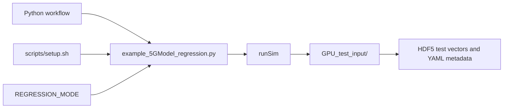
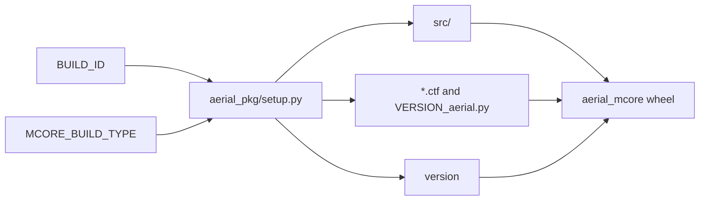

<!-- source: DeepWiki mcp.deepwiki.com · repo NVIDIA/aerial-cuda-accelerated-ran · page 3 aerial_mcore Package · fetched 2026-10-26 -->

# aerial_mcore Package

Relevant source files

The following files were used as context for generating this wiki page:

- [5GModel/aerial_mcore/QuickStart.md](5GModel/aerial_mcore/QuickStart.md)
- [5GModel/aerial_mcore/aerial_pkg/setup.py](5GModel/aerial_mcore/aerial_pkg/setup.py)

## Purpose and Scope

`aerial_mcore` provides Python bindings to the Aerial 5GModel and supports generating Aerial test-vector files through its Python API. This parent page summarizes the package’s role, build and distribution, API workflows, and MATLAB integration; follow the child pages for implementation detail. [5GModel/aerial_mcore/QuickStart.md:1-3]()

- For package organization, build configuration, versioning, and wheel distribution, see [Package Structure and Build](#3.1).
- For the Python API and returned data structures, see [Python API Reference](#3.2).
- For MATLAB integration details, see [MATLAB Integration](#3.3).

Sources: [5GModel/aerial_mcore/QuickStart.md:1-3]()

## Package Overview

The package is distributed as `aerial_mcore`; its setup configuration identifies it as “Aerial 5GModel Python bindings,” packages modules from `src`, and includes `.ctf` and `VERSION_aerial.py` package data. The configured minimum Python version is 3.8. [5GModel/aerial_mcore/aerial_pkg/setup.py:33-43]()

A documented workflow installs a wheel, sets up the example environment, runs `example_5GModel_regression.py allChannels`, and checks the resulting `GPU_test_input/` directory. The example output includes HDF5 test vectors and YAML metadata. [5GModel/aerial_mcore/QuickStart.md:9-22] [5GModel/aerial_mcore/QuickStart.md:55-67]()

Sources: [5GModel/aerial_mcore/aerial_pkg/setup.py:33-43](), [5GModel/aerial_mcore/QuickStart.md:9-22](), [5GModel/aerial_mcore/QuickStart.md:55-67]()

## Package Architecture

At a high level, the package connects Python-based workflows to the Aerial 5GModel. The quickstart demonstrates a regression example that exercises configured downlink and uplink simulations and produces test-vector files; details of the API and MATLAB boundary are covered in the child pages. [5GModel/aerial_mcore/QuickStart.md:15-22] [5GModel/aerial_mcore/QuickStart.md:31-51]()

**Python workflow to simulation and test-vector entities**

Sources: [5GModel/aerial_mcore/QuickStart.md:15-22](), [5GModel/aerial_mcore/QuickStart.md:31-51](), [5GModel/aerial_mcore/QuickStart.md:55-67]()

### Package Build and Distribution

`setup.py` defines the package name, source directory, package-data patterns, and Python version requirement. It requires `BUILD_ID` to be set, reads `MCORE_BUILD_TYPE` when present, and uses those values to form the package version. For build and wheel details, see [Package Structure and Build](#3.1). [5GModel/aerial_mcore/aerial_pkg/setup.py:20-43]()

**Build configuration to package entities**

Sources: [5GModel/aerial_mcore/aerial_pkg/setup.py:20-43]()

## Core Workflow

The quickstart’s example runs regression for `allChannels` after sourcing `scripts/setup.sh` and setting `REGRESSION_MODE=1`. Its displayed output reports downlink and uplink runs and a `PASS` result; generated files are listed under `GPU_test_input/`. [5GModel/aerial_mcore/QuickStart.md:15-22] [5GModel/aerial_mcore/QuickStart.md:31-51] [5GModel/aerial_mcore/QuickStart.md:55-67]()

For API-level details, see [Python API Reference](#3.2); for MATLAB integration, see [MATLAB Integration](#3.3).

Sources: [5GModel/aerial_mcore/QuickStart.md:15-22](), [5GModel/aerial_mcore/QuickStart.md:31-51](), [5GModel/aerial_mcore/QuickStart.md:55-67]()

## Package Build and Distribution

The documented quickstart installs an `aerial_mcore` wheel from `aerial_pkg/dist/` using `pip`. The setup configuration names the distribution `aerial_mcore` and declares package data for `*.ctf` and `VERSION_aerial.py`. [5GModel/aerial_mcore/QuickStart.md:9-13] [5GModel/aerial_mcore/aerial_pkg/setup.py:33-43]()

For build configuration, `BUILD_ID` versioning, and wheel distribution details, see [Package Structure and Build](#3.1).

Sources: [5GModel/aerial_mcore/QuickStart.md:9-13](), [5GModel/aerial_mcore/aerial_pkg/setup.py:33-43]()

## Summary

`aerial_mcore` is the Python-binding package for the Aerial 5GModel. Its documented quickstart demonstrates a regression workflow that produces HDF5 test vectors and YAML metadata, while `setup.py` defines package metadata, version inputs, and included package data. [5GModel/aerial_mcore/QuickStart.md:1-3] [5GModel/aerial_mcore/QuickStart.md:15-22] [5GModel/aerial_mcore/QuickStart.md:55-67] [5GModel/aerial_mcore/aerial_pkg/setup.py:20-43]()

- See [Package Structure and Build](#3.1) for packaging and versioning.
- See [Python API Reference](#3.2) for the API.
- See [MATLAB Integration](#3.3) for the Python–MATLAB boundary.

Sources: [5GModel/aerial_mcore/QuickStart.md:1-3](), [5GModel/aerial_mcore/QuickStart.md:15-22](), [5GModel/aerial_mcore/QuickStart.md:55-67](), [5GModel/aerial_mcore/aerial_pkg/setup.py:20-43]()

---

