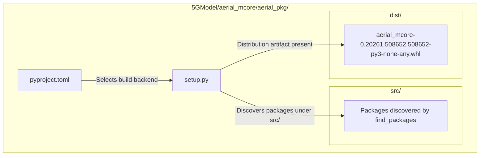
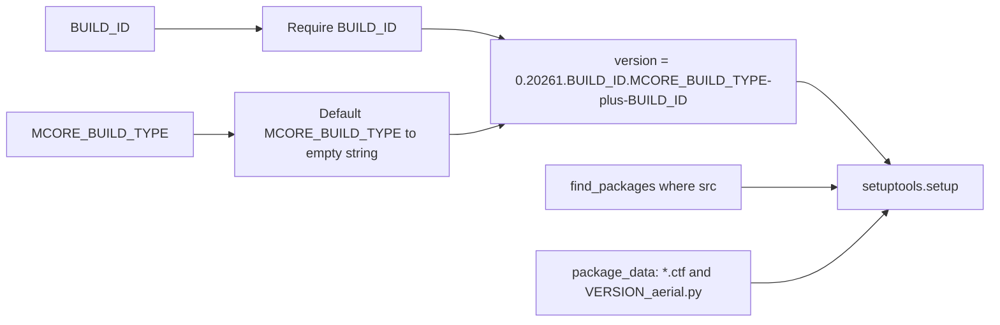
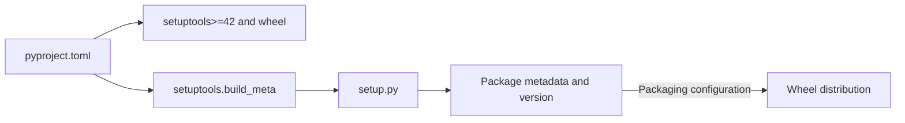

<!-- source: DeepWiki mcp.deepwiki.com · repo NVIDIA/aerial-cuda-accelerated-ran · page 3.1 Package Structure and Build · fetched 2026-10-26 -->

# Package Structure and Build

Relevant source files

The following files were used as context for generating this wiki page:

- [5GModel/aerial_mcore/aerial_pkg/dist/aerial_mcore-0.20261.508652.508652-py3-none-any.whl](5GModel/aerial_mcore/aerial_pkg/dist/aerial_mcore-0.20261.508652.508652-py3-none-any.whl)
- [5GModel/aerial_mcore/aerial_pkg/pyproject.toml](5GModel/aerial_mcore/aerial_pkg/pyproject.toml)
- [5GModel/aerial_mcore/aerial_pkg/setup.py](5GModel/aerial_mcore/aerial_pkg/setup.py)

## Purpose and Scope

This page documents the `aerial_mcore` package’s build configuration, package metadata, `BUILD_ID`-based version construction, and the wheel artifact present in the repository. The package metadata identifies it as “Aerial 5GModel Python bindings.” [5GModel/aerial_mcore/aerial_pkg/setup.py:33-43]()

**Sources:** [5GModel/aerial_mcore/aerial_pkg/setup.py:33-43]()

---

## Package Directory Structure

The package’s build configuration is in `5GModel/aerial_mcore/aerial_pkg/`. `setup.py` maps package discovery to the `src` directory, and `pyproject.toml` selects the setuptools build backend. A wheel artifact is present under `dist/`; the provided file is a Git LFS pointer rather than the wheel’s unpacked contents. [5GModel/aerial_mcore/aerial_pkg/setup.py:33-43]() [5GModel/aerial_mcore/aerial_pkg/pyproject.toml:16-21]() [5GModel/aerial_mcore/aerial_pkg/dist/aerial_mcore-0.20261.508652.508652-py3-none-any.whl:1-3]()

### Package Organization Diagram

**Sources:** [5GModel/aerial_mcore/aerial_pkg/setup.py:33-43]() [5GModel/aerial_mcore/aerial_pkg/pyproject.toml:16-21]() [5GModel/aerial_mcore/aerial_pkg/dist/aerial_mcore-0.20261.508652.508652-py3-none-any.whl:1-3]()

The package layout and distribution-related settings are:

| Area | Configuration or artifact | Meaning |
|---|---|---|
| Package root | `5GModel/aerial_mcore/aerial_pkg/` | Contains the packaging configuration files. [5GModel/aerial_mcore/aerial_pkg/setup.py:33-43]() |
| Source mapping | `package_dir={"": "src"}` | Maps package directories to `src`. [5GModel/aerial_mcore/aerial_pkg/setup.py:38]() |
| Package discovery | `setuptools.find_packages(where="src")` | Discovers packages under `src`. [5GModel/aerial_mcore/aerial_pkg/setup.py:39]() |
| Distribution artifact | `dist/aerial_mcore-0.20261.508652.508652-py3-none-any.whl` | A wheel file tracked through Git LFS; the supplied contents show its LFS pointer metadata, not its internal files. [5GModel/aerial_mcore/aerial_pkg/dist/aerial_mcore-0.20261.508652.508652-py3-none-any.whl:1-3]() |

**Sources:** [5GModel/aerial_mcore/aerial_pkg/setup.py:33-43]() [5GModel/aerial_mcore/aerial_pkg/dist/aerial_mcore-0.20261.508652.508652-py3-none-any.whl:1-3]()

---

## Build System Configuration

### `pyproject.toml`

`pyproject.toml` declares the build-system requirements as `setuptools>=42` and `wheel`, and uses `setuptools.build_meta` as the build backend. [5GModel/aerial_mcore/aerial_pkg/pyproject.toml:16-21]()

| Configuration | Value | Effect |
|---|---|---|
| `build-system.requires` | `setuptools>=42`, `wheel` | Declares the build dependencies. [5GModel/aerial_mcore/aerial_pkg/pyproject.toml:16-20]() |
| `build-backend` | `setuptools.build_meta` | Selects the setuptools PEP 517 backend. [5GModel/aerial_mcore/aerial_pkg/pyproject.toml:21]() |

**Sources:** [5GModel/aerial_mcore/aerial_pkg/pyproject.toml:16-21]()

### `setup.py`

`setup.py` reads `BUILD_ID` and `MCORE_BUILD_TYPE` from the process environment, constructs the package version, then passes package metadata and discovery settings to `setuptools.setup()`. [5GModel/aerial_mcore/aerial_pkg/setup.py:16-43]()

### `setup.py` Logic Flow

**Sources:** [5GModel/aerial_mcore/aerial_pkg/setup.py:20-43]()

#### Key Configuration Parameters

| Parameter | Value | Description |
|---|---|---|
| `name` | `aerial_mcore` | Distribution name. [5GModel/aerial_mcore/aerial_pkg/setup.py:33-35]() |
| `version` | `0.20261.{BUILD_ID}.{MCORE_BUILD_TYPE}{BUILD_ID}` | Version assembled from the environment. [5GModel/aerial_mcore/aerial_pkg/setup.py:20-31]() |
| `author` | `NVIDIA` | Package author metadata. [5GModel/aerial_mcore/aerial_pkg/setup.py:35-37]() |
| `description` | `Aerial 5GModel Python bindings` | Package description metadata. [5GModel/aerial_mcore/aerial_pkg/setup.py:36-38]() |
| `package_dir` | `{"": "src"}` | Maps packages to the `src` directory. [5GModel/aerial_mcore/aerial_pkg/setup.py:38]() |
| `packages` | `setuptools.find_packages(where="src")` | Discovers packages in `src`. [5GModel/aerial_mcore/aerial_pkg/setup.py:39]() |
| `include_package_data` | `True` | Enables inclusion of package data. [5GModel/aerial_mcore/aerial_pkg/setup.py:40]() |
| `package_data` | `{"": ["*.ctf","VERSION_aerial.py"]}` | Specifies data-file patterns. [5GModel/aerial_mcore/aerial_pkg/setup.py:41]() |
| `python_requires` | `>=3.8` | Declares the minimum Python version. [5GModel/aerial_mcore/aerial_pkg/setup.py:42]() |
| `zip_safe` | `False` | Marks the distribution as not zip-safe. [5GModel/aerial_mcore/aerial_pkg/setup.py:43]() |

**Sources:** [5GModel/aerial_mcore/aerial_pkg/setup.py:33-43]()

#### Environment Variable Requirements

- **`BUILD_ID` (required):** The setup script reads this environment variable and raises `RuntimeError` if it is absent. The source comment describes it as coming from Jenkins. [5GModel/aerial_mcore/aerial_pkg/setup.py:20-23]()
- **`MCORE_BUILD_TYPE` (optional):** The script reads this variable and assigns an empty string when it is unset. Its value is incorporated into the generated version. [5GModel/aerial_mcore/aerial_pkg/setup.py:25-31]()

**Sources:** [5GModel/aerial_mcore/aerial_pkg/setup.py:20-31]()

---

## Build Process

The supplied build configuration identifies setuptools as the backend and declares setuptools and wheel as build requirements. The supplied files do not describe a build command, wrapper script, cleanup procedure, or the sequence used to produce the repository’s wheel artifact. [5GModel/aerial_mcore/aerial_pkg/pyproject.toml:16-21]() [5GModel/aerial_mcore/aerial_pkg/setup.py:33-43]()

### Build Workflow Diagram

**Sources:** [5GModel/aerial_mcore/aerial_pkg/pyproject.toml:16-21]() [5GModel/aerial_mcore/aerial_pkg/setup.py:20-43]()

**Sources:** [5GModel/aerial_mcore/aerial_pkg/pyproject.toml:16-21]() [5GModel/aerial_mcore/aerial_pkg/setup.py:20-43]()

---

## Versioning Scheme

The setup script constructs the version using the format `0.20261.{BUILD_ID}.{MCORE_BUILD_TYPE}{BUILD_ID}`. `BUILD_ID` is required; `MCORE_BUILD_TYPE` defaults to the empty string when unset. [5GModel/aerial_mcore/aerial_pkg/setup.py:20-31]()

### Version Format

| Component | Source | Role |
|---|---|---|
| `0.20261` | Literal in the version expression | Fixed leading version components. [5GModel/aerial_mcore/aerial_pkg/setup.py:29-31]() |
| First `{BUILD_ID}` | `BUILD_ID` environment variable | Build identifier in the version. [5GModel/aerial_mcore/aerial_pkg/setup.py:20-23]()] |
| `{MCORE_BUILD_TYPE}{BUILD_ID}` | Optional build-type value followed by `BUILD_ID` | Final version component; the build type is empty if unset. [5GModel/aerial_mcore/aerial_pkg/setup.py:25-31]() |

**Sources:** [5GModel/aerial_mcore/aerial_pkg/setup.py:20-31]()

The wheel filename present in the repository is `aerial_mcore-0.20261.508652.508652-py3-none-any.whl`. Its filename version is `0.20261.508652.508652`; the supplied `setup.py` expression produces that shape when `BUILD_ID` is `508652` and `MCORE_BUILD_TYPE` is empty. The artifact is represented in the supplied file contents by a Git LFS pointer, so its internal wheel metadata is not available here. [5GModel/aerial_mcore/aerial_pkg/setup.py:20-31]() [5GModel/aerial_mcore/aerial_pkg/dist/aerial_mcore-0.20261.508652.508652-py3-none-any.whl:1-3]()

**Sources:** [5GModel/aerial_mcore/aerial_pkg/setup.py:20-31]() [5GModel/aerial_mcore/aerial_pkg/dist/aerial_mcore-0.20261.508652.508652-py3-none-any.whl:1-3]()

---

## Distribution Format

The repository contains a `.whl` distribution artifact. The `setup.py` configuration supplies package discovery, package-data patterns, Python-version metadata, and the `zip_safe` setting used by setuptools. [5GModel/aerial_mcore/aerial_pkg/setup.py:33-43]() [5GModel/aerial_mcore/aerial_pkg/dist/aerial_mcore-0.20261.508652.508652-py3-none-any.whl:1-3]()

### Wheel Contents

| Content category | Setup configuration | What can be established |
|---|---|---|
| Python packages | `find_packages(where="src")` and `package_dir={"": "src"}` | Package discovery is configured for packages under `src`. [5GModel/aerial_mcore/aerial_pkg/setup.py:38-39]() |
| Package data | `include_package_data=True` | Package-data inclusion is enabled. [5GModel/aerial_mcore/aerial_pkg/setup.py:40]() |
| Explicit data patterns | `*.ctf`, `VERSION_aerial.py` | These patterns are listed in `package_data`. [5GModel/aerial_mcore/aerial_pkg/setup.py:41]() |

The supplied wheel file is a Git LFS pointer containing the object identifier and size, not an unpacked listing of wheel members. Therefore, the configured data patterns describe what `setup.py` requests for packaging; they do not independently verify the contents of that particular wheel. [5GModel/aerial_mcore/aerial_pkg/dist/aerial_mcore-0.20261.508652.508652-py3-none-any.whl:1-3]() [5GModel/aerial_mcore/aerial_pkg/setup.py:38-41]()

**Sources:** [5GModel/aerial_mcore/aerial_pkg/setup.py:38-41]() [5GModel/aerial_mcore/aerial_pkg/dist/aerial_mcore-0.20261.508652.508652-py3-none-any.whl:1-3]()

The package is marked `zip_safe=False`. The supplied configuration does not state the reason for this setting, so no further runtime consequence is asserted here. [5GModel/aerial_mcore/aerial_pkg/setup.py:43]()

**Sources:** [5GModel/aerial_mcore/aerial_pkg/setup.py:43]()

---

