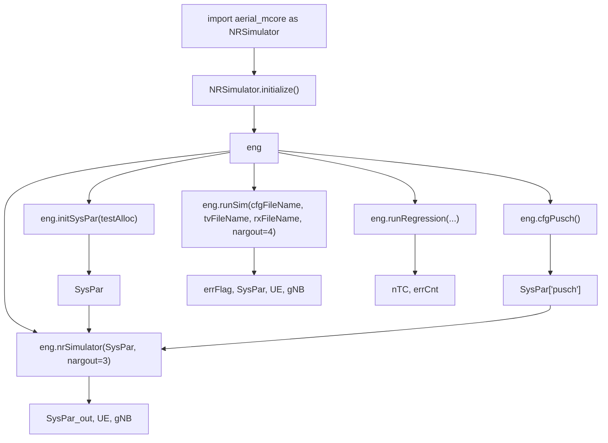
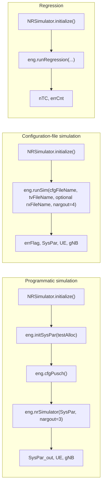

<!-- source: DeepWiki mcp.deepwiki.com · repo NVIDIA/aerial-cuda-accelerated-ran · page 3.2 Python API Reference · fetched 2026-10-26 -->

# Python API Reference

Relevant source files

The following files were used as context for generating this wiki page:

- [5GModel/aerial_mcore/examples/example_nrSimulator.py](5GModel/aerial_mcore/examples/example_nrSimulator.py)
- [5GModel/aerial_mcore/examples/example_runSim.py](5GModel/aerial_mcore/examples/example_runSim.py)

## Purpose and Scope

This page describes the Python-facing `aerial_mcore` API as exercised by the package examples: initializing the simulator, running a YAML-configured simulation with `runSim`, invoking `nrSimulator` with programmatically configured parameters, and interpreting the returned values. It also records the `runRegression` usage documented in the existing reference. The examples show calls through an `eng` object returned by `NRSimulator.initialize()`; they do not define the underlying MATLAB implementation. [5GModel/aerial_mcore/examples/example_nrSimulator.py:16-21](), [5GModel/aerial_mcore/examples/example_runSim.py:16-39](), [5GModel/aerial_mcore/examples/example_5GModel_regression.py:34-61]()

Sources: [5GModel/aerial_mcore/examples/example_nrSimulator.py:16-21](), [5GModel/aerial_mcore/examples/example_runSim.py:16-39](), [5GModel/aerial_mcore/examples/example_5GModel_regression.py:34-61]()

---

## Module Import and Initialization

### Importing the Module

The examples import `aerial_mcore` under the alias `NRSimulator`. The `example_nrSimulator.py` example also imports `matlab` and NumPy: it uses `matlab.double` for a PUSCH field and converts a returned MATLAB value with `np.array`. [5GModel/aerial_mcore/examples/example_nrSimulator.py:16-18](), [5GModel/aerial_mcore/examples/example_nrSimulator.py:51-51](), [5GModel/aerial_mcore/examples/example_nrSimulator.py:96-96]()

Sources: [5GModel/aerial_mcore/examples/example_nrSimulator.py:16-18](), [5GModel/aerial_mcore/examples/example_nrSimulator.py:51-51](), [5GModel/aerial_mcore/examples/example_nrSimulator.py:96-96]()

### Initialization Function

#### `NRSimulator.initialize()`

Both supplied examples call `NRSimulator.initialize()` and assign its return value to `eng`. Subsequent simulation operations are invoked as methods on `eng`, including `runSim`, `initSysPar`, `cfgPusch`, and `nrSimulator`. [5GModel/aerial_mcore/examples/example_nrSimulator.py:21-21](), [5GModel/aerial_mcore/examples/example_nrSimulator.py:28-36](), [5GModel/aerial_mcore/examples/example_runSim.py:32-39]()

The examples establish this usage pattern but do not specify the return type or initialization internals. [5GModel/aerial_mcore/examples/example_nrSimulator.py:21-21](), [5GModel/aerial_mcore/examples/example_runSim.py:32-39]()

Sources: [5GModel/aerial_mcore/examples/example_nrSimulator.py:21-36](), [5GModel/aerial_mcore/examples/example_runSim.py:32-39]()

---

## API Architecture

### Natural Language to Code Entity Mapping

| System concept | Code entity | Example use |
|---|---|---|
| Python package entry point | `aerial_mcore` imported as `NRSimulator` | Import in the simulator examples. [5GModel/aerial_mcore/examples/example_nrSimulator.py:16-16](), [5GModel/aerial_mcore/examples/example_runSim.py:16-16]() |
| API initialization | `NRSimulator.initialize()` | Assigns the returned object to `eng`. [5GModel/aerial_mcore/examples/example_nrSimulator.py:21-21](), [5GModel/aerial_mcore/examples/example_runSim.py:32-32]() |
| System parameter setup | `eng.initSysPar(testAlloc)` | Initializes `SysPar` using channel allocation flags. [5GModel/aerial_mcore/examples/example_nrSimulator.py:23-28]() |
| PUSCH configuration creation | `eng.cfgPusch()` | Supplies a PUSCH configuration placed in `SysPar["pusch"]`. [5GModel/aerial_mcore/examples/example_nrSimulator.py:36-36]() |
| Programmatic simulator entry point | `eng.nrSimulator(SysPar, nargout=3)` | Returns updated system parameters and UE/gNB structures. [5GModel/aerial_mcore/examples/example_nrSimulator.py:92-92]() |
| Configuration-file runner | `eng.runSim(...)` | Accepts configuration and test-vector filenames, with an optional receive filename. [5GModel/aerial_mcore/examples/example_runSim.py:26-39]() |
| Regression entry point | `eng.runRegression(...)` | Used by the regression example to obtain test-case and error counts. [5GModel/aerial_mcore/examples/example_5GModel_regression.py:44-61]() |

Sources: [5GModel/aerial_mcore/examples/example_nrSimulator.py:16-36](), [5GModel/aerial_mcore/examples/example_nrSimulator.py:92-92](), [5GModel/aerial_mcore/examples/example_runSim.py:16-39](), [5GModel/aerial_mcore/examples/example_5GModel_regression.py:44-61]()

### API Execution Flow

**Diagram: Python API names mapped to simulator operations**

The diagram maps the names used in the Python examples to the calls and returned values shown there. The `runSim` example chooses between the two-argument-file form and the form with an additional `rxFileName`; the programmatic example builds `SysPar` before calling `nrSimulator`. [5GModel/aerial_mcore/examples/example_nrSimulator.py:21-36](), [5GModel/aerial_mcore/examples/example_nrSimulator.py:90-92](), [5GModel/aerial_mcore/examples/example_runSim.py:26-39](), [5GModel/aerial_mcore/examples/example_5GModel_regression.py:44-61]()

Sources: [5GModel/aerial_mcore/examples/example_nrSimulator.py:21-36](), [5GModel/aerial_mcore/examples/example_nrSimulator.py:90-92](), [5GModel/aerial_mcore/examples/example_runSim.py:26-39](), [5GModel/aerial_mcore/examples/example_5GModel_regression.py:44-61]()

### API Workflows

**Diagram: Example workflow names mapped to API entities**

The programmatic and file-based paths are demonstrated in the supplied simulator examples. The regression path and its two-result assignment are documented by the regression example referenced in the existing page. [5GModel/aerial_mcore/examples/example_nrSimulator.py:21-36](), [5GModel/aerial_mcore/examples/example_nrSimulator.py:90-92](), [5GModel/aerial_mcore/examples/example_runSim.py:32-39](), [5GModel/aerial_mcore/examples/example_5GModel_regression.py:34-61]()

Sources: [5GModel/aerial_mcore/examples/example_nrSimulator.py:21-36](), [5GModel/aerial_mcore/examples/example_nrSimulator.py:90-92](), [5GModel/aerial_mcore/examples/example_runSim.py:32-39](), [5GModel/aerial_mcore/examples/example_5GModel_regression.py:34-61]()

---

## Core API Functions

### Configuration Functions

#### `eng.initSysPar(testAlloc)`

The programmatic example passes a dictionary with `dl`, `ul`, and `pusch` keys to `eng.initSysPar`, assigning the result to `SysPar`. In that example, `dl` is disabled while `ul` and `pusch` are enabled. [5GModel/aerial_mcore/examples/example_nrSimulator.py:23-28]()

| Input key | Example value | Meaning shown by the example |
|---|---:|---|
| `dl` | `0` | Downlink allocation flag in the supplied test allocation. [5GModel/aerial_mcore/examples/example_nrSimulator.py:23-27]() |
| `ul` | `1` | Uplink allocation flag in the supplied test allocation. [5GModel/aerial_mcore/examples/example_nrSimulator.py:23-27]() |
| `pusch` | `1` | PUSCH allocation flag in the supplied test allocation. [5GModel/aerial_mcore/examples/example_nrSimulator.py:23-27]() |

The example then modifies the returned `SysPar`, including simulation-control and carrier fields. [5GModel/aerial_mcore/examples/example_nrSimulator.py:28-34]()

Sources: [5GModel/aerial_mcore/examples/example_nrSimulator.py:23-34]()

#### `eng.cfgPusch()`

The example calls `eng.cfgPusch()` and places the result in a one-element list at `SysPar["pusch"]`. It then updates the first list element with a PUSCH parameter dictionary. [5GModel/aerial_mcore/examples/example_nrSimulator.py:36-36](), [5GModel/aerial_mcore/examples/example_nrSimulator.py:37-90]()

Sources: [5GModel/aerial_mcore/examples/example_nrSimulator.py:36-90]()

### Simulation Functions

#### `eng.nrSimulator(SysPar, nargout=3)`

The programmatic example calls `eng.nrSimulator(SysPar, nargout=3)` and unpacks the result as `SysPar_out`, `UE`, and `gNB`. It subsequently reads the first UE’s transmit grid from `UE[0]['Phy']['tx']['Xtf']`. [5GModel/aerial_mcore/examples/example_nrSimulator.py:92-96]()

| Return value | Example use |
|---|---|
| `SysPar_out` | Reads PUSCH resource-allocation fields to calculate resource-grid indices. [5GModel/aerial_mcore/examples/example_nrSimulator.py:98-101]() |
| `UE` | Reads the first UE’s `Phy` → `tx` → `Xtf` data. [5GModel/aerial_mcore/examples/example_nrSimulator.py:96-96]() |
| `gNB` | Returned as the third output; the example does not inspect it. [5GModel/aerial_mcore/examples/example_nrSimulator.py:92-92]() |

Sources: [5GModel/aerial_mcore/examples/example_nrSimulator.py:92-101]()

#### `eng.runSim(cfgFileName, tvFileName, [rxFileName], nargout=4)`

The file-based example reads a configuration filename and test-vector filename from command-line arguments. It accepts an optional third filename as `rxFileName`, initializes `eng`, then calls `runSim` with either two filenames or all three. It requests four outputs in both cases. [5GModel/aerial_mcore/examples/example_runSim.py:21-39]()

| Argument or result | Role in the example |
|---|---|
| `cfgFileName` | First filename argument, passed to `runSim`. [5GModel/aerial_mcore/examples/example_runSim.py:21-27](), [5GModel/aerial_mcore/examples/example_runSim.py:37-39]() |
| `tvFileName` | Second filename argument, passed to `runSim`. [5GModel/aerial_mcore/examples/example_runSim.py:21-27](), [5GModel/aerial_mcore/examples/example_runSim.py:37-39]() |
| `rxFileName` | Optional third filename; when present, passed as an additional `runSim` argument. [5GModel/aerial_mcore/examples/example_runSim.py:28-39]() |
| `errFlag`, `SysPar`, `UE`, `gNB` | Four unpacked return values. [5GModel/aerial_mcore/examples/example_runSim.py:36-39]() |

The example prints `errFlag` and elapsed time, and exits with status `1` when `errFlag` is nonzero. [5GModel/aerial_mcore/examples/example_runSim.py:35-45]()

Sources: [5GModel/aerial_mcore/examples/example_runSim.py:21-45]()

### Regression Testing Functions

#### `eng.runRegression(...)`

The existing reference describes a regression example that calls `eng.runRegression` with test-set, channel, mode, subset, and release arguments, requesting two outputs. The outputs are assigned to `nTC` and `errCnt`. [5GModel/aerial_mcore/examples/example_5GModel_regression.py:44-61]()

| Return value | Description in the existing reference |
|---|---|
| `nTC` | Number of test cases executed. [5GModel/aerial_mcore/examples/example_5GModel_regression.py:44-61]() |
| `errCnt` | Number of test cases with errors. [5GModel/aerial_mcore/examples/example_5GModel_regression.py:44-61]() |

The provided regression reference also checks the error count and reports a failed test condition when it is nonzero. [5GModel/aerial_mcore/examples/example_5GModel_regression.py:102-103]()

Sources: [5GModel/aerial_mcore/examples/example_5GModel_regression.py:44-61](), [5GModel/aerial_mcore/examples/example_5GModel_regression.py:102-103]()

---

## Data Structures

### `SysPar`

`SysPar` is the parameter value returned by `eng.initSysPar(testAlloc)` and passed to `eng.nrSimulator`. The example accesses `SimCtrl`, `carrier`, and `pusch` fields, setting values in the first two and adding a PUSCH configuration list. [5GModel/aerial_mcore/examples/example_nrSimulator.py:28-36]()

| Field | Example access or update |
|---|---|
| `SimCtrl` | Sets `fp16AlgoSel` and `N_frame`. [5GModel/aerial_mcore/examples/example_nrSimulator.py:30-31]() |
| `carrier` | Sets `Nant_gNB`, `Nant_UE`, and `N_ID_CELL`. [5GModel/aerial_mcore/examples/example_nrSimulator.py:32-34]() |
| `pusch` | Replaced with a list containing `eng.cfgPusch()`; its first item is updated with PUSCH parameters. [5GModel/aerial_mcore/examples/example_nrSimulator.py:36-36](), [5GModel/aerial_mcore/examples/example_nrSimulator.py:90-90]() |

Sources: [5GModel/aerial_mcore/examples/example_nrSimulator.py:28-36](), [5GModel/aerial_mcore/examples/example_nrSimulator.py:90-90]()

### PUSCH Configuration

The example creates a PUSCH configuration with `eng.cfgPusch()` and updates it with fields covering bandwidth-part and resource allocation, modulation and coding, DMRS, payload, HARQ, and related settings. The following table highlights fields subsequently used for resource-grid inspection. [5GModel/aerial_mcore/examples/example_nrSimulator.py:36-90]()

| Field | Example value or use |
|---|---|
| `BWPSize` | Set to `273.0`. [5GModel/aerial_mcore/examples/example_nrSimulator.py:37-40]() |
| `rbStart` | Set to `24.`; used to calculate the starting resource element. [5GModel/aerial_mcore/examples/example_nrSimulator.py:58-60](), [5GModel/aerial_mcore/examples/example_nrSimulator.py:98-99]() |
| `rbSize` | Set to `26.`; used to calculate the resource-element span. [5GModel/aerial_mcore/examples/example_nrSimulator.py:59-60](), [5GModel/aerial_mcore/examples/example_nrSimulator.py:98-99]() |
| `StartSymbolIndex` | Set to `0.` and used to calculate the symbol range. [5GModel/aerial_mcore/examples/example_nrSimulator.py:65-66](), [5GModel/aerial_mcore/examples/example_nrSimulator.py:100-101]() |
| `NrOfSymbols` | Set to `14.` and used to calculate the symbol range. [5GModel/aerial_mcore/examples/example_nrSimulator.py:65-66](), [5GModel/aerial_mcore/examples/example_nrSimulator.py:100-101]() |
| `DmrsSymbPos` | Set using `matlab.double` and read while classifying symbols in the output grid. [5GModel/aerial_mcore/examples/example_nrSimulator.py:51-52](), [5GModel/aerial_mcore/examples/example_nrSimulator.py:102-106]() |

Sources: [5GModel/aerial_mcore/examples/example_nrSimulator.py:36-90](), [5GModel/aerial_mcore/examples/example_nrSimulator.py:98-106]()

### Output Structures: `UE` and `gNB`

`eng.nrSimulator` returns `UE` and `gNB` as its second and third outputs. The example accesses the first UE, follows the nested `Phy`, `tx`, and `Xtf` fields, and converts the resulting value to a NumPy array. It does not inspect `gNB`. [5GModel/aerial_mcore/examples/example_nrSimulator.py:92-96]()

The example calculates a resource-element range from the returned PUSCH allocation and iterates over the configured symbol range. For each symbol it checks `DmrsSymbPos` and prints the first resource element as DMRS or DATA accordingly. [5GModel/aerial_mcore/examples/example_nrSimulator.py:98-106]()

Sources: [5GModel/aerial_mcore/examples/example_nrSimulator.py:92-106]()

---

## MATLAB Data Type Conversion

The programmatic example uses `matlab.double` for `DmrsSymbPos`. It converts `UE[0]['Phy']['tx']['Xtf']` with `np.array` before indexing the transmit grid. These examples demonstrate conversion at the Python/MATLAB boundary for those particular values. [5GModel/aerial_mcore/examples/example_nrSimulator.py:16-18](), [5GModel/aerial_mcore/examples/example_nrSimulator.py:51-51](), [5GModel/aerial_mcore/examples/example_nrSimulator.py:96-96]()

Sources: [5GModel/aerial_mcore/examples/example_nrSimulator.py:16-18](), [5GModel/aerial_mcore/examples/example_nrSimulator.py:51-51](), [5GModel/aerial_mcore/examples/example_nrSimulator.py:96-96]()

---

## Return Value Handling

### `nargout`

The examples specify `nargout` at calls that return multiple MATLAB outputs:

| Call | Requested outputs | Unpacked values |
|---|---:|---|
| `eng.nrSimulator(...)` | `3` | `SysPar_out`, `UE`, `gNB`. [5GModel/aerial_mcore/examples/example_nrSimulator.py:92-92]() |
| `eng.runSim(...)` | `4` | `errFlag`, `SysPar`, `UE`, `gNB`. [5GModel/aerial_mcore/examples/example_runSim.py:36-39]() |
| `eng.runRegression(...)` | `2` | `nTC`, `errCnt`. [5GModel/aerial_mcore/examples/example_5GModel_regression.py:44-61]() |

Sources: [5GModel/aerial_mcore/examples/example_nrSimulator.py:92-92](), [5GModel/aerial_mcore/examples/example_runSim.py:36-39](), [5GModel/aerial_mcore/examples/example_5GModel_regression.py:44-61]()

### Error Handling

The `runSim` example treats a nonzero `errFlag` as failure and exits with status `1`. The regression example checks `errCnt` and reports failure when it is nonzero. [5GModel/aerial_mcore/examples/example_runSim.py:42-45](), [5GModel/aerial_mcore/examples/example_5GModel_regression.py:102-103]()

Sources: [5GModel/aerial_mcore/examples/example_runSim.py:42-45](), [5GModel/aerial_mcore/examples/example_5GModel_regression.py:102-103]()

---

