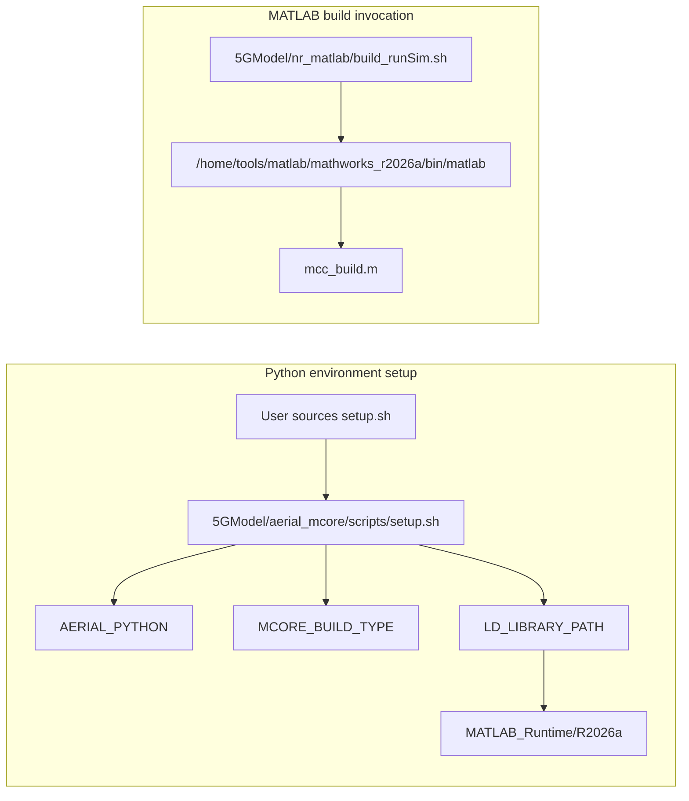
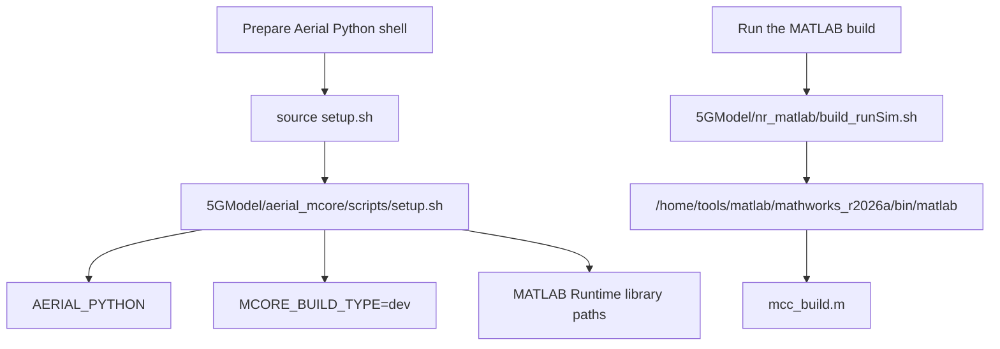
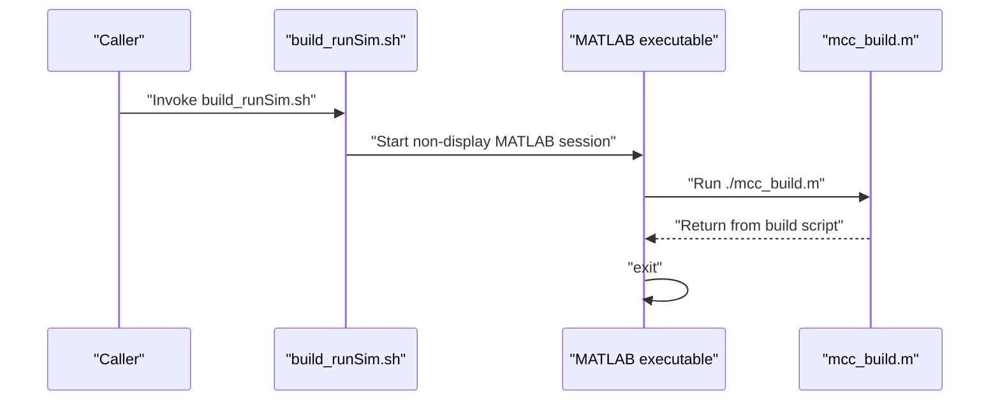

<!-- source: DeepWiki mcp.deepwiki.com · repo NVIDIA/aerial-cuda-accelerated-ran · page 3.3 MATLAB Integration · fetched 2026-10-26 -->

# MATLAB Integration

Relevant source files

The following files were used as context for generating this wiki page:

- [5GModel/aerial_mcore/scripts/setup.sh](5GModel/aerial_mcore/scripts/setup.sh)
- [5GModel/nr_matlab/build_runSim.sh](5GModel/nr_matlab/build_runSim.sh)

## Purpose and Scope

This page describes the MATLAB integration points visible in the supplied `aerial_mcore` and `nr_matlab` files: configuring MATLAB Runtime library paths for a Python environment and launching a MATLAB build step. These files do not establish the Python MATLAB Engine call path, `yamlmatlab` setup, or `.ctf` packaging details, so those implementation details are not asserted here. [5GModel/aerial_mcore/scripts/setup.sh:18-25](), [5GModel/nr_matlab/build_runSim.sh:18-18]()

Sources: [5GModel/aerial_mcore/scripts/setup.sh:18-25](), [5GModel/nr_matlab/build_runSim.sh:18-18]()

## Architecture Overview

The supplied integration files show two distinct operations: `setup.sh` prepares a shell environment for Aerial Python by setting MATLAB Runtime library paths, while `build_runSim.sh` invokes a MATLAB executable to run `mcc_build.m`. [5GModel/aerial_mcore/scripts/setup.sh:18-25](), [5GModel/nr_matlab/build_runSim.sh:18-18]()

### Integration Components

**Diagram: Environment setup and MATLAB build entry point**

Sources: [5GModel/aerial_mcore/scripts/setup.sh:18-25](), [5GModel/nr_matlab/build_runSim.sh:18-18]()

**Diagram: Natural-language responsibilities mapped to code entities**

Sources: [5GModel/aerial_mcore/scripts/setup.sh:18-25](), [5GModel/nr_matlab/build_runSim.sh:18-18]()

Sources: [5GModel/aerial_mcore/scripts/setup.sh:18-25](), [5GModel/nr_matlab/build_runSim.sh:18-18]()

## MATLAB Runtime Environment

`setup.sh` is intended to be sourced, rather than run as a standalone process. On its first activation—when `AERIAL_PYTHON` is not set—it sets `AERIAL_PYTHON=1`, prefixes the shell prompt with `[Aerial Python]`, and appends MATLAB Runtime library directories to `LD_LIBRARY_PATH`. It sets `MCORE_BUILD_TYPE=dev` after the conditional, so that assignment is performed whenever the script is sourced. [5GModel/aerial_mcore/scripts/setup.sh:18-25]()

The configured runtime paths point to MATLAB Runtime `R2026a` and include its runtime, binary, operating-system, external-binary, and OpenGL library directories. [5GModel/aerial_mcore/scripts/setup.sh:23-23]()

| Setting | Behavior established by the script |
|---|---|
| `AERIAL_PYTHON` | Set to `1` if it is not already set. [5GModel/aerial_mcore/scripts/setup.sh:20-21]() |
| `PS1` | Prefixed with `[Aerial Python]` when the setup guard runs. [5GModel/aerial_mcore/scripts/setup.sh:20-23]() |
| `LD_LIBRARY_PATH` | Appended with MATLAB Runtime `R2026a` library directories when the setup guard runs. [5GModel/aerial_mcore/scripts/setup.sh:20-23]() |
| `MCORE_BUILD_TYPE` | Set to `dev` whenever the script is sourced. [5GModel/aerial_mcore/scripts/setup.sh:25-25]() |

The guard checks whether `AERIAL_PYTHON` is set, not whether its value is `1`; if it is already set, the guarded prompt and library-path changes are skipped. The unconditional `MCORE_BUILD_TYPE` assignment still runs. [5GModel/aerial_mcore/scripts/setup.sh:20-25]()

Sources: [5GModel/aerial_mcore/scripts/setup.sh:18-25]()

## MATLAB Build Invocation

`build_runSim.sh` invokes a MATLAB executable at `/home/tools/matlab/mathworks_r2026a/bin/matlab` with `-nodisplay`, `-nosplash`, and `-nodesktop`. Its `-r` argument runs `./mcc_build.m` and then exits MATLAB. The supplied file shows the invocation, but does not include `mcc_build.m` or specify which artifacts that build produces. [5GModel/nr_matlab/build_runSim.sh:18-18]()

**Diagram: `build_runSim.sh` execution flow**

Sources: [5GModel/nr_matlab/build_runSim.sh:18-18]()

Sources: [5GModel/nr_matlab/build_runSim.sh:18-18]()

## Engine, YAML, and CTF Boundaries

The available files do not show an implementation of MATLAB Engine API calls from Python, MATLAB function dispatch, Python/MATLAB data conversion, `yamlmatlab` installation or configuration, or `.ctf` creation and inclusion in a wheel. Those topics therefore cannot be detailed from the provided code evidence. [5GModel/aerial_mcore/scripts/setup.sh:18-25](), [5GModel/nr_matlab/build_runSim.sh:18-18]()

The concrete MATLAB integration behavior established here is limited to configuring MATLAB Runtime shared-library lookup paths for the Aerial Python shell and invoking `mcc_build.m` through a MATLAB executable. [5GModel/aerial_mcore/scripts/setup.sh:18-25](), [5GModel/nr_matlab/build_runSim.sh:18-18]()

Sources: [5GModel/aerial_mcore/scripts/setup.sh:18-25](), [5GModel/nr_matlab/build_runSim.sh:18-18]()

---

