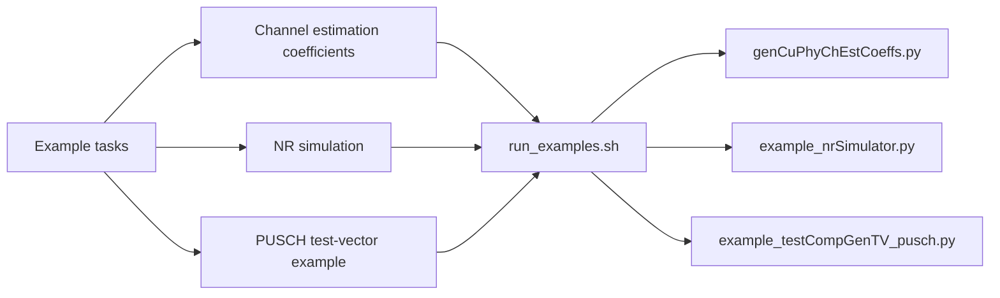
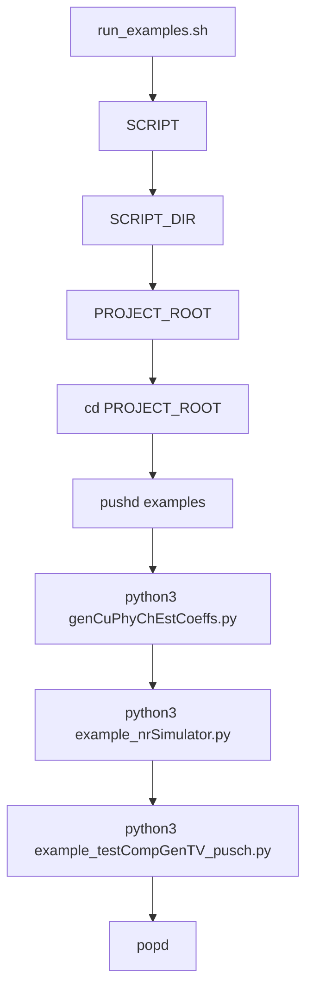

<!-- source: DeepWiki mcp.deepwiki.com · repo NVIDIA/aerial-cuda-accelerated-ran · page 4 Examples and Usage · fetched 2026-10-26 -->

# Examples and Usage

Relevant source files

The following files were used as context for generating this wiki page:

- [5GModel/aerial_mcore/scripts/run_examples.sh](5GModel/aerial_mcore/scripts/run_examples.sh)

## Purpose and Scope

This page introduces the example scripts used with `aerial_mcore` and points to the detailed guides for each example type. The `run_examples.sh` launcher runs a small set of scripts from the `examples` directory; the child pages cover simulation, test-vector generation, physical-layer examples, and end-to-end workflows in more detail. [5GModel/aerial_mcore/scripts/run_examples.sh:28-33]()

**Sources:** [5GModel/aerial_mcore/scripts/run_examples.sh:28-33]()

## Example Categories and Scripts

The launcher changes into the `examples` directory and runs three Python scripts in sequence: `genCuPhyChEstCoeffs.py`, `example_nrSimulator.py`, and `example_testCompGenTV_pusch.py`. It stops if a command fails because the script enables `set -e`. [5GModel/aerial_mcore/scripts/run_examples.sh:18-19](), [5GModel/aerial_mcore/scripts/run_examples.sh:28-33]()

For the broader workflows and their configuration details, see the child pages linked below. [5GModel/aerial_mcore/scripts/run_examples.sh:28-33]()

**Sources:** [5GModel/aerial_mcore/scripts/run_examples.sh:18-19](), [5GModel/aerial_mcore/scripts/run_examples.sh:28-33]()

### Example Launcher: Natural-Language Tasks to Script Names

This mapping connects the example types covered by the child pages to the script names explicitly invoked by the launcher. The filenames indicate the launcher’s channel-estimation, simulator, and PUSCH test-vector examples. [5GModel/aerial_mcore/scripts/run_examples.sh:28-33]()

**Sources:** [5GModel/aerial_mcore/scripts/run_examples.sh:28-33]()

### Launcher Execution Flow: Script and Directory Entities

The launcher resolves its own path, derives `PROJECT_ROOT`, changes to that directory, and then runs the three examples from `examples`. This diagram connects those steps to the corresponding shell variables and commands. [5GModel/aerial_mcore/scripts/run_examples.sh:21-33]()

**Sources:** [5GModel/aerial_mcore/scripts/run_examples.sh:21-33]()

### Summary

| Example area | Script invoked by `run_examples.sh` | Child page |
|---|---|---|
| Basic simulation | `example_nrSimulator.py` [5GModel/aerial_mcore/scripts/run_examples.sh:30-32]() | [Basic Simulation Examples](#4.1) |
| Test-vector generation | `example_testCompGenTV_pusch.py` [5GModel/aerial_mcore/scripts/run_examples.sh:30-33]() | [Test Vector Generation](#4.2) |
| Physical-layer examples | `genCuPhyChEstCoeffs.py` [5GModel/aerial_mcore/scripts/run_examples.sh:28-31]() | [Physical Layer Examples](#4.3) |
| End-to-end test-vector generation | See the dedicated child page for this workflow. | [End-to-End Test Vector Generation](#4.4) |

**Sources:** [5GModel/aerial_mcore/scripts/run_examples.sh:28-33]()

## Basic Simulation Examples

The launcher includes `example_nrSimulator.py` as its simulation example. This parent page does not detail its API or configuration; see [Basic Simulation Examples](#4.1) for the `nrSimulator` and `runSim` guidance. [5GModel/aerial_mcore/scripts/run_examples.sh:30-32]()

**Sources:** [5GModel/aerial_mcore/scripts/run_examples.sh:30-32]()

## Test Vector Generation

The launcher runs `example_testCompGenTV_pusch.py`, identifying a PUSCH test-vector example in its selected set. The broader test-vector generation workflows are covered in [Test Vector Generation](#4.2). [5GModel/aerial_mcore/scripts/run_examples.sh:31-33]()

**Sources:** [5GModel/aerial_mcore/scripts/run_examples.sh:31-33]()

## Physical Layer and E2E Artifacts

The launcher also runs `genCuPhyChEstCoeffs.py`, a channel-estimation-coefficient example. For details on physical-layer examples, see [Physical Layer Examples](#4.3). For the separate end-to-end test-vector workflows, see [End-to-End Test Vector Generation](#4.4). [5GModel/aerial_mcore/scripts/run_examples.sh:28-31]()

**Sources:** [5GModel/aerial_mcore/scripts/run_examples.sh:28-31]

---

