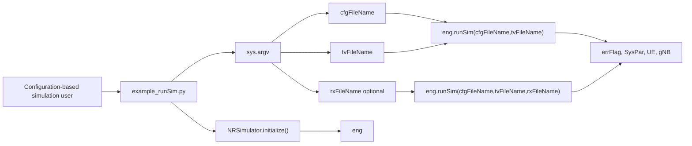
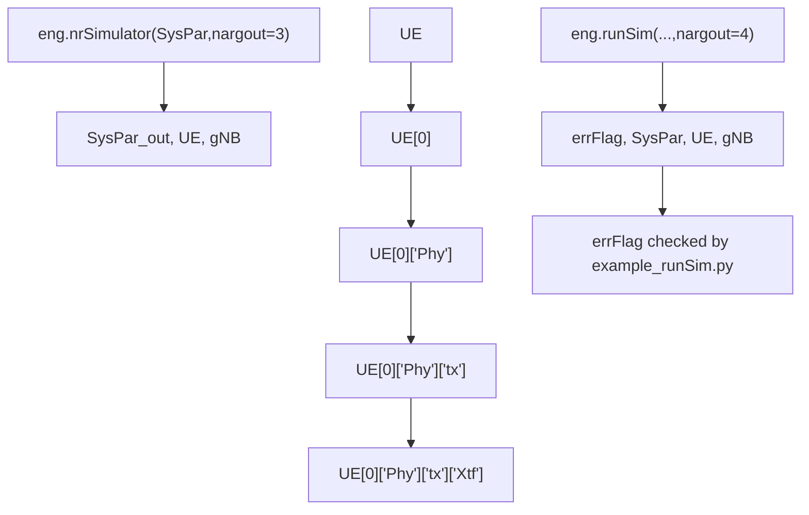

<!-- source: DeepWiki mcp.deepwiki.com · repo NVIDIA/aerial-cuda-accelerated-ran · page 4.1 Basic Simulation Examples · fetched 2026-10-26 -->

# Basic Simulation Examples

Relevant source files

The following files were used as context for generating this wiki page:

- [5GModel/aerial_mcore/examples/example_nrSimulator.py](5GModel/aerial_mcore/examples/example_nrSimulator.py)
- [5GModel/aerial_mcore/examples/example_runSim.py](5GModel/aerial_mcore/examples/example_runSim.py)
- [5GModel/nr_matlab/cfg_template.yaml](5GModel/nr_matlab/cfg_template.yaml)

## Purpose and Scope

This page describes two examples in `aerial_mcore/examples`: direct parameter-driven simulation with `nrSimulator`, and configuration-file-driven execution through `runSim`. The examples initialize the `aerial_mcore` MATLAB engine interface and expose simulation results to Python. [5GModel/aerial_mcore/examples/example_nrSimulator.py:16-28](), [5GModel/aerial_mcore/examples/example_runSim.py:16-40]()

**Sources:** [5GModel/aerial_mcore/examples/example_nrSimulator.py:16-28](), [5GModel/aerial_mcore/examples/example_runSim.py:16-40]()

---

## Simulation Approaches Overview

The examples demonstrate two interfaces. `example_nrSimulator.py` constructs and updates simulation parameters in Python before calling `eng.nrSimulator`; `example_runSim.py` accepts configuration and output filenames as command-line arguments and invokes `eng.runSim`. The optional third argument to `example_runSim.py` supplies an RX filename. [5GModel/aerial_mcore/examples/example_nrSimulator.py:21-36](), [5GModel/aerial_mcore/examples/example_nrSimulator.py:90-106](), [5GModel/aerial_mcore/examples/example_runSim.py:21-39]()

| Approach | Example | Inputs shown in the example | MATLAB entry point | Results used by the example |
|---|---|---|---|---|
| Direct parameter-driven | `example_nrSimulator.py` | `testAlloc`, `SysPar`, and a PUSCH configuration | `eng.nrSimulator` | `SysPar_out`, `UE`, `gNB`; the script extracts `UE[0]['Phy']['tx']['Xtf']` |
| Configuration-file-driven | `example_runSim.py` | `cfgFileName`, `tvFileName`, and optional `rxFileName` | `eng.runSim` | `errFlag`, `SysPar`, `UE`, `gNB` |

[5GModel/aerial_mcore/examples/example_nrSimulator.py:21-36](), [5GModel/aerial_mcore/examples/example_nrSimulator.py:90-106](), [5GModel/aerial_mcore/examples/example_runSim.py:21-45]()

**Sources:** [5GModel/aerial_mcore/examples/example_nrSimulator.py:21-36](), [5GModel/aerial_mcore/examples/example_nrSimulator.py:90-106](), [5GModel/aerial_mcore/examples/example_runSim.py:21-45]()

### System Names Mapped to Code Entities: Direct Simulation

This diagram maps the example’s simulation concepts to the identifiers used in the Python script. [5GModel/aerial_mcore/examples/example_nrSimulator.py:16-36](), [5GModel/aerial_mcore/examples/example_nrSimulator.py:90-106]()

**Direct simulation: concept-to-code mapping**

```mermaid
flowchart LR
    User["Python example user"] --> Script["example_nrSimulator.py"]
    Script --> Init["NRSimulator.initialize()"]
    Init --> Engine["eng"]
    Engine --> Alloc["eng.initSysPar(testAlloc)"]
    Alloc --> Params["SysPar"]
    Params --> Config["SysPar['pusch'][0].update(updatePusch)"]
    Config --> Sim["eng.nrSimulator(SysPar,nargout=3)"]
    Sim --> Result["SysPar_out, UE, gNB"]
    Result --> Tensor["UE[0]['Phy']['tx']['Xtf']"]
```

**Sources:** [5GModel/aerial_mcore/examples/example_nrSimulator.py:16-36](), [5GModel/aerial_mcore/examples/example_nrSimulator.py:90-106]()

### System Names Mapped to Code Entities: Configuration-Based Simulation

This diagram connects the user-provided configuration and output filenames to the command-line handling and MATLAB call in `example_runSim.py`. The diagram represents the calls and values shown in the example; it does not imply additional `runSim` implementation details. [5GModel/aerial_mcore/examples/example_runSim.py:21-45]()

**Configuration-based simulation: concept-to-code mapping**

**Sources:** [5GModel/aerial_mcore/examples/example_runSim.py:21-45]()

---

## Direct Simulation with `nrSimulator`

### Workflow Overview

`example_nrSimulator.py` initializes the engine, creates a baseline `SysPar` using `eng.initSysPar(testAlloc)`, configures a PUSCH entry, and calls `eng.nrSimulator(SysPar, nargout=3)`. It then converts the UE transmit field `Xtf` to a NumPy array and uses the returned PUSCH allocation to inspect resource elements across the configured symbol interval. [5GModel/aerial_mcore/examples/example_nrSimulator.py:21-28](), [5GModel/aerial_mcore/examples/example_nrSimulator.py:36-36](), [5GModel/aerial_mcore/examples/example_nrSimulator.py:90-106]()

**Sources:** [5GModel/aerial_mcore/examples/example_nrSimulator.py:21-28](), [5GModel/aerial_mcore/examples/example_nrSimulator.py:36-36](), [5GModel/aerial_mcore/examples/example_nrSimulator.py:90-106]()

### Initialization and System Allocation

The script imports `aerial_mcore` under the name `NRSimulator` and calls `NRSimulator.initialize()` to obtain `eng`. It sets `testAlloc` to disable downlink and enable uplink and PUSCH, then passes that allocation dictionary to `eng.initSysPar`. [5GModel/aerial_mcore/examples/example_nrSimulator.py:16-28]()

| `testAlloc` key | Example value |
|---|---:|
| `dl` | `0` |
| `ul` | `1` |
| `pusch` | `1` |

[5GModel/aerial_mcore/examples/example_nrSimulator.py:23-28]()

**Sources:** [5GModel/aerial_mcore/examples/example_nrSimulator.py:16-28]()

### System and PUSCH Configuration

The example updates `SysPar['SimCtrl']` with `fp16AlgoSel = 1` and `N_frame = 1`. It sets the gNB and UE antenna counts to `2.0` and `1.0`, respectively, and sets the cell identity to `41`. [5GModel/aerial_mcore/examples/example_nrSimulator.py:30-34]()

The script initializes the PUSCH configuration with `eng.cfgPusch()`, stores it in a one-element list at `SysPar["pusch"]`, and applies the `updatePusch` dictionary to that entry. The dictionary includes bandwidth-part settings, RNTI and MCS values, DMRS symbol positions, resource allocation (`rbStart` and `rbSize`), symbol-range settings, payload-related fields, and other PUSCH parameters. `DmrsSymbPos` is converted using `matlab.double`. [5GModel/aerial_mcore/examples/example_nrSimulator.py:36-90]()

| Configuration area | Example fields |
|---|---|
| Simulation control | `fp16AlgoSel`, `N_frame` |
| Carrier | `Nant_gNB`, `Nant_UE`, `N_ID_CELL` |
| PUSCH allocation and scheduling | `BWPSize`, `RNTI`, `mcsIndex`, `rbStart`, `rbSize`, `StartSymbolIndex`, `NrOfSymbols` |
| PUSCH DMRS | `DmrsSymbPos`, `dmrsConfigType`, `DmrsScramblingId`, `DmrsMappingType` |

[5GModel/aerial_mcore/examples/example_nrSimulator.py:30-34](), [5GModel/aerial_mcore/examples/example_nrSimulator.py:36-90]()

**Sources:** [5GModel/aerial_mcore/examples/example_nrSimulator.py:30-34](), [5GModel/aerial_mcore/examples/example_nrSimulator.py:36-90]()

### Execution and Result Inspection

The example calls `eng.nrSimulator(SysPar, nargout=3)` and unpacks the result into `SysPar_out`, `UE`, and `gNB`. It extracts `UE[0]['Phy']['tx']['Xtf']` as a NumPy array. [5GModel/aerial_mcore/examples/example_nrSimulator.py:92-96]()

For inspection, the script calculates the first and last resource-element indices from the returned PUSCH `rbStart` and `rbSize` values, and calculates the symbol interval from `StartSymbolIndex` and `NrOfSymbols`. It iterates through that symbol interval and prints the `Xtf` value at the first resource element. The printed label is selected using the corresponding entry in `DmrsSymbPos`. [5GModel/aerial_mcore/examples/example_nrSimulator.py:96-106]()

**Sources:** [5GModel/aerial_mcore/examples/example_nrSimulator.py:92-106]()

---

## Configuration-Based Simulation with `runSim`

### Workflow Overview

`example_runSim.py` checks that at least two command-line arguments follow the script name, reads the configuration and test-vector filenames, and optionally reads an RX filename. It initializes `eng`, records elapsed wall-clock time around the call to `eng.runSim`, prints the returned error flag and elapsed time, and exits with status `1` if `errFlag` is nonzero. [5GModel/aerial_mcore/examples/example_runSim.py:21-45]()

The example calls `eng.runSim(cfgFileName, tvFileName, nargout=4)` when no RX filename is supplied. If `rxFileName` is supplied, it calls `eng.runSim(cfgFileName, tvFileName, rxFileName, nargout=4)`. Both branches unpack four outputs: `errFlag`, `SysPar`, `UE`, and `gNB`. [5GModel/aerial_mcore/examples/example_runSim.py:26-39]()

**Sources:** [5GModel/aerial_mcore/examples/example_runSim.py:21-45]()

### YAML Configuration Structure

`5GModel/nr_matlab/cfg_template.yaml` provides a YAML example containing a `testAlloc` mapping and configuration sections for the carrier and physical channels. The visible portion sets allocation flags for channels including SSB, PDCCH, PDSCH, CSIRS, PRACH, PUCCH, PUSCH, and SRS. [5GModel/nr_matlab/cfg_template.yaml:16-17]()

The `carrier` section includes carrier frequency, duplex mode, cyclic-prefix type, numerology, grid dimensions, cell identity, antenna counts, and slot configuration. [5GModel/nr_matlab/cfg_template.yaml:18-39]()

The visible channel sections illustrate per-channel parameters. For example, the PDSCH entry includes bandwidth-part, MCS, layer, DMRS, resource-allocation, and symbol-range fields; the CSIRS section includes resource-bandwidth and pattern-related fields. [5GModel/nr_matlab/cfg_template.yaml:99-168]()

| YAML section | Examples of visible configuration |
|---|---|
| `testAlloc` | Channel allocation flags |
| `carrier` | `carrierFreq`, `mu`, `N_grid_size_mu`, `N_ID_CELL`, antenna counts |
| `ssb` | SSB offsets, period, case type, beam and bitmap fields |
| `pdcch` | CORESET, symbol duration, DCI fields |
| `pdsch` | MCS, layers, DMRS, resource allocation, symbol range |
| `csirs` | Resource allocation, CSI type, row, frequency-domain settings |

[5GModel/nr_matlab/cfg_template.yaml:16-39](), [5GModel/nr_matlab/cfg_template.yaml:40-98](), [5GModel/nr_matlab/cfg_template.yaml:99-168]()

**Sources:** [5GModel/nr_matlab/cfg_template.yaml:16-39](), [5GModel/nr_matlab/cfg_template.yaml:40-98](), [5GModel/nr_matlab/cfg_template.yaml:99-168]()

### Command-Line Inputs and Return Handling

The example’s usage check requires a configuration filename and a test-vector filename. It assigns `sys.argv[1]` to `cfgFileName`, `sys.argv[2]` to `tvFileName`, and, when present, `sys.argv[3]` to `rxFileName`. [5GModel/aerial_mcore/examples/example_runSim.py:21-30]()

The script initializes the engine before calling `runSim`. Its timer surrounds the `runSim` call, and the script prints `errFlag` and elapsed seconds after the call. A nonzero `errFlag` causes the process to exit with status `1`. [5GModel/aerial_mcore/examples/example_runSim.py:32-45]()

**Sources:** [5GModel/aerial_mcore/examples/example_runSim.py:21-45]()

---

## Comparing the Approaches

Use the direct `nrSimulator` example when constructing parameters in Python and inspecting the returned simulation structures is the focus. Use the `runSim` example when providing a configuration filename and test-vector filename to the `runSim` entry point is the desired interface. These distinctions follow from the inputs and calls implemented in the two example scripts. [5GModel/aerial_mcore/examples/example_nrSimulator.py:21-36](), [5GModel/aerial_mcore/examples/example_nrSimulator.py:90-106](), [5GModel/aerial_mcore/examples/example_runSim.py:21-39]()

| Aspect | `nrSimulator` example | `runSim` example |
|---|---|---|
| Scenario inputs | Python allocation and parameter structures | Configuration filename, test-vector filename, optional RX filename |
| Call | `eng.nrSimulator(SysPar, nargout=3)` | `eng.runSim(...)` with `nargout=4` |
| Outputs unpacked by the example | `SysPar_out`, `UE`, `gNB` | `errFlag`, `SysPar`, `UE`, `gNB` |
| Example’s result handling | Converts UE `Xtf` to a NumPy array and prints selected values | Prints error flag and elapsed time; exits nonzero if `errFlag != 0` |

[5GModel/aerial_mcore/examples/example_nrSimulator.py:90-106](), [5GModel/aerial_mcore/examples/example_runSim.py:32-45]()

**Sources:** [5GModel/aerial_mcore/examples/example_nrSimulator.py:90-106](), [5GModel/aerial_mcore/examples/example_runSim.py:32-45]()

### Result Structures Shown by the Examples

The direct example unpacks `SysPar_out`, `UE`, and `gNB`, and accesses the UE transmit field through `UE[0]['Phy']['tx']['Xtf']`. The configuration-based example unpacks `errFlag`, `SysPar`, `UE`, and `gNB`; it does not access nested fields in those structures in the provided script. [5GModel/aerial_mcore/examples/example_nrSimulator.py:92-96](), [5GModel/aerial_mcore/examples/example_runSim.py:37-45]()

**Output names and accesses in the examples**

**Sources:** [5GModel/aerial_mcore/examples/example_nrSimulator.py:92-96](), [5GModel/aerial_mcore/examples/example_runSim.py:37-45]()

---

## Running the Examples

`example_nrSimulator.py` is a standalone example script: it initializes the engine, runs the configured simulation, and prints selected values from the UE transmit tensor. [5GModel/aerial_mcore/examples/example_nrSimulator.py:21-28](), [5GModel/aerial_mcore/examples/example_nrSimulator.py:92-106]()

`example_runSim.py` documents its required positional arguments in its usage message as `cfgFileName` and `tvFileName`, with `rxFileName` optional. Supply the paths appropriate to the environment and configuration being used. The provided files establish the argument order and behavior but do not specify a required working directory or a guaranteed output-file format. [5GModel/aerial_mcore/examples/example_runSim.py:21-30](), [5GModel/aerial_mcore/examples/example_runSim.py:36-45]()

**Sources:** [5GModel/aerial_mcore/examples/example_nrSimulator.py:21-28](), [5GModel/aerial_mcore/examples/example_nrSimulator.py:92-106](), [5GModel/aerial_mcore/examples/example_runSim.py:21-30](), [5GModel/aerial_mcore/examples/example_runSim.py:36-45]()

---

