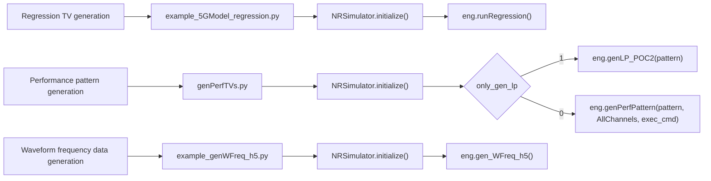
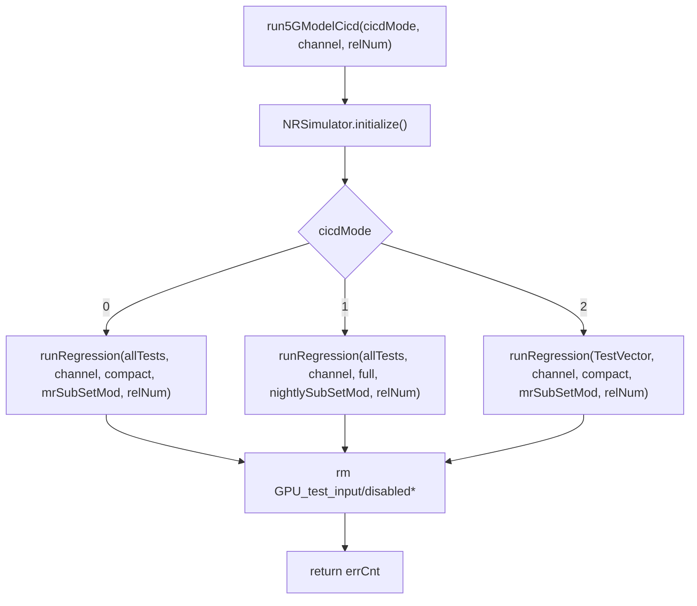
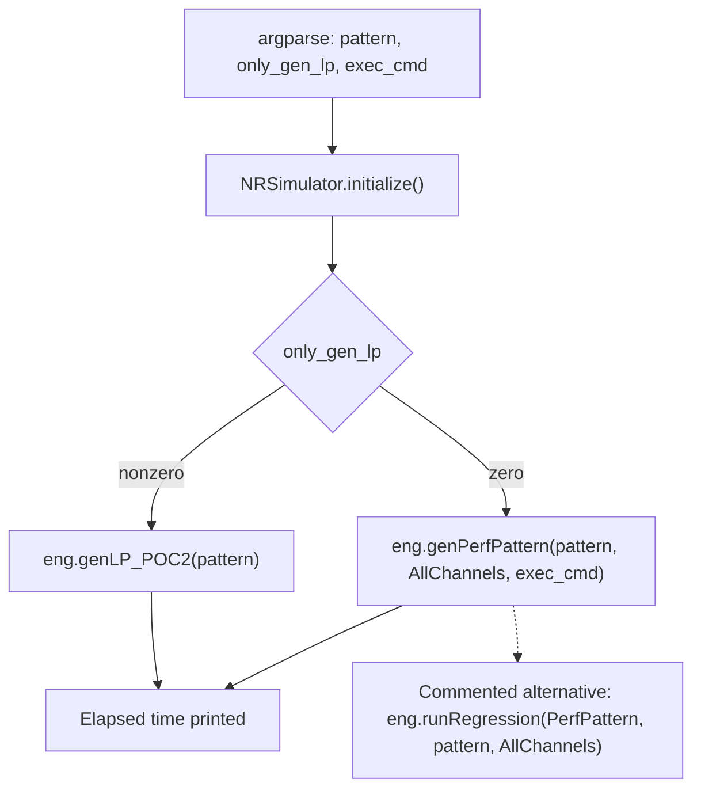
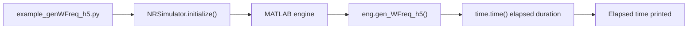
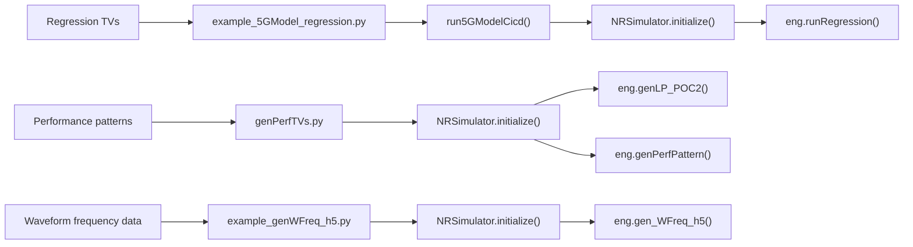

<!-- source: DeepWiki mcp.deepwiki.com · repo NVIDIA/aerial-cuda-accelerated-ran · page 4.2 Test Vector Generation · fetched 2026-10-26 -->

# Test Vector Generation

Relevant source files

The following files were used as context for generating this wiki page:

- [5GModel/aerial_mcore/examples/example_5GModel_regression.py](5GModel/aerial_mcore/examples/example_5GModel_regression.py)
- [5GModel/aerial_mcore/examples/example_genWFreq_h5.py](5GModel/aerial_mcore/examples/example_genWFreq_h5.py)
- [5GModel/aerial_mcore/examples/genPerfTVs.py](5GModel/aerial_mcore/examples/genPerfTVs.py)

## Purpose and Scope

This page documents the test-vector generation entry points present in `5GModel/aerial_mcore/examples`: regression generation through `example_5GModel_regression.py`, performance-pattern generation through `genPerfTVs.py`, and waveform frequency generation through `example_genWFreq_h5.py`. Each script initializes `aerial_mcore` and invokes a MATLAB engine method. The supplied files do not specify the generated artifacts’ storage paths or formats, so those details are not asserted here. [5GModel/aerial_mcore/examples/example_5GModel_regression.py:16-66](), [5GModel/aerial_mcore/examples/genPerfTVs.py:18-51](), [5GModel/aerial_mcore/examples/example_genWFreq_h5.py:16-27]()

**Sources:** [5GModel/aerial_mcore/examples/example_5GModel_regression.py:16-66](), [5GModel/aerial_mcore/examples/genPerfTVs.py:18-51](), [5GModel/aerial_mcore/examples/example_genWFreq_h5.py:16-27]()

## Test Vector Generation Overview

The available scripts expose three generation paths: regression modes call `eng.runRegression()`, performance generation calls either `eng.genLP_POC2()` or `eng.genPerfPattern()`, and waveform frequency generation calls `eng.gen_WFreq_h5()`. All three initialize the engine with `NRSimulator.initialize()`. The supplied files show these calls and parameters but do not implement the MATLAB functions themselves. [5GModel/aerial_mcore/examples/example_5GModel_regression.py:34-65](), [5GModel/aerial_mcore/examples/genPerfTVs.py:35-48](), [5GModel/aerial_mcore/examples/example_genWFreq_h5.py:20-25]()

| Generation path | Python entry point | Engine method | Script-controlled inputs |
|---|---|---|---|
| Regression | `example_5GModel_regression.py` | `eng.runRegression()` | `cicdMode`, `channel`, `relNum` [5GModel/aerial_mcore/examples/example_5GModel_regression.py:22-28](), [5GModel/aerial_mcore/examples/example_5GModel_regression.py:40-65]() |
| Performance | `genPerfTVs.py` | `eng.genLP_POC2()` or `eng.genPerfPattern()` | `pattern`, `only_gen_lp`, `exec_cmd` [5GModel/aerial_mcore/examples/genPerfTVs.py:23-28](), [5GModel/aerial_mcore/examples/genPerfTVs.py:40-48]() |
| Waveform frequency | `example_genWFreq_h5.py` | `eng.gen_WFreq_h5()` | No script arguments are passed to the engine method [5GModel/aerial_mcore/examples/example_genWFreq_h5.py:20-25]() |

### Generation Workflow

The diagram maps the human-facing generation tasks to the Python files and engine methods used by those scripts. It does not imply a particular output directory or file format, which the supplied scripts do not identify. [5GModel/aerial_mcore/examples/example_5GModel_regression.py:34-65](), [5GModel/aerial_mcore/examples/genPerfTVs.py:35-48](), [5GModel/aerial_mcore/examples/example_genWFreq_h5.py:20-25]()

**Sources:** [5GModel/aerial_mcore/examples/example_5GModel_regression.py:34-65](), [5GModel/aerial_mcore/examples/genPerfTVs.py:35-48](), [5GModel/aerial_mcore/examples/example_genWFreq_h5.py:20-25]()

## Regression Test Vector Generation

`run5GModelCicd(cicdMode, channel, relNum)` initializes the engine, selects a `runRegression()` invocation based on `cicdMode`, removes files matching `GPU_test_input/disabled*`, and returns the MATLAB call’s `errCnt`. The function accepts modes from 0 through 2; the script’s command-line entry point reads the mode from `REGRESSION_MODE` and the release number from `RELEASE_NUMBER`. [5GModel/aerial_mcore/examples/example_5GModel_regression.py:22-34](), [5GModel/aerial_mcore/examples/example_5GModel_regression.py:40-66](), [5GModel/aerial_mcore/examples/example_5GModel_regression.py:86-103]()

### Generation Modes

| `cicdMode` | Regression request | Format argument | Subset modifier |
|---:|---|---|---|
| `0` | `['allTests']` for `[channel]` | `'compact'` | `mrSubSetMod`, set to `matlab.double([0, 1])` [5GModel/aerial_mcore/examples/example_5GModel_regression.py:37-45]() |
| `1` | `['allTests']` for `[channel]` | `'full'` | `nightlySubSetMod`, set to `matlab.double([0, 1])` [5GModel/aerial_mcore/examples/example_5GModel_regression.py:37-38](), [5GModel/aerial_mcore/examples/example_5GModel_regression.py:50-54]() |
| `2` | `['TestVector']` for `[channel]` | `'compact'` | `mrSubSetMod` [5GModel/aerial_mcore/examples/example_5GModel_regression.py:37-38](), [5GModel/aerial_mcore/examples/example_5GModel_regression.py:60-61]() |

The script comments identify mode 0 as MR mode, mode 1 as nightly regression mode, and mode 2 as compact TV generation. It also comments that each run may generate TVs unsupported by cuPHY, then removes the `GPU_test_input/disabled*` matches after each mode’s call. [5GModel/aerial_mcore/examples/example_5GModel_regression.py:26-28](), [5GModel/aerial_mcore/examples/example_5GModel_regression.py:40-65]()

### Mode Selection and Execution Flow

The script selects one of three `runRegression()` calls, then performs the same shell cleanup and returns `errCnt`. The diagram represents the control flow implemented in `run5GModelCicd()`. [5GModel/aerial_mcore/examples/example_5GModel_regression.py:34-66]()

**Sources:** [5GModel/aerial_mcore/examples/example_5GModel_regression.py:34-66]()

### Inputs, Defaults, and Exit Status

The script requires `REGRESSION_MODE`; if it is absent, `printUsage()` prints usage information and exits. The accepted values are 0, 1, and 2. `RELEASE_NUMBER` defaults to `10000` when unset, and the channel is read from `sys.argv[1]`. [5GModel/aerial_mcore/examples/example_5GModel_regression.py:68-84](), [5GModel/aerial_mcore/examples/example_5GModel_regression.py:86-101]()

The usage text identifies release number `10000` as latest and `2240` as Rel-22-4. After `run5GModelCicd()` returns, the script exits with status 1 when `errCnt > 0`. [5GModel/aerial_mcore/examples/example_5GModel_regression.py:26-28](), [5GModel/aerial_mcore/examples/example_5GModel_regression.py:80-83](), [5GModel/aerial_mcore/examples/example_5GModel_regression.py:101-103]()

**Sources:** [5GModel/aerial_mcore/examples/example_5GModel_regression.py:26-28](), [5GModel/aerial_mcore/examples/example_5GModel_regression.py:68-103]()

## Performance Test Vector Generation

`genPerfTVs.py` parses three optional positional arguments, initializes `NRSimulator`, and selects launch-pattern-only or performance-pattern generation based on `only_gen_lp`. The script measures elapsed time with `time.time()`. [5GModel/aerial_mcore/examples/genPerfTVs.py:18-51]()

### Arguments and Generation Modes

| Argument | Type | Default | Script behavior |
|---|---:|---:|---|
| `pattern` | Integer | `69` | Passed to `genLP_POC2()` or `genPerfPattern()` [5GModel/aerial_mcore/examples/genPerfTVs.py:24-28](), [5GModel/aerial_mcore/examples/genPerfTVs.py:40-45]() |
| `only_gen_lp` | Integer | `0` | Nonzero selects `genLP_POC2()`; zero selects `genPerfPattern()` [5GModel/aerial_mcore/examples/genPerfTVs.py:26-27](), [5GModel/aerial_mcore/examples/genPerfTVs.py:40-45]() |
| `exec_cmd` | Integer | `1` | Passed as the third argument to `genPerfPattern()` when that mode is selected [5GModel/aerial_mcore/examples/genPerfTVs.py:27-28](), [5GModel/aerial_mcore/examples/genPerfTVs.py:44-45]() |

When `only_gen_lp` is nonzero, the script calls `eng.genLP_POC2(args.pattern)`. Otherwise, it calls `eng.genPerfPattern(args.pattern, 'AllChannels', args.exec_cmd)`. The script’s argument summary says `exec_cmd` controls execution versus printing; the code passes its value to `genPerfPattern()` and does not pass it to `genLP_POC2()`. [5GModel/aerial_mcore/examples/genPerfTVs.py:30-33](), [5GModel/aerial_mcore/examples/genPerfTVs.py:40-45]()

The script also includes a commented alternative using `eng.runRegression(['PerfPattern'], args.pattern, ['AllChannels'])`; it is not executed by the active control flow. [5GModel/aerial_mcore/examples/genPerfTVs.py:44-48]()

### Performance Generation Flow

This diagram maps the CLI arguments to the active branches and engine methods. [5GModel/aerial_mcore/examples/genPerfTVs.py:23-51]()

**Sources:** [5GModel/aerial_mcore/examples/genPerfTVs.py:23-51]()

## Waveform Frequency Data Generation

`example_genWFreq_h5.py` initializes the MATLAB engine through `NRSimulator.initialize()`, calls `eng.gen_WFreq_h5()` without arguments, and prints elapsed time measured with `time.time()`. The filename contains `h5`, but the supplied script does not document the output location or the function’s output schema. [5GModel/aerial_mcore/examples/example_genWFreq_h5.py:16-27]()

### Waveform Frequency Generation Flow

The diagram shows the script’s direct data-generation call and timing path; it does not assert where or how the MATLAB function stores its results. [5GModel/aerial_mcore/examples/example_genWFreq_h5.py:20-27]()

**Sources:** [5GModel/aerial_mcore/examples/example_genWFreq_h5.py:20-27]()

## Script-to-Code Entity Map

This map links the user-facing generation tasks to the concrete Python entry points, functions, and MATLAB engine method names shown in the supplied files. [5GModel/aerial_mcore/examples/example_5GModel_regression.py:22-66](), [5GModel/aerial_mcore/examples/genPerfTVs.py:18-51](), [5GModel/aerial_mcore/examples/example_genWFreq_h5.py:16-27]()

**Sources:** [5GModel/aerial_mcore/examples/example_5GModel_regression.py:22-66](), [5GModel/aerial_mcore/examples/genPerfTVs.py:18-51](), [5GModel/aerial_mcore/examples/example_genWFreq_h5.py:16-27]()

## Operational Notes

The regression entry point requires a channel argument at `sys.argv[1]`; it reads `REGRESSION_MODE` and optionally `RELEASE_NUMBER` from the environment. It reports an error through the process exit status when the returned error count is positive. [5GModel/aerial_mcore/examples/example_5GModel_regression.py:68-103]()

`genPerfTVs.py` uses positional arguments with defaults, prints the selected configuration, and reports elapsed generation time. `example_genWFreq_h5.py` also reports elapsed time. These scripts do not provide further output-format or destination details in the supplied content. [5GModel/aerial_mcore/examples/genPerfTVs.py:23-51](), [5GModel/aerial_mcore/examples/example_genWFreq_h5.py:20-27]()

**Sources:** [5GModel/aerial_mcore/examples/example_5GModel_regression.py:68-103](), [5GModel/aerial_mcore/examples/genPerfTVs.py:23-51](), [5GModel/aerial_mcore/examples/example_genWFreq_h5.py:20-27]()

---

