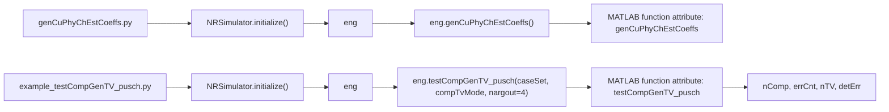
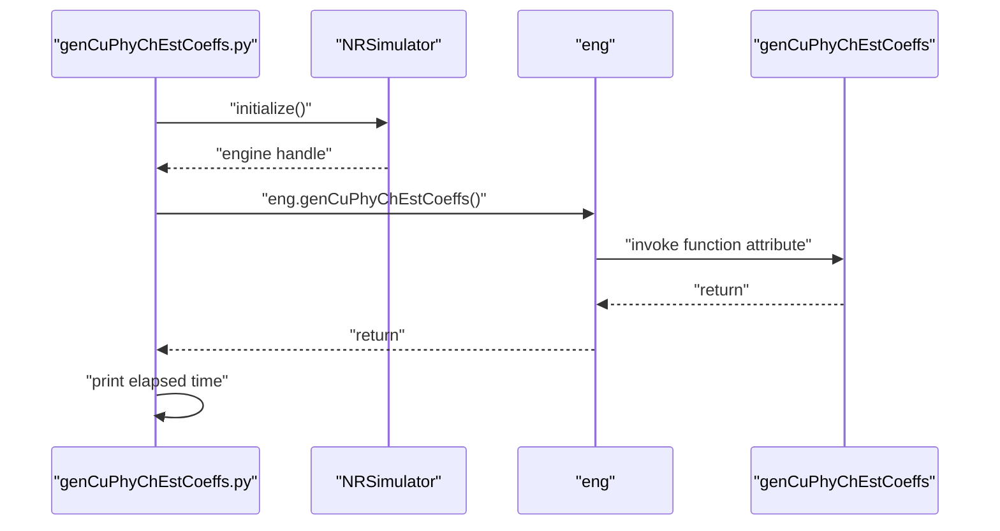
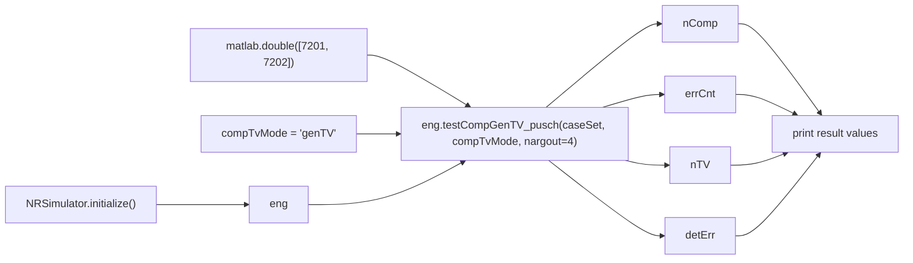

<!-- source: DeepWiki mcp.deepwiki.com · repo NVIDIA/aerial-cuda-accelerated-ran · page 4.3 Physical Layer Examples · fetched 2026-10-26 -->

# Physical Layer Examples

Relevant source files

The following files were used as context for generating this wiki page:

- [5GModel/aerial_mcore/examples/example_testCompGenTV_pusch.py](5GModel/aerial_mcore/examples/example_testCompGenTV_pusch.py)
- [5GModel/aerial_mcore/examples/genCuPhyChEstCoeffs.py](5GModel/aerial_mcore/examples/genCuPhyChEstCoeffs.py)

## Purpose and Scope

This page documents two physical-layer example scripts in `5GModel/aerial_mcore/examples`: one invokes MATLAB-side channel-estimation coefficient generation, and the other invokes PUSCH component test-vector generation. Both use `aerial_mcore.initialize()` to obtain an engine handle and call a MATLAB function through that handle. [5GModel/aerial_mcore/examples/genCuPhyChEstCoeffs.py:18-25](), [5GModel/aerial_mcore/examples/example_testCompGenTV_pusch.py:16-27]()

This page is limited to the behavior visible in those scripts. It does not specify generated file formats, output locations, MATLAB implementation details, or downstream cuPHY test-bench behavior; those details are not shown in the provided files. [5GModel/aerial_mcore/examples/genCuPhyChEstCoeffs.py:18-28](), [5GModel/aerial_mcore/examples/example_testCompGenTV_pusch.py:16-34]()

Sources: [5GModel/aerial_mcore/examples/genCuPhyChEstCoeffs.py:18-28](), [5GModel/aerial_mcore/examples/example_testCompGenTV_pusch.py:16-34]()

## Overview

The examples expose two calls through the `aerial_mcore` Python interface:

- `eng.genCuPhyChEstCoeffs()` is called by `genCuPhyChEstCoeffs.py`. [5GModel/aerial_mcore/examples/genCuPhyChEstCoeffs.py:18-28]()
- `eng.testCompGenTV_pusch(caseSet, compTvMode, nargout=4)` is called by `example_testCompGenTV_pusch.py`; the script supplies case IDs and a mode, then prints four returned values. [5GModel/aerial_mcore/examples/example_testCompGenTV_pusch.py:23-34]()

The scripts measure elapsed wall-clock time around their MATLAB-engine calls. [5GModel/aerial_mcore/examples/genCuPhyChEstCoeffs.py:24-28](), [5GModel/aerial_mcore/examples/example_testCompGenTV_pusch.py:26-34]()

### Architecture and Data Flow

The diagram connects the Python-facing example names to the engine handle and the MATLAB function names used as attributes on that handle. The provided scripts establish these call relationships but do not show the MATLAB function implementations or the resulting artifact paths. [5GModel/aerial_mcore/examples/genCuPhyChEstCoeffs.py:18-25](), [5GModel/aerial_mcore/examples/example_testCompGenTV_pusch.py:16-27]()

**Figure 1: Python Examples to MATLAB Engine Calls**

Sources: [5GModel/aerial_mcore/examples/genCuPhyChEstCoeffs.py:18-25](), [5GModel/aerial_mcore/examples/example_testCompGenTV_pusch.py:16-34]()

Sources: [5GModel/aerial_mcore/examples/genCuPhyChEstCoeffs.py:18-25](), [5GModel/aerial_mcore/examples/example_testCompGenTV_pusch.py:16-27]()

## Channel Estimation Coefficient Generation

### Script Flow

`genCuPhyChEstCoeffs.py` imports `aerial_mcore` under the alias `NRSimulator`, initializes it, and calls `eng.genCuPhyChEstCoeffs()`. The call is bracketed by `time.time()` measurements, and the script prints the elapsed time. [5GModel/aerial_mcore/examples/genCuPhyChEstCoeffs.py:18-28]()

The script contains a commented-out `eng.cfg_parfor(0,nargout=0)` line. Since it is commented out, it is not executed by the script as provided. [5GModel/aerial_mcore/examples/genCuPhyChEstCoeffs.py:21-22]()

**Figure 2: Channel Estimation Example Call Sequence**

Sources: [5GModel/aerial_mcore/examples/genCuPhyChEstCoeffs.py:18-28]()

### Invocation and Timing

The script has no arguments or configuration inputs in its shown Python body. It invokes `genCuPhyChEstCoeffs()` without explicit arguments and prints a single elapsed-time message after the call returns. [5GModel/aerial_mcore/examples/genCuPhyChEstCoeffs.py:18-28]()

Sources: [5GModel/aerial_mcore/examples/genCuPhyChEstCoeffs.py:18-28]()

## PUSCH Test Vector Generation

### Inputs and Invocation

`example_testCompGenTV_pusch.py` imports `aerial_mcore` as `NRSimulator` and imports `matlab`. It initializes the engine, constructs `caseSet` as `matlab.double([7201, 7202])`, and sets `compTvMode` to the string `'genTV'`. [5GModel/aerial_mcore/examples/example_testCompGenTV_pusch.py:16-24]()

It calls `eng.testCompGenTV_pusch(caseSet, compTvMode, nargout=4)`. The four returned values are assigned to `nComp`, `errCnt`, `nTV`, and `detErr`, then each is printed. [5GModel/aerial_mcore/examples/example_testCompGenTV_pusch.py:26-34]()

**Figure 3: PUSCH Example Inputs and Results**

Sources: [5GModel/aerial_mcore/examples/example_testCompGenTV_pusch.py:16-34]()

### Return Values and Timing

The script requests four MATLAB outputs using `nargout=4` and binds them to the names `nComp`, `errCnt`, `nTV`, and `detErr`. It prints those values and reports elapsed time measured around the function call. [5GModel/aerial_mcore/examples/example_testCompGenTV_pusch.py:26-34]()

The source sets `compTvMode` to `'genTV'`. A comment mentions `'both'` as an alternative, but the script does not define or document the behavior of either mode beyond passing the selected string to the MATLAB function. [5GModel/aerial_mcore/examples/example_testCompGenTV_pusch.py:23-27]()

Sources: [5GModel/aerial_mcore/examples/example_testCompGenTV_pusch.py:23-34]()

## Comparing the Two Examples

Both scripts initialize `aerial_mcore` and invoke a function through the returned `eng` handle. The channel-estimation example makes a no-argument call; the PUSCH example passes a MATLAB-compatible case array and a mode string, and requests four outputs. [5GModel/aerial_mcore/examples/genCuPhyChEstCoeffs.py:18-25](), [5GModel/aerial_mcore/examples/example_testCompGenTV_pusch.py:16-27]()

| Example | Engine call | Inputs shown in Python | Output handling shown in Python |
|---|---|---|---|
| Channel estimation | `eng.genCuPhyChEstCoeffs()` | No explicit arguments | Prints elapsed time [5GModel/aerial_mcore/examples/genCuPhyChEstCoeffs.py:24-28]() |
| PUSCH component test vectors | `eng.testCompGenTV_pusch(caseSet, compTvMode, nargout=4)` | `caseSet = matlab.double([7201, 7202])`; `compTvMode = 'genTV'` | Prints `nComp`, `errCnt`, `nTV`, `detErr`, and elapsed time [5GModel/aerial_mcore/examples/example_testCompGenTV_pusch.py:23-34]() |

Sources: [5GModel/aerial_mcore/examples/genCuPhyChEstCoeffs.py:18-28](), [5GModel/aerial_mcore/examples/example_testCompGenTV_pusch.py:16-34]()

## Execution Notes

The scripts are standalone Python examples in `5GModel/aerial_mcore/examples`. The channel-estimation script uses `time`; the PUSCH script uses both `time` and `matlab`. [5GModel/aerial_mcore/examples/genCuPhyChEstCoeffs.py:18-28](), [5GModel/aerial_mcore/examples/example_testCompGenTV_pusch.py:16-34]()

The source files do not specify command-line options, generated artifact locations, artifact formats, or the MATLAB-side definitions of the called functions. Those aspects cannot be inferred from these examples alone. [5GModel/aerial_mcore/examples/genCuPhyChEstCoeffs.py:18-28](), [5GModel/aerial_mcore/examples/example_testCompGenTV_pusch.py:16-34]()

Sources: [5GModel/aerial_mcore/examples/genCuPhyChEstCoeffs.py:18-28](), [5GModel/aerial_mcore/examples/example_testCompGenTV_pusch.py:16-34]()

---

