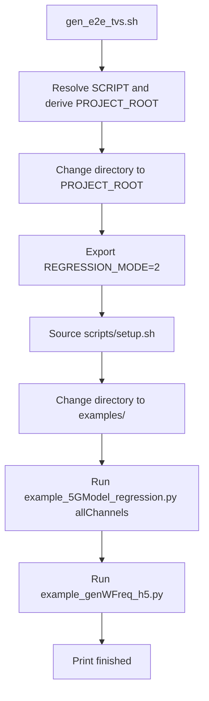
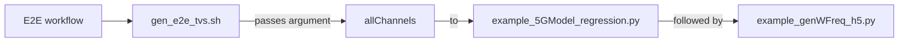
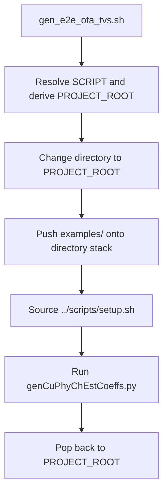
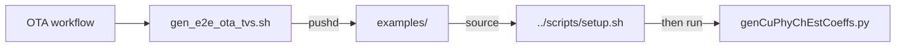

<!-- source: DeepWiki mcp.deepwiki.com · repo NVIDIA/aerial-cuda-accelerated-ran · page 4.4 End-to-End Test Vector Generation · fetched 2026-10-26 -->

# End-to-End Test Vector Generation

Relevant source files

The following files were used as context for generating this wiki page:

- [5GModel/aerial_mcore/scripts/gen_e2e_ota_tvs.sh](5GModel/aerial_mcore/scripts/gen_e2e_ota_tvs.sh)
- [5GModel/aerial_mcore/scripts/gen_e2e_tvs.sh](5GModel/aerial_mcore/scripts/gen_e2e_tvs.sh)

## Purpose and Scope

This page documents the two shell-script workflows provided for end-to-end (E2E) and OTA test-vector generation: `gen_e2e_tvs.sh` and `gen_e2e_ota_tvs.sh`. It covers their execution order, environment setup, and the Python scripts they invoke. The available script contents do not specify the generated artifacts’ filenames, formats, or output directories. [5GModel/aerial_mcore/scripts/gen_e2e_tvs.sh:18-44](), [5GModel/aerial_mcore/scripts/gen_e2e_ota_tvs.sh:18-31]()

Sources: [5GModel/aerial_mcore/scripts/gen_e2e_tvs.sh:18-44](), [5GModel/aerial_mcore/scripts/gen_e2e_ota_tvs.sh:18-31]()

## Overview

Both shell scripts enable execution to stop on the first command failure with `set -e`, resolve their own paths, derive `PROJECT_ROOT` from the script location, and change to that directory before proceeding. Their workflows then diverge: `gen_e2e_tvs.sh` sets `REGRESSION_MODE=2` and runs two Python examples, while `gen_e2e_ota_tvs.sh` enters `examples/`, sources setup there, and runs `genCuPhyChEstCoeffs.py`. [5GModel/aerial_mcore/scripts/gen_e2e_tvs.sh:18-40](), [5GModel/aerial_mcore/scripts/gen_e2e_ota_tvs.sh:18-30]()

| Workflow | Script | Environment and commands |
|---|---|---|
| E2E | `gen_e2e_tvs.sh` | Sets `REGRESSION_MODE=2`, sources `scripts/setup.sh`, then runs `example_5GModel_regression.py allChannels` and `example_genWFreq_h5.py`. [5GModel/aerial_mcore/scripts/gen_e2e_tvs.sh:28-40]() |
| OTA | `gen_e2e_ota_tvs.sh` | Enters `examples/`, sources `../scripts/setup.sh`, then runs `genCuPhyChEstCoeffs.py`. [5GModel/aerial_mcore/scripts/gen_e2e_ota_tvs.sh:28-30]() |

Sources: [5GModel/aerial_mcore/scripts/gen_e2e_tvs.sh:18-40](), [5GModel/aerial_mcore/scripts/gen_e2e_ota_tvs.sh:18-30]()

## End-to-End Test Vector Generation Workflow

### Script: `gen_e2e_tvs.sh`

The E2E script derives `PROJECT_ROOT` from the resolved script path and changes to that directory. It sets `REGRESSION_MODE=2`, sources `scripts/setup.sh`, changes into `examples/`, and sequentially invokes `example_5GModel_regression.py` with `allChannels` and `example_genWFreq_h5.py`. The commands are prefixed with `time`; the script then prints a completion message if execution reaches the end. [5GModel/aerial_mcore/scripts/gen_e2e_tvs.sh:18-44]()

#### Workflow diagram

**Diagram: E2E script execution sequence**

Sources: [5GModel/aerial_mcore/scripts/gen_e2e_tvs.sh:18-44]()

### Execution steps

1. **Resolve the project directory.** The script resolves its own path, obtains its directory, derives `PROJECT_ROOT` as the parent of that directory, and changes to `PROJECT_ROOT`. [5GModel/aerial_mcore/scripts/gen_e2e_tvs.sh:21-26]()
2. **Set the regression mode and source setup.** It exports `REGRESSION_MODE=2` and sources `scripts/setup.sh` from the project root. [5GModel/aerial_mcore/scripts/gen_e2e_tvs.sh:28-31]()
3. **Run the regression example.** From `examples/`, it invokes `python3 ./example_5GModel_regression.py allChannels` with `time`. [5GModel/aerial_mcore/scripts/gen_e2e_tvs.sh:34-39]()
4. **Run the waveform-frequency example.** It then invokes `python3 ./example_genWFreq_h5.py` with `time`. [5GModel/aerial_mcore/scripts/gen_e2e_tvs.sh:39-40]()
5. **Handle failures.** Because the script uses `set -e`, a failing command stops the script before later commands, including the final completion message. [5GModel/aerial_mcore/scripts/gen_e2e_tvs.sh:18-19]()

Sources: [5GModel/aerial_mcore/scripts/gen_e2e_tvs.sh:18-44]()

### Relationship between the channel argument and code entities

The shell script supplies the literal argument `allChannels` to `example_5GModel_regression.py`. The available script content establishes that invocation, but does not define which individual channels the Python example processes. [5GModel/aerial_mcore/scripts/gen_e2e_tvs.sh:39]()

**Diagram: `allChannels` invocation mapped to script entities**

Sources: [5GModel/aerial_mcore/scripts/gen_e2e_tvs.sh:34-40]()

## Over-The-Air Test Vector Generation

### Script: `gen_e2e_ota_tvs.sh`

The OTA script derives `PROJECT_ROOT` from the resolved script path and changes to that directory. It then enters `examples/`, sources `../scripts/setup.sh`, and invokes `python3 genCuPhyChEstCoeffs.py`. The script does not set `REGRESSION_MODE` in its own contents. [5GModel/aerial_mcore/scripts/gen_e2e_ota_tvs.sh:18-30]()

#### Workflow diagram

**Diagram: OTA script execution sequence**

Sources: [5GModel/aerial_mcore/scripts/gen_e2e_ota_tvs.sh:18-31]()

### Execution steps

1. **Resolve the project directory.** The script resolves its own path, derives `PROJECT_ROOT` from the script directory, and changes to the project root. [5GModel/aerial_mcore/scripts/gen_e2e_ota_tvs.sh:21-26]()
2. **Enter the examples directory.** It uses `pushd examples` to change directories while saving the previous directory on the shell’s directory stack. [5GModel/aerial_mcore/scripts/gen_e2e_ota_tvs.sh:28]()
3. **Source setup and run the generator.** From `examples/`, it sources `../scripts/setup.sh` and runs `python3 genCuPhyChEstCoeffs.py`. [5GModel/aerial_mcore/scripts/gen_e2e_ota_tvs.sh:28-30]()
4. **Return to the project root.** If execution reaches the next command, `popd` restores the previous directory. [5GModel/aerial_mcore/scripts/gen_e2e_ota_tvs.sh:31]()
5. **Handle failures.** The script uses `set -e`; a failing command stops execution, so a failure before `popd` prevents that command from running. [5GModel/aerial_mcore/scripts/gen_e2e_ota_tvs.sh:18-19]()

Sources: [5GModel/aerial_mcore/scripts/gen_e2e_ota_tvs.sh:18-31]()

### Relationship between OTA workflow and code entities

The OTA shell workflow’s Python entry point is `genCuPhyChEstCoeffs.py`, invoked from the `examples/` working directory after setup is sourced. The shell script does not expose the generator’s internal implementation or specify its output paths. [5GModel/aerial_mcore/scripts/gen_e2e_ota_tvs.sh:28-30]()

**Diagram: OTA workflow mapped to script entities**

Sources: [5GModel/aerial_mcore/scripts/gen_e2e_ota_tvs.sh:28-30]()

## Comparison of E2E and OTA Workflows

| Aspect | E2E | OTA |
|---|---|---|
| Script | `gen_e2e_tvs.sh` [5GModel/aerial_mcore/scripts/gen_e2e_tvs.sh:1-2]() | `gen_e2e_ota_tvs.sh` [5GModel/aerial_mcore/scripts/gen_e2e_ota_tvs.sh:1-2]() |
| Setup script invocation | Sources `scripts/setup.sh` from `PROJECT_ROOT`. [5GModel/aerial_mcore/scripts/gen_e2e_tvs.sh:26-31]() | Enters `examples/` and sources `../scripts/setup.sh`. [5GModel/aerial_mcore/scripts/gen_e2e_ota_tvs.sh:26-30]() |
| Explicit regression mode | Exports `REGRESSION_MODE=2`. [5GModel/aerial_mcore/scripts/gen_e2e_tvs.sh:28]() | No regression-mode assignment appears in the script. [5GModel/aerial_mcore/scripts/gen_e2e_ota_tvs.sh:18-31]() |
| Python entry points | `example_5GModel_regression.py allChannels`, followed by `example_genWFreq_h5.py`. [5GModel/aerial_mcore/scripts/gen_e2e_tvs.sh:39-40]() | `genCuPhyChEstCoeffs.py`. [5GModel/aerial_mcore/scripts/gen_e2e_ota_tvs.sh:30]() |

The provided shell scripts identify their Python entry points but do not establish the generated artifacts’ exact contents, filenames, formats, or storage locations. [5GModel/aerial_mcore/scripts/gen_e2e_tvs.sh:34-40](), [5GModel/aerial_mcore/scripts/gen_e2e_ota_tvs.sh:28-30]()

Sources: [5GModel/aerial_mcore/scripts/gen_e2e_tvs.sh:18-40](), [5GModel/aerial_mcore/scripts/gen_e2e_ota_tvs.sh:18-30]()

## Sources and Scope Notes

This page describes behavior visible in the two supplied shell scripts. Details of the Python generators, setup-script effects, channel coverage, and output artifact structure are not established by those script contents. [5GModel/aerial_mcore/scripts/gen_e2e_tvs.sh:28-40](), [5GModel/aerial_mcore/scripts/gen_e2e_ota_tvs.sh:28-30]()

Sources: [5GModel/aerial_mcore/scripts/gen_e2e_tvs.sh:18-44](), [5GModel/aerial_mcore/scripts/gen_e2e_ota_tvs.sh:18-31]()

---

