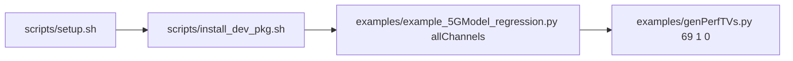
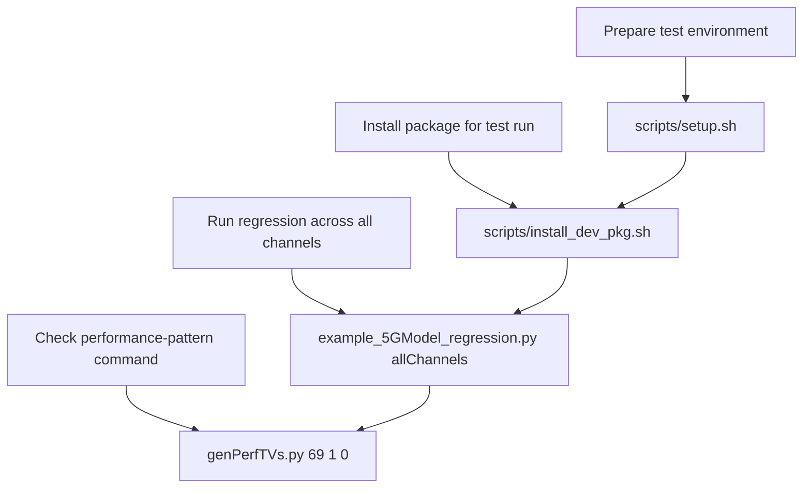

<!-- source: DeepWiki mcp.deepwiki.com · repo NVIDIA/aerial-cuda-accelerated-ran · page 5 Testing and Validation · fetched 2026-10-26 -->

# Testing and Validation

Relevant source files

The following files were used as context for generating this wiki page:

- [5GModel/aerial_mcore/scripts/run_5GModel_regression.sh](5GModel/aerial_mcore/scripts/run_5GModel_regression.sh)

## Purpose and Scope

This page outlines the testing and validation entry points visible in the provided code: a regression script that prepares the environment, installs the developer-mode package, runs the regression example for all channels, and checks performance-pattern generation. Detailed coverage of each testing area is delegated to the child pages below. [5GModel/aerial_mcore/scripts/run_5GModel_regression.sh:28-40]()

Sources: [5GModel/aerial_mcore/scripts/run_5GModel_regression.sh:28-40]()

---

## Testing Architecture Overview

The regression script provides a high-level sequence for validation: environment setup and package installation precede the regression example, followed by a performance-pattern generation check. For subsystem details, see the child pages linked throughout this page. [5GModel/aerial_mcore/scripts/run_5GModel_regression.sh:28-40]()

### Testing Components and Flow

**Diagram: Regression script sequence**

Sources: [5GModel/aerial_mcore/scripts/run_5GModel_regression.sh:28-40]()

**Diagram: Validation concepts mapped to script entities**

Sources: [5GModel/aerial_mcore/scripts/run_5GModel_regression.sh:28-40]()

---

## Regression Testing Framework

The parent regression script invokes `example_5GModel_regression.py` with the `allChannels` argument. This page does not document regression modes or their configuration; see [Regression Testing Framework](#5.1) for those details. [5GModel/aerial_mcore/scripts/run_5GModel_regression.sh:34-40]()

Sources: [5GModel/aerial_mcore/scripts/run_5GModel_regression.sh:34-40]()

---

## Sharded Parallel Testing

The provided regression script runs the all-channel example directly. Sharded execution is covered separately in [Sharded Parallel Testing](#5.2). [5GModel/aerial_mcore/scripts/run_5GModel_regression.sh:34-40]()

Sources: [5GModel/aerial_mcore/scripts/run_5GModel_regression.sh:34-40]()

---

## Test Vector System

This page’s available regression-script excerpt does not specify test-vector formats or storage. For the test-vector structure and its use in validation, see [Test Vector System](#5.3).

Sources: [5GModel/aerial_mcore/scripts/run_5GModel_regression.sh:34-40]()

---

## Performance Test Vectors

After the regression example, the script invokes `genPerfTVs.py` with arguments `69 1 0`. The script comment describes this invocation as checking the performance-generation pattern while using `0` to print the command. For generation modes and usage, see [Performance Test Vectors](#5.4). [5GModel/aerial_mcore/scripts/run_5GModel_regression.sh:39-40]()

Sources: [5GModel/aerial_mcore/scripts/run_5GModel_regression.sh:39-40]()

---

## GPU Test Bench and Performance Benchmarking

GPU test-bench tools and broader benchmarking workflows are outside the scope of the available script excerpt. See [GPU Test Bench and Performance Benchmarking](#5.5) for details. The regression script’s performance-related entry point is the `genPerfTVs.py` invocation described above. [5GModel/aerial_mcore/scripts/run_5GModel_regression.sh:39-40]()

Sources: [5GModel/aerial_mcore/scripts/run_5GModel_regression.sh:39-40]()

---

