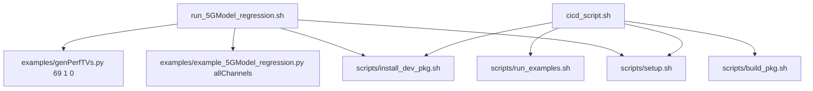
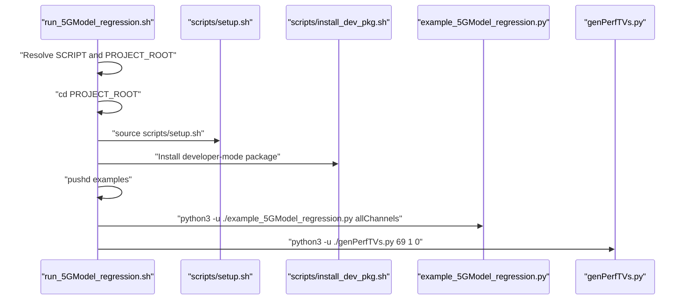
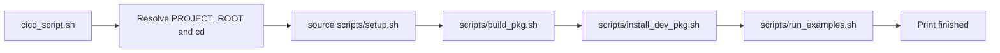

<!-- source: DeepWiki mcp.deepwiki.com · repo NVIDIA/aerial-cuda-accelerated-ran · page 5.1 Regression Testing Framework · fetched 2026-10-26 -->

# Regression Testing Framework

Relevant source files

The following files were used as context for generating this wiki page:

- [5GModel/aerial_mcore/scripts/cicd_script.sh](5GModel/aerial_mcore/scripts/cicd_script.sh)
- [5GModel/aerial_mcore/scripts/run_5GModel_regression.sh](5GModel/aerial_mcore/scripts/run_5GModel_regression.sh)

## Purpose and Scope

This page documents the regression-related shell entry points visible in the supplied code: `run_5GModel_regression.sh` and `cicd_script.sh`. The regression script prepares the `aerial_mcore` environment, runs the `allChannels` example, and checks a performance-test-vector command pattern. The supplied files do not include the Python regression implementation, so details such as MR/nightly mode semantics, compact-TV behavior, `run5GModelCicd`, and `REGRESSION_MODE` handling cannot be established here. [5GModel/aerial_mcore/scripts/run_5GModel_regression.sh:28-40]()

Sources: [5GModel/aerial_mcore/scripts/run_5GModel_regression.sh:28-40]()

## Overview

`run_5GModel_regression.sh` changes to the project root, sources `scripts/setup.sh`, installs the developer-mode package, and then runs `example_5GModel_regression.py allChannels` from the `examples` directory. It next invokes `genPerfTVs.py` with arguments `69 1 0`; the shell comment says the final `0` causes the command to be printed only, to check the performance-generation pattern. The script uses `set -e`, so a failing command stops the script. [5GModel/aerial_mcore/scripts/run_5GModel_regression.sh:18-19](), [5GModel/aerial_mcore/scripts/run_5GModel_regression.sh:21-40]()

`cicd_script.sh` is a separate package-and-examples workflow: it sources setup, builds the package, installs it in developer mode, and runs the examples. It does not invoke `run_5GModel_regression.sh` in the supplied contents. [5GModel/aerial_mcore/scripts/cicd_script.sh:18-19](), [5GModel/aerial_mcore/scripts/cicd_script.sh:21-38]()

### Shell Entry Points and Code Entities

**Diagram: Regression and package-workflow entry points**

Sources: [5GModel/aerial_mcore/scripts/run_5GModel_regression.sh:21-40](), [5GModel/aerial_mcore/scripts/cicd_script.sh:21-38]()

## Regression Script Execution

The regression script resolves its own path, derives `PROJECT_ROOT` from the script directory, and changes into that root before sourcing setup. It then installs the developer-mode package, changes into `examples`, and executes the regression example with the positional argument `allChannels`. [5GModel/aerial_mcore/scripts/run_5GModel_regression.sh:21-35](), [5GModel/aerial_mcore/scripts/run_5GModel_regression.sh:39]()

The script declares `pids` and `stats` arrays before executing the Python commands. In the supplied lines, those arrays are not subsequently used. The performance-vector invocation is a separate command following the regression example. [5GModel/aerial_mcore/scripts/run_5GModel_regression.sh:34-40]()

**Diagram: `run_5GModel_regression.sh` command flow**

Sources: [5GModel/aerial_mcore/scripts/run_5GModel_regression.sh:21-40]()

## MR, Nightly, Compact TV, and `REGRESSION_MODE`

The supplied shell scripts do not define MR or nightly modes, select compact versus full test-vector generation, or read `REGRESSION_MODE`. The regression script invokes the example with `allChannels`, but the contents provided do not show how that argument is interpreted or how the Python code selects a regression mode. Consequently, mode values, defaults, test scope, and output behavior are not specified here. [5GModel/aerial_mcore/scripts/run_5GModel_regression.sh:34-40](), [5GModel/aerial_mcore/scripts/cicd_script.sh:28-38]()

Sources: [5GModel/aerial_mcore/scripts/run_5GModel_regression.sh:34-40](), [5GModel/aerial_mcore/scripts/cicd_script.sh:28-38]()

## `cicd_script.sh` Workflow

`cicd_script.sh` enables `set -e`, resolves the project root, sources `scripts/setup.sh`, builds the package with `scripts/build_pkg.sh`, installs the developer-mode package with `scripts/install_dev_pkg.sh`, and runs `scripts/run_examples.sh`. The script prints start and finish messages around this workflow. [5GModel/aerial_mcore/scripts/cicd_script.sh:18-41]()

This is a package-build-and-examples workflow, not the dedicated regression sequence shown in `run_5GModel_regression.sh`: the supplied `cicd_script.sh` does not call the regression example or the performance-vector generator directly. [5GModel/aerial_mcore/scripts/cicd_script.sh:28-41](), [5GModel/aerial_mcore/scripts/run_5GModel_regression.sh:28-40]()

**Diagram: `cicd_script.sh` workflow**

Sources: [5GModel/aerial_mcore/scripts/cicd_script.sh:18-41]()

## Operational Notes

Both scripts use `set -e`, which makes the shell exit when a command fails. The regression script therefore stops if setup, package installation, the regression example, or the performance-pattern command fails; `cicd_script.sh` similarly stops on a failed setup, build, install, or examples command. [5GModel/aerial_mcore/scripts/run_5GModel_regression.sh:18-19](), [5GModel/aerial_mcore/scripts/cicd_script.sh:18-19]()

The regression script runs its Python commands from the `examples` directory after `pushd examples`. Its explicit inputs are `allChannels` for `example_5GModel_regression.py` and `69 1 0` for `genPerfTVs.py`. The supplied files do not document the meaning of the latter arguments beyond the comment that the final `0` prints the command for pattern checking. [5GModel/aerial_mcore/scripts/run_5GModel_regression.sh:34-40]()

Sources: [5GModel/aerial_mcore/scripts/run_5GModel_regression.sh:18-19](), [5GModel/aerial_mcore/scripts/run_5GModel_regression.sh:34-40]()

---

