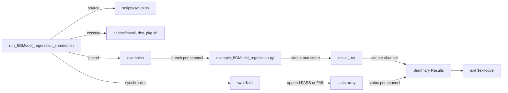
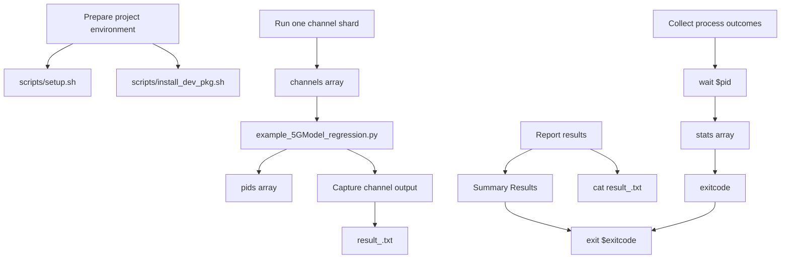
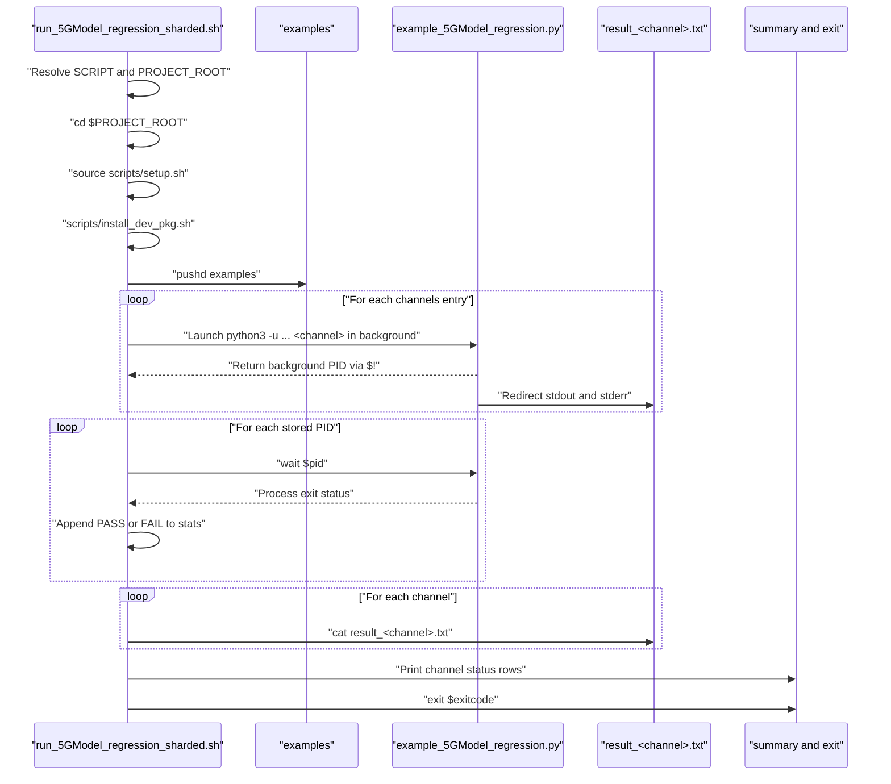
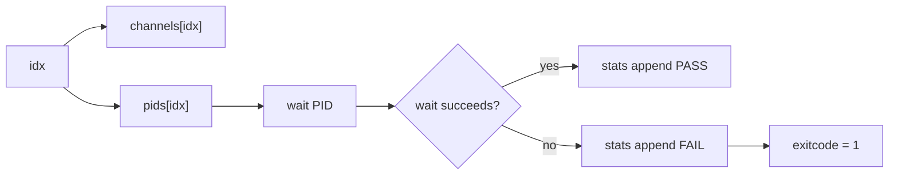

<!-- source: DeepWiki mcp.deepwiki.com · repo NVIDIA/aerial-cuda-accelerated-ran · page 5.2 Sharded Parallel Testing · fetched 2026-10-26 -->

# Sharded Parallel Testing

Relevant source files

The following files were used as context for generating this wiki page:

- [5GModel/aerial_mcore/scripts/run_5GModel_regression_sharded.sh](5GModel/aerial_mcore/scripts/run_5GModel_regression_sharded.sh)

## Purpose and Scope

This page describes `run_5GModel_regression_sharded.sh`, which prepares the `aerial_mcore` project environment, launches one regression process per configured channel in parallel, collects their exit statuses, prints each channel’s log, and exits with an aggregate status. The available implementation does not show the internals of `example_5GModel_regression.py` or establish how test vectors are generated, so those behaviors are not covered here. [5GModel/aerial_mcore/scripts/run_5GModel_regression_sharded.sh:18-87]()

Sources: [5GModel/aerial_mcore/scripts/run_5GModel_regression_sharded.sh:18-87]()

## Overview

The script defines 16 channel names, changes to the project root, sources `scripts/setup.sh`, and runs `scripts/install_dev_pkg.sh` before entering `examples`. It then starts one background `python3 -u ./example_5GModel_regression.py <channel>` process for each channel, redirecting that process’s standard output and standard error to `result_<channel>.txt`. [5GModel/aerial_mcore/scripts/run_5GModel_regression_sharded.sh:21-46]()

The script stores each background process ID in `pids`, waits for the processes in channel order, and appends `PASS` or `FAIL` to `stats` in the same order. After the waits, it prints the contents of the per-channel result files, prints a channel/status summary, and exits with the accumulated `exitcode`. [5GModel/aerial_mcore/scripts/run_5GModel_regression_sharded.sh:39-87]()

Sources: [5GModel/aerial_mcore/scripts/run_5GModel_regression_sharded.sh:21-87]()

## System Architecture

The code entities below connect the script’s setup, worker-launch, and reporting stages. Each channel invocation is a separate background process, and its output is redirected to a channel-specific file. [5GModel/aerial_mcore/scripts/run_5GModel_regression_sharded.sh:31-48]()

**Diagram: Script stages and code entities**

Sources: [5GModel/aerial_mcore/scripts/run_5GModel_regression_sharded.sh:31-87]()

### Natural Language to Code Entity Mapping

“Prepare the environment” maps to sourcing `scripts/setup.sh` and invoking `scripts/install_dev_pkg.sh`. “Run a channel shard” maps to a background invocation of `example_5GModel_regression.py` with one channel argument. “Collect results” maps to `wait`, `stats`, `result_<channel>.txt`, and the final summary loop. [5GModel/aerial_mcore/scripts/run_5GModel_regression_sharded.sh:31-87]()

**Diagram: Testing concepts mapped to script identifiers**

Sources: [5GModel/aerial_mcore/scripts/run_5GModel_regression_sharded.sh:21-87]()

## Channel Configuration

The `channels` Bash array contains 16 entries. The script passes each entry as the sole channel argument to `example_5GModel_regression.py` and uses it in the corresponding `result_<channel>.txt` filename and summary row. The names are reproduced as configured; this script does not define their test semantics. [5GModel/aerial_mcore/scripts/run_5GModel_regression_sharded.sh:21-23](), [5GModel/aerial_mcore/scripts/run_5GModel_regression_sharded.sh:43-47](), [5GModel/aerial_mcore/scripts/run_5GModel_regression_sharded.sh:64-80]()

| Array order | Channel value |
|---:|---|
| 1 | `ssb` |
| 2 | `pdcch` |
| 3 | `pdsch` |
| 4 | `csirs` |
| 5 | `dlmix` |
| 6 | `prach` |
| 7 | `pucch` |
| 8 | `pusch` |
| 9 | `srs` |
| 10 | `ulmix` |
| 11 | `bfw` |
| 12 | `cuPHY-CP_TVs` |
| 13 | `perf_TVs` |
| 14 | `cfgTemplate` |
| 15 | `launchPatternFile` |
| 16 | `CfgTV_nvbug` |

Sources: [5GModel/aerial_mcore/scripts/run_5GModel_regression_sharded.sh:21-23]()

## Execution Flow

The script enables `set -e`, resolves its own path with `readlink -f`, derives `SCRIPT_DIR` and `PROJECT_ROOT`, and changes to that project root. It then sources the setup script and runs the developer package installation script before changing into `examples`. [5GModel/aerial_mcore/scripts/run_5GModel_regression_sharded.sh:18-38]()

**Diagram: Setup, parallel launch, and collection**

Sources: [5GModel/aerial_mcore/scripts/run_5GModel_regression_sharded.sh:18-87]()

### Process Launch and Output Capture

The launch loop iterates over the array indices, selects `channels[$idx]`, and starts `python3 -u ./example_5GModel_regression.py $channel` in the background. Shell redirection sends both standard output and standard error to `result_$channel.txt`, and `$!` is appended to `pids`. [5GModel/aerial_mcore/scripts/run_5GModel_regression_sharded.sh:43-48]()

All launches happen before the script enters the wait loop, so the worker processes can run concurrently. The script does not impose a worker limit; it launches one background process for every entry in `channels`. [5GModel/aerial_mcore/scripts/run_5GModel_regression_sharded.sh:43-62]()

Sources: [5GModel/aerial_mcore/scripts/run_5GModel_regression_sharded.sh:43-48]()

### Waiting and Status Collection

The wait loop uses the same array index to retrieve a PID from `pids` and its channel name from `channels`. A successful `wait` appends `PASS` to `stats`; an unsuccessful `wait` appends `FAIL` and sets `exitcode=1`. The loop continues after a failed wait, allowing the script to collect statuses for the remaining processes. [5GModel/aerial_mcore/scripts/run_5GModel_regression_sharded.sh:50-62]()

**Diagram: PID-to-status mapping**

Sources: [5GModel/aerial_mcore/scripts/run_5GModel_regression_sharded.sh:39-62]()

## Result Aggregation

After waiting for every PID, the script loops through the channels and prints each corresponding `result_<channel>.txt` with `cat`. It then loops through the channels again, pairing each channel with `stats[$idx]` to print a `Channel <channel> status <status>` row. [5GModel/aerial_mcore/scripts/run_5GModel_regression_sharded.sh:64-81]()

The overall exit status begins at `0` and changes to `1` when any `wait` fails. The script returns that value with `exit $exitcode`. [5GModel/aerial_mcore/scripts/run_5GModel_regression_sharded.sh:39-40](), [5GModel/aerial_mcore/scripts/run_5GModel_regression_sharded.sh:54-61](), [5GModel/aerial_mcore/scripts/run_5GModel_regression_sharded.sh:85-87]()

Sources: [5GModel/aerial_mcore/scripts/run_5GModel_regression_sharded.sh:39-40](), [5GModel/aerial_mcore/scripts/run_5GModel_regression_sharded.sh:50-87]()

## Implementation Details and Operational Notes

The process ID and status arrays are populated and read by matching channel-array indices. This positional relationship is what associates a completed process with its channel in the summary; the script does not store channel names alongside PIDs in a separate mapping. [5GModel/aerial_mcore/scripts/run_5GModel_regression_sharded.sh:39-62](), [5GModel/aerial_mcore/scripts/run_5GModel_regression_sharded.sh:77-81]()

Each worker’s output file is opened by shell redirection when that worker starts. The script later reads those files after the wait loop, so the displayed logs follow channel-array order rather than process completion order. [5GModel/aerial_mcore/scripts/run_5GModel_regression_sharded.sh:43-47](), [5GModel/aerial_mcore/scripts/run_5GModel_regression_sharded.sh:50-71]()

Two log messages use `$p` rather than the local `pid` or `channel` variables: the wait-loop success/failure messages use `Channel $p`, and the log-display heading prints `Log for channel $channel` before assigning the current loop’s channel. The result-file selection itself occurs after that assignment and uses the indexed channel. [5GModel/aerial_mcore/scripts/run_5GModel_regression_sharded.sh:50-70]()

Sources: [5GModel/aerial_mcore/scripts/run_5GModel_regression_sharded.sh:39-71]()

## Limits of the Available Implementation

This script establishes the channel list, process orchestration, output-file naming, status collection, and final exit behavior. It does not show the implementation of `example_5GModel_regression.py`, the meaning of the channel arguments, the test cases executed by each worker, or the format and destination of any generated artifacts. [5GModel/aerial_mcore/scripts/run_5GModel_regression_sharded.sh:21-87]()

Sources: [5GModel/aerial_mcore/scripts/run_5GModel_regression_sharded.sh:21-87]()

---

