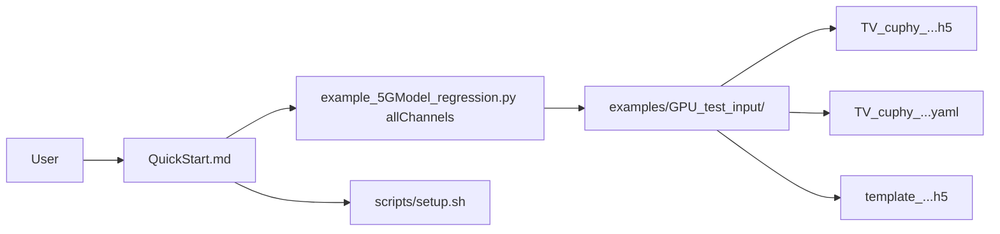
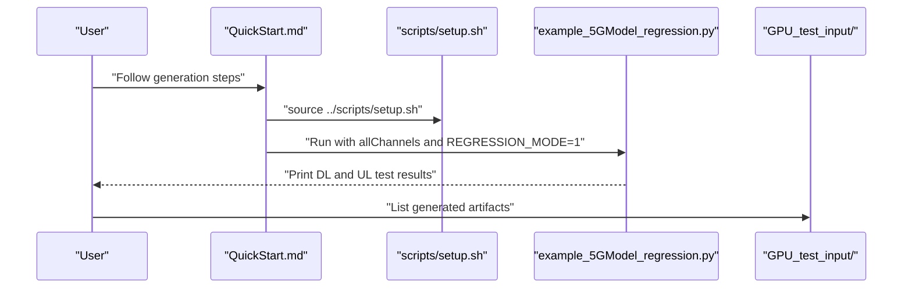

<!-- source: DeepWiki mcp.deepwiki.com · repo NVIDIA/aerial-cuda-accelerated-ran · page 5.3 Test Vector System · fetched 2026-10-26 -->

# Test Vector System

Relevant source files

The following files were used as context for generating this wiki page:

- [.gitignore](.gitignore)
- [5GModel/aerial_mcore/QuickStart.md](5GModel/aerial_mcore/QuickStart.md)

## Purpose and Scope

This page describes the test-vector artifacts shown in the repository-provided `aerial_mcore` quickstart: files generated under `GPU_test_input/`, their observed HDF5 and YAML naming, and how the example workflow is used to generate them. The available material identifies `TV_cuphy_...` files and channel-specific template files, but does not document the HDF5 dataset schema or a cuPHY/cuMAC reader implementation. [5GModel/aerial_mcore/QuickStart.md:3-3]()

Sources: [5GModel/aerial_mcore/QuickStart.md:3-3]()

## Test Vector Storage Structure

### `GPU_test_input/` Directory

The quickstart runs `example_5GModel_regression.py allChannels` from `5GModel/aerial_mcore/examples` and then lists that example directory’s `GPU_test_input/`. The displayed listing contains `TV_cuphy_...` HDF5/YAML files and `template_...` HDF5 files. [.gitignore:16-17](), [5GModel/aerial_mcore/QuickStart.md:15-22](), [5GModel/aerial_mcore/QuickStart.md:55-67]()

**Natural Language to Code Entity Mapping: Generation and Storage**

Sources: [5GModel/aerial_mcore/QuickStart.md:15-22](), [5GModel/aerial_mcore/QuickStart.md:55-67]()

### Directory Lifecycle

The documented quickstart uses `source ../scripts/setup.sh`, sets `REGRESSION_MODE=1`, runs the example with `allChannels`, and inspects `GPU_test_input/`. The root `.gitignore` excludes `testVectors/*.h5` and `testVectors/multi-cell/*.yaml`; a separate ignore file excludes the `GPU_test_input/` directories under `5GModel/aerial_mcore/examples` and `5GModel/nr_matlab`. These are distinct paths, so the ignore patterns should not be read as establishing that `testVectors/` and `GPU_test_input/` are the same directory. [.gitignore:5-6](), [.gitignore:16-17](), [5GModel/aerial_mcore/QuickStart.md:15-22]()

| Stage | Documented action or repository rule |
|---|---|
| Setup | Source `../scripts/setup.sh` from the examples directory. [5GModel/aerial_mcore/QuickStart.md:17-18]() |
| Generation | Run `example_5GModel_regression.py allChannels` with `REGRESSION_MODE=1`. [5GModel/aerial_mcore/QuickStart.md:19-21]() |
| Inspection | List `GPU_test_input/` to view generated artifacts. [5GModel/aerial_mcore/QuickStart.md:20-22]() |
| Version control | Ignore patterns cover selected `testVectors/` files and the two named `GPU_test_input/` paths. [.gitignore:5-6](), [.gitignore:16-17]() |

Sources: [.gitignore:5-6](), [.gitignore:16-17](), [5GModel/aerial_mcore/QuickStart.md:15-22]()

## Test Vector File Formats

### HDF5 Binary Files

The quickstart’s output listing includes `.h5` artifacts, including regression files named `TV_cuphy_...h5` and template files named `template_...h5`. It gives example file sizes, but does not specify HDF5 groups, datasets, datatypes, or tensor layouts. [5GModel/aerial_mcore/QuickStart.md:55-67]()

| Observed artifact | Example | Listing size |
|---|---|---:|
| Regression vector | `TV_cuphy_F01-DS-01_slot0_MIMO4x4_PRB106_DataSyms11_qam256.h5` | 35,195,447 bytes [5GModel/aerial_mcore/QuickStart.md:59-60]() |
| Template vector | `template_UL_PUSCH_gNB_CUPHY_s0p0.h5` | 7,253,384 bytes [5GModel/aerial_mcore/QuickStart.md:64-67]() |

Sources: [5GModel/aerial_mcore/QuickStart.md:55-67]()

### YAML Files

The listing shows YAML files alongside regression HDF5 files, with matching filename stems in the examples. For instance, the `TV_cuphy_F01-DS-01_slot0_MIMO4x4_PRB106_DataSyms11_qam256` stem appears with both `.h5` and `.yaml` extensions. The provided content does not describe YAML keys or establish that every HDF5 file has a YAML partner. [5GModel/aerial_mcore/QuickStart.md:59-63]()

Sources: [5GModel/aerial_mcore/QuickStart.md:59-63]()

## Test Vector Types

### Regression Test Vectors (`TV_cuphy`)

The quickstart listing demonstrates regression-vector filenames beginning with `TV_cuphy_`. The shown name encodes fields such as `F01-DS-01`, `slot0`, `MIMO4x4`, `PRB106`, `DataSyms11`, and `qam256`. The supplied files do not define the meaning or allowed values of those fields, so treat this as an observed filename pattern rather than a complete naming specification. [5GModel/aerial_mcore/QuickStart.md:59-63]()

**Observed example:** `TV_cuphy_F01-DS-01_slot0_MIMO4x4_PRB106_DataSyms11_qam256.h5`, accompanied in the listing by a YAML file with the same stem. [5GModel/aerial_mcore/QuickStart.md:59-62]()

Sources: [5GModel/aerial_mcore/QuickStart.md:59-63]()

### Template Test Vectors

The listing includes template HDF5 files for uplink channels and a FAPI-named artifact. Examples are `template_UL_PUCCH_F0_gNB_CUPHY_s0p1.h5`, `template_UL_PUSCH_gNB_CUPHY_s0p0.h5`, `template_UL_SRS_gNB_CUPHY_s0p0.h5`, and `template_UL_gNB_FAPI_s0.h5`. The provided material shows these filenames and sizes, but does not specify their internal schema or how consumers load them. [5GModel/aerial_mcore/QuickStart.md:64-67]()

Sources: [5GModel/aerial_mcore/QuickStart.md:64-67]()

## Test Vector Generation Workflow

The quickstart provides a command-level workflow for generating test-vector files through the `aerial_mcore` Python package and its example script. It shows the setup and invocation, and reports DL/UL simulation output; it does not expose implementation-level calls between Python and MATLAB. [5GModel/aerial_mcore/QuickStart.md:9-22](), [5GModel/aerial_mcore/QuickStart.md:31-51]()

**Natural Language to Code Entity Mapping: Quickstart Workflow**

Sources: [5GModel/aerial_mcore/QuickStart.md:15-22](), [5GModel/aerial_mcore/QuickStart.md:31-51]()

**Quickstart steps:**

1. Install the built `aerial_mcore` wheel from `${cuBB_SDK}/5GModel/aerial_mcore/aerial_pkg/dist/`. [5GModel/aerial_mcore/QuickStart.md:9-13]()
2. Change to `${cuBB_SDK}/5GModel/aerial_mcore/examples` and source `../scripts/setup.sh`. [5GModel/aerial_mcore/QuickStart.md:15-18]()
3. Set `REGRESSION_MODE=1` and invoke `example_5GModel_regression.py allChannels`. [5GModel/aerial_mcore/QuickStart.md:19-21]()
4. Inspect the generated-file listing with `ls -alF GPU_test_input/`. [5GModel/aerial_mcore/QuickStart.md:20-22]()

Sources: [5GModel/aerial_mcore/QuickStart.md:9-22]()

## Test Vector Categories

### Channel-Specific Test Vectors

The quickstart output reports channel allocations for a DL run and an UL run. The displayed channel names are `ssb`, `pdcch`, `pdsch`, `csirs`, `prach`, `pucch`, `pusch`, and `srs`; the example output also reports PUSCH TB, PRACH, and PUCCH UCI detection for the UL run. [5GModel/aerial_mcore/QuickStart.md:31-51]()

| Example run | Channels allocated in output |
|---|---|
| DL | SSB, PDCCH, PDSCH, CSIRS [5GModel/aerial_mcore/QuickStart.md:35-38]() |
| UL | PRACH, PUCCH, PUSCH, SRS [5GModel/aerial_mcore/QuickStart.md:44-50]() |

Sources: [5GModel/aerial_mcore/QuickStart.md:31-51]()

## Version Control Considerations

### Ignore Rules and Artifact Location

The root `.gitignore` contains patterns for selected files under `testVectors/`, while another set of patterns ignores `GPU_test_input/` under `5GModel/aerial_mcore/examples` and `5GModel/nr_matlab`. These rules establish that the named generated-artifact paths are ignored; they do not establish a general retention or cleanup policy for all test vectors. [.gitignore:5-6](), [.gitignore:16-17]()

Sources: [.gitignore:5-6](), [.gitignore:16-17]()

## Validation Consumer Boundary

The quickstart’s regression-vector names contain `cuphy`, and the template examples include `gNB_CUPHY` in their filenames. The provided material does not include cuPHY or cuMAC test-reader code, so it is insufficient to document consumer entry points, HDF5 dataset mappings, comparison behavior, or cuMAC-specific vector usage. Those implementation details should be documented from the relevant consumer sources rather than inferred from filenames. [5GModel/aerial_mcore/QuickStart.md:59-67]()

Sources: [5GModel/aerial_mcore/QuickStart.md:59-67]()

---

