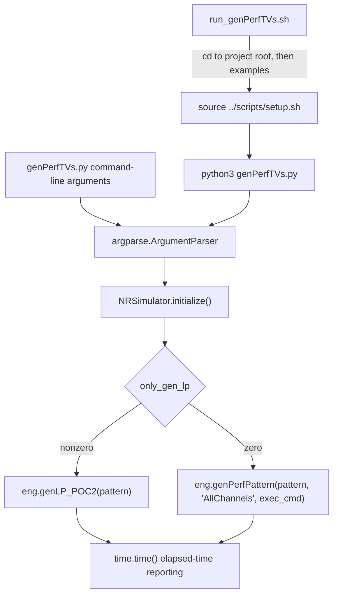
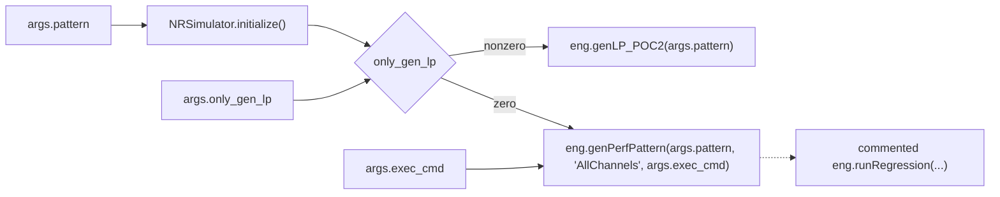

<!-- source: DeepWiki mcp.deepwiki.com · repo NVIDIA/aerial-cuda-accelerated-ran · page 5.4 Performance Test Vectors · fetched 2026-10-26 -->

# Performance Test Vectors

Relevant source files

The following files were used as context for generating this wiki page:

- [5GModel/aerial_mcore/examples/genPerfTVs.py](5GModel/aerial_mcore/examples/genPerfTVs.py)
- [5GModel/aerial_mcore/scripts/run_genPerfTVs.sh](5GModel/aerial_mcore/scripts/run_genPerfTVs.sh)

## Purpose and Scope

This page documents the performance test vector (Perf TV) generation entry point `genPerfTVs.py` and its shell wrapper, `run_genPerfTVs.sh`. It describes the command-line options, the Python-to-MATLAB call flow, and the wrapper’s environment setup and launch sequence. The available implementation shows which MATLAB functions are called, but does not specify the generated artifacts’ formats, storage locations, or contents. [5GModel/aerial_mcore/examples/genPerfTVs.py:18-51](), [5GModel/aerial_mcore/scripts/run_genPerfTVs.sh:18-34]()

Sources: [5GModel/aerial_mcore/examples/genPerfTVs.py:18-51](), [5GModel/aerial_mcore/scripts/run_genPerfTVs.sh:18-34]()

---

## Overview

`genPerfTVs.py` imports `aerial_mcore` as `NRSimulator`, initializes it with `NRSimulator.initialize()`, then selects a MATLAB operation based on the `only_gen_lp` argument. In launch-pattern-only mode, it calls `eng.genLP_POC2(pattern)`. Otherwise, it calls `eng.genPerfPattern(pattern, 'AllChannels', exec_cmd)`. [5GModel/aerial_mcore/examples/genPerfTVs.py:18-18](), [5GModel/aerial_mcore/examples/genPerfTVs.py:35-48]()

The script accepts three optional positional arguments: a pattern number, a launch-pattern-only flag, and an execution flag. Their defaults are `69`, `0`, and `1`, respectively. The separate shell wrapper changes to the aerial_mcore project directory, enters `examples`, sources `scripts/setup.sh`, and runs `python3 genPerfTVs.py` without overriding those defaults. [5GModel/aerial_mcore/examples/genPerfTVs.py:23-28](), [5GModel/aerial_mcore/scripts/run_genPerfTVs.sh:21-31]()

Sources: [5GModel/aerial_mcore/examples/genPerfTVs.py:18-48](), [5GModel/aerial_mcore/scripts/run_genPerfTVs.sh:21-31]()

---

## Performance Test Vector Generation Workflow

The Python script is the orchestration layer visible in the supplied implementation: it parses arguments, initializes `aerial_mcore`, selects one of two MATLAB calls, and reports elapsed time. The MATLAB functions’ internal behavior and output destinations are not shown in these files. [5GModel/aerial_mcore/examples/genPerfTVs.py:23-51]()

### Data Flow Diagram

Sources: [5GModel/aerial_mcore/examples/genPerfTVs.py:23-51](), [5GModel/aerial_mcore/scripts/run_genPerfTVs.sh:21-31]()

---

## genPerfTVs.py Implementation

`genPerfTVs.py` imports `aerial_mcore` under the name `NRSimulator`, along with MATLAB, `time`, and `argparse`. It defines three optional positional arguments, prints the selected configuration, initializes the simulator, and measures the duration of the selected generation call. [5GModel/aerial_mcore/examples/genPerfTVs.py:18-38](), [5GModel/aerial_mcore/examples/genPerfTVs.py:50-51]()

### Script Logic and Mapping

The `only_gen_lp` value controls which MATLAB method is called. A nonzero value invokes `eng.genLP_POC2(args.pattern)`; zero invokes `eng.genPerfPattern(args.pattern, 'AllChannels', args.exec_cmd)`. The script also contains a commented alternative using `eng.runRegression(['PerfPattern'], args.pattern, ['AllChannels'])`; it is not executed by the current code path. [5GModel/aerial_mcore/examples/genPerfTVs.py:40-48]()

Sources: [5GModel/aerial_mcore/examples/genPerfTVs.py:18-28](), [5GModel/aerial_mcore/examples/genPerfTVs.py:35-48]()

### Command-Line Arguments

| Argument | Type | Default | Behavior in the script |
|---|---:|---:|---|
| `pattern` | `int` | `69` | Passed as the pattern argument to the selected MATLAB call. |
| `only_gen_lp` | `int` | `0` | If nonzero, selects `eng.genLP_POC2`; otherwise, selects `eng.genPerfPattern`. |
| `exec_cmd` | `int` | `1` | Passed as the third argument to `eng.genPerfPattern`; it does not affect the launch-pattern-only call. |

The arguments are optional positional arguments, in the order shown. The help text describes `exec_cmd` as executing commands (`1`) or printing them (`0`), and describes `only_gen_lp` as selecting launch-pattern-only generation (`1`) or performance-pattern generation (`0`). [5GModel/aerial_mcore/examples/genPerfTVs.py:23-28](), [5GModel/aerial_mcore/examples/genPerfTVs.py:40-45]()

Sources: [5GModel/aerial_mcore/examples/genPerfTVs.py:23-28](), [5GModel/aerial_mcore/examples/genPerfTVs.py:40-45]()

---

## Performance Profiles (FRC)

The supplied `genPerfTVs.py` and `run_genPerfTVs.sh` contents do not define FRC profiles, identify a profile file, or describe how a pattern number maps to a simulation configuration. The script passes the chosen integer to the MATLAB generation function, but the mapping and profile details are outside the available implementation. [5GModel/aerial_mcore/examples/genPerfTVs.py:23-28](), [5GModel/aerial_mcore/examples/genPerfTVs.py:40-48]()

Sources: [5GModel/aerial_mcore/examples/genPerfTVs.py:23-28](), [5GModel/aerial_mcore/examples/genPerfTVs.py:40-48]()

---

## Usage and Execution

### Generating Performance TVs via Shell Script

`run_genPerfTVs.sh` resolves its own path, derives the aerial_mcore project root from the script directory, changes to that root, enters `examples`, sources `../scripts/setup.sh`, and invokes `python3 genPerfTVs.py`. Because it supplies no positional arguments, the Python script’s defaults are used. [5GModel/aerial_mcore/scripts/run_genPerfTVs.sh:21-31](), [5GModel/aerial_mcore/examples/genPerfTVs.py:23-28]()

The wrapper enables `set -e`, so a failing command terminates the script before it reaches the final completion message. On completion, it prints a finished message. [5GModel/aerial_mcore/scripts/run_genPerfTVs.sh:18-19](), [5GModel/aerial_mcore/scripts/run_genPerfTVs.sh:33-34]()

Sources: [5GModel/aerial_mcore/scripts/run_genPerfTVs.sh:18-34](), [5GModel/aerial_mcore/examples/genPerfTVs.py:23-28]()

### Execution Modes and Use Cases

| Mode | Positional arguments | Effect |
|---|---|---|
| Default performance-pattern path | Omitted, or `69 0 1` | Calls `eng.genPerfPattern` with pattern `69`, channel selector `'AllChannels'`, and execution flag `1`. |
| Launch-pattern-only path | `69 1 1` | Calls `eng.genLP_POC2` with pattern `69`; `exec_cmd` is not passed to this call. |
| Performance-pattern print mode | `69 0 0` | Calls `eng.genPerfPattern` with `exec_cmd` set to `0`; the argument help describes this as print-only behavior. |

These examples follow the script’s positional argument order and branch logic. The exact MATLAB-side effects of each call are not defined by the Python and shell files. [5GModel/aerial_mcore/examples/genPerfTVs.py:23-28](), [5GModel/aerial_mcore/examples/genPerfTVs.py:40-48]()

Sources: [5GModel/aerial_mcore/examples/genPerfTVs.py:23-28](), [5GModel/aerial_mcore/examples/genPerfTVs.py:40-48]()

---

## Key Functions Reference

### `NRSimulator.initialize()`

Called after argument parsing and configuration output. Its return value is stored in `eng`, which is then used for the MATLAB method calls. The initialization implementation is not included in the supplied files. [5GModel/aerial_mcore/examples/genPerfTVs.py:18-18](), [5GModel/aerial_mcore/examples/genPerfTVs.py:35-35]()

Sources: [5GModel/aerial_mcore/examples/genPerfTVs.py:18-18](), [5GModel/aerial_mcore/examples/genPerfTVs.py:35-35]()

### `eng.genLP_POC2(pattern)`

Called when `only_gen_lp` is nonzero. The Python script passes the selected pattern number and does not pass `exec_cmd` to this method. [5GModel/aerial_mcore/examples/genPerfTVs.py:40-42]()

Sources: [5GModel/aerial_mcore/examples/genPerfTVs.py:40-42]()

### `eng.genPerfPattern(pattern, 'AllChannels', exec_cmd)`

Called when `only_gen_lp` is zero. The call passes the pattern number, the literal channel selector `'AllChannels'`, and the `exec_cmd` argument. [5GModel/aerial_mcore/examples/genPerfTVs.py:43-45]()

Sources: [5GModel/aerial_mcore/examples/genPerfTVs.py:43-45]()

### `eng.runRegression(['PerfPattern'], pattern, ['AllChannels'])`

This is shown as a commented alternative in the script, not as an active call. It is presented with the regression mode `'PerfPattern'`, the pattern number, and the channel selector `'AllChannels'`. [5GModel/aerial_mcore/examples/genPerfTVs.py:47-48]()

Sources: [5GModel/aerial_mcore/examples/genPerfTVs.py:47-48]()

---

