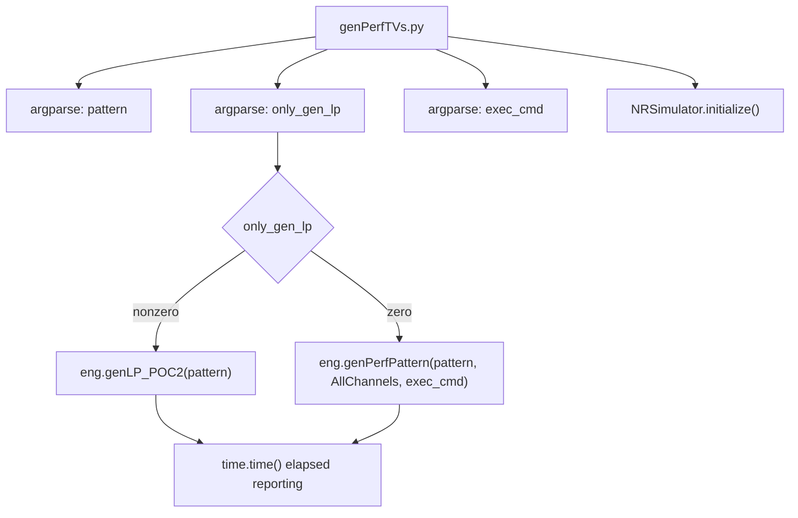
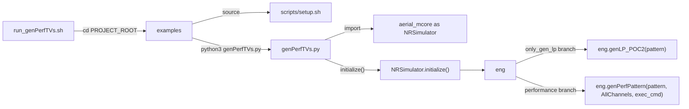

<!-- source: DeepWiki mcp.deepwiki.com · repo NVIDIA/aerial-cuda-accelerated-ran · page 5.5 GPU Test Bench and Performance Benchmarking · fetched 2026-10-26 -->

# GPU Test Bench and Performance Benchmarking

Relevant source files

The following files were used as context for generating this wiki page:

- [5GModel/aerial_mcore/examples/genPerfTVs.py](5GModel/aerial_mcore/examples/genPerfTVs.py)
- [5GModel/aerial_mcore/scripts/run_genPerfTVs.sh](5GModel/aerial_mcore/scripts/run_genPerfTVs.sh)

## Purpose and scope

This page documents the performance-test-vector generation workflow visible in the supplied files: the `genPerfTVs.py` Python script and its `run_genPerfTVs.sh` wrapper. The supplied files do not define `cubb_gpu_test_bench`, `gpu3GPPChan`, latency-measurement code, or `phase4_test_scripts`; their implementation and behavior therefore cannot be described here without additional source files. [5GModel/aerial_mcore/examples/genPerfTVs.py:18-51](), [5GModel/aerial_mcore/scripts/run_genPerfTVs.sh:18-34]()

Sources: [5GModel/aerial_mcore/examples/genPerfTVs.py:18-51](), [5GModel/aerial_mcore/scripts/run_genPerfTVs.sh:18-34]()

## Overview

The supplied performance-generation workflow has a shell entry point, `run_genPerfTVs.sh`, and a Python generator, `genPerfTVs.py`. The shell script changes to the `aerial_mcore` project root, enters `examples`, sources `scripts/setup.sh`, and runs the Python script. The Python script initializes `aerial_mcore` and invokes a MATLAB-engine method selected by its command-line options. [5GModel/aerial_mcore/scripts/run_genPerfTVs.sh:21-31](), [5GModel/aerial_mcore/examples/genPerfTVs.py:18-45]()

The supplied code documents generation of launch patterns and performance patterns; it does not show GPU execution, timing of GPU work, or benchmark-result collection. [5GModel/aerial_mcore/examples/genPerfTVs.py:38-51](), [5GModel/aerial_mcore/scripts/run_genPerfTVs.sh:28-31]()

Sources: [5GModel/aerial_mcore/examples/genPerfTVs.py:18-51](), [5GModel/aerial_mcore/scripts/run_genPerfTVs.sh:21-31]()

## `cubb_gpu_test_bench`

The supplied files do not contain a definition, invocation, or configuration for `cubb_gpu_test_bench`. Consequently, its inputs, GPU execution path, measurement method, and outputs cannot be established from this source excerpt. The documented scripts below generate performance-related patterns and test vectors; they do not demonstrate that `cubb_gpu_test_bench` consumes those artifacts. [5GModel/aerial_mcore/examples/genPerfTVs.py:18-51](), [5GModel/aerial_mcore/scripts/run_genPerfTVs.sh:28-31]()

Sources: [5GModel/aerial_mcore/examples/genPerfTVs.py:18-51](), [5GModel/aerial_mcore/scripts/run_genPerfTVs.sh:28-31]()

## Performance Test Vector Generation

`genPerfTVs.py` accepts three optional positional integer arguments: `pattern` (default `69`), `only_gen_lp` (default `0`), and `exec_cmd` (default `1`). It prints the selected pattern and operation mode, then initializes the MATLAB engine through `NRSimulator.initialize()`. [5GModel/aerial_mcore/examples/genPerfTVs.py:18-35]()

When `only_gen_lp` is nonzero, the script calls `eng.genLP_POC2(args.pattern)`. Otherwise, it calls `eng.genPerfPattern(args.pattern, 'AllChannels', args.exec_cmd)`. The script measures elapsed wall-clock time around the selected generation call using `time.time()` and prints the elapsed seconds; this is generator duration, not a GPU-kernel latency measurement. [5GModel/aerial_mcore/examples/genPerfTVs.py:38-51]()

Sources: [5GModel/aerial_mcore/examples/genPerfTVs.py:18-51]()

### `genPerfTVs.py` arguments and execution

| Argument | Default | Effect |
|---|---:|---|
| `pattern` | `69` | Pattern number passed to `genLP_POC2` or `genPerfPattern`. |
| `only_gen_lp` | `0` | Nonzero selects `genLP_POC2`; zero selects `genPerfPattern`. |
| `exec_cmd` | `1` | Passed to `genPerfPattern` as its third argument when `only_gen_lp` is zero. |

The script’s printed execution-mode message treats MATLAB command execution as enabled when `only_gen_lp` is nonzero or `exec_cmd` is truthy. The `exec_cmd` argument is passed to `genPerfPattern` only in the performance-pattern branch. [5GModel/aerial_mcore/examples/genPerfTVs.py:23-33](), [5GModel/aerial_mcore/examples/genPerfTVs.py:40-45]()

Sources: [5GModel/aerial_mcore/examples/genPerfTVs.py:23-45]()

**Diagram: CLI options mapped to generator functions**

Sources: [5GModel/aerial_mcore/examples/genPerfTVs.py:18-51]()

### `run_genPerfTVs.sh`

The shell wrapper enables `set -e`, resolves its own path, derives `SCRIPT_DIR` and `PROJECT_ROOT`, and changes to the project root. It then enters `examples`, sources `../scripts/setup.sh`, runs `python3 genPerfTVs.py`, returns from the directory, and prints a completion message. Because the invocation supplies no positional arguments, the Python script’s defaults apply when run through this wrapper. [5GModel/aerial_mcore/scripts/run_genPerfTVs.sh:18-34](), [5GModel/aerial_mcore/examples/genPerfTVs.py:23-28]()

Sources: [5GModel/aerial_mcore/scripts/run_genPerfTVs.sh:18-34](), [5GModel/aerial_mcore/examples/genPerfTVs.py:23-28]()

**Diagram: shell entry point mapped to Python and MATLAB-facing entities**

Sources: [5GModel/aerial_mcore/scripts/run_genPerfTVs.sh:21-31](), [5GModel/aerial_mcore/examples/genPerfTVs.py:18-45]()

## Performance Benchmarking Methodology

The available Python script reports elapsed time around its pattern-generation operation. It does not contain CUDA events, GPU synchronization, per-kernel timing, throughput calculations, or latency statistics. No GPU benchmark methodology can be inferred from these two files. [5GModel/aerial_mcore/examples/genPerfTVs.py:38-51]()

Sources: [5GModel/aerial_mcore/examples/genPerfTVs.py:38-51]()

## `gpu3GPPChan` and Phase 4 Test Scripts

The supplied files do not reference `gpu3GPPChan` or `phase4_test_scripts`. They provide no basis for describing their interfaces, test scenarios, execution sequence, or relationship to generated performance patterns. [5GModel/aerial_mcore/examples/genPerfTVs.py:18-51](), [5GModel/aerial_mcore/scripts/run_genPerfTVs.sh:18-34]()

Sources: [5GModel/aerial_mcore/examples/genPerfTVs.py:18-51](), [5GModel/aerial_mcore/scripts/run_genPerfTVs.sh:18-34]()

---

