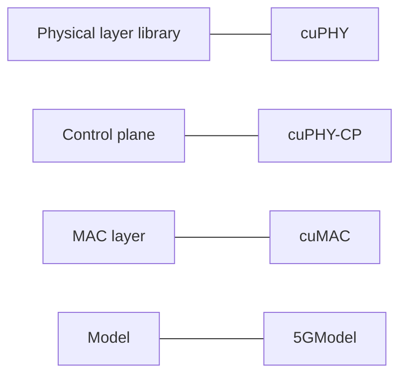
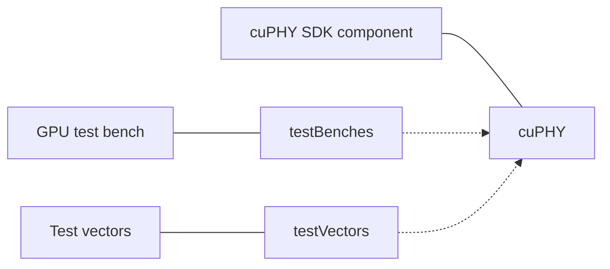

<!-- source: DeepWiki mcp.deepwiki.com · repo NVIDIA/aerial-cuda-accelerated-ran · page 6 cuPHY — Physical Layer Library · fetched 2026-10-26 -->

# cuPHY — Physical Layer Library

Relevant source files

The following files were used as context for generating this wiki page:

- [.clang-tidy](.clang-tidy)
- [.dockerignore](.dockerignore)

## Purpose and scope

This page introduces cuPHY’s place in the Aerial SDK repository and summarizes the visible repository layout and build entry points. It stays at parent-page scope; see [cuPHY Library Architecture](#6.1) and [cuPHY Examples and Tests](#6.2) for details. The repository’s Docker build context explicitly includes `cuPHY` alongside `aerial_common`, `cuMAC`, and `cuPHY-CP` [.dockerignore:8-18]().

Sources: [.dockerignore:8-18]()

## Overview and Directory Structure

The Docker build-context rules allow `cuPHY` and selected related repository paths, including `5GModel`, `cubb_scripts`, `testBenches`, and `testVectors` [.dockerignore:10-20](). These rules describe which paths are admitted to the build context; they do not, by themselves, specify the contents or responsibilities of each directory.

| Path admitted to the Docker build context | Relationship at this page’s scope |
|---|---|
| `cuPHY` | Physical-layer SDK component |
| `cuPHY-CP` | Related control-plane component |
| `cuMAC` | Related MAC component |
| `5GModel` | Separate model component |
| `testBenches`, `testVectors` | Test and vector paths |

Sources: [.dockerignore:10-20]()

### Component Relationship

The diagrams below associate the component names used on this page with repository path names admitted by the Docker build-context rules [.dockerignore:10-20](). They show repository-level relationships only, not runtime calls or data flow.

**Aerial SDK component names and repository paths**

Sources: [.dockerignore:10-18]()

**Validation-related names and repository paths**

Sources: [.dockerignore:13-20]()

## Library Architecture

This parent page does not enumerate cuPHY’s internal source modules or public APIs. For the architecture details—including `src/cuphy`, `cuphy_channels`, `cuphy_hdf5`, logging, utilities, and public APIs—see [cuPHY Library Architecture](#6.1).

Sources: [.dockerignore:13-18]()

## Examples and Pipeline Validation

The child page [cuPHY Examples and Tests](#6.2) covers the example applications and unit tests, including `pdsch_tx`, `pusch_rx_multi_pipe`, `srs_rx_pipeline`, `prach_receiver_multi_cell`, and `ch_est`. The repository’s build-context rules include the `testBenches` and `testVectors` paths [.dockerignore:18-20]().

Sources: [.dockerignore:18-20]()

## Building cuPHY

The Docker build-context allowlist includes the top-level `CMakeLists.txt` and `CMakePresets.json` files, as well as the `cuPHY` directory [.dockerignore:13-22](). This establishes that CMake build files and cuPHY are included in the context; the provided files do not specify build commands, dependencies, or standalone build procedures. For component-specific build and test guidance, see [cuPHY Examples and Tests](#6.2).

Sources: [.dockerignore:13-22]()

---

