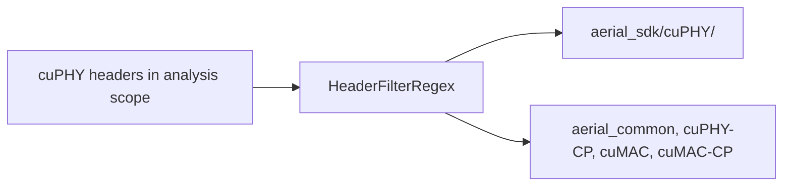
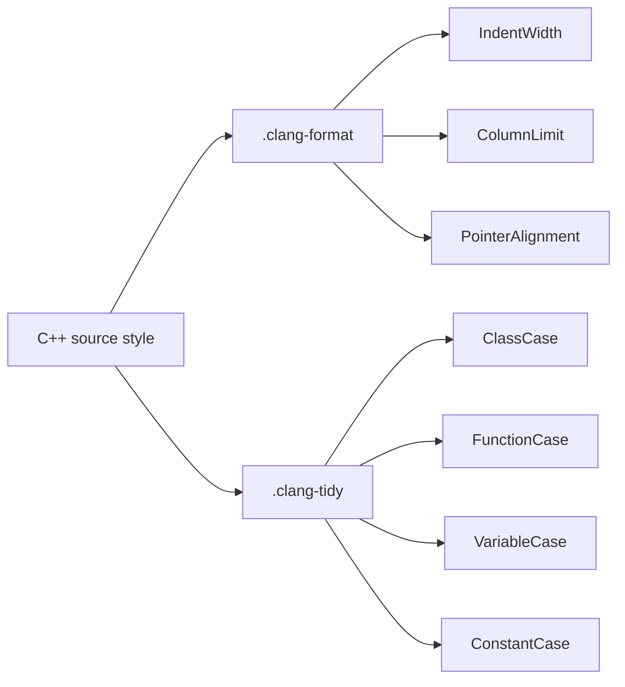

<!-- source: DeepWiki mcp.deepwiki.com · repo NVIDIA/aerial-cuda-accelerated-ran · page 6.1 cuPHY Library Architecture · fetched 2026-10-26 -->

# cuPHY Library Architecture

Relevant source files

The following files were used as context for generating this wiki page:

- [.clang-format](.clang-format)
- [.clang-tidy](.clang-tidy)

## Purpose and scope

This page describes what can be established about cuPHY from the supplied repository files. The available files are `.clang-format` and `.clang-tidy`; they provide C++ formatting, static-analysis, and path-filter configuration, but do not include cuPHY implementation files or public API declarations. As a result, this page documents those repository-level conventions and identifies the limits of the available architectural evidence rather than attributing unverified behavior to cuPHY modules. [`.clang-format:1-5`]() [`.clang-tidy:27-29`]()

Sources: [`.clang-format:1-5`]() [`.clang-tidy:27-29`]()

## What the supplied files establish

The supplied static-analysis configuration explicitly includes headers under paths matching `aerial_sdk/cuPHY/` in its `HeaderFilterRegex`. This establishes that headers at that path are in scope for the configured clang-tidy checks; it does not identify particular cuPHY classes, functions, or APIs. [`.clang-tidy:27-29`]()

The formatting configuration is for C++ and specifies, among other settings, four-space indentation, a 100-column limit, right-aligned pointers, and attached braces. These are repository formatting rules, not evidence of any particular cuPHY implementation structure. [`.clang-format:1-5`()] [`.clang-format:90-103`()] [`.clang-format:158-159`()] [`.clang-format:197-201`]()

Sources: [`.clang-format:1-5`()] [`.clang-format:90-103`()] [`.clang-format:158-159`()] [`.clang-format:197-201`]() [`.clang-tidy:27-29`]()

## C++ analysis and naming conventions

The configured clang-tidy policy enables checks broadly, excludes several named check families and individual checks, and treats warnings as errors. The header filter limits the selected project headers to the listed `aerial_sdk` subtrees, including `cuPHY`. The supplied configuration does not state which build targets invoke clang-tidy or whether every cuPHY source file is analyzed. [`.clang-tidy:2-29`]()

For identifiers, the configuration specifies `CamelCase` for types, `lower_case` for functions and methods, and `lower_case` for variables and members. It specifies `UPPER_CASE` for several constant categories, with exceptions for local and static constants. These settings describe intended checks; they do not establish that every existing identifier conforms. [`.clang-tidy:41-56`()] [`.clang-tidy:59-98`()] [`.clang-tidy:100-126`]()

Sources: [`.clang-tidy:2-29`()] [`.clang-tidy:41-56`()] [`.clang-tidy:59-98`()] [`.clang-tidy:100-126`]()

## Configuration-to-code mapping

The diagram maps the natural-language role “cuPHY headers selected by clang-tidy” to the configured path pattern. It represents configuration scope, not a call graph or a claim about cuPHY module dependencies. [`.clang-tidy:27-29`]()

**Title: clang-tidy Header Scope**

Sources: [`.clang-tidy:27-29`]()

The next diagram connects configured C++ style concepts to the corresponding named settings. It summarizes the configuration only; it does not imply that a particular public API or implementation file has been inspected. [`.clang-format:1-5`()] [`.clang-format:90-103`()] [`.clang-format:158-159`()] [`.clang-format:197-201`()] [`.clang-tidy:41-56`()] [`.clang-tidy:59-98`()] [`.clang-tidy:100-126`]()

**Title: C++ Style Concepts and Configuration Entities**

Sources: [`.clang-format:1-5`()] [`.clang-format:90-103`()] [`.clang-format:158-159`()] [`.clang-format:197-201`()] [`.clang-tidy:41-56`()] [`.clang-tidy:59-98`()] [`.clang-tidy:100-126`]()

## Architecture details not established by the supplied files

The supplied files do not show the contents or relationships of `src/cuphy`, `cuphy_channels`, `cuphy_hdf5`, `nvlog`, `util/ldpc`, or MATLAB utilities. They also do not provide public API declarations, implementation call sites, data-flow definitions, or build-target dependencies for these components. Consequently, this source set cannot substantiate descriptions of their classes, functions, runtime behavior, or interactions. [`.clang-tidy:27-29`]()

Sources: [`.clang-tidy:27-29`()]

---

