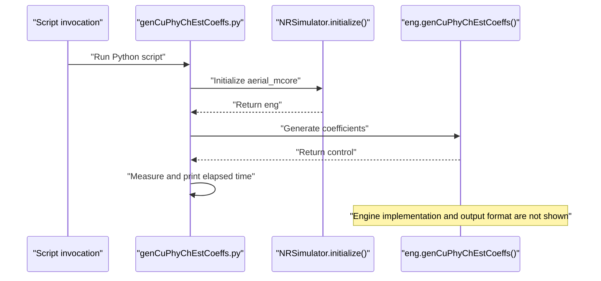
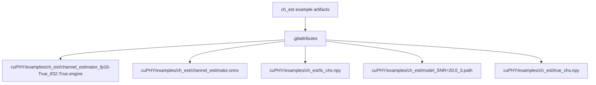

<!-- source: DeepWiki mcp.deepwiki.com · repo NVIDIA/aerial-cuda-accelerated-ran · page 6.2 cuPHY Examples and Tests · fetched 2026-10-26 -->

# cuPHY Examples and Tests

Relevant source files

The following files were used as context for generating this wiki page:

- [.gitattributes](.gitattributes)
- [5GModel/aerial_mcore/examples/genCuPhyChEstCoeffs.py](5GModel/aerial_mcore/examples/genCuPhyChEstCoeffs.py)

## Purpose and scope

This page covers the cuPHY example and test material that can be documented from the supplied source excerpts. The available files show a Python entry point for generating channel-estimation coefficients and Git LFS tracking rules for `ch_est` artifacts. They do not include the cuPHY example implementations, unit-test driver, test-vector readers, or application call graphs, so those details are not inferred here. [5GModel/aerial_mcore/examples/genCuPhyChEstCoeffs.py:18-28](), [.gitattributes:1-10]()

Sources: [5GModel/aerial_mcore/examples/genCuPhyChEstCoeffs.py:18-28](), [.gitattributes:1-10]()

## Example applications

The requested example-app scope includes `pdsch_tx`, `pusch_rx_multi_pipe`, `srs_rx_pipeline`, `prach_receiver_multi_cell`, and `ch_est`. The available source excerpt does not show their source files, command-line interfaces, pipeline stages, or test harness; consequently, this page does not attribute specific processing behavior to those applications. The only directly evidenced example workflow is the `ch_est` coefficient-generation script described below. [5GModel/aerial_mcore/examples/genCuPhyChEstCoeffs.py:18-28]()

Sources: [5GModel/aerial_mcore/examples/genCuPhyChEstCoeffs.py:18-28]()

## Channel-estimation coefficient generation

`genCuPhyChEstCoeffs.py` imports `aerial_mcore` under the name `NRSimulator`, initializes it with `NRSimulator.initialize()`, and invokes `eng.genCuPhyChEstCoeffs()`. It measures elapsed wall-clock time around that call and prints the duration. The script includes a commented-out `eng.cfg_parfor(0,nargout=0)` line; it is not executed. [5GModel/aerial_mcore/examples/genCuPhyChEstCoeffs.py:18-28]()

The excerpt establishes the Python-to-engine call sequence, but does not show the implementation of `initialize()` or `genCuPhyChEstCoeffs()`, the coefficient format, or the downstream consumer of generated data. [5GModel/aerial_mcore/examples/genCuPhyChEstCoeffs.py:18-28]()

**Diagram: Python entry point mapped to code entities**

Sources: [5GModel/aerial_mcore/examples/genCuPhyChEstCoeffs.py:18-28]()

**Diagram: Observed call sequence and evidence boundary**

Sources: [5GModel/aerial_mcore/examples/genCuPhyChEstCoeffs.py:18-28]()

## `ch_est` tracked artifacts

Git LFS tracking rules identify five files under `cuPHY/examples/ch_est`: `channel_estimator_fp16-True_tf32-True.engine`, `channel_estimator.onnx`, `ls_chs.npy`, `model_SNR=20.0_3.path`, and `true_chs.npy`. The rules establish that these paths are configured for LFS; they do not establish how the example loads or uses each artifact. [.gitattributes:5-9]()

| Tracked path | Evidence in supplied files |
|---|---|
| `cuPHY/examples/ch_est/channel_estimator_fp16-True_tf32-True.engine` | Configured for Git LFS [.gitattributes:5-5]() |
| `cuPHY/examples/ch_est/channel_estimator.onnx` | Configured for Git LFS [.gitattributes:6-6]() |
| `cuPHY/examples/ch_est/ls_chs.npy` | Configured for Git LFS [.gitattributes:7-7]() |
| `cuPHY/examples/ch_est/model_SNR=20.0_3.path` | Configured for Git LFS [.gitattributes:8-8]() |
| `cuPHY/examples/ch_est/true_chs.npy` | Configured for Git LFS [.gitattributes:9-9]() |

**Diagram: `ch_est` paths mapped to repository tracking rules**

Sources: [.gitattributes:5-9]()

## Unit tests and test-vector coverage

The supplied files do not include cuPHY unit-test sources, test executables, test scripts, test-vector schemas, or invocation instructions. Therefore, no test-driver behavior, application-to-vector mapping, comparison procedure, or pass/fail criteria can be established from this evidence. [.gitattributes:1-10](), [5GModel/aerial_mcore/examples/genCuPhyChEstCoeffs.py:18-28]()

Sources: [.gitattributes:1-10](), [5GModel/aerial_mcore/examples/genCuPhyChEstCoeffs.py:18-28]()

## Related tracked package and data patterns

In addition to the `ch_est` paths, `.gitattributes` configures all `*.pkl` and `*.parquet` files, and a specific `aerial_mcore` wheel path, for Git LFS. These rules describe repository storage configuration, not whether those files are consumed by cuPHY tests. [.gitattributes:3-10]()

| Pattern or path | Tracking rule |
|---|---|
| `*.pkl` | Git LFS filter configured [.gitattributes:3-3]() |
| `*.parquet` | Git LFS filter configured [.gitattributes:4-4]() |
| `5GModel/aerial_mcore/aerial_pkg/dist/aerial_mcore-0.20261.508652.508652-py3-none-any.whl` | Git LFS filter configured [.gitattributes:10-10]() |

Sources: [.gitattributes:3-10]()

---

