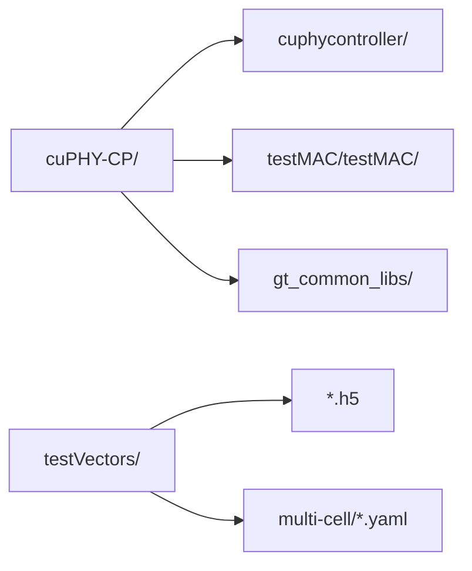
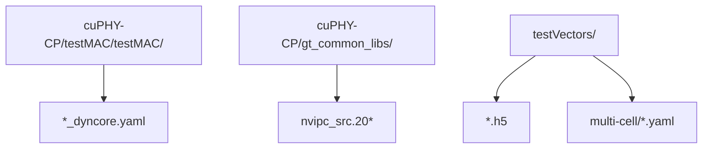

<!-- source: DeepWiki mcp.deepwiki.com · repo NVIDIA/aerial-cuda-accelerated-ran · page 7 cuPHY-CP — Control Plane · fetched 2026-10-26 -->

# cuPHY-CP — Control Plane

Relevant source files

The following files were used as context for generating this wiki page:

- [.gitignore](.gitignore)

## Purpose and scope

This page introduces the cuPHY Control Plane (cuPHY-CP) at a high level and links to child pages for subsystem details. The supplied repository evidence identifies `cuPHY-CP/cuphycontroller`, `cuPHY-CP/testMAC`, and `cuPHY-CP/gt_common_libs` through ignore rules for files in those directories; it does not establish their runtime behavior or interfaces. [.gitignore:1-3]()

Sources: `.gitignore`

## System Architecture and Code Mapping

The available file evidence supports a limited mapping between the cuPHY-CP name and repository directories. The diagram shows those code entities, plus the `testVectors` path, without asserting runtime connections that are not documented by the supplied files. [.gitignore:1-6]()

**Diagram: Repository Paths Associated with cuPHY-CP**

Sources: `.gitignore`

## Key Components

The child pages cover the controller and driver, L2 adapters and FAPI interface, fronthaul driver and RU emulator, and testMAC and common libraries. The supplied file evidence specifically references `cuphycontroller`, `testMAC`, and `gt_common_libs`; see the child pages for the subsystem-level discussion. [.gitignore:1-3]()

| Topic | Child page |
|---|---|
| Controller lifecycle/configuration and driver orchestration | [cuPHY Controller and Driver](#7.1) |
| L2 adapters and FAPI message handling | [L2 Adapters and FAPI Interface](#7.2) |
| Fronthaul driver and RU emulator | [Fronthaul Driver and RU Emulator](#7.3) |
| testMAC and common libraries | [testMAC and Common Libraries](#7.4) |

Sources: `.gitignore`

### 7.1. cuPHY Controller and Driver

The repository ignore rules identify `cuPHY-CP/cuphycontroller/config/*_dyncore.yaml`, establishing a controller configuration path. For lifecycle, configuration, GPU/fronthaul orchestration, and slot-command processing details, see [cuPHY Controller and Driver](#7.1). [.gitignore:1]()

Sources: `.gitignore`

### 7.2. L2 Adapters and FAPI Interface

The supplied file evidence does not identify L2 adapter or FAPI implementation paths. For `cuphyl2adapter` and `scfl2adapter` details, see [L2 Adapters and FAPI Interface](#7.2).

Sources: `.gitignore`

### 7.3. Fronthaul Driver and RU Emulator

The supplied file evidence does not identify the fronthaul driver or RU emulator paths. For O-RAN transport, compression/decompression, and emulator details, see [Fronthaul Driver and RU Emulator](#7.3).

Sources: `.gitignore`

### 7.4. testMAC and Common Libraries

The ignore rules identify `cuPHY-CP/testMAC/testMAC/*_dyncore.yaml` and `cuPHY-CP/gt_common_libs/nvipc_src.20*`, showing configuration and nvIPC-related paths in those directories. For testMAC, common-library, OAM, and agent details, see [testMAC and Common Libraries](#7.4). [.gitignore:2-3]()

**Diagram: Configuration and Common-Library Paths**

Sources: `.gitignore`

## Directory Structure and Organization

The paths evidenced by the supplied ignore rules include the controller configuration directory, testMAC configuration directory, common-library directory, and test-vector locations. These entries establish repository locations, not a complete inventory of cuPHY-CP components. [.gitignore:1-6]()

| Repository path | Evidence in supplied file |
|---|---|
| `cuPHY-CP/cuphycontroller/config/` | Dynamic-core YAML files are ignored. |
| `cuPHY-CP/testMAC/testMAC/` | Dynamic-core YAML files are ignored. |
| `cuPHY-CP/gt_common_libs/` | `nvipc_src.20*` files are ignored. |
| `testVectors/` | HDF5 files and multi-cell YAML files are ignored. |

Sources: `.gitignore`

---

