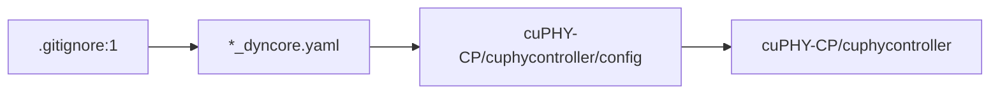
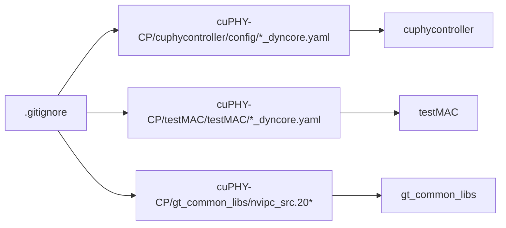

<!-- source: DeepWiki mcp.deepwiki.com · repo NVIDIA/aerial-cuda-accelerated-ran · page 7.1 cuPHY Controller and Driver · fetched 2026-10-26 -->

# cuPHY Controller and Driver

Relevant source files

The following files were used as context for generating this wiki page:

- [.gitignore](.gitignore)

## Purpose and scope

This page covers the `cuPHY-CP` controller and driver at the level supported by the available repository evidence. That evidence identifies controller and `testMAC` configuration files matching `*_dyncore.yaml`, an `nvipc_src.20*` path under `gt_common_libs`, and the `cuPHY-CP` directory structure. It does not include controller or driver source code, so lifecycle transitions, configuration parsing, GPU/FH orchestration, and slot-command processing cannot be described or verified here. [.gitignore:1-3]()

Sources: [.gitignore:1-3]()

## `cuphycontroller`

The repository ignore rules identify `cuPHY-CP/cuphycontroller/config/*_dyncore.yaml`. This establishes that controller configuration includes a `config` directory and a filename pattern for dynamic-core YAML files; the ignore rules do not show how those files are generated, loaded, validated, or applied. [.gitignore:1-1]()

| Repository evidence | What it establishes | What it does not establish |
|---|---|---|
| `cuPHY-CP/cuphycontroller/config/*_dyncore.yaml` | A controller configuration path and ignored filename pattern. | Configuration schema, defaults, runtime reload behavior, or lifecycle effects. |

Sources: [.gitignore:1-1]()

### Configuration artifact relationship

**Diagram: Controller configuration path mapped to repository evidence**

Sources: [.gitignore:1-1]()

## `cuphydriver`

The available file listing does not identify driver source files, classes, functions, or call sites. Consequently, it is not possible to substantiate how `cuphydriver` processes slot commands, schedules GPU work, coordinates with a fronthaul driver, or synchronizes PHY tasks. The `cuphycontroller` path in the ignore rules does not by itself establish that driver implementation resides there. [.gitignore:1-3]()

Sources: [.gitignore:1-3]()

## System integration and component mapping

The ignore rules also identify a `testMAC` configuration pattern and an `nvipc_src.20*` path under `gt_common_libs`. These entries establish repository paths and ignored-file patterns only. They do not establish runtime connectivity, message formats, or which component calls another. [.gitignore:2-3]()

| Path or pattern | Evidence-supported description |
|---|---|
| `cuPHY-CP/cuphycontroller/config/*_dyncore.yaml` | Ignored controller configuration files matching the `_dyncore.yaml` suffix. |
| `cuPHY-CP/testMAC/testMAC/*_dyncore.yaml` | Ignored `testMAC` configuration files matching the `_dyncore.yaml` suffix. |
| `cuPHY-CP/gt_common_libs/nvipc_src.20*` | An ignored path pattern for `nvipc_src.20*` beneath `gt_common_libs`. |

Sources: [.gitignore:1-3]()

### Repository paths mapped to code entities

**Diagram: Named repository paths grounded in ignore rules**

Sources: [.gitignore:1-3]()

## Key implementation files

The provided evidence consists of `.gitignore` entries rather than implementation files. It supports identifying the paths below, but not describing their internal implementation or behavior. [.gitignore:1-3]()

- `cuPHY-CP/cuphycontroller/config/*_dyncore.yaml` — controller configuration-file pattern excluded from version control. [.gitignore:1-1]()
- `cuPHY-CP/testMAC/testMAC/*_dyncore.yaml` — `testMAC` configuration-file pattern excluded from version control. [.gitignore:2-2]()
- `cuPHY-CP/gt_common_libs/nvipc_src.20*` — `gt_common_libs` path pattern excluded from version control. [.gitignore:3-3]()

To document lifecycle, configuration semantics, GPU/fronthaul orchestration, and slot-command processing in technical detail, implementation source files and their call sites are required; those details cannot be inferred from ignore rules. [.gitignore:1-3]()

Sources: [.gitignore:1-3]()

---

