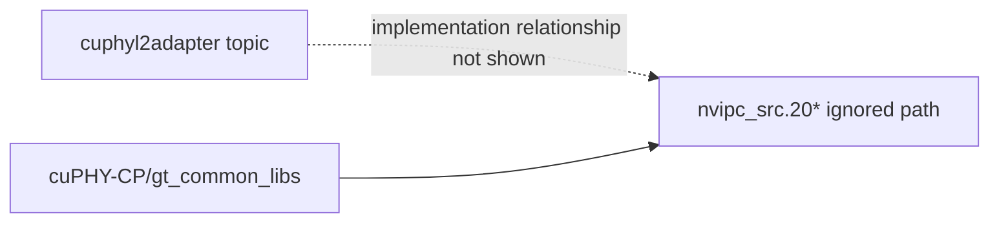
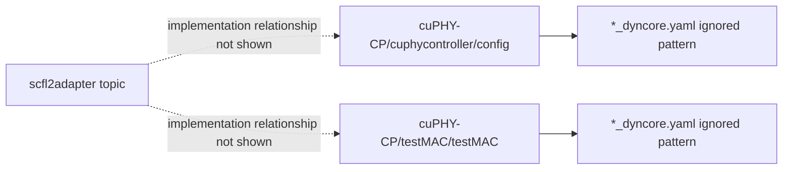

<!-- source: DeepWiki mcp.deepwiki.com · repo NVIDIA/aerial-cuda-accelerated-ran · page 7.2 L2 Adapters and FAPI Interface · fetched 2026-10-26 -->

# L2 Adapters and FAPI Interface

Relevant source files

The following files were used as context for generating this wiki page:

- [.gitignore](.gitignore)

## Purpose and scope

This page covers the `cuphyl2adapter` and `scfl2adapter` topics within cuPHY-CP. The available repository evidence for this page is limited to `.gitignore`: it identifies paths for cuPHY-CP dynamic-core YAML files and an nvIPC-related path, but does not include adapter source, FAPI definitions, or configuration contents. Accordingly, implementation details and message behavior cannot be verified here. [.gitignore:1-3]()

Sources: `[.gitignore:1-3]()`

## 1. `cuphyl2adapter`: L1–L2 communication

The ignore rules identify `cuPHY-CP/gt_common_libs/nvipc_src.20*` as an ignored path pattern. This establishes that the repository has a path associated with nvIPC under `gt_common_libs`, but does not reveal nvIPC APIs, transport behavior, message formats, or how `cuphyl2adapter` uses it. [.gitignore:3-3]()

The provided files do not include a definition of `cuphyl2adapter`, its key functions or classes, or its interaction with `cuphydriver` and `cuphycontroller`. Those implementation details cannot be documented from the available evidence.

Sources: `[.gitignore:3-3]()`

### L1–L2 path and known repository references

This diagram distinguishes the named adapter topic from the repository path actually evidenced by the provided file. The connecting relationship is intentionally not asserted: `.gitignore` does not establish that the adapter calls or depends on the nvIPC path. [.gitignore:3-3]()

**Known L1–L2-related names and repository path**

Sources: `[.gitignore:3-3]()`

## 2. `scfl2adapter`: SCF FAPI handling

The provided file contents do not include `scfl2adapter` source code, FAPI message definitions, or message-handling call sites. Therefore, the supported evidence does not establish which SCF FAPI messages are handled, how messages are translated, or how adapter processing interacts with PHY tasks. [.gitignore:1-3]()

Sources: `[.gitignore:1-3]()`

### FAPI-to-code entity map

This diagram maps the requested system name to the cuPHY-CP repository area identified by the ignore rules. It does not imply that the matching directories contain the FAPI implementation: the supplied evidence only shows ignored dynamic-core YAML patterns in those locations. [.gitignore:1-2]()

**FAPI topic and identified configuration-path patterns**

Sources: `[.gitignore:1-2]()`

## 3. Configuration and dynamic-core path patterns

`.gitignore` excludes `cuPHY-CP/cuphycontroller/config/*_dyncore.yaml` and `cuPHY-CP/testMAC/testMAC/*_dyncore.yaml`. These entries show that files matching those patterns are ignored by Git; they do not document the YAML schema, CPU-affinity settings, adapter configuration, or runtime effects. [.gitignore:1-2]()

The same file also excludes `cuPHY-CP/gt_common_libs/nvipc_src.20*`. The pattern identifies an ignored path, not the contents or behavior of that path. [.gitignore:3-3]()

| Repository path pattern | What the available evidence establishes |
|---|---|
| `cuPHY-CP/cuphycontroller/config/*_dyncore.yaml` | Matching files are ignored by Git. [.gitignore:1-1]() |
| `cuPHY-CP/testMAC/testMAC/*_dyncore.yaml` | Matching files are ignored by Git. [.gitignore:2-2]() |
| `cuPHY-CP/gt_common_libs/nvipc_src.20*` | Matching paths are ignored by Git. [.gitignore:3-3]() |

Sources: `[.gitignore:1-3]()`

---

