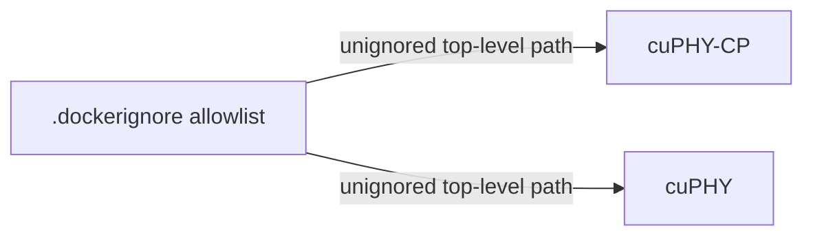
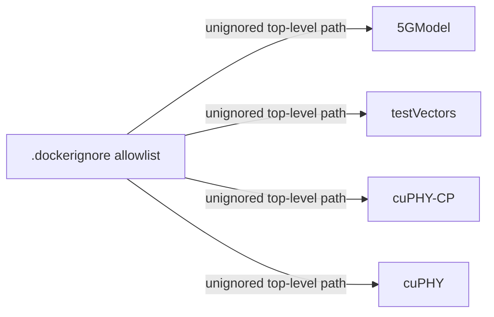

<!-- source: DeepWiki mcp.deepwiki.com · repo NVIDIA/aerial-cuda-accelerated-ran · page 7.3 Fronthaul Driver and RU Emulator · fetched 2026-10-26 -->

# Fronthaul Driver and RU Emulator

Relevant source files

The following files were used as context for generating this wiki page:

- [.dockerignore](.dockerignore)

## Purpose and scope

This page covers the requested `aerial-fh-driver` and `ru-emulator` topics in the context of the repository’s cuPHY-CP subsystem. The available source for this page is the repository’s `.dockerignore`: it documents which top-level paths are admitted to a Docker build context, but it does not describe fronthaul protocols, driver implementation, compression, emulator behavior, or runtime configuration. Those implementation details therefore cannot be established from the available source. [.dockerignore:1-24]()

Sources: [.dockerignore:1-24]()

## 1. Aerial Fronthaul Driver

The repository’s Docker build-context allowlist includes `cuPHY-CP` and `cuPHY`, but does not name an `aerial-fh-driver` path. The allowlist establishes that those top-level directories are eligible for inclusion in the context; it does not establish the driver’s source location, APIs, dependencies, or behavior. [.dockerignore:14-18]()

### 1.1 Architecture and Data Flow

The available source does not describe a fronthaul packet path or interactions among `cuphycontroller`, `cuphydriver`, DPDK, and a Radio Unit. The diagram below maps the documented Docker build-context rule to the named repository directories; it is not a runtime data-flow diagram. [.dockerignore:1-18]()

**Docker Build-Context Selection: Subsystem Names to Repository Paths**

Sources: [.dockerignore:1-18]()

### 1.2 Key Responsibilities

The available source does not specify C-Plane or U-Plane processing, eCPRI or O-RAN packet handling, IQ data transfer, timing synchronization, or DPDK APIs. Those responsibilities should not be inferred from the presence of `cuPHY-CP` or `cuPHY` in the Docker allowlist. [.dockerignore:14-18]()

Sources: [.dockerignore:14-18]()

## 2. RU Emulator

The Docker build-context allowlist includes `testVectors`, `5GModel`, `cuPHY-CP`, and `cuPHY`. These entries establish that the corresponding top-level paths are eligible for inclusion in the Docker context. They do not establish that an RU emulator exists at a particular path or consumes test vectors in a particular way. [.dockerignore:10-20]()

### 2.1 Implementation Details

The available source does not describe emulator classes, functions, packet handling, test-vector formats, or validation logic. In particular, the `.dockerignore` rules do not document any relationship between `testVectors`, `5GModel`, and an RU emulator beyond their independent inclusion in the Docker build context. [.dockerignore:10-20]()

**Docker Build-Context Allowlist: Test and PHY Paths**

Sources: [.dockerignore:10-20]()

### 2.2 Integration with cuPHY-CP

`cuPHY-CP`, `cuPHY`, and `testVectors` are separately included by name in the Docker build-context allowlist. The available source does not identify `testMAC`, an RU-emulator path, or an integration interface among these directories. [.dockerignore:14-20]()

| Path named in `.dockerignore` | What the source establishes |
|---|---|
| `cuPHY-CP` | The top-level path is allowed into the Docker build context. [.dockerignore:16-17]() |
| `cuPHY` | The top-level path is allowed into the Docker build context. [.dockerignore:15-16]() |
| `testVectors` | The top-level path is allowed into the Docker build context. [.dockerignore:19-20]() |

Sources: [.dockerignore:14-20]()

## 3. Configuration and Deployment

The `.dockerignore` starts by excluding everything, then permits selected paths and files. Consequently, whether a path is available to a Docker build depends on its matching allowlist entry; the file does not provide runtime configuration for fronthaul or RU-emulator behavior. [.dockerignore:1-24]()

### 3.1 Dynamic Configuration

The available source contains no YAML configuration entries or references to dynamic configuration files. It therefore does not establish configuration keys for network endpoints, compression, slot offsets, or other fronthaul settings. [.dockerignore:1-24]()

Sources: [.dockerignore:1-24]()

### 3.2 Deployment via Docker

The Docker context allowlist includes `cuPHY-CP`, `cuPHY`, `testVectors`, and other repository paths, as well as `CMakeLists.txt` and `CMakePresets.json`. This documents which named paths are permitted into the context; it does not specify container build commands, DPDK dependencies, linked libraries, or deployment procedures. [.dockerignore:10-24]()

Sources: [.dockerignore:10-24]()

---

