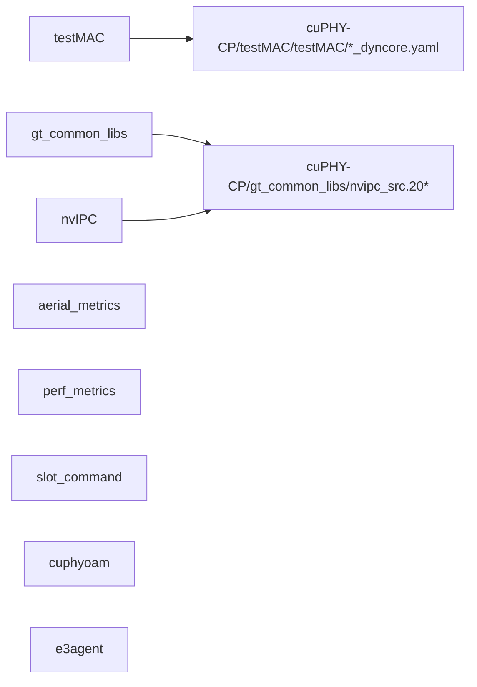
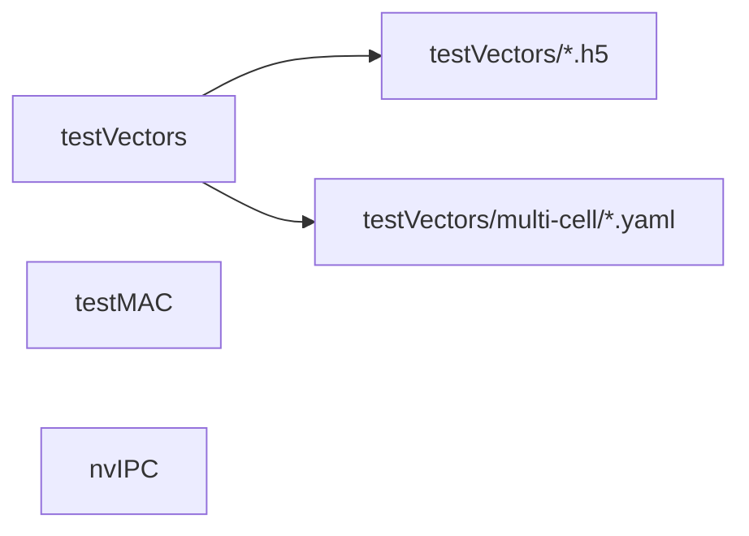

<!-- source: DeepWiki mcp.deepwiki.com · repo NVIDIA/aerial-cuda-accelerated-ran · page 7.4 testMAC and Common Libraries · fetched 2026-10-26 -->

# testMAC and Common Libraries

Relevant source files

The following files were used as context for generating this wiki page:

- [.gitignore](.gitignore)

## Purpose and scope

This page covers `testMAC` and the common-library components named in the section scope: `gt_common_libs`, `nvIPC`, `aerial_metrics`, `perf_metrics`, `slot_command`, `cuphyoam`, and `e3agent`. The only source file available for this page is the repository `.gitignore`. It establishes a few relevant directory and generated-file paths, but does not provide implementation details, APIs, or runtime data flow for these components. Accordingly, the sections below distinguish what that file confirms from what requires source documentation. [.gitignore:1-23]()

Sources: [.gitignore:1-23]()

## testMAC overview

The ignore rules identify `cuPHY-CP/testMAC/testMAC/*_dyncore.yaml` as a path pattern for files excluded from Git. This supports the existence of a `testMAC` directory under `cuPHY-CP` and indicates that files matching the `*_dyncore.yaml` pattern there are treated as generated or otherwise untracked configuration artifacts. The ignore rule alone does not establish how `testMAC` runs, which scenarios it supports, or how it communicates with other components. [.gitignore:1-2]()

Sources: [.gitignore:1-2]()

### Scope of implementation details

The supplied file does not define `testMAC` classes, functions, executables, launch-pattern formats, or its interactions with `cuphycontroller` or `cuphydriver`. Those details cannot be established from the available source. [.gitignore:1-23]()

Sources: [.gitignore:1-23]()

## `gt_common_libs` and named libraries

The ignore rules identify `cuPHY-CP/gt_common_libs/nvipc_src.20*` as a path pattern excluded from Git. This confirms a `gt_common_libs` directory under `cuPHY-CP` and a matching `nvipc_src.20*` path pattern. It does not show the `nvIPC` implementation, its API, or whether it uses shared memory, sockets, or another transport. [.gitignore:3-3]()

Sources: [.gitignore:3-3]()

The available file does not describe `aerial_metrics`, `perf_metrics`, `slot_command`, `cuphyoam`, or `e3agent`: it contains no definitions, call sites, configuration keys, or references to their interfaces. Their roles and relationships therefore cannot be documented reliably from this source alone. [.gitignore:1-23]()

Sources: [.gitignore:1-23]()

## Repository-path mapping

The following diagram maps the component names in this page to the directory and file-pattern evidence present in `.gitignore`. The diagram does not imply runtime connections between those entities. [.gitignore:1-3]()

**Diagram: Component names and evidenced repository paths**

Sources: [.gitignore:1-3]()

## Configuration and generated-file evidence

The `.gitignore` contains two patterns relevant to this page: `cuPHY-CP/testMAC/testMAC/*_dyncore.yaml` and `cuPHY-CP/gt_common_libs/nvipc_src.20*`. Because these are ignore rules, they describe paths Git is configured to exclude; they do not document how or when matching files are produced, consumed, or built. [.gitignore:1-3]()

| Path pattern | What the ignore rule establishes |
|---|---|
| `cuPHY-CP/testMAC/testMAC/*_dyncore.yaml` | Matching files under the `testMAC` path are ignored by Git. [.gitignore:2-2]() |
| `cuPHY-CP/gt_common_libs/nvipc_src.20*` | Matching files under `gt_common_libs` are ignored by Git. [.gitignore:3-3]() |

Sources: [.gitignore:1-3]()

## Relationship to test vectors

The same file excludes `testVectors/*.h5` and `testVectors/multi-cell/*.yaml`. These rules establish that HDF5 files directly under `testVectors/` and YAML files under `testVectors/multi-cell/` are ignored by Git. They do not establish whether `testMAC` reads or writes these files, nor do they specify their schema or role in a test workflow. [.gitignore:5-6]()

**Diagram: Ignored test-vector paths and component names**

Sources: [.gitignore:1-6]()

## Evidence limits

The available source is an ignore file, not implementation or build documentation. It can support claims about the listed paths and Git ignore patterns, but not detailed explanations of `testMAC` processing, `nvIPC` messaging, metrics collection, slot-command handling, OAM behavior, agent behavior, build targets, or inter-component call sequences. [.gitignore:1-23]()

Sources: [.gitignore:1-23]()

---

