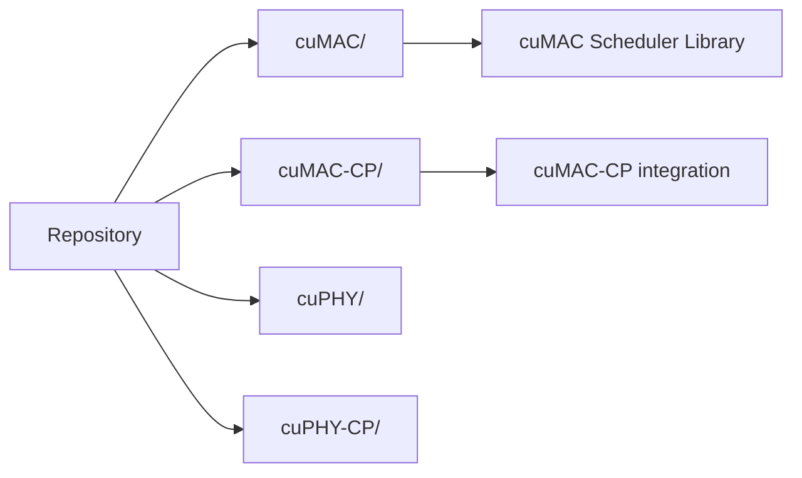
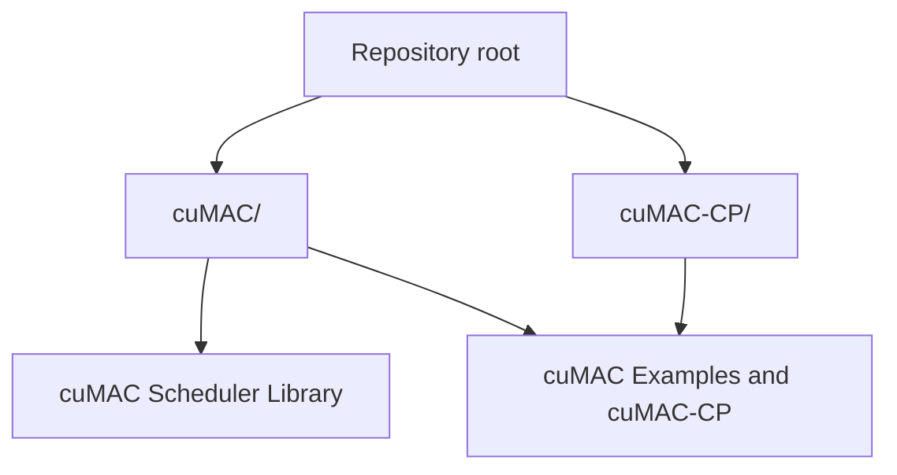

<!-- source: DeepWiki mcp.deepwiki.com · repo NVIDIA/aerial-cuda-accelerated-ran · page 8 cuMAC — MAC Layer Scheduler · fetched 2026-10-26 -->

# cuMAC — MAC Layer Scheduler

Relevant source files

The following files were used as context for generating this wiki page:

- [.dockerignore](.dockerignore)

## Purpose and scope

This page introduces the repository’s `cuMAC` and `cuMAC-CP` components and points to child pages for their implementation and usage. The repository’s Docker build context explicitly includes both directories, alongside `cuPHY` and `cuPHY-CP`. [/.dockerignore:13-17]()

Sources: [/.dockerignore:13-17]()

## System overview

`cuMAC` and `cuMAC-CP` are separate repository components. This page treats them as the scheduler and integration topics, respectively, and keeps implementation detail in the child pages. The repository also includes `cuPHY` and `cuPHY-CP`; their presence provides the broader component context, without specifying interfaces or runtime behavior here. [/.dockerignore:13-17]()

Sources: [/.dockerignore:13-17]()

### Component map: repository names to subsystem topics

Sources: [/.dockerignore:13-17]()

## Functional architecture

At this overview level, the relationship is organizational: `cuMAC` and `cuMAC-CP` are distinct components in the repository, while detailed architecture and interactions are covered by the child pages. The available repository evidence identifies these directories but does not establish specific call paths or interfaces. [/.dockerignore:13-17]()

Sources: [/.dockerignore:13-17]()

### Component names and documentation destinations

Sources: [/.dockerignore:13-15]()

## Component breakdown

### [cuMAC Scheduler Library](#8.1)

See this child page for the cuMAC C++/CUDA library, its 4T4R and 64T64R source areas, MU-MIMO pairing and sorting topics, and public `api.h` and `cumac.h` interfaces. [/.dockerignore:13-13]()

For details, see [cuMAC Scheduler Library](#8.1).

Sources: [/.dockerignore:13-13]()

### [cuMAC Examples and cuMAC-CP](#8.2)

See this child page for the cuMAC examples—including `multiCellMuMimoScheduler`, `singleCellScheduler`, `muMimoUeGrpL2Integration`, `trafficModel`, and ML examples—and for cuMAC-CP L2 integration. The repository includes the `cuMAC` and `cuMAC-CP` directories. [/.dockerignore:13-14]()

For details, see [cuMAC Examples and cuMAC-CP](#8.2).

Sources: [/.dockerignore:13-14]()

## Relationship to repository structure

The Docker build-context rules allow `cuMAC`, `cuMAC-CP`, `cuPHY`, and `cuPHY-CP` into the build context. This confirms their repository-level placement; it does not by itself describe dependencies or runtime communication between them. [/.dockerignore:13-17]()

Sources: [/.dockerignore:13-17]()

**Next steps:** Visit [cuMAC Scheduler Library](#8.1) for scheduler-library details, or [cuMAC Examples and cuMAC-CP](#8.2) for examples and L2 integration.

---

