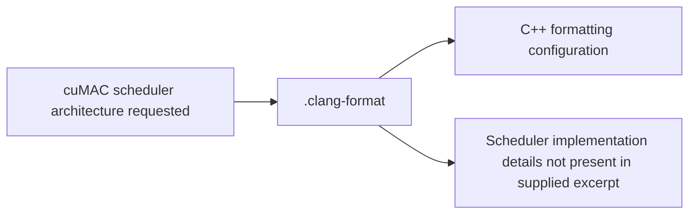
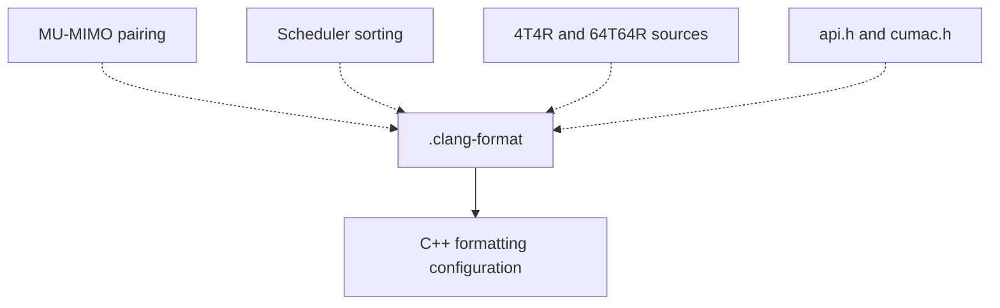

<!-- source: DeepWiki mcp.deepwiki.com · repo NVIDIA/aerial-cuda-accelerated-ran · page 8.1 cuMAC Scheduler Library · fetched 2026-10-26 -->

# cuMAC Scheduler Library

Relevant source files

The following files were used as context for generating this wiki page:

- [.clang-format](.clang-format)

## Purpose and scope

This page is intended to describe the cuMAC scheduler’s C++/CUDA architecture, including its 4T4R and 64T64R sources, MU-MIMO pairing and sorting, and public headers `api.h` and `cumac.h`. The only source content provided for this revision is the repository’s `.clang-format` configuration; it establishes C++ formatting conventions but contains no scheduler implementation, API declarations, or data-flow details. Accordingly, those implementation details cannot be documented or verified from the available source. [.clang-format:1-3]()

Sources: [.clang-format:1-3]()

## Architecture Overview

The supplied `.clang-format` excerpt identifies the project’s formatting configuration as C++ and says it is based on LLVM style. It does not identify cuMAC modules, scheduler classes, or how scheduler components interact. [.clang-format:1-3]()

### Key Components and Data Flow

The scheduler components and data flow requested for this page are not established by the available source excerpt. In particular, it does not document UE inputs, scheduling outputs, MU-MIMO grouping, or interactions with cuPHY or cuMAC-CP. [.clang-format:1-3]()

**Available Source Coverage**

Sources: [.clang-format:1-3]()

## Key Data Structures

No cuMAC data structures are declared in the provided `.clang-format` excerpt. Names such as `multiCellMuGrpList` therefore cannot be verified or described using the available source. [.clang-format:1-3]()

Sources: [.clang-format:1-3]()

## MU-MIMO Scheduling Algorithms

The supplied source does not describe MU-MIMO pairing, sorting, UE eligibility, resource allocation, or MCS selection. Any account of those algorithms would require scheduler source files beyond the provided excerpt. [.clang-format:1-3]()

### Scheduling Workflow

A scheduler workflow cannot be derived from a formatting configuration. The excerpt only establishes that `.clang-format` configures C++ formatting; it does not show scheduling function definitions or call sites. [.clang-format:1-3]()

**Requested Scheduler Concepts and Available Code Evidence**

Sources: [.clang-format:1-3]()

## Public Interface (API)

The provided source excerpt does not define or mention `api.h` or `cumac.h`, so their declarations, visibility, and relationship to the scheduler cannot be confirmed here. The excerpt does establish C++ as the configured language for `.clang-format`. [.clang-format:1-3]()

### Public Headers

No public-header contents were supplied. In particular, the available excerpt does not establish whether `api.h` or `cumac.h` is an entry point, what symbols they expose, or how external components use them. [.clang-format:1-3]()

### Namespace: `cumac`

The supplied excerpt contains no namespace declarations, so the `cumac` namespace and its contents cannot be verified from it. [.clang-format:1-3]()

Sources: [.clang-format:1-3]()

## Integration with cuMAC-CP

The provided source does not describe cuMAC-CP integration, scheduler lifecycle, cell configuration, or calls between control-plane components and cuMAC. Those interactions require implementation or API sources not included in the available material. [.clang-format:1-3]()

Sources: [.clang-format:1-3]()

---

