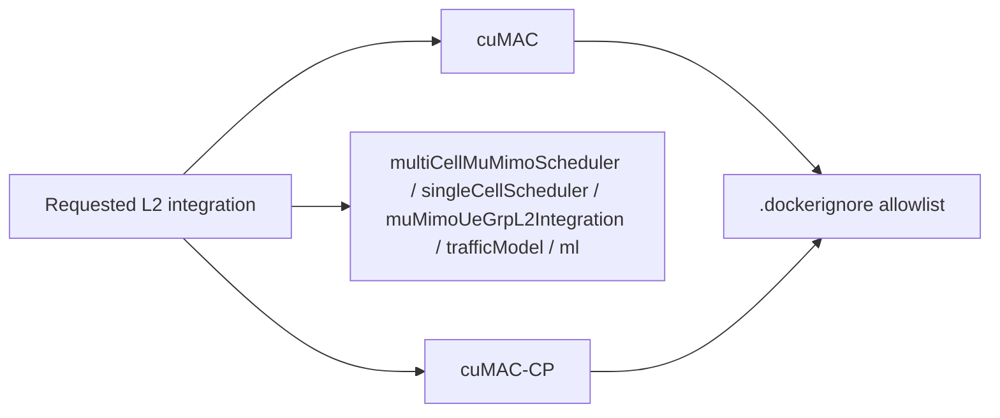
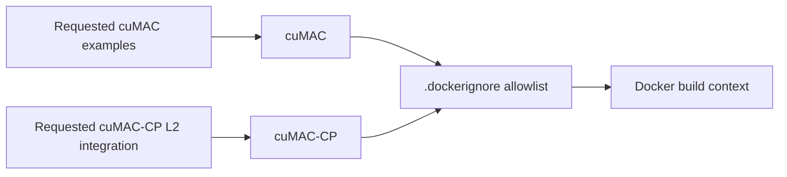

<!-- source: DeepWiki mcp.deepwiki.com · repo NVIDIA/aerial-cuda-accelerated-ran · page 8.2 cuMAC Examples and cuMAC-CP · fetched 2026-10-26 -->

# cuMAC Examples and cuMAC-CP

Relevant source files

The following files were used as context for generating this wiki page:

- [.dockerignore](.dockerignore)

## Purpose and scope

This page covers the requested cuMAC example applications—`multiCellMuMimoScheduler`, `singleCellScheduler`, `muMimoUeGrpL2Integration`, `trafficModel`, and `ml`—and cuMAC-CP L2 integration. The available repository content for this page establishes that `cuMAC` and `cuMAC-CP` are included in the Docker build context; it does not provide their source files, so implementation details, APIs, execution steps, and message flows cannot be verified here. [.dockerignore:1-20]()

Sources: [.dockerignore:1-20]()

## Overview of cuMAC Examples

The requested example scope includes `multiCellMuMimoScheduler`, `singleCellScheduler`, `muMimoUeGrpL2Integration`, `trafficModel`, and `ml`. The available file content confirms that the repository’s Docker build context allows the `cuMAC` directory, but does not include example source files or establish the behavior of those applications. [.dockerignore:13-15]()

| Example in requested scope | Implementation detail established by the available file |
|---|---|
| `multiCellMuMimoScheduler` | No source or behavior details provided. |
| `singleCellScheduler` | No source or behavior details provided. |
| `muMimoUeGrpL2Integration` | No source or behavior details provided. |
| `trafficModel` | No source or behavior details provided. |
| `ml` | No source or behavior details provided. |

Sources: [.dockerignore:13-15]()

### Repository inclusion and code entities

The Docker ignore rules exclude files by default, then allow selected repository directories back into the build context. In those rules, `cuMAC` and `cuMAC-CP` are separate allowed directory entries; the supplied content does not show their internal structure or relationships. [.dockerignore:1-18]()

**Diagram: Requested subsystems mapped to repository directory names**

Sources: [.dockerignore:13-15]()

## cuMAC-CP L2 Integration

The available repository evidence establishes that `cuMAC-CP` is an allowed directory in the Docker build context. It does not provide cuMAC-CP source files, interface definitions, or call sites, so its L2 integration behavior and data flow cannot be described reliably from the supplied content. [.dockerignore:14-18]()

### Data flow and architecture

No MAC-to-PHY, L2-to-L1, or inter-process message flow is established by the available file. The diagram therefore maps only the requested system names to the repository directory names explicitly allowed by the Docker ignore rules. [.dockerignore:13-18]()

**Diagram: Requested L2 integration scope mapped to repository directories**

Sources: [.dockerignore:1-18]()

## Implementation Details

The provided content does not include cuMAC or cuMAC-CP implementation files. It therefore does not substantiate scheduler interfaces, data structures, traffic-generation behavior, L2 message handling, or integration with cuPHY-CP. The only implementation-adjacent fact established here is that the Docker context allowlist includes both directories. [.dockerignore:13-18]()

### Scheduler interface and data structures

No scheduler API definitions or data-structure declarations are present in the supplied content. [.dockerignore:13-18]()

Sources: [.dockerignore:13-18]()

### Traffic modeling

The `trafficModel` example is in the requested page scope, but the supplied content does not include its implementation or establish its inputs, outputs, or relationship to scheduler state. [.dockerignore:13-15]()

Sources: [.dockerignore:13-15]()

### Integration with cuPHY-CP

The supplied content separately allows `cuMAC-CP` and `cuPHY-CP` into the Docker context. It does not show whether, or how, these components communicate. [.dockerignore:14-18]()

Sources: [.dockerignore:14-18]()

## Build and Execution

The Docker ignore rules allow the `build*`, `cuMAC`, and `cuMAC-CP` paths into the Docker build context. They do not specify CMake targets, build commands, binary locations, runtime arguments, configuration files, or test-vector locations. [.dockerignore:1-18]()

Sources: [.dockerignore:1-18]

---

