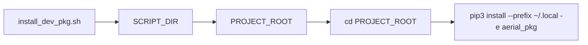
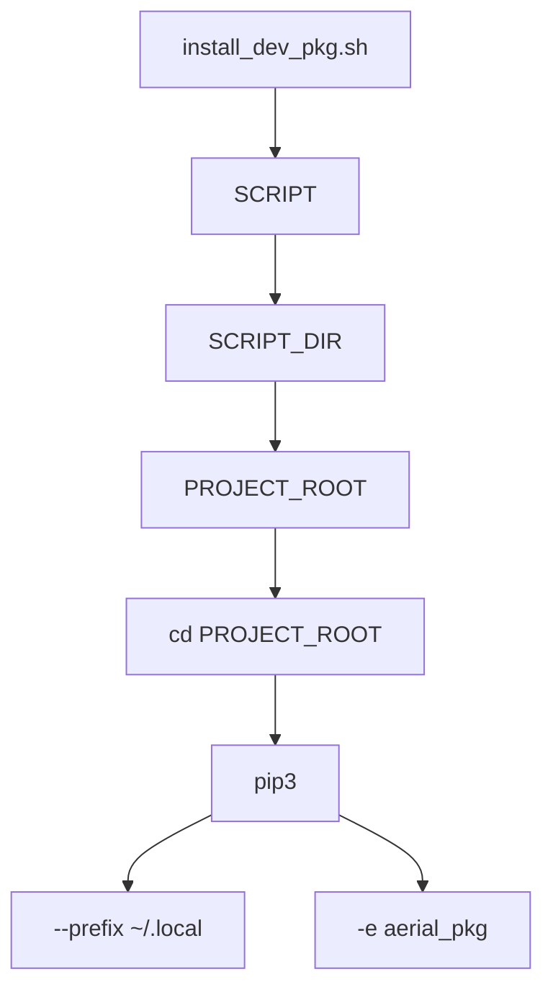

<!-- source: DeepWiki mcp.deepwiki.com · repo NVIDIA/aerial-cuda-accelerated-ran · page 9.1 pyaerial API and pybind11 Bindings · fetched 2026-10-26 -->

# pyaerial API and pybind11 Bindings

Relevant source files

The following files were used as context for generating this wiki page:

- [5GModel/aerial_mcore/scripts/install_dev_pkg.sh](5GModel/aerial_mcore/scripts/install_dev_pkg.sh)

## Purpose and scope

This page covers the available implementation evidence for the `pyaerial` topic: the developer installation script under `5GModel/aerial_mcore`. The supplied file confirms how that script locates the project root and installs `aerial_pkg` in editable mode; it does not define the `aerial.phy5g` API, pybind11 bindings, module implementations, or tests. Those details are therefore not inferred here. [5GModel/aerial_mcore/scripts/install_dev_pkg.sh:18-32]()

Sources: [5GModel/aerial_mcore/scripts/install_dev_pkg.sh:18-32]()

## Package Structure and Architecture

The installer changes into `PROJECT_ROOT` and invokes pip on the `aerial_pkg` directory. The supplied script does not show the contents of `aerial_pkg` or establish how that package relates to any `aerial.phy5g` modules. [5GModel/aerial_mcore/scripts/install_dev_pkg.sh:21-29]()

### Core Modules

No definitions or imports for `aerial.phy5g.pusch`, `pdsch`, `srs`, `csirs`, or `ldpc` are present in the supplied file. Their Python APIs and implementation details cannot be documented from this source. [5GModel/aerial_mcore/scripts/install_dev_pkg.sh:1-32]()

Sources: [5GModel/aerial_mcore/scripts/install_dev_pkg.sh:1-32]()

### pybind11 Integration

The supplied installer contains no pybind11 references, binding declarations, C++ wrapper definitions, or data-transfer behavior. It confirms only the editable installation command for `aerial_pkg`; it does not establish how Python interfaces with C++ or CUDA. [5GModel/aerial_mcore/scripts/install_dev_pkg.sh:28-30]()

Sources: [5GModel/aerial_mcore/scripts/install_dev_pkg.sh:28-30]()

## Data Flow: Python to cuPHY

The available source establishes an installation step, not a runtime path from Python through bindings to cuPHY. The diagram below maps the confirmed installation operation to its script and target directory; runtime behavior is not represented. [5GModel/aerial_mcore/scripts/install_dev_pkg.sh:21-29]()

### Installation Path from Script to Package

Sources: [5GModel/aerial_mcore/scripts/install_dev_pkg.sh:21-29]()

## Installation and Development

### `install_dev_pkg.sh`

The script enables `set -e`, resolves its own absolute path with `readlink -f`, derives `SCRIPT_DIR` and `PROJECT_ROOT`, and changes to the project root. It then runs `pip3 install --prefix ~/.local -e aerial_pkg` and prints a completion message if execution reaches the end. [5GModel/aerial_mcore/scripts/install_dev_pkg.sh:18-32]()

The editable-install command targets the relative directory `aerial_pkg` from `PROJECT_ROOT`, uses pip’s `--prefix ~/.local` option, and includes `-e`. The script does not show dependency installation, build configuration, or validation of the installed package. [5GModel/aerial_mcore/scripts/install_dev_pkg.sh:21-30]()

Sources: [5GModel/aerial_mcore/scripts/install_dev_pkg.sh:18-32]()

### Dependency Management

The supplied script does not declare or install dependencies, nor does it identify pybind11, cuPHY, CUDA, or CMake requirements. Such requirements cannot be determined from this installer alone. [5GModel/aerial_mcore/scripts/install_dev_pkg.sh:1-32]()

Sources: [5GModel/aerial_mcore/scripts/install_dev_pkg.sh:1-32]()

## Machine Learning Integration

The supplied file contains no ML model loading, ONNX or TensorRT references, channel-estimation workflow, or runtime integration points. No ML pipeline behavior is established by this source. [5GModel/aerial_mcore/scripts/install_dev_pkg.sh:1-32]()

Sources: [5GModel/aerial_mcore/scripts/install_dev_pkg.sh:1-32]()

## Mapping System Names to Code Entities

The confirmed relationship in the available source is between the installer script and the `aerial_pkg` directory passed to pip. The script derives the project root from its location before invoking pip, so the package path is interpreted relative to that root. [5GModel/aerial_mcore/scripts/install_dev_pkg.sh:21-29]()

| System name | Confirmed code entity | Evidence |
|---|---|---|
| Developer installer | `5GModel/aerial_mcore/scripts/install_dev_pkg.sh` | Script path and execution are visible in the supplied file. [5GModel/aerial_mcore/scripts/install_dev_pkg.sh:1-2]() |
| Project root | `PROJECT_ROOT` | Derived from `SCRIPT_DIR`, then used as the working directory. [5GModel/aerial_mcore/scripts/install_dev_pkg.sh:21-26]() |
| Editable-install target | `aerial_pkg` | Passed to pip in the editable-install command. [5GModel/aerial_mcore/scripts/install_dev_pkg.sh:28-30]() |
| User installation prefix | `~/.local` | Passed to pip using `--prefix`. [5GModel/aerial_mcore/scripts/install_dev_pkg.sh:28-30]() |

Sources: [5GModel/aerial_mcore/scripts/install_dev_pkg.sh:21-30]()

### Script-to-Installation Entity Map

This diagram connects the named installation operation to the exact shell variables and command shown in the script. It does not imply details about the package’s internal modules. [5GModel/aerial_mcore/scripts/install_dev_pkg.sh:21-30]()

Sources: [5GModel/aerial_mcore/scripts/install_dev_pkg.sh:21-30]()

## API, bindings, and tests: source coverage

The supplied file does not define Python classes or functions, pybind11 binding code, the `pusch`, `pdsch`, `srs`, `csirs`, or `ldpc` modules, or tests for those components. Documenting their signatures, data flow, and test coverage requires source files beyond the installer provided here. [5GModel/aerial_mcore/scripts/install_dev_pkg.sh:1-32]()

Sources: [5GModel/aerial_mcore/scripts/install_dev_pkg.sh:1-32]()

---

