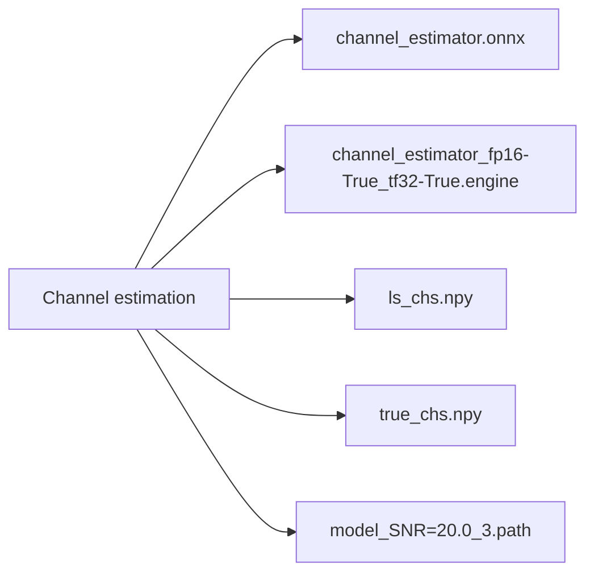
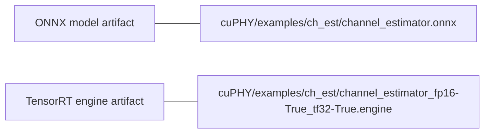
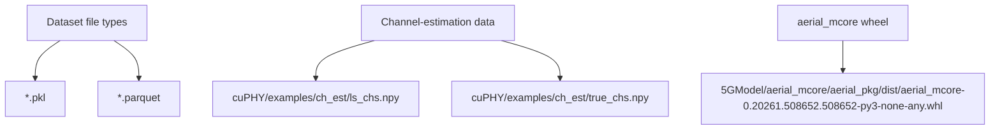

<!-- source: DeepWiki mcp.deepwiki.com · repo NVIDIA/aerial-cuda-accelerated-ran · page 9.2 ML Models and Jupyter Notebooks · fetched 2026-10-26 -->

# ML Models and Jupyter Notebooks

Relevant source files

The following files were used as context for generating this wiki page:

- [.gitattributes](.gitattributes)

## Purpose and scope

This page documents the ML-related repository artifacts evidenced by the available file contents: channel-estimation model and data files under `cuPHY/examples/ch_est`, and Git LFS tracking rules for model, dataset, and package artifacts. The provided contents do not include notebook files or a `model_to_engine` implementation, so their APIs and execution steps cannot be described here. [.gitattributes:3-10]()

Sources: [.gitattributes:3-10]()

## Channel-estimation artifacts

The `cuPHY/examples/ch_est` artifacts tracked by Git LFS include an ONNX model, a TensorRT engine, two NumPy arrays, and a model-path file. The engine filename includes `fp16-True` and `tf32-True`; this documents the configuration encoded in its name, but the provided contents do not establish how the engine was built or which runtime loads it. [.gitattributes:5-9]()

| Artifact | What the tracked path identifies |
|---|---|
| `channel_estimator.onnx` | ONNX channel-estimator model artifact |
| `channel_estimator_fp16-True_tf32-True.engine` | TensorRT engine artifact whose filename includes FP16 and TF32 flags |
| `ls_chs.npy` | NumPy channel-estimation data artifact |
| `true_chs.npy` | NumPy channel data artifact |
| `model_SNR=20.0_3.path` | Model-path artifact whose filename includes an SNR value |

Sources: [.gitattributes:5-9]()

### Artifact mapping: model names to repository entities

This diagram maps the channel-estimation concept to the exact tracked artifact names. It shows repository-level associations only; it does not imply a verified conversion or runtime call sequence. [.gitattributes:5-9]()

**Diagram: Channel-estimation artifact names**

Sources: [.gitattributes:5-9]()

## ONNX and TensorRT engine conversion

The tracked artifacts include both `channel_estimator.onnx` and a TensorRT-style `.engine` file named `channel_estimator_fp16-True_tf32-True.engine`. Their coexistence establishes that both artifact formats are present in the example path. The provided contents do not include a `model_to_engine` script, conversion command, supported arguments, or implementation details, so no conversion procedure can be specified from this evidence. [.gitattributes:5-6]()

Sources: [.gitattributes:5-6]()

### Artifact mapping: model formats to tracked files

The diagram connects the general concepts of ONNX and TensorRT engine artifacts to their repository filenames. It deliberately does not draw a conversion arrow because the provided file contents do not document that operation. [.gitattributes:5-6]()

**Diagram: Model-format entities**

Sources: [.gitattributes:5-6]()

## Jupyter notebooks

No Jupyter notebook paths or notebook contents are present in the provided file contents. Consequently, notebook names, example workflows, dependencies, and calls into Python or cuPHY cannot be verified here. [.gitattributes:1-10]()

Sources: [.gitattributes:1-10]()

## Data artifacts and Git LFS

The repository’s `.gitattributes` rules mark `.pkl` and `.parquet` files for Git LFS, alongside the channel-estimation `.npy` artifacts and model files. These rules identify file types and paths handled through LFS; they do not, by themselves, specify a data-lake schema, dataset-generation workflow, or loading API. [.gitattributes:3-9]()

| Tracked category | LFS rule or example |
|---|---|
| Pickle data | `*.pkl` |
| Parquet data | `*.parquet` |
| Channel-estimation artifacts | Specific `.engine`, `.onnx`, `.npy`, and `.path` files under `cuPHY/examples/ch_est` |
| Python wheel | Specific `aerial_mcore` wheel under `5GModel/aerial_mcore/aerial_pkg/dist` |

Sources: [.gitattributes:3-10]()

### Data and package entities

The diagram associates the data-lake-related file extensions and package artifact with the exact LFS patterns and path recorded in `.gitattributes`. It does not infer how these files are produced or consumed. [.gitattributes:3-4](), [.gitattributes:10-10]()

**Diagram: LFS-tracked data and package artifacts**

Sources: [.gitattributes:3-4](), [.gitattributes:7-10]()

---

